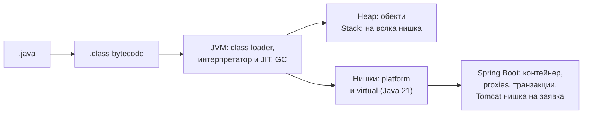

# Бърз преговор

Най-важното от всички теми, сбито за последните 15 минути преди интервюто. Всеки ред е отговор, който можеш да кажеш на глас. За обяснението и диаграмите отвори съответния документ.

## 1. Картата

## 2. Езикът и JVM

| Въпрос | Отговор |
|---|---|
| JDK, JRE, JVM? | JVM изпълнява bytecode; JRE = JVM + библиотеки; JDK = JRE + инструменти |
| Защо има warm-up? | Интерпретатор първо, JIT (C1, после C2) компилира горещия код по-късно |
| Class loading? | Bootstrap → Platform → Application, parent delegation, мързеливо |
| Stack срещу heap? | Stack на нишка: рамки и локални; heap общ: всички обекти, чисти го GC |
| Как работи GC? | Достижимост от GC roots, поколения: млади често и евтино, стари рядко |
| G1 срещу ZGC? | G1 по подразбиране, цел ~200 ms пауза; ZGC паузи под ms |
| Pass-by-value? | Винаги; при обекти се копира референцията |
| `Integer` 127 == 127? | `true` заради кеша -128..127; 128 е `false`. Ползвай `equals` |
| Защо String е immutable? | Сигурност, thread safety, pool, кеширан hashCode |
| equals и hashCode? | Равни обекти ⇒ еднакъв hashCode, иначе HashMap ги губи |
| Изменим ключ в HashMap? | Отива в грешен bucket, `get` не го намира |
| record? | Неизменим носител на данни, генерирани equals/hashCode/toString, final |
| sealed? | Изброени подтипове, изчерпателен switch без default |
| Type erasure? | Generics се изтриват при компилация; няма `new T()` |
| PECS? | Producer `extends` (четене), Consumer `super` (писане) |
| Checked срещу unchecked? | Checked: компилаторът изисква обработка; unchecked: `RuntimeException` |
| finally винаги ли? | Почти; не при `System.exit` или срив. Не прави `return` в него |

## 3. Колекции

| Въпрос | Отговор |
|---|---|
| HashMap отвътре? | Масив от buckets, `hash ^ (hash >>> 16)`, `& (n-1)`, списък → дърво при 8 (и 64 капацитет), resize при 0.75 |
| Сложност на HashMap? | O(1) средно, O(log n) в най-лошия от Java 8 |
| HashMap, LinkedHashMap, TreeMap? | Без ред / по вмъкване или LRU / сортиран, O(log n) |
| ArrayList или LinkedList? | Почти винаги ArrayList; за опашка и стек ArrayDeque |
| Как расте ArrayList? | С ~50%, копиране в нов масив, O(1) амортизирано |
| PriorityQueue? | Binary heap, O(log n) offer/poll, итерирането не е сортирано |
| Fail-fast? | `ConcurrentModificationException` при промяна по време на итериране |
| List.of срещу unmodifiableList? | Неизменим срещу изглед върху изменим |
| Stream мързелив? | Нищо не става до терминалната операция; елементите минават един по един |
| map срещу flatMap? | Елемент към елемент срещу елемент към поток, слят в един |
| parallelStream? | Общ ForkJoinPool; само CPU работа върху големи масиви, никога I/O |

## 4. Конкурентност

| Въпрос | Отговор |
|---|---|
| start срещу run? | start създава нишка; run е обикновено извикване |
| Как се спира нишка? | `interrupt()` и кооперативна проверка; възстанови флага в catch |
| volatile? | Видимост и подредба; не прави `count++` атомарно |
| synchronized? | Взаимно изключване + видимост, reentrant |
| happens-before? | Гаранция за видимост: unlock→lock, volatile запис→четене, start, join |
| CAS? | Атомарно сравни-и-замени, основата на Atomic класовете |
| ConcurrentHashMap? | CAS за празен bucket, lock на първия възел, четене без lock, без null |
| Deadlock? | Кръгово чакане; глобален ред на ключалките, tryLock с timeout |
| ThreadPoolExecutor? | core → опашка → до max → reject; над core само при пълна опашка |
| newFixedThreadPool риск? | Неограничена опашка → OOM |
| thenApply срещу thenCompose? | map срещу flatMap за CompletableFuture |
| Virtual threads? | JVM нишки върху carrier-и, unmount при блокиране; за I/O, не за CPU, без pool |
| Pinning? | synchronized около I/O в Java 21-23 блокира carrier-а; оправено в 24 |

## 5. Spring Boot

| Въпрос | Отговор |
|---|---|
| IoC и DI? | Контейнерът създава и свързва обектите; зависимости през конструктора |
| Жизнен цикъл на bean? | Дефиниция → конструктор → инжектиране → BPP before → @PostConstruct → BPP after (proxy) → @PreDestroy |
| Scopes? | singleton (по подразбиране), prototype, request, session |
| Auto-configuration? | Класове от `AutoConfiguration.imports` с @ConditionalOnClass/OnMissingBean/OnProperty |
| Как заменяш автоматичен bean? | Дефинираш собствен от същия тип |
| Как работи @Transactional? | Proxy + TransactionInterceptor, връзката е в ThreadLocal |
| Self-invocation? | `this.method()` заобикаля proxy-то: анотацията не работи |
| JDK proxy срещу CGLIB? | Интерфейс срещу подклас; Boot ползва CGLIB; не прихваща private/final |
| Rollback кога? | RuntimeException и Error; checked само с `rollbackFor` |
| REQUIRED срещу REQUIRES_NEW? | Участва в текущата срещу нова независима (втора връзка) |
| UnexpectedRollbackException? | Вътрешен REQUIRED метод маркира rollback-only, а външният хваща и продължава |
| Persistence context? | First-level кеш + dirty checking до края на транзакцията |
| N+1? | Lazy асоциация в цикъл; JOIN FETCH, EntityGraph, batch size, DTO проекция |
| LazyInitializationException? | Lazy достъп след затворен контекст; зареди явно в service-а |
| open-in-view? | По подразбиране true; изключи го в production |
| Filter срещу interceptor? | Servlet ниво преди Spring срещу вътре в DispatcherServlet, знае handler-а |
| Нишки на Tomcat? | 200 по подразбиране; virtual threads с `spring.threads.virtual.enabled` |

## 6. Как да отговаряш

1. **Определение** в едно изречение.
2. **Защо** съществува: какъв проблем решава.
3. **Как работи** под капака, по възможност с диаграма: HashMap, жизненият цикъл на bean, пътят през proxy-то.
4. **Пример** от реален проект.
5. **Капан**, който си срещал: self-invocation, N+1, изменим ключ, неограничена опашка. Това отличава човек с опит.

## 7. Свързани документи

- [HashMap отвътре](HashMap.md)
- [Java Memory Model](JMM.md)
- [Virtual threads](Virtual_Threads.md)
- [AOP и proxies](Spring_AOP.md)
- [@Transactional отвътре](Spring_Transactions.md)
- [JPA и Hibernate](JPA_Hibernate.md)
