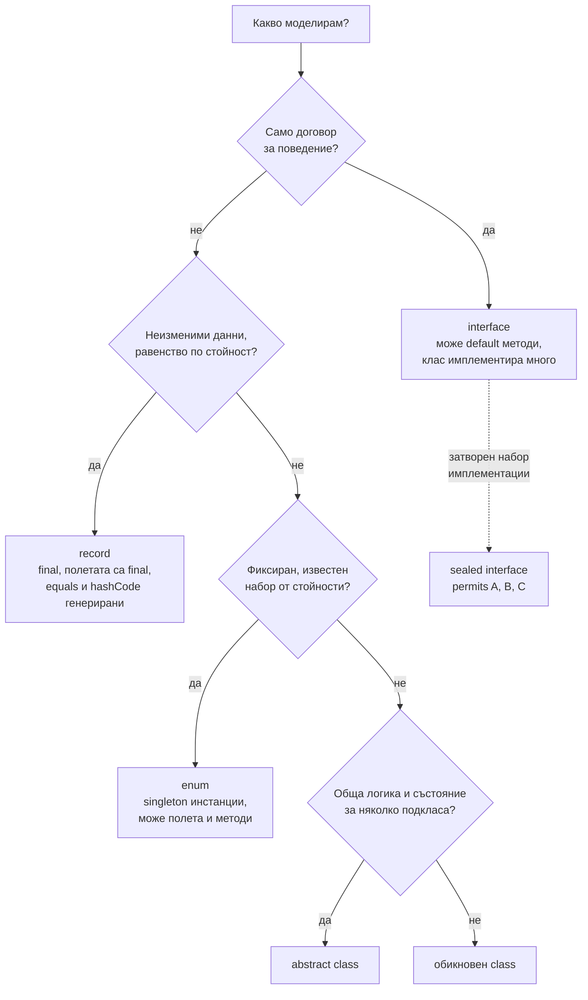

# Класове, records, sealed, enums

Освен обикновените класове, Java има няколко специализирани вида типове. Interface описва договор и от Java 8 може да има `default` методи. Abstract клас е частична имплементация. `record` (Java 16) е неизменим носител на данни, за който компилаторът генерира конструктор, getters, `equals`, `hashCode` и `toString`. `sealed` (Java 17) ограничава кои класове могат да наследят даден тип. `enum` е клас с фиксиран набор от инстанции. Заедно с pattern matching в `switch` (Java 21) те позволяват да моделираш данни като алгебрични типове.

## 1. За какво се ползва и защо ни е нужен

Съвременният Java код изглежда много различно от Java 8:

- DTO, събития, стойностни обекти и резултати от заявки стават `record` от един ред, вместо 50 реда с Lombok или ръчни getters;
- състояния и резултати се моделират със `sealed interface` и records, а компилаторът проверява, че `switch` обработва всички варианти;
- `instanceof` и `switch` разпознават типа и разопаковат полетата в една стъпка.

На интервю питат: interface срещу abstract клас, какво е record и какво не може, защо sealed, кога enum.

## 2. Видовете типове



## 3. interface срещу abstract клас

| | `interface` | `abstract class` |
|---|---|---|
| Множествено | Клас имплементира много | Клас наследява един |
| Състояние | Само `static final` константи | Полета на инстанцията |
| Конструктор | Не | Да |
| Методи с тяло | `default`, `static`, `private` (Java 9) | Всякакви |
| Модификатори на методите | Публични по подразбиране | Всякакви |
| Кога | Договор, способност (`Comparable`, `Repository`) | Обща имплементация в йерархия (template method) |

## 4. record

```java Records.java
import java.math.BigDecimal;
import java.util.List;

public class Records {
    // Компилаторът генерира: private final полета, конструктор, amount(), currency(),
    // equals, hashCode, toString
    record Money(BigDecimal amount, String currency) {
        // Compact конструктор: валидация, без да пишеш присвояванията
        Money {
            if (amount.signum() < 0) throw new IllegalArgumentException("отрицателна сума");
            currency = currency.toUpperCase();     // може да нормализираш параметрите
        }

        Money plus(Money other) {                  // обикновени методи са позволени
            return new Money(amount.add(other.amount), currency);
        }
    }

    record Order(String id, List<String> items) {
        Order {
            items = List.copyOf(items);            // защитно копие: иначе списъкът е изменим отвън
        }
    }

    public static void main(String[] args) {
        Money a = new Money(new BigDecimal("10"), "eur");
        System.out.println(a);                                         // Money[amount=10, currency=EUR]
        System.out.println(a.equals(new Money(new BigDecimal("10"), "EUR")));   // true
        System.out.println(a.plus(a).amount());                        // 20
    }
}
```

Records не могат да наследяват клас (имплицитно наследяват `java.lang.Record`), не могат да имат допълнителни полета на инстанцията и са `final`. Могат да имплементират interfaces. Неизменимостта е плитка: `record` с `List` поле пази референцията, но не и съдържанието, затова защитното копие.

## 5. sealed и pattern matching

```java Shapes.java
public class Shapes {
    // Само тези три могат да имплементират Shape
    sealed interface Shape permits Circle, Square, Rect {}
    record Circle(double r) implements Shape {}
    record Square(double side) implements Shape {}
    record Rect(double w, double h) implements Shape {}

    static double area(Shape s) {
        // Изчерпателен switch: без default; ако добавиш нов тип, тук става грешка при компилация
        return switch (s) {
            case Circle c -> Math.PI * c.r() * c.r();
            case Square(double side) -> side * side;              // record pattern: разопакова полето
            case Rect(double w, double h) when w == h -> w * w;   // guard
            case Rect(double w, double h) -> w * h;
        };
    }

    public static void main(String[] args) {
        System.out.println(area(new Square(3)));                  // 9.0
        System.out.println(area(new Rect(2, 5)));                 // 10.0

        Object o = "Здравей";
        if (o instanceof String str && str.length() > 3) {        // pattern matching за instanceof
            System.out.println(str.toUpperCase());                // ЗДРАВЕЙ
        }
    }
}
```

## 6. enum

```java Enums.java
import java.util.EnumMap;
import java.util.Map;

public class Enums {
    enum Status {
        NEW("Нова") { @Override boolean canCancel() { return true; } },
        PAID("Платена") { @Override boolean canCancel() { return true; } },
        SHIPPED("Изпратена") { @Override boolean canCancel() { return false; } };

        private final String label;
        Status(String label) { this.label = label; }       // конструкторът е винаги private
        String label() { return label; }
        abstract boolean canCancel();                      // всяка константа го имплементира
    }

    public static void main(String[] args) {
        Status s = Status.valueOf("PAID");
        System.out.println(s.label() + " " + s.canCancel() + " " + s.ordinal());   // Платена true 1

        Map<Status, Integer> counts = new EnumMap<>(Status.class);   // масив вътре: много бърз
        counts.merge(Status.NEW, 1, Integer::sum);
        System.out.println(counts);                                  // {NEW=1}
    }
}
```

Enum константите са singleton-и, създадени при зареждане на класа, затова `==` е безопасно за сравнение. Enum с един елемент е препоръчаният начин за singleton (безопасен при сериализация и reflection). Не записвай `ordinal()` в базата: при пренареждане на константите стойностите се разместват. Записвай `name()` (`@Enumerated(EnumType.STRING)` в JPA).

## 7. Въпроси на интервю

### Каква е разликата между interface и abstract клас?

Interface е договор: клас може да имплементира много, няма състояние на инстанцията и конструктор, методите са публични, може да има `default` методи. Abstract класът може да има полета, конструктор и всякакви методи, но клас наследява само един. Interface за способност, abstract клас за обща имплементация.

### Какво е record?

Кратък синтаксис за неизменим клас с данни. Компилаторът генерира private final полета, каноничен конструктор, accessor методи (`amount()`, не `getAmount()`), `equals`, `hashCode` и `toString`. Records са final, не наследяват класове и не могат да имат допълнителни полета на инстанцията. Валидация се прави в compact конструктор.

### Подходящ ли е record за JPA entity?

Не. JPA изисква конструктор без аргументи, изменими полета и не-final клас (за lazy proxies). Records са отлични за DTO и проекции от заявки.

### Какво е sealed клас и защо е полезен?

Тип, който изрично изброява допустимите подтипове (`permits`). Компилаторът знае всички варианти, така че `switch` по него може да е изчерпателен без `default`, а добавянето на нов вариант дава грешка навсякъде, където не е обработен.

### Защо enum е добър singleton?

JVM гарантира една инстанция на константа, създадена thread-safe при инициализацията на класа. Сериализацията и reflection не могат да създадат втора инстанция, за разлика от класически singleton с private конструктор.

## 8. Капани и чести грешки

- Record с изменимо поле (`List`, масив) без защитно копие.
- `ordinal()` в базата данни.
- `switch` по sealed тип с `default`: губиш проверката за изчерпателност.
- Interface с много `default` методи, който на практика е abstract клас.
- Lombok `@Data` върху JPA entity: генерира `equals`/`hashCode` по всички полета, включително lazy колекции.

## 9. Свързани документи

- [equals, hashCode, Comparable](Equals_HashCode.md)
- [Generics и type erasure](Generics.md)
- [Lambdas, Streams, Optional](Streams.md)
- [JPA и Hibernate](JPA_Hibernate.md)
