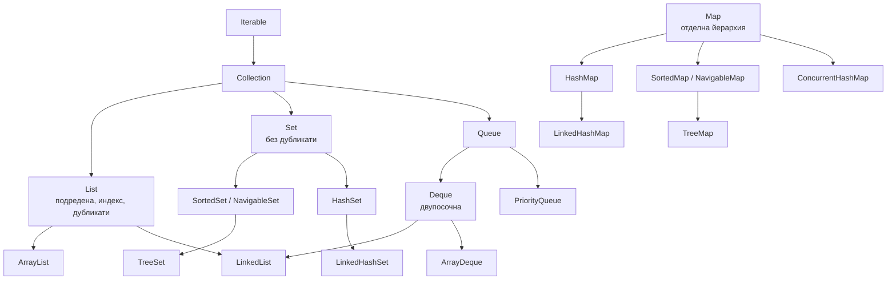
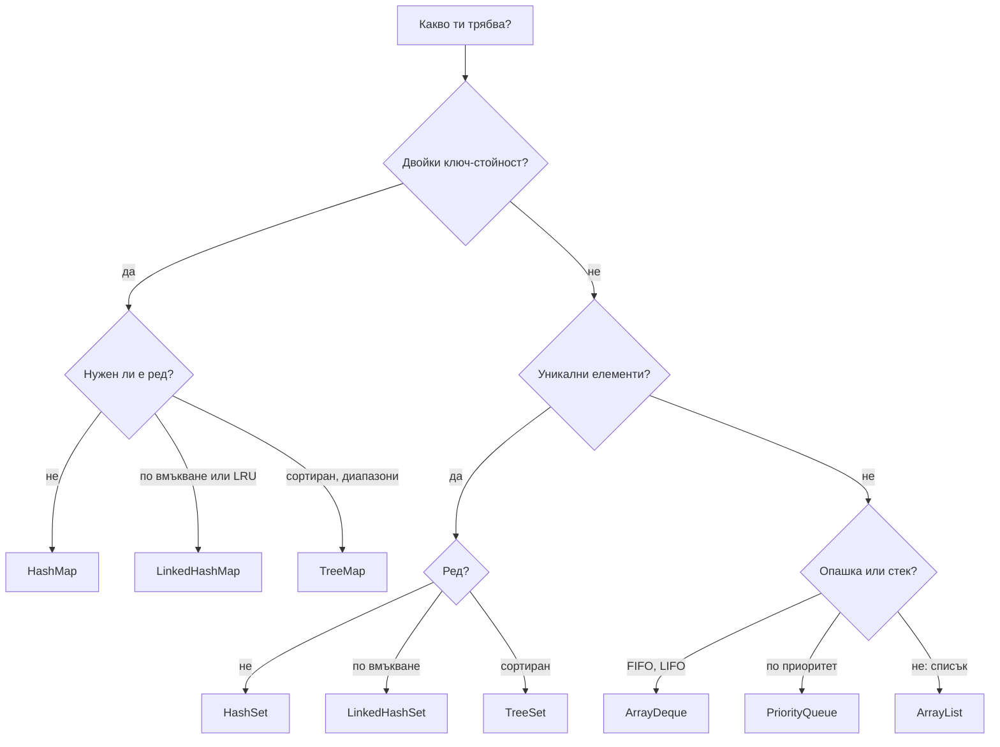

# Collections Framework

Collections Framework е наборът от интерфейси и имплементации в `java.util` за работа с групи от обекти. Четири основни абстракции: `List` (подредена, с дубликати, достъп по индекс), `Set` (без дубликати), `Queue`/`Deque` (опашка и двупосочна опашка) и `Map` (ключ към стойност, не наследява `Collection`). Всяка има няколко имплементации с различна структура отдолу, а оттам и различна сложност на операциите.

## 1. За какво се ползва и защо ни е нужен

Изборът на колекция е решение за производителност и коректност. `contains` в `ArrayList` от 1 милион елемента е милион сравнения, в `HashSet` е едно. `TreeMap` дава сортирани ключове и търсене по диапазон, `HashMap` не. `List.of` е неизменим и хвърля при `add`.

На интервю питат: йерархията, разликите между имплементациите, сложността, fail-fast итераторите, неизменимите колекции, кога `LinkedHashMap` и кога `TreeMap`.

## 2. Йерархията



От Java 21 `SequencedCollection` и `SequencedMap` дават общи методи `getFirst()`, `getLast()`, `reversed()` за всички колекции с ред (`List`, `Deque`, `LinkedHashSet`, `LinkedHashMap`, `TreeMap`).

## 3. Имплементации и сложност

| Имплементация | Структура | get / достъп | add | contains / remove | Ред |
|---|---|---|---|---|---|
| `ArrayList` | Динамичен масив | O(1) по индекс | O(1) амортизирано в края | O(n) | По вмъкване |
| `LinkedList` | Двойно свързан списък | O(n) по индекс | O(1) в краищата | O(n) | По вмъкване |
| `ArrayDeque` | Кръгов масив | O(1) в краищата | O(1) амортизирано | O(n) | По вмъкване |
| `PriorityQueue` | Binary heap | O(1) peek | O(log n) | O(n) contains, O(log n) poll | По приоритет |
| `HashSet` / `HashMap` | Хеш таблица | O(1) средно | O(1) средно | O(1) средно | Няма |
| `LinkedHashSet` / `LinkedHashMap` | Хеш таблица + свързан списък | O(1) | O(1) | O(1) | По вмъкване (или по достъп) |
| `TreeSet` / `TreeMap` | Червено-черно дърво | O(log n) | O(log n) | O(log n) | Сортиран |
| `EnumMap` / `EnumSet` | Масив / битова маска | O(1) | O(1) | O(1) | По ordinal |

## 4. Как да избереш



## 5. Минимален пример

```java CollectionsDemo.java
import java.util.*;

public class CollectionsDemo {
    public static void main(String[] args) {
        // Неизменими колекции (Java 9+): хвърлят при промяна, не приемат null
        List<String> fixed = List.of("a", "b");
        try {
            fixed.add("c");
        } catch (UnsupportedOperationException e) {
            System.out.println("List.of е неизменим");
        }

        // unmodifiableList е изглед: промени в оригинала се виждат
        List<String> source = new ArrayList<>(List.of("x"));
        List<String> view = Collections.unmodifiableList(source);
        List<String> copy = List.copyOf(source);
        source.add("y");
        System.out.println(view + " " + copy);              // [x, y] [x]

        // Fail-fast итератор: промяна по време на обхождане
        List<Integer> nums = new ArrayList<>(List.of(1, 2, 3, 4));
        try {
            for (Integer n : nums) if (n % 2 == 0) nums.remove(n);
        } catch (ConcurrentModificationException e) {
            System.out.println("ConcurrentModificationException");
        }
        nums.removeIf(n -> n % 2 == 0);                      // правилният начин
        System.out.println(nums);                            // [1, 3]

        // Ред в различните Map
        Map<String, Integer> hash = new HashMap<>();
        SequencedMap<String, Integer> linked = new LinkedHashMap<>();   // SequencedMap: Java 21
        Map<String, Integer> tree = new TreeMap<>();
        for (String k : List.of("банан", "ябълка", "круша")) {
            hash.put(k, k.length()); linked.put(k, k.length()); tree.put(k, k.length());
        }
        System.out.println(linked.keySet());                 // [банан, ябълка, круша]: по вмъкване
        System.out.println(tree.keySet());                   // [банан, круша, ябълка]: сортиран

        // NavigableMap: търсене по диапазон
        TreeMap<Integer, String> grades = new TreeMap<>(Map.of(2, "слаб", 3, "среден", 4, "добър", 5, "много добър", 6, "отличен"));
        System.out.println(grades.floorEntry(5).getValue()); // много добър
        System.out.println(grades.headMap(4));               // {2=слаб, 3=среден}

        // Sequenced (Java 21)
        System.out.println(linked.firstEntry() + " " + List.of(1, 2, 3).reversed());   // банан=5 [3, 2, 1]
    }
}
```

## 6. Въпроси на интервю

### Каква е разликата между `List`, `Set` и `Map`?

`List` е подредена колекция с индекси и дубликати. `Set` не допуска дубликати (по `equals`/`hashCode` или по comparator). `Map` съпоставя уникални ключове на стойности и не е `Collection`.

### Каква е разликата между `HashMap`, `LinkedHashMap` и `TreeMap`?

`HashMap` е хеш таблица без гарантиран ред, O(1) средно. `LinkedHashMap` добавя двойно свързан списък през записите и пази реда на вмъкване (или на достъп, което позволява LRU кеш с `removeEldestEntry`). `TreeMap` е червено-черно дърво: ключовете са сортирани, операциите са O(log n), има `floorKey`, `ceilingKey`, `subMap`.

### Какво е fail-fast итератор?

Итераторът пази брояч на структурните промени (`modCount`). Ако колекцията се промени не през самия итератор, следващото `next()` хвърля `ConcurrentModificationException`. Това е защита от бъгове, не механизъм за синхронизация. Премахване по време на обхождане: `iterator.remove()` или `removeIf`. Конкурентните колекции (`ConcurrentHashMap`, `CopyOnWriteArrayList`) имат weakly consistent итератори, които не хвърлят.

### Каква е разликата между `List.of`, `Collections.unmodifiableList` и `List.copyOf`?

`List.of` и `List.copyOf` създават истински неизменими списъци (не приемат `null`). `unmodifiableList` е само изглед, който забранява промяна през себе си, но промените в оригиналния списък се виждат.

### Как да направиш LRU кеш с стандартната библиотека?

`LinkedHashMap` с `accessOrder = true` и override на `removeEldestEntry`, който връща `true`, когато размерът надхвърли лимита. За production: Caffeine.

## 7. Капани и чести грешки

- `contains` в цикъл върху `ArrayList`: O(n²). Направи `HashSet`.
- Промяна на колекция по време на `for-each`.
- `List.of(...)` с `null` елемент: `NullPointerException`.
- `Arrays.asList`: фиксиран размер, `add` хвърля, а `set` променя оригиналния масив.
- Обект с грешен `hashCode` в `HashSet` или `TreeSet` с comparator, неконсистентен с `equals`.
- `HashMap` между нишки без синхронизация. Виж [Locks, atomics, конкурентни колекции](Locks_Atomics.md).

## 8. Свързани документи

- [HashMap отвътре](HashMap.md)
- [ArrayList, LinkedList, Deque, PriorityQueue](Lists_Queues.md)
- [equals, hashCode, Comparable](Equals_HashCode.md)
- [Lambdas, Streams, Optional](Streams.md)
