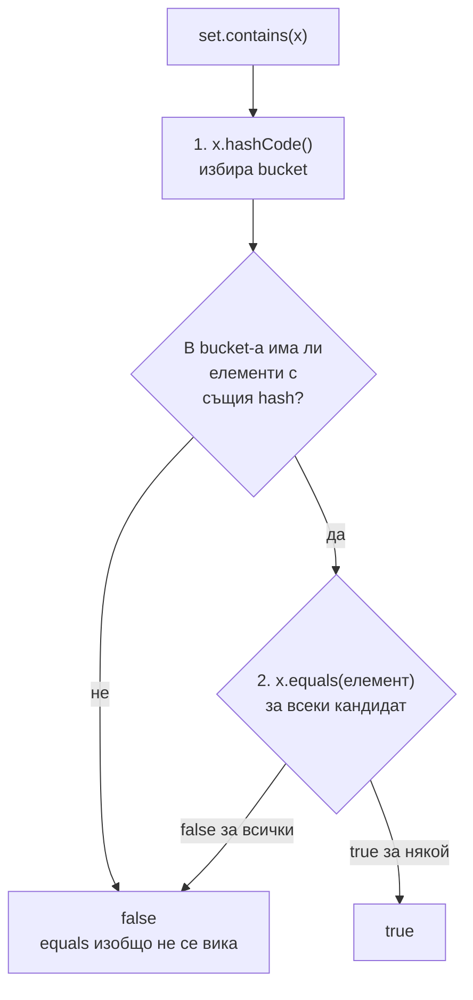

# equals, hashCode, Comparable

`==` сравнява дали две референции сочат към един и същ обект. `equals` сравнява дали два обекта са логически равни, както го дефинира класът. `hashCode` дава число, по което хеш-базираните колекции (`HashMap`, `HashSet`) избират къде да сложат обекта. Двата метода имат общ договор: равните обекти задължително имат еднакъв `hashCode`. Ако го нарушиш, колекциите губят обекти. `Comparable` и `Comparator` дават наредба за сортиране и за `TreeMap`/`TreeSet`.

## 1. За какво се ползва и защо ни е нужен

Почти всеки domain обект рано или късно влиза в `Set`, става ключ в `Map` или се сортира. Ако `equals` и `hashCode` са грешни:

- `set.contains(order)` връща `false` за обект, който "очевидно" е вътре;
- дубликати в `HashSet`;
- кешът в `HashMap` никога не намира записа и расте без край (memory leak);
- `TreeSet` тихо губи елементи, ако `compareTo` дава 0 за различни обекти.

Това е сред първите пет въпроса на всяко Java интервю.

## 2. Как `HashSet.contains` ползва двата метода



Ако два равни обекта имат различен `hashCode`, те отиват в различни buckets и `equals` никога не се извиква. Затова договорът е задължителен.

## 3. Договорите

**equals** трябва да е:

| Свойство | Значение |
|---|---|
| Рефлексивно | `x.equals(x)` е `true` |
| Симетрично | `x.equals(y)` ⇔ `y.equals(x)` |
| Транзитивно | `x.equals(y)` и `y.equals(z)` ⇒ `x.equals(z)` |
| Консистентно | Многократните извиквания дават един и същ резултат, ако обектите не са променени |
| За `null` | `x.equals(null)` е `false` |

**hashCode:**

- равни обекти (по `equals`) ⇒ еднакъв `hashCode`;
- еднакъв `hashCode` не значи равни (колизиите са позволени);
- стойността не бива да се променя, докато обектът е в хеш колекция.

**compareTo** трябва да е консистентен с `equals` (`compareTo == 0` ⇔ `equals`), ако обектите ще са в `TreeSet` или `TreeMap`, защото те ползват само `compareTo`.

## 4. Минимален пример: какво се чупи

```java EqualsDemo.java
import java.util.*;

public class EqualsDemo {
    // Без equals и hashCode: наследява ги от Object (сравнение по референция)
    static class PointNoEquals {
        final int x, y;
        PointNoEquals(int x, int y) { this.x = x; this.y = y; }
    }

    // Само equals, без hashCode: нарушен договор
    static class PointOnlyEquals {
        final int x, y;
        PointOnlyEquals(int x, int y) { this.x = x; this.y = y; }
        @Override public boolean equals(Object o) {
            return o instanceof PointOnlyEquals p && p.x == x && p.y == y;
        }
    }

    // Правилно: record генерира equals, hashCode и toString от компонентите
    record Point(int x, int y) {}

    // Изменим ключ
    static class MutableKey {
        int id;
        MutableKey(int id) { this.id = id; }
        @Override public boolean equals(Object o) { return o instanceof MutableKey k && k.id == id; }
        @Override public int hashCode() { return Integer.hashCode(id); }
    }

    public static void main(String[] args) {
        Set<PointNoEquals> a = new HashSet<>(List.of(new PointNoEquals(1, 2)));
        System.out.println(a.contains(new PointNoEquals(1, 2)));     // false: различни референции

        Set<PointOnlyEquals> b = new HashSet<>(List.of(new PointOnlyEquals(1, 2)));
        System.out.println(b.contains(new PointOnlyEquals(1, 2)));   // false: различен bucket

        Set<Point> c = new HashSet<>(List.of(new Point(1, 2)));
        System.out.println(c.contains(new Point(1, 2)));             // true

        MutableKey key = new MutableKey(1);
        Map<MutableKey, String> map = new HashMap<>();
        map.put(key, "стойност");
        key.id = 2;                                                  // hashCode се промени
        System.out.println(map.get(key));                            // null: търси в грешния bucket
        System.out.println(map.size());                              // 1: записът е там, но е недостижим

        // compareTo, който не е консистентен с equals
        Set<String> tree = new TreeSet<>(String.CASE_INSENSITIVE_ORDER);
        tree.add("Java");
        tree.add("JAVA");
        System.out.println(tree);                                    // [Java]: "JAVA" е счетен за дубликат
    }
}
```

## 5. Правилна имплементация

```java Money.java
import java.math.BigDecimal;
import java.util.Comparator;
import java.util.Objects;

public final class Money implements Comparable<Money> {
    private final BigDecimal amount;
    private final String currency;

    public Money(BigDecimal amount, String currency) {
        this.amount = amount.stripTrailingZeros();   // 1.0 и 1.00 да са равни
        this.currency = Objects.requireNonNull(currency);
    }

    @Override
    public boolean equals(Object o) {
        if (this == o) return true;                          // бърз път
        if (!(o instanceof Money other)) return false;       // и проверка за null
        return amount.equals(other.amount) && currency.equals(other.currency);
    }

    @Override
    public int hashCode() {
        return Objects.hash(amount, currency);               // същите полета като в equals
    }

    private static final Comparator<Money> ORDER =
            Comparator.comparing((Money m) -> m.currency).thenComparing(m -> m.amount);

    @Override
    public int compareTo(Money other) {
        return ORDER.compare(this, other);                   // 0 само ако двете полета са равни
    }

    public static void main(String[] args) {
        Money x = new Money(new BigDecimal("1.0"), "EUR");
        Money y = new Money(new BigDecimal("1.00"), "EUR");
        System.out.println(x.equals(y) + " " + (x.hashCode() == y.hashCode()) + " " + x.compareTo(y));
    }
}
// true true 0
```

В нов код най-лесно е `record`: генерира коректни `equals` и `hashCode` от всички компоненти. За JPA entities правилата са различни (виж [JPA и Hibernate](JPA_Hibernate.md)).

## 6. Въпроси на интервю

### Каква е разликата между `==` и `equals`?

`==` сравнява референции (същият обект ли е) за обекти и стойности за примитиви. `equals` сравнява логическо равенство според имплементацията на класа. По подразбиране (`Object.equals`) е същото като `==`.

### Защо при override на `equals` трябва да override-неш и `hashCode`?

Договорът изисква равните обекти да имат еднакъв `hashCode`. Хеш колекциите първо избират bucket по `hashCode` и чак там викат `equals`. Ако равни обекти имат различен hash, те попадат в различни buckets и колекцията не ги намира.

### Може ли два различни обекта да имат еднакъв `hashCode`?

Да, това е колизия и е нормално: `hashCode` е `int`, а възможните обекти са безброй. Колекцията тогава различава обектите с `equals`. Многото колизии само влошават производителността.

### Какво става, ако промениш поле, участващо в `hashCode`, докато обектът е ключ в `HashMap`?

Обектът остава в стария bucket, а новият hash сочи към друг. `get` и `remove` не го намират, но той продължава да заема място. Затова ключовете трябва да са неизменими.

### Каква е разликата между `Comparable` и `Comparator`?

`Comparable` е естествената наредба, имплементирана от самия клас (`compareTo`). `Comparator` е външна наредба, която може да има много варианти (`Comparator.comparing(User::getName).reversed()`). `TreeSet` и `TreeMap` ползват едното от двете вместо `equals` и `hashCode`.

## 7. Капани и чести грешки

- `equals` без `hashCode` (или обратно).
- Изменими полета в `hashCode` на обект, който е ключ.
- `equals(Order other)` вместо `equals(Object o)`: това е overload, не override. `@Override` го хваща.
- `getClass() != o.getClass()` срещу `instanceof`: първото чупи сравнение с подкласове и Hibernate proxies, второто може да наруши симетрията при наследяване. За final класове и records няма проблем.
- `compareTo` с изваждане (`return a - b`): препълване при големи числа. Ползвай `Integer.compare`.
- `TreeSet` с comparator, който дава 0 за различни обекти: тихо губи елементи.

## 8. Свързани документи

- [HashMap отвътре](HashMap.md)
- [Класове, records, sealed, enums](Classes_Records.md)
- [Collections Framework](Collections.md)
- [JPA и Hibernate](JPA_Hibernate.md)
