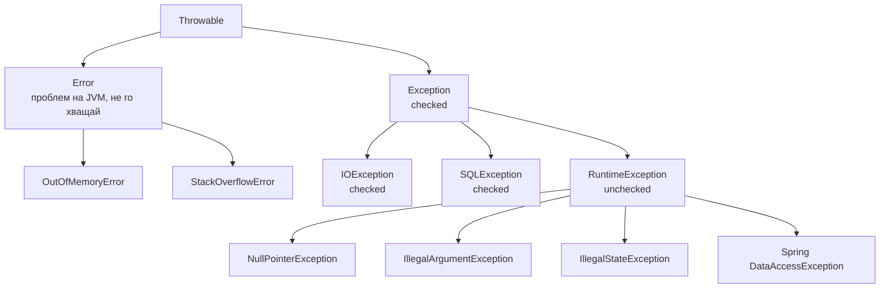
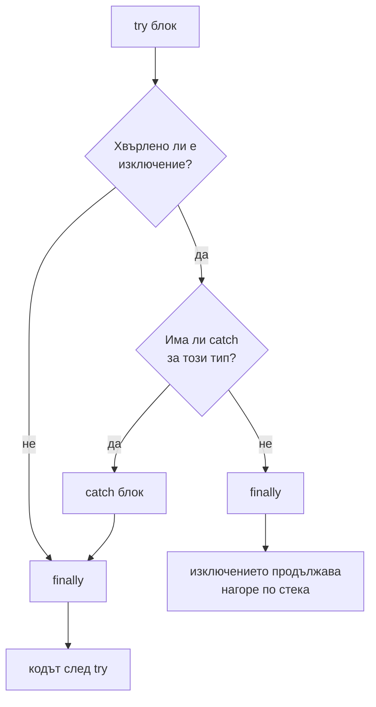

# Изключения

Изключенията в Java са обекти, които наследяват `Throwable`. Делят се на два клона: `Error` (проблеми на JVM, от които обикновено не се възстановяваш: `OutOfMemoryError`, `StackOverflowError`) и `Exception`. Сред `Exception` компилаторът различава checked изключения (трябва да ги обработиш или декларираш с `throws`) и unchecked (`RuntimeException` и наследниците му), за които не изисква нищо. `try-with-resources` гарантира затварянето на ресурси, а `finally` се изпълнява почти винаги.

## 1. За какво се ползва и защо ни е нужен

Обработката на грешки определя дали системата се държи предвидимо при проблем: дали връзката към базата се затваря, дали транзакцията се отказва, дали клиентът получава смислен отговор, дали грешката се логва с причината.

На интервю питат почти винаги: checked срещу unchecked и кога кое, `finally` и `return`, try-with-resources, `Error` срещу `Exception`, защо Spring отказва транзакцията само при unchecked изключения.

## 2. Йерархията



| | Checked | Unchecked |
|---|---|---|
| Наследява | `Exception` (без `RuntimeException`) | `RuntimeException` или `Error` |
| Компилаторът изисква | `catch` или `throws` | Нищо |
| Типично значение | Очакван проблем от средата: файл, мрежа | Бъг или нарушено предусловие |
| Примери | `IOException`, `SQLException`, `InterruptedException` | `NullPointerException`, `IllegalArgumentException` |
| В lambdas и streams | Неудобни: функционалните интерфейси не декларират `throws` | Работят |

Съвременната практика (и Spring) клони към unchecked: Spring превежда `SQLException` в unchecked `DataAccessException`. Checked изключенията "заразяват" всеки слой с `throws` и не се връзват с lambdas.

## 3. Как се изпълнява try/catch/finally



При try-with-resources ресурсите се затварят в обратен ред на отварянето, **преди** `catch` и `finally`. Ако и тялото, и `close()` хвърлят, изключението от `close()` се добавя като suppressed към основното, вместо да го замени.

## 4. Минимален пример

```java ExceptionsDemo.java
public class ExceptionsDemo {
    static class Resource implements AutoCloseable {
        private final String name;
        Resource(String name) { this.name = name; System.out.println("отварям " + name); }
        @Override public void close() {
            System.out.println("затварям " + name);
            throw new IllegalStateException("close на " + name + " се провали");
        }
    }

    // Собствено unchecked изключение с причина (cause)
    static class OrderNotFoundException extends RuntimeException {
        OrderNotFoundException(String id, Throwable cause) {
            super("поръчка " + id + " не е намерена", cause);
        }
    }

    @SuppressWarnings("finally")
    static int finallyWins() {
        try {
            return 1;
        } finally {
            return 2;                          // презаписва return от try: никога не го прави
        }
    }

    public static void main(String[] args) {
        try (Resource a = new Resource("A"); Resource b = new Resource("B")) {
            throw new RuntimeException("грешка в тялото");
        } catch (RuntimeException e) {
            System.out.println("хванато: " + e.getMessage());
            for (Throwable s : e.getSuppressed()) System.out.println("  suppressed: " + s.getMessage());
        } finally {
            System.out.println("finally");
        }

        try {
            try {
                Integer.parseInt("abc");
            } catch (NumberFormatException e) {
                throw new OrderNotFoundException("abc", e);   // обвиване: пазим причината
            }
        } catch (OrderNotFoundException e) {
            System.out.println(e.getMessage() + ", причина: " + e.getCause().getClass().getSimpleName());
        }

        System.out.println(finallyWins());
    }
}
// отварям A
// отварям B
// затварям B
// затварям A
// хванато: грешка в тялото
//   suppressed: close на B се провали
//   suppressed: close на A се провали
// finally
// поръчка abc не е намерена, причина: NumberFormatException
// 2
```

## 5. Въпроси на интервю

### Каква е разликата между checked и unchecked изключения?

Checked наследяват `Exception`, но не `RuntimeException`, и компилаторът изисква да ги хванеш или декларираш с `throws`. Unchecked наследяват `RuntimeException` (или `Error`) и не изискват нищо. Checked са за очаквани проблеми от средата, unchecked за бъгове и нарушени предусловия. На практика повечето съвременни API-та (Spring, JPA) ползват unchecked.

### Изпълнява ли се винаги `finally`?

Почти винаги: и при нормален край, и при изключение, и при `return` в `try`. Не се изпълнява, ако JVM спре (`System.exit`, срив на процеса, `kill -9`) или ако нишката никога не излезе от `try` (безкраен цикъл). `return` във `finally` презаписва резултата и поглъща изключенията: никога не го прави.

### Какво прави try-with-resources?

Автоматично вика `close()` на всички ресурси, които имплементират `AutoCloseable`, в обратен ред на отварянето, дори при изключение. Изключенията от `close()` се добавят като suppressed към основното, вместо да го скрият.

### Защо не трябва да хващаш `Throwable` или `Error`?

`Error` значи, че JVM е в лошо състояние (няма памет, препълнен стек). Опитът да продължиш нормално обикновено влошава нещата. Хващането на `Throwable` поглъща и тях. Изключение: най-горното ниво на нишка, където логваш и спираш.

### Защо `@Transactional` не прави rollback при checked изключение?

Spring по подразбиране отказва транзакцията само при `RuntimeException` и `Error`, следвайки EJB конвенцията, че checked изключенията са "бизнес" резултат. Промяна: `@Transactional(rollbackFor = Exception.class)`. Виж [@Transactional отвътре](Spring_Transactions.md).

### Какво е exception chaining?

Обвиване на ниско ниво изключение в по-смислено за слоя, като се подава оригиналното като `cause`: `throw new OrderException("...", e)`. Stack trace-ът показва цялата верига ("Caused by"), така че причината не се губи.

## 6. Капани и чести грешки

- Празен `catch` или само `e.printStackTrace()`.
- Обвиване без `cause`: оригиналният stack trace се губи.
- `catch (Exception e)` около всичко, което хваща и бъгове, които трябва да гръмнат.
- `return` или `throw` във `finally`.
- `InterruptedException`, погълнат без `Thread.currentThread().interrupt()`. Виж [Нишки и жизнен цикъл](Threads.md).
- Изключения за контрол на потока (вместо `if`): скъпи са заради stack trace-а.
- Логване и повторно хвърляне на всяко ниво: една грешка се появява десет пъти в лога.

## 7. Свързани документи

- [@Transactional отвътре](Spring_Transactions.md)
- [Нишки и жизнен цикъл](Threads.md)
- [Lambdas, Streams, Optional](Streams.md)
- [Пътят на HTTP заявката](Spring_MVC.md)
