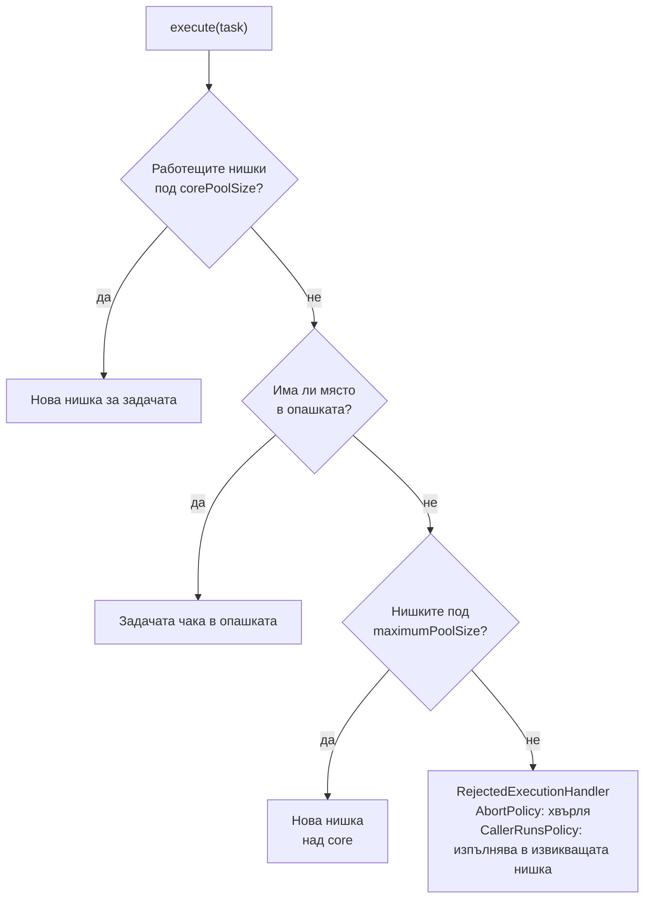
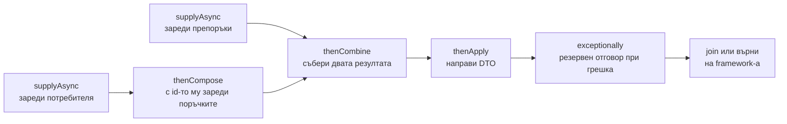

# ExecutorService и CompletableFuture

`ExecutorService` е пул от нишки, на който подаваш задачи, вместо да създаваш нишки ръчно. Нишките се преизползват, броят им е ограничен, а чакащите задачи стоят в опашка. Основната имплементация е `ThreadPoolExecutor` с core и max брой нишки, опашка и политика за отказ. `CompletableFuture` описва асинхронен резултат и позволява да вериж операции (`thenApply`, `thenCompose`, `thenCombine`) и да обработваш грешки, без да блокираш нишка.

## 1. За какво се ползва и защо ни е нужен

Създаването на platform нишка е скъпо, а неограниченият брой нишки изчерпва паметта. Пулът решава и двата проблема. В Spring Boot пулове има навсякъде: Tomcat (нишки за заявки), `@Async` (`ThreadPoolTaskExecutor`), `@Scheduled`, HTTP клиенти, Kafka listeners.

Типична задача: страница трябва да извика три независими сървиса. Последователно струва сумата от времената, паралелно с `CompletableFuture` струва колкото най-бавния.

На интервю питат: как `ThreadPoolExecutor` решава какво да прави с нова задача, защо `Executors.newFixedThreadPool` може да изчерпа паметта, `Future` срещу `CompletableFuture`, `thenApply` срещу `thenCompose`, кой pool ползва `supplyAsync` по подразбиране.

## 2. Как ThreadPoolExecutor приема задача



Контраинтуитивното: нишки над `corePoolSize` се създават **само когато опашката е пълна**. С неограничена опашка (`LinkedBlockingQueue` без лимит) `maximumPoolSize` никога не се достига, а опашката расте до `OutOfMemoryError`.

| Фабрика | Какво създава | Риск |
|---|---|---|
| `newFixedThreadPool(n)` | n нишки, неограничена опашка | Опашката расте без край при претоварване |
| `newCachedThreadPool()` | 0 core, неограничен max, без опашка | Хиляди нишки при пик |
| `newSingleThreadExecutor()` | 1 нишка, неограничена опашка | Като fixed |
| `newScheduledThreadPool(n)` | За отложени и периодични задачи | |
| `newVirtualThreadPerTaskExecutor()` | Нова virtual нишка за всяка задача (Java 21) | Без ограничение: лимитирай достъпа до ресурса със `Semaphore` |
| `new ThreadPoolExecutor(...)` | Всичко явно | Препоръчано за production |

## 3. Минимален пример: ThreadPoolExecutor

```java PoolDemo.java
import java.util.concurrent.*;

public class PoolDemo {
    public static void main(String[] args) throws Exception {
        ThreadPoolExecutor pool = new ThreadPoolExecutor(
                2,                                    // corePoolSize
                4,                                    // maximumPoolSize
                30, TimeUnit.SECONDS,                 // колко живее нишка над core без работа
                new ArrayBlockingQueue<>(2),          // ограничена опашка
                new ThreadPoolExecutor.AbortPolicy()); // при препълване: RejectedExecutionException

        for (int i = 1; i <= 7; i++) {
            int id = i;
            try {
                pool.execute(() -> sleep(300));
                System.out.printf("задача %d приета: нишки=%d, в опашката=%d%n", id, pool.getPoolSize(), pool.getQueue().size());
            } catch (RejectedExecutionException e) {
                System.out.printf("задача %d отказана%n", id);
            }
        }
        pool.shutdown();                              // не приема нови, довършва старите
        pool.awaitTermination(5, TimeUnit.SECONDS);
    }

    static void sleep(long ms) {
        try { Thread.sleep(ms); } catch (InterruptedException e) { Thread.currentThread().interrupt(); }
    }
}
```

```text output
задача 1 приета: нишки=1, в опашката=0
задача 2 приета: нишки=2, в опашката=0
задача 3 приета: нишки=2, в опашката=1
задача 4 приета: нишки=2, в опашката=2
задача 5 приета: нишки=3, в опашката=2
задача 6 приета: нишки=4, в опашката=2
задача 7 отказана
```

Задачи 1-2 получават core нишки, 3-4 отиват в опашката, 5-6 създават нишки над core (опашката е пълна), 7 е отказана.

## 4. CompletableFuture



| Метод | Аналог | Кога |
|---|---|---|
| `thenApply(f)` | `map` | Синхронна трансформация на резултата |
| `thenCompose(f)` | `flatMap` | Следващата стъпка сама е асинхронна (връща `CompletableFuture`) |
| `thenCombine(other, f)` | zip | Комбиниране на два независими резултата |
| `allOf(...)` / `anyOf(...)` | | Изчакване на всички / на първия |
| `exceptionally(f)`, `handle(f)` | catch | Обработка на грешка |
| `orTimeout`, `completeOnTimeout` | | Timeout (Java 9) |
| Варианти `...Async` | | Следващата стъпка в друга нишка от pool-а |

```java FuturesDemo.java
import java.util.List;
import java.util.concurrent.*;

public class FuturesDemo {
    record User(long id, String name) {}

    static User loadUser(long id) { sleep(300); return new User(id, "Ана"); }
    static List<String> loadOrders(long userId) { sleep(300); return List.of("#1", "#2"); }
    static List<String> loadRecommendations() { sleep(300); throw new IllegalStateException("сървисът е недостъпен"); }

    public static void main(String[] args) {
        ExecutorService io = Executors.newFixedThreadPool(4);   // собствен pool за I/O, не commonPool
        long start = System.nanoTime();

        CompletableFuture<List<String>> orders = CompletableFuture
                .supplyAsync(() -> loadUser(42), io)
                .thenCompose(u -> CompletableFuture.supplyAsync(() -> loadOrders(u.id()), io));

        CompletableFuture<List<String>> recs = CompletableFuture
                .supplyAsync(FuturesDemo::loadRecommendations, io)
                .exceptionally(e -> List.of("популярни продукти"))    // резервен отговор
                .orTimeout(2, TimeUnit.SECONDS);

        String page = orders.thenCombine(recs, (o, r) -> "поръчки=" + o + ", препоръки=" + r).join();
        System.out.println(page);
        System.out.printf("време: ~%d ms (последователно би било ~900)%n", (System.nanoTime() - start) / 1_000_000 / 100 * 100);
        io.shutdown();
    }

    static void sleep(long ms) {
        try { Thread.sleep(ms); } catch (InterruptedException e) { Thread.currentThread().interrupt(); }
    }
}
```

```text output
поръчки=[#1, #2], препоръки=[популярни продукти]
време: ~600 ms (последователно би било ~900)
```

Потребителят и поръчките са последователни (поръчките зависят от id-то), но препоръките вървят паралелно с тях.

## 5. Въпроси на интервю

### Как `ThreadPoolExecutor` решава какво да прави с нова задача?

Ако работещите нишки са под core, създава нова. Иначе опитва да сложи задачата в опашката. Ако опашката е пълна и нишките са под max, създава нова. Ако и max е достигнат, вика `RejectedExecutionHandler`. Нишки над core се създават само при пълна опашка.

### Защо `Executors.newFixedThreadPool` е рискован в production?

Използва неограничена `LinkedBlockingQueue`. При натоварване, по-голямо от капацитета, задачите се трупат в паметта без край, латентността расте и накрая идва `OutOfMemoryError`. По-добре `ThreadPoolExecutor` с ограничена опашка и съзнателна политика за отказ (например `CallerRunsPolicy` за backpressure).

### Каква е разликата между `Future` и `CompletableFuture`?

`Future` може само да се провери (`isDone`) или да се изчака блокиращо (`get`). `CompletableFuture` позволява да закачиш продължения, които се изпълняват, когато резултатът е готов, да комбинираш няколко, да обработваш грешки и да го завършиш ръчно (`complete`).

### Каква е разликата между `thenApply` и `thenCompose`?

`thenApply` приема функция, която връща обикновена стойност (`T -> U`). `thenCompose` приема функция, която връща `CompletableFuture<U>`, и "изравнява" резултата, вместо да даде `CompletableFuture<CompletableFuture<U>>`. Същата разлика като `map` и `flatMap`.

### Кой pool ползва `supplyAsync` без executor?

`ForkJoinPool.commonPool()`, общ за целия процес (включително parallel streams), с брой нишки около броя на ядрата. За блокиращ I/O винаги подавай собствен executor, иначе няколко бавни извиквания блокират общия pool за всички.

### Как се спира `ExecutorService`?

`shutdown()` спира приемането на нови задачи и оставя текущите да довършат. `shutdownNow()` прекъсва работещите (`interrupt`) и връща чакащите. После `awaitTermination` с timeout. От Java 19 `ExecutorService` е `AutoCloseable` и може да се ползва в try-with-resources.

## 6. Капани и чести грешки

- Неограничени опашки и неограничен брой нишки.
- `supplyAsync` за I/O без собствен executor.
- `future.get()` веднага след `submit`: асинхронността е безсмислена.
- Изгубени изключения: задача, подадена с `submit`, пази изключението във `Future`, и ако никой не вика `get`, то никога не се вижда.
- Незатворен executor: нишките (не daemon) държат JVM жива.
- `@Async` върху метод, извикан от същия клас: proxy-то се заобикаля и методът е синхронен. Виж [AOP и proxies](Spring_AOP.md).
- `ThreadLocal` (например security context, MDC) не се пренася автоматично в друга нишка от pool-а.

## 7. Свързани документи

- [Нишки и жизнен цикъл](Threads.md)
- [Virtual threads](Virtual_Threads.md)
- [Locks, atomics, конкурентни колекции](Locks_Atomics.md)
- [AOP и proxies](Spring_AOP.md)
