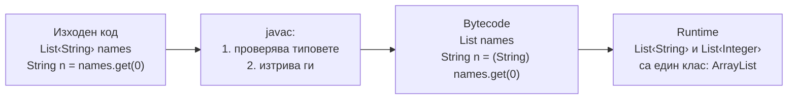
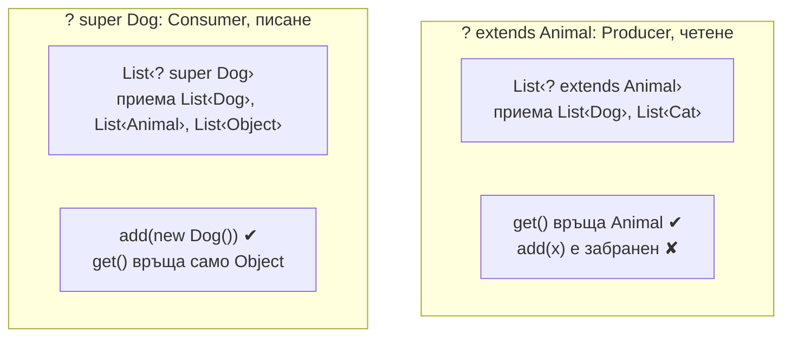

# Generics и type erasure

Generics позволяват класове и методи да работят с различни типове, като компилаторът проверява типовете: `List<String>` приема само низове и `get` връща `String` без cast. В Java generics са реализирани чрез type erasure: компилаторът проверява типовете и после ги изтрива, така че в runtime `List<String>` и `List<Integer>` са един и същ клас `List`. Оттам идват и ограниченията: не може `new T()`, не може `instanceof List<String>`, а `List<String>` не е подтип на `List<Object>`.

## 1. За какво се ползва и защо ни е нужен

Преди Java 5 колекциите държаха `Object` и всеки `get` изискваше cast, който можеше да гръмне в runtime с `ClassCastException`. Generics преместват тази грешка в компилацията.

На интервю generics са любима тема, защото проверяват дълбочината:

- защо `List<Dog>` не може да се подаде там, където се очаква `List<Animal>`;
- какво значат `? extends` и `? super` и правилото PECS;
- какво е type erasure и какви ограничения носи;
- защо масивите се държат различно от generic колекциите.

## 2. Type erasure



Компилаторът заменя типовия параметър с неговата граница (`T` става `Object`, `T extends Number` става `Number`) и вмъква cast-ове там, където е нужно. Причината е обратна съвместимост: generic кодът работи със стари библиотеки отпреди Java 5.

Следствия:

| Не може | Защо | Решение |
|---|---|---|
| `new T()` | В runtime `T` не е известен | Подай `Supplier<T>` или `Class<T>` |
| `new T[10]` | Същото | `(T[]) new Object[10]` с warning, или `List<T>` |
| `x instanceof List<String>` | Типът е изтрит | `x instanceof List<?>` |
| `static T field` | Статичното поле е общо за всички параметризации | Няма |
| Два метода `f(List<String>)` и `f(List<Integer>)` | След erasure са една сигнатура | Различни имена |
| `List<int>` | Типовите параметри са само референтни типове | `List<Integer>` |

## 3. Инвариантност и wildcards

`Dog` е подтип на `Animal`, но `List<Dog>` **не е** подтип на `List<Animal>`. Ако беше, можеше да направиш:

```java Invariance.java
import java.util.ArrayList;
import java.util.List;

public class Invariance {
    static class Animal {}
    static class Dog extends Animal {}
    static class Cat extends Animal {}

    public static void main(String[] args) {
        List<Dog> dogs = new ArrayList<>();
        // List<Animal> animals = dogs;      // грешка при компилация: иначе следващият ред би бил позволен
        // animals.add(new Cat());           // и в списъка с кучета щеше да има котка

        // Масивите са ковариантни и проверяват в runtime:
        Animal[] arr = new Dog[1];
        try {
            arr[0] = new Cat();              // компилира се
        } catch (ArrayStoreException e) {
            System.out.println("ArrayStoreException: " + e.getMessage());
        }
    }
}
// ArrayStoreException: Invariance$Cat
```

Wildcards дават гъвкавост, когато ти трябва само четене или само писане:



**PECS: Producer Extends, Consumer Super.** Ако колекцията ти дава елементи (четеш от нея), ползвай `extends`. Ако приема елементи (пишеш в нея), ползвай `super`. Класическият пример е `Collections.copy(List<? super T> dest, List<? extends T> src)`.

## 4. Минимален пример

```java GenericsDemo.java
import java.util.*;
import java.util.function.Supplier;

public class GenericsDemo {
    // Generic метод с граница: T трябва да е сравним със себе си
    static <T extends Comparable<? super T>> T max(Collection<? extends T> items) {
        Iterator<? extends T> it = items.iterator();
        T best = it.next();
        while (it.hasNext()) {
            T next = it.next();
            if (next.compareTo(best) > 0) best = next;
        }
        return best;
    }

    // PECS: четем от src (extends), пишем в dst (super)
    static <T> void copyAll(Collection<? extends T> src, Collection<? super T> dst) {
        for (T item : src) dst.add(item);
    }

    // Заобикаляне на "new T()": подаваме фабрика
    static <T> List<T> createN(int n, Supplier<T> factory) {
        List<T> out = new ArrayList<>();
        for (int i = 0; i < n; i++) out.add(factory.get());
        return out;
    }

    public static void main(String[] args) {
        System.out.println(max(List.of(3, 9, 4)));                 // 9
        List<Number> numbers = new ArrayList<>();
        copyAll(List.of(1, 2), numbers);                            // Integer в Number: позволено от super
        copyAll(List.of(1.5), numbers);
        System.out.println(numbers);                                // [1, 2, 1.5]
        System.out.println(createN(2, StringBuilder::new).size());  // 2

        List<String> a = new ArrayList<>();
        List<Integer> b = new ArrayList<>();
        System.out.println(a.getClass() == b.getClass());          // true: erasure
    }
}
```

## 5. Въпроси на интервю

### Какво е type erasure?

Компилаторът проверява generic типовете и после ги изтрива: типовите параметри се заменят с границата си (обикновено `Object`), а където е нужно се вмъкват cast-ове. В runtime няма информация за `T`. Причината е обратната съвместимост с код отпреди Java 5.

### Защо `List<String>` не е подтип на `List<Object>`?

Защото generic типовете са инвариантни. Ако беше подтип, можеше да добавиш `Integer` в списъка с низове през референцията `List<Object>`. Масивите са ковариантни (`String[]` е `Object[]`) и плащат за това с runtime проверка (`ArrayStoreException`).

### Какво значи PECS?

Producer Extends, Consumer Super. Параметър, от който четеш, е `? extends T`: приема `T` и подтиповете, но не позволява писане. Параметър, в който пишеш, е `? super T`: приема `T` и надтиповете, позволява добавяне на `T`, но четенето дава само `Object`.

### Каква е разликата между `List<?>`, `List<Object>` и raw `List`?

`List<?>` е списък с неизвестен тип: можеш да четеш `Object`, не можеш да добавяш (освен `null`). `List<Object>` е списък, в който можеш да добавяш всичко, но не приема `List<String>`. Raw `List` изключва проверката на generics изобщо, остатък от Java 1.4, и води до heap pollution.

### Как да създадеш инстанция на `T`?

Директно не може, защото `T` не съществува в runtime. Подай фабрика (`Supplier<T>`) или `Class<T>` и ползвай `clazz.getDeclaredConstructor().newInstance()`.

## 6. Капани и чести грешки

- Raw типове (`List list = new ArrayList()`): губиш проверката, `ClassCastException` излиза далеч от причината.
- Игнорирани `unchecked` warnings.
- Overload, който след erasure дава еднакви сигнатури.
- `? extends` в параметър, в който трябва да пишеш.
- Generic масиви и varargs с generic тип (`@SafeVarargs`).

## 7. Свързани документи

- [Collections Framework](Collections.md)
- [Класове, records, sealed, enums](Classes_Records.md)
- [Lambdas, Streams, Optional](Streams.md)
- [Типове, boxing и String](Types_Strings.md)
