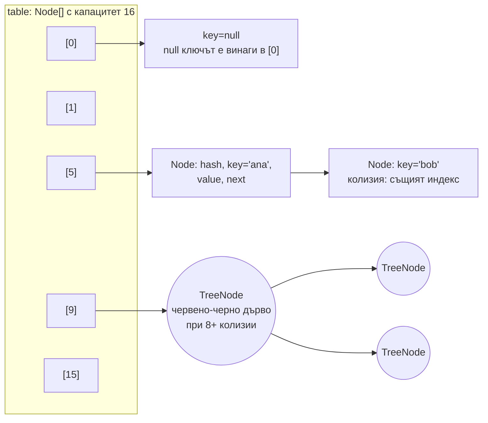
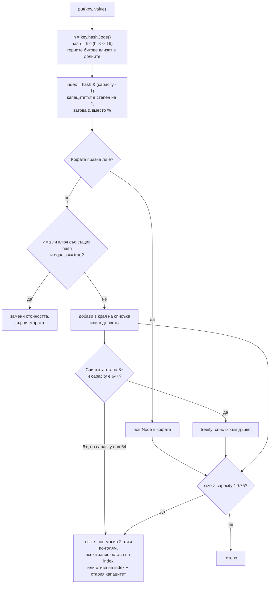

# HashMap отвътре

`HashMap` е масив от "кофи" (buckets). За всеки ключ изчислява `hashCode`, размесва битовете му и по него избира индекс в масива. Ключовете с еднакъв индекс (колизия) се пазят в свързан списък в кофата, а когато списъкът стане дълъг (8 елемента) и таблицата е достатъчно голяма (64 кофи), се превръща в червено-черно дърво. Когато броят на елементите надхвърли капацитета по load factor (0.75), масивът се удвоява и записите се преразпределят. Средната сложност на `get` и `put` е O(1).

## 1. За какво се ползва и защо ни е нужен

`HashMap` е най-използваната структура в Java: кешове, индекси, групиране, броене, JSON обекти. "Как работи HashMap" е може би най-честият въпрос на Java интервю, защото свързва няколко теми: `hashCode` и `equals`, сложност, памет, конкурентност.

Практическите последствия:

- лош `hashCode` (много колизии) превръща O(1) в O(log n) или O(n);
- изменим ключ се "губи" в таблицата;
- многократно преоразмеряване при пълнене на голяма карта струва време: задай начален капацитет;
- `HashMap` не е thread-safe.

## 2. Структура



Всеки `Node` пази `hash` (за да не се преизчислява), `key`, `value` и `next`. От Java 8 новите елементи се добавят в края на списъка.

## 3. Пътят на `put`



| Константа | Стойност | Значение |
|---|---|---|
| Начален капацитет | 16 | Масивът се заделя мързеливо, при първия `put` |
| Load factor | 0.75 | Компромис между памет и колизии |
| Праг (threshold) | капацитет × 0.75 | При 16 кофи: resize при 13-ия елемент |
| `TREEIFY_THRESHOLD` | 8 | Дължина на списък, при която кофата става дърво |
| `UNTREEIFY_THRESHOLD` | 6 | Обратно към списък при намаляване |
| `MIN_TREEIFY_CAPACITY` | 64 | Под този капацитет вместо дърво се прави resize |

Защо `h ^ (h >>> 16)`: индексът ползва само долните битове на hash-а (при 16 кофи, само 4 бита). Без размесването ключове, които се различават само в горните битове, биха попаднали в една кофа.

Защо resize е евтин за всеки запис: при удвояване на капацитета нов бит влиза в маската. Записът или остава на същия индекс (битът е 0), или отива на `index + oldCapacity` (битът е 1). Не е нужно преизчисляване на hash-а.

## 4. Минимален пример: какво става вътре

```java HashMapInternals.java
import java.lang.reflect.Field;
import java.util.HashMap;
import java.util.Map;

public class HashMapInternals {
    // Ключ с ужасен hashCode: всички отиват в една кофа
    record BadKey(int id) {
        @Override public int hashCode() { return 42; }
    }

    static int capacity(Map<?, ?> map) throws Exception {
        Field f = HashMap.class.getDeclaredField("table");   // нужен е --add-opens java.base/java.util=ALL-UNNAMED
        f.setAccessible(true);
        Object[] table = (Object[]) f.get(map);
        return table == null ? 0 : table.length;
    }

    public static void main(String[] args) throws Exception {
        Map<Integer, String> map = new HashMap<>();
        System.out.println("преди put: " + capacity(map));            // 0: мързеливо заделяне
        for (int i = 1; i <= 13; i++) {
            map.put(i, "v" + i);
            if (i == 1 || i == 12 || i == 13) System.out.println(i + " елемента: капацитет " + capacity(map));
        }

        Map<Integer, String> presized = new HashMap<>(1000);           // закръглява до степен на 2
        presized.put(1, "x");
        System.out.println("new HashMap<>(1000): капацитет " + capacity(presized));

        // Колизии: време за 20 000 get при добър и при константен hashCode
        int n = 20_000;
        Map<Integer, Integer> good = new HashMap<>();
        Map<BadKey, Integer> bad = new HashMap<>();
        for (int i = 0; i < n; i++) { good.put(i, i); bad.put(new BadKey(i), i); }
        long t0 = System.nanoTime();
        for (int i = 0; i < n; i++) good.get(i);
        long t1 = System.nanoTime();
        for (int i = 0; i < n; i++) bad.get(new BadKey(i));
        long t2 = System.nanoTime();
        System.out.printf("добър hashCode: %.1f ms, константен hashCode: %.1f ms%n", (t1 - t0) / 1e6, (t2 - t1) / 1e6);
    }
}
// java --add-opens java.base/java.util=ALL-UNNAMED HashMapInternals.java
// преди put: 0
// 1 елемента: капацитет 16
// 12 елемента: капацитет 16
// 13 елемента: капацитет 32        <- 13 > 16 * 0.75
// new HashMap<>(1000): капацитет 1024
// добър hashCode: 0.6 ms, константен hashCode: 531.0 ms
```

`BadKey` не имплементира `Comparable`, така че дървото не може да подрежда ключовете по стойност и търсенето пак обхожда много възли. Ако ключът е `Comparable`, дървото дава O(log n) дори при пълна колизия.

## 5. Въпроси на интервю

### Как работи `HashMap`?

Масив от кофи. При `put` се изчислява `hashCode` на ключа, размесва се (`h ^ h >>> 16`) и индексът е `hash & (capacity - 1)`. Ако в кофата няма ключ, равен по `equals`, записът се добавя в списъка на кофата, иначе стойността се заменя. При `get` същото изчисление намира кофата, а `equals` намира ключа в нея. Когато размерът надхвърли капацитет × 0.75, масивът се удвоява. Кофи с 8+ записа стават червено-черни дървета.

### Каква е сложността?

O(1) средно за `get`, `put`, `remove`, при добър `hashCode`. В най-лошия случай (всички ключове в една кофа) е O(log n) от Java 8 (дървета) или O(n), ако ключовете не са `Comparable`. Итерирането е O(capacity + size).

### Защо капацитетът е степен на 2?

За да може индексът да се смята с побитово `&` вместо с по-бавното `%`, и за да е евтин resize: всеки запис остава на мястото си или се мести с точно стария капацитет.

### Защо load factor е 0.75?

Компромис между памет и брой колизии. По-нисък дава по-малко колизии, но повече празни кофи. По-висок пести памет, но кофите стават по-дълги. При добър hash и 0.75 вероятността за кофа с 8 елемента е нищожна.

### Защо `HashMap` не е thread-safe и какво да ползваш?

Две нишки, които едновременно правят `put` или `resize`, могат да изгубят записи или да оставят таблицата в неконсистентно състояние (в Java 7 при resize можеше да се получи безкраен цикъл). Ползвай `ConcurrentHashMap`, не `Collections.synchronizedMap` и не `Hashtable`. Виж [Locks, atomics, конкурентни колекции](Locks_Atomics.md).

### Може ли ключът да е `null`?

В `HashMap` да, един `null` ключ, винаги в кофа 0. В `ConcurrentHashMap`, `Map.of` и `TreeMap` (с естествена наредба) не.

## 6. Капани и чести грешки

- Изменим обект като ключ.
- `hashCode`, който връща константа или зависи от малко полета.
- Пълнене на голяма карта без начален капацитет: многократни resize. За N елемента: `HashMap.newHashMap(N)` (Java 19+), който сам изчислява капацитета.
- `HashMap` като споделен кеш между нишки.
- Разчитане на реда на итериране: той зависи от hash-овете и капацитета и може да се промени между версии на Java.

## 7. Свързани документи

- [equals, hashCode, Comparable](Equals_HashCode.md)
- [Collections Framework](Collections.md)
- [Locks, atomics, конкурентни колекции](Locks_Atomics.md)
- [Памет и Garbage Collection](Memory_GC.md)
