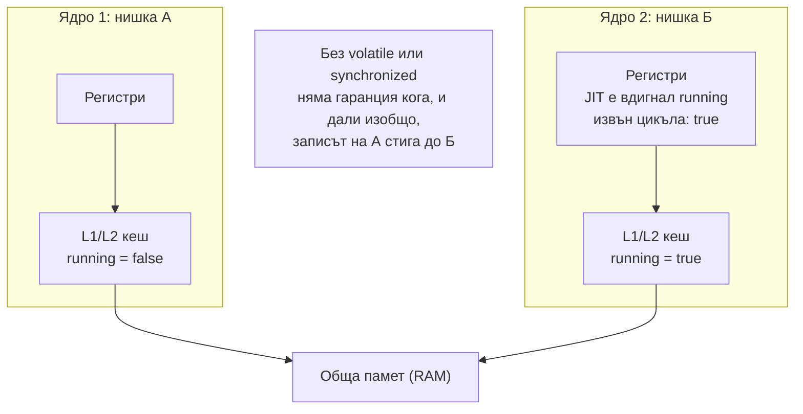
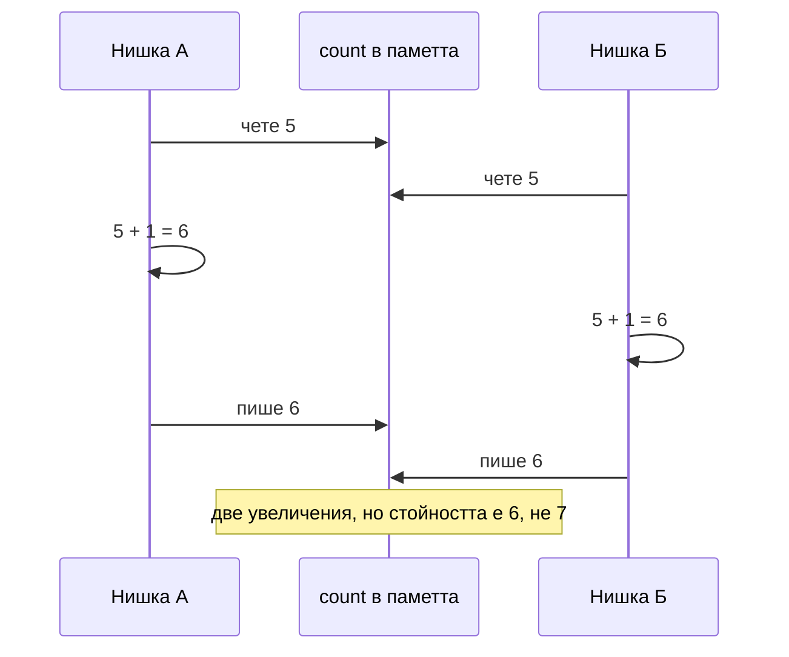

# Java Memory Model

Java Memory Model (JMM) определя кога запис, направен от една нишка, е гарантирано видим за друга. Без синхронизация няма такава гаранция: процесорът държи стойности в кеша си и в регистри, а компилаторът и JIT могат да преподреждат и дори да премахват четения. JMM дава правилата happens-before: ако действие A happens-before действие B, всичко записано преди A е видимо в B. `volatile`, `synchronized`, `Lock`, `Thread.start()` и `join()` създават такива връзки.

## 1. За какво се ползва и защо ни е нужен

Конкурентните бъгове са най-трудните: не се възпроизвеждат локално, появяват се само под натоварване и само на някои машини. Има три отделни проблема, които JMM адресира:

- **Видимост:** нишка Б не вижда записа на нишка А (флаг за спиране, който никога не "пристига").
- **Атомарност:** `count++` е три операции (прочети, увеличи, запиши) и две нишки губят обновявания.
- **Подредба:** записите изглеждат в друг ред за друга нишка (полуинициализиран обект в double-checked locking).

На интервю питат: какво прави `volatile` и какво не прави, разликата с `synchronized`, happens-before, race condition, защо double-checked locking иска `volatile`.

## 2. Защо нишките не виждат промените



## 3. Happens-before правилата

| Правило | Значение |
|---|---|
| Програмен ред | В една нишка всяко действие happens-before следващото |
| Монитор | `unlock` на монитор happens-before всеки следващ `lock` на същия монитор (`synchronized`) |
| `volatile` | Запис във `volatile` поле happens-before всяко следващо четене на същото поле |
| Старт на нишка | `t.start()` happens-before всичко в `t` |
| Край на нишка | Всичко в `t` happens-before връщането от `t.join()` |
| Транзитивност | A hb B и B hb C ⇒ A hb C |
| `final` полета | Правилно конструиран обект: `final` полетата му са видими за всички нишки без синхронизация |
| `java.util.concurrent` | Поставяне в `BlockingQueue`, `ConcurrentHashMap`, `Future.get` и т.н. създават hb връзки |

Транзитивността е ключът: ако нишка А запише обикновено поле и после `volatile` флаг, а нишка Б прочете флага и после обикновеното поле, Б вижда и обикновеното поле.

## 4. Видимост: volatile

```java Visibility.java
public class Visibility {
    static boolean running = true;              // без volatile
    static volatile boolean runningV = true;    // с volatile

    public static void main(String[] args) throws Exception {
        Thread t1 = new Thread(() -> { long n = 0; while (running) n++; System.out.println("без volatile: спря"); });
        Thread t2 = new Thread(() -> { long n = 0; while (runningV) n++; System.out.println("с volatile: спря"); });
        t1.setDaemon(true);
        t1.start(); t2.start();
        Thread.sleep(500);                       // JIT компилира цикъла и "вдига" четенето на running
        running = false;
        runningV = false;
        t2.join();
        t1.join(2_000);
        System.out.println("нишката без volatile жива ли е след 2 s: " + t1.isAlive());
    }
}
// с volatile: спря
// нишката без volatile жива ли е след 2 s: true      <- никога няма да спре
```

JIT вижда, че в цикъла никой не пише в `running`, и има право да го прочете веднъж, извън цикъла. `volatile` забранява тази оптимизация и гарантира, че всяко четене вижда последния запис.

## 5. Атомарност: synchronized и atomics

```java Counter.java
import java.util.concurrent.atomic.AtomicInteger;

public class Counter {
    static int plain = 0;
    static int locked = 0;
    static final AtomicInteger atomic = new AtomicInteger();
    static synchronized void incLocked() { locked++; }

    public static void main(String[] args) throws Exception {
        Runnable work = () -> {
            for (int i = 0; i < 1_000_000; i++) { plain++; incLocked(); atomic.incrementAndGet(); }
        };
        Thread a = new Thread(work), b = new Thread(work);
        a.start(); b.start(); a.join(); b.join();
        System.out.println("plain++:      " + plain);
        System.out.println("synchronized: " + locked);
        System.out.println("AtomicInteger: " + atomic.get());
    }
}
// plain++:      1999954     <- изгубени обновявания (числото варира)
// synchronized: 2000000
// AtomicInteger: 2000000
```



`volatile int count` не помага тук: гарантира видимост, но `count++` остава три отделни стъпки. Трябва взаимно изключване (`synchronized`, `Lock`) или атомарна операция (`AtomicInteger`, `LongAdder`).

## 6. volatile срещу synchronized

| | `volatile` | `synchronized` |
|---|---|---|
| Видимост | Да | Да |
| Атомарност на съставни операции | Не (само на едно четене или запис) | Да |
| Блокиране | Никога | Нишките чакат монитора |
| Забранява преподреждане около себе си | Да | Да |
| Кога | Флаг, публикуване на неизменим обект, double-checked locking | Съставни операции върху споделено състояние |

## 7. Double-checked locking

```java Singleton.java
public class Singleton {
    private static volatile Singleton instance;   // без volatile: друга нишка може да види полуконструиран обект

    private final String config;
    private Singleton() { config = "зареден"; }

    static Singleton get() {
        Singleton local = instance;               // едно volatile четене в бързия път
        if (local == null) {
            synchronized (Singleton.class) {
                local = instance;
                if (local == null) instance = local = new Singleton();
            }
        }
        return local;
    }

    public static void main(String[] args) {
        System.out.println(get().config + " " + (get() == get()));   // зареден true
    }
}
```

`instance = new Singleton()` е три стъпки: заделяне на памет, конструктор, присвояване. Без `volatile` процесорът може да направи присвояването преди конструктора и друга нишка да види ненулев, но неинициализиран обект. По-просто и също толкова бързо е holder идиомът (`private static class Holder { static final Singleton I = new Singleton(); }`) или enum singleton.

## 8. Въпроси на интервю

### Какво прави `volatile`?

Гарантира видимост (всяко четене вижда последния запис от която и да е нишка) и забранява преподреждането на операции около volatile достъпа. Записът във volatile поле happens-before следващото четене. Не прави съставни операции (`count++`, check-then-act) атомарни.

### Каква е разликата между `volatile` и `synchronized`?

`volatile` дава видимост и подредба за едно поле, без блокиране. `synchronized` дава взаимно изключване (само една нишка в блока), видимост за всичко записано в блока и атомарност на съставни операции, срещу цената на чакането.

### Какво е happens-before?

Отношение между две действия, което гарантира, че резултатите от първото са видими за второто. Създава се от програмния ред в една нишка, освобождаване и придобиване на монитор, запис и четене на volatile, `start` и `join`, и класовете от `java.util.concurrent`. Транзитивно е.

### Какво е race condition?

Резултатът зависи от реда, в който нишките се изпълняват. Класически форми: read-modify-write (`count++`) и check-then-act (`if (!map.containsKey(k)) map.put(k, v)`). Решава се с атомарни операции (`computeIfAbsent`, `AtomicInteger`) или с lock около цялата съставна операция.

### Защо неизменимите обекти са thread-safe?

Състоянието им не се променя след конструирането, а `final` полетата имат специална гаранция в JMM: щом конструкторът приключи (и `this` не е изтекло по време на него), всяка нишка вижда правилните им стойности без синхронизация.

## 9. Капани и чести грешки

- Флаг за спиране без `volatile`.
- `volatile` за брояч.
- Синхронизация на четенето, но не и на записа (или обратното): и двете трябва да ползват същия lock.
- `synchronized` върху различни обекти в различни методи, които пазят едно и също състояние.
- Изтичане на `this` от конструктора (регистриране като listener, стартиране на нишка): другите нишки виждат полуконструиран обект.
- Double-checked locking без `volatile`.

## 10. Свързани документи

- [Нишки и жизнен цикъл](Threads.md)
- [Locks, atomics, конкурентни колекции](Locks_Atomics.md)
- [ExecutorService и CompletableFuture](Executors.md)
- [Virtual threads](Virtual_Threads.md)
