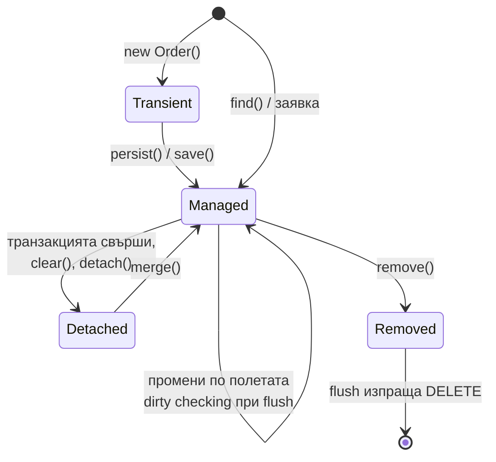
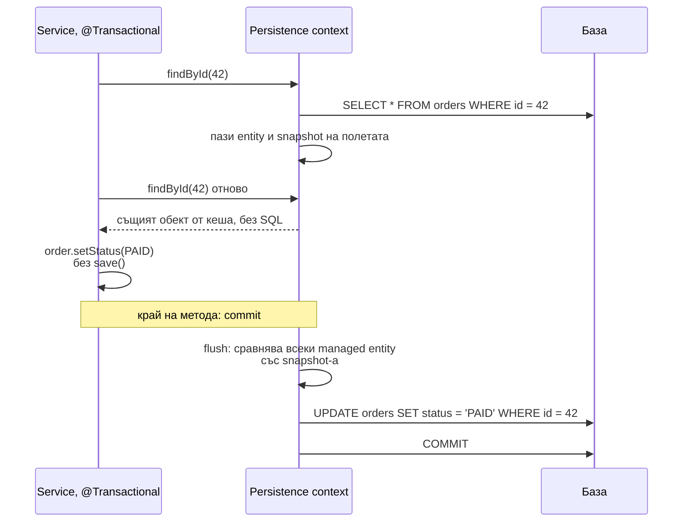
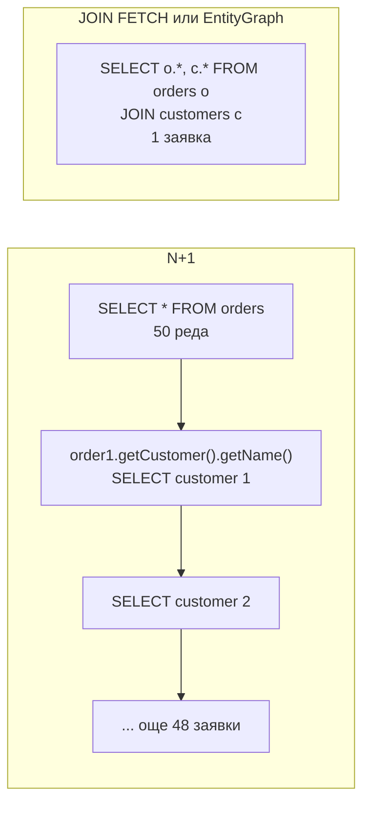

# JPA и Hibernate

JPA е стандартният API за ORM в Java (`EntityManager`, `@Entity`, JPQL), а Hibernate е най-разпространената му имплементация и това, което Spring Data JPA ползва отдолу. Сърцето на Hibernate е persistence context: кеш на entities за текущата транзакция. Всеки entity, зареден в него, е "managed": Hibernate пази копие на първоначалното му състояние и при flush сравнява и генерира `UPDATE` само за променените (dirty checking). Връзките между entities могат да се зареждат мързеливо (lazy) чрез proxies, което е и основният източник на проблема N+1.

## 1. За какво се ползва и защо ни е нужен

JPA спестява ръчния SQL и mapping за типичния CRUD, но поведението му е неочевидно и води до най-честите производителни проблеми в Spring приложения:

- страница с 50 поръчки прави 51 заявки (N+1);
- `LazyInitializationException` при сериализация на отговора;
- промяна по entity се записва в базата без извикване на `save`;
- `OutOfMemoryError` при обработка на голяма таблица, защото persistence context-ът държи всичко.

На интервю питат: persistence context и състоянията на entity, dirty checking, lazy срещу eager, N+1 и как се решава, Open Session in View, `equals`/`hashCode` на entities.

## 2. Състояния на entity



| Състояние | В persistence context | Промени се записват |
|---|---|---|
| Transient | Не | Не, обикновен обект |
| Managed | Да | Да, автоматично при flush |
| Detached | Не (контекстът е затворен) | Не, освен след `merge` |
| Removed | Да, маркиран за изтриване | `DELETE` при flush |

## 3. Persistence context и dirty checking



Persistence context е и first-level кеш: в рамките на транзакцията един ред от базата е точно един Java обект (`find` два пъти връща `==` обекти). Flush става преди commit, преди JPQL заявка, която може да засегне променените таблици, и при ръчно `flush()`.

## 4. N+1

```java Order.java
@Entity
@Table(name = "orders")
public class Order {
    @Id @GeneratedValue(strategy = GenerationType.SEQUENCE)
    private Long id;

    @ManyToOne(fetch = FetchType.LAZY)              // по подразбиране за @ManyToOne е EAGER: смени го
    private Customer customer;

    @OneToMany(mappedBy = "order", cascade = CascadeType.ALL, orphanRemoval = true)
    private List<OrderLine> lines = new ArrayList<>();   // @OneToMany е LAZY по подразбиране

    @Version
    private long version;                            // оптимистично заключване

    // getters...
}
```

```java OrderRepository.java
public interface OrderRepository extends JpaRepository<Order, Long> {

    // N+1: 1 заявка за поръчките + 1 за клиента на всяка поръчка при достъп до order.getCustomer()
    List<Order> findByStatus(Status status);

    // Решение 1: JOIN FETCH в една заявка
    @Query("select o from Order o join fetch o.customer where o.status = :status")
    List<Order> findWithCustomerByStatus(Status status);

    // Решение 2: EntityGraph, без да пишеш JPQL
    @EntityGraph(attributePaths = {"customer", "lines"})
    List<Order> findAllByCustomerId(Long customerId);

    // Решение 3: проекция в DTO: само нужните колони, без managed entities
    @Query("select new com.acme.order.OrderRow(o.id, c.name, o.total) from Order o join o.customer c")
    List<OrderRow> listRows();
}
```



Други варианти: `@BatchSize(size = 50)` или `hibernate.default_batch_fetch_size`, при които lazy колекциите се зареждат на пакети с `IN (...)`. При `JOIN FETCH` на две колекции едновременно резултатът е декартово произведение (и `MultipleBagFetchException` за два `List`): зареждай колекциите с отделни заявки.

## 5. Lazy loading и Open Session in View

Lazy асоциация е proxy (за `@ManyToOne`) или `PersistentBag` (за колекции), който прави заявка при първия достъп. Ако persistence context-ът вече е затворен (транзакцията е свършила), достъпът хвърля `LazyInitializationException`.

Spring Boot по подразбиране включва `spring.jpa.open-in-view=true`: persistence context-ът остава отворен до края на HTTP заявката, така че lazy loading работи и в контролера и при JSON сериализацията. Затова Spring Boot пише warning при старт. Проблемите: връзката към базата се държи по-дълго, а заявки се правят скрито при сериализацията (често N+1). Препоръката е `open-in-view=false` и явно зареждане на нужните данни в service слоя, с DTO на изхода.

## 6. Въпроси на интервю

### Какво е persistence context?

Множеството от managed entities за текущата сесия (обикновено транзакция). Работи като first-level кеш (един ред е един обект), следи промените (dirty checking) и ги записва при flush. Затваря се с транзакцията (или с HTTP заявката при Open Session in View).

### Какво е dirty checking?

При зареждане Hibernate пази snapshot на полетата на entity-то. При flush сравнява текущите стойности със snapshot-а и генерира `UPDATE` за променените. Затова промяна по managed entity се записва без `save()`, а `readOnly = true` пести памет и време, като изключва този механизъм.

### Какво е проблемът N+1 и как го решаваш?

Една заявка зарежда N реда, а после достъпът до lazy асоциация на всеки ред прави още по една заявка: общо N+1. Решения: `JOIN FETCH` в JPQL, `@EntityGraph`, batch fetching (`@BatchSize`), или проекция в DTO. Откриване: логване на SQL (`spring.jpa.show-sql` или datasource-proxy) и броене на заявките в тестове.

### Lazy или eager?

Lazy по подразбиране за всички асоциации, включително `@ManyToOne` и `@OneToOne` (които JPA прави eager по подразбиране). Eager зарежда винаги, дори когато не ти трябва, и не може да се "изключи" за конкретна заявка. Зареждането на нужното се решава на ниво заявка с fetch join или entity graph.

### Как пишеш `equals` и `hashCode` за entity?

Не по всички полета (lazy колекции, изменими полета) и не по генерирания id, ако той е `null` преди persist (обектът сменя hashCode след запис и се губи от `HashSet`). Варианти: по естествен бизнес ключ (имейл, ISBN), или по id с `hashCode`, който връща константа за класа (`getClass().hashCode()`), и `equals`, който сравнява id само ако не е `null`. Records не стават за entities.

### Каква е разликата между `persist` и `merge`?

`persist` прави transient обект managed (същия обект). `merge` копира състоянието на detached обект в managed копие и връща копието: подаденият обект остава detached. Spring Data `save` вика `persist` за нови и `merge` за съществуващи entities.

## 7. Капани и чести грешки

- `@ManyToOne` без `fetch = LAZY`.
- N+1 в списъчни endpoints.
- Връщане на entities от контролера вместо DTO: lazy loading при сериализация, безкрайна рекурсия при двупосочни връзки, изтичане на полета.
- `open-in-view=true` в production.
- `GenerationType.IDENTITY` изключва batch insert в Hibernate. За масови записи ползвай `SEQUENCE`.
- Зареждане на 1 милион entities в една транзакция: persistence context-ът ги държи всичките. Ползвай pagination, `Stream` с `clear()` на порции или JDBC.
- Lombok `@Data` или `@EqualsAndHashCode` върху entity.
- `findAll()` и филтриране в Java вместо в заявката.

## 8. Свързани документи

- [@Transactional отвътре](Spring_Transactions.md)
- [equals, hashCode, Comparable](Equals_HashCode.md)
- [Пътят на HTTP заявката](Spring_MVC.md)
- [Памет и Garbage Collection](Memory_GC.md)
