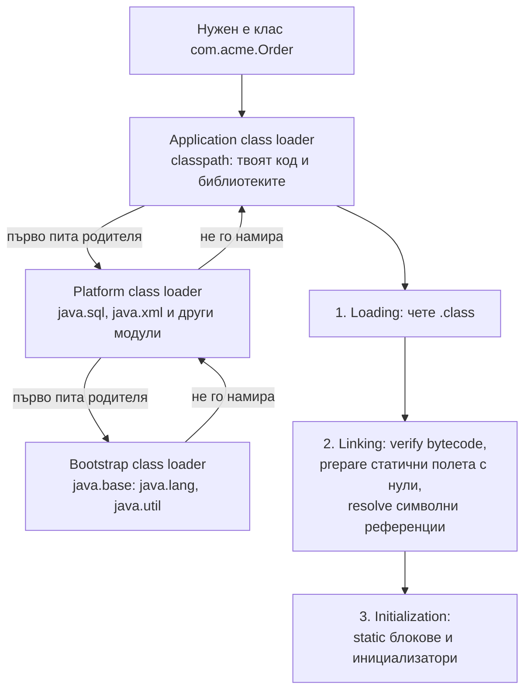

# JVM, bytecode и JIT

Java кодът не се компилира директно до машинен код. `javac` го превръща в bytecode (`.class` файлове), който е еднакъв за всяка платформа. Java Virtual Machine (JVM) зарежда bytecode-а, проверява го и го изпълнява: в началото с интерпретатор, а често изпълняваните методи компилира по време на работа до оптимизиран машинен код с JIT (just-in-time) компилатор. Оттам идва "write once, run anywhere" и оттам идва warm-up времето на Java приложенията.

## 1. За какво се ползва и защо ни е нужен

Разбирането на JVM обяснява поведение, което виждаш всеки ден в production:

- защо Spring Boot приложение стартира за секунди, а първите заявки са по-бавни от следващите (class loading и JIT warm-up);
- защо `ClassNotFoundException` и `NoClassDefFoundError` са различни грешки;
- защо един и същ `.jar` работи на Linux, macOS и Windows;
- защо GraalVM native image стартира за милисекунди, но има ограничения с reflection.

На интервю почти винаги питат за разликата JDK/JRE/JVM, как работи class loading и какво е JIT.

## 2. От изходен код до изпълнение

```mermaid
flowchart LR
    SRC["Order.java"] --> JAVAC["javac<br/>компилатор"]
    JAVAC --> BC["Order.class<br/>bytecode"]
    BC --> JAR["app.jar"]
    JAR --> CL["Class loader<br/>зарежда, проверява,<br/>свързва, инициализира"]
    CL --> INT["Интерпретатор<br/>изпълнява bytecode<br/>инструкция по инструкция"]
    INT -- "методът е горещ:<br/>броячът на извикванията<br/>минава праг" --> C1["C1 JIT<br/>бърза компилация,<br/>малко оптимизации"]
    C1 -- "още по-горещ,<br/>с профил" --> C2["C2 JIT<br/>агресивни оптимизации:<br/>inlining, escape analysis"]
    C2 -- "предположение се оказва<br/>грешно" --> DEOPT["Deoptimization<br/>обратно към интерпретатора"]
    DEOPT --> INT
```



## 3. JDK, JRE, JVM

| | Какво съдържа | Кога |
|---|---|---|
| JVM | Виртуалната машина: class loader, execution engine (интерпретатор и JIT), garbage collector | Изпълнява bytecode |
| JRE | JVM + стандартната библиотека (`java.*`) | Само изпълнение. От Java 11 не се разпространява отделно: правиш собствен runtime с `jlink` |
| JDK | JRE + инструменти: `javac`, `jar`, `jshell`, `jcmd`, `jfr`, `jlink` | Разработка и build |

Имплементации на JVM: HotSpot (OpenJDK, Oracle, Temurin, Corretto са build-ове на него), OpenJ9, GraalVM.

## 4. Class loading



- **Parent delegation:** class loader-ът първо пита родителя си. Така никой не може да подмени `java.lang.String` със собствен клас.
- **Мързеливо:** класът се зарежда при първа употреба, не при старта. Затова първата заявка към нов endpoint е по-бавна.
- **Идентичност:** клас се идентифицира по име и по class loader-а, който го е заредил. Един и същ клас, зареден от два loader-а, дава `ClassCastException` между "еднакви" типове (класически проблем при hot reload и application сървъри).
- **Инициализация:** `static` блоковете се изпълняват веднъж, thread-safe, при първото активно използване на класа.

| Грешка | Значение |
|---|---|
| `ClassNotFoundException` | Checked. Кодът изрично търси клас по име (`Class.forName`) и той не е на classpath |
| `NoClassDefFoundError` | Error. Класът е бил наличен при компилация, но липсва при изпълнение, или статичната му инициализация е гръмнала по-рано |

## 5. JIT

JVM брои извикванията на всеки метод и итерациите на циклите. Горещият код минава през нива (tiered compilation): интерпретатор, C1 (бърза компилация), C2 (бавна, но силно оптимизираща, с профила от реалното изпълнение). Основни оптимизации на C2:

- **Inlining:** тялото на малък метод се вгражда на мястото на извикването. Getters и setters практически нямат цена.
- **Escape analysis:** обект, който не "излиза" от метода, може изобщо да не се създаде в heap-а.
- **Спекулативни оптимизации:** ако даден interface досега винаги е имал една имплементация, извикването става директно. Ако се появи втора, кодът се деоптимизира.

Затова benchmark на Java код без warm-up лъже, и затова се ползва JMH.

## 6. Минимален пример

```java Main.java
public class Main {
    static {
        System.out.println("1. static блок: класът се инициализира");   // веднъж, при първа употреба
    }

    static long work(int n) {
        long sum = 0;
        for (int i = 0; i < n; i++) sum += i % 7;
        return sum;
    }

    public static void main(String[] args) {
        System.out.println("2. main");
        for (int round = 1; round <= 5; round++) {
            long start = System.nanoTime();
            work(5_000_000);
            System.out.printf("кръг %d: %.2f ms%n", round, (System.nanoTime() - start) / 1e6);
        }
    }
}
// java Main.java           -> всеки кръг ~2-4 ms: JIT компилира цикъла още в първия кръг (OSR)
// java -Xint Main.java     -> всеки кръг ~20 ms: само интерпретатор, без JIT
// Разликата (около 8 пъти на този код) е това, което JIT дава.
// java -XX:+PrintCompilation Main.java показва кога и на кое ниво се компилира всеки метод.
```

## 7. Въпроси на интервю

### Каква е разликата между JDK, JRE и JVM?

JVM изпълнява bytecode. JRE е JVM плюс стандартната библиотека, достатъчно за изпълнение. JDK е JRE плюс инструментите за разработка (`javac`, `jar`, `jcmd`). От Java 11 отделен JRE няма; минимален runtime се прави с `jlink`.

### Какво е bytecode и защо Java е платформено независима?

Bytecode е набор от инструкции за стекова виртуална машина, генериран от `javac`. Той е еднакъв навсякъде. Платформено зависима е JVM: всяка ОС има своя, която превежда bytecode-а до машинен код за конкретния процесор.

### Как работи class loading?

Три фази: loading (четене на `.class`), linking (verification, preparation, resolution) и initialization (static блокове). Class loader-ите са йерархия (bootstrap, platform, application) и използват parent delegation: първо пита родителя. Класовете се зареждат мързеливо, при първа употреба.

### Какво е JIT и защо Java приложенията имат warm-up?

JIT компилира горещите методи до машинен код по време на изпълнение, използвайки профила на реалното поведение. Преди това кодът се изпълнява от интерпретатора, който е много по-бавен. Затова първите минути след старт латентността е по-висока. Решения: warm-up заявки преди да се приема трафик, CDS/AOT кеш (по-бърз старт), GraalVM native image (компилация предварително, без JIT).

### Какво е GraalVM native image?

Ahead-of-time компилация на приложението до самостоятелен изпълним файл. Стартира за милисекунди и ползва по-малко памет, но изисква предварително да се знае всичко, което се ползва с reflection, и няма JIT оптимизации по време на работа. Spring Boot 3 го поддържа с AOT обработка.

## 8. Капани и чести грешки

- Benchmark без warm-up и без JMH.
- Конфликт на версии на библиотека на classpath (две версии на един jar): `NoSuchMethodError` в runtime.
- Тежка логика в `static` блок: грешка там прави класа неизползваем (`ExceptionInInitializerError`, после `NoClassDefFoundError`).
- Очакване, че Docker контейнер с Java е готов веднага след старт. Readiness probe трябва да чака warm-up.
- Компилиране за нова версия (`--release 21`) и пускане на по-стара JVM: `UnsupportedClassVersionError`.

## 9. Свързани документи

- [Памет и Garbage Collection](Memory_GC.md)
- [Стартиране и auto-configuration](Spring_Boot_Startup.md)
- [Типове, boxing и String](Types_Strings.md)
