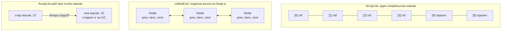
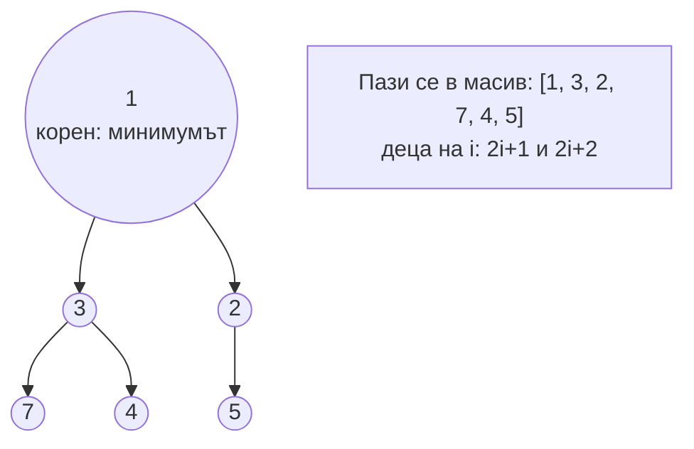

# ArrayList, LinkedList, Deque, PriorityQueue

`ArrayList` е динамичен масив: елементите са последователно в паметта, достъпът по индекс е O(1), а когато масивът се напълни, се заделя нов, около 1.5 пъти по-голям, и данните се копират. `LinkedList` е двойно свързан списък: всеки елемент е отделен възел с указатели към съседите. `ArrayDeque` е кръгов масив, най-добрият избор за стек и опашка. `PriorityQueue` е binary heap: винаги дава най-малкия (или най-приоритетния) елемент за O(log n).

## 1. За какво се ползва и защо ни е нужен

"ArrayList или LinkedList" е класически въпрос, а верният отговор изненадва: почти винаги `ArrayList`. Теоретичното предимство на `LinkedList` (O(1) вмъкване в средата) рядко се реализира, защото първо трябва да стигнеш до средата (O(n)), а разпилените в паметта възли са бавни за процесорния кеш.

Практически:

- списък от резултати, DTO, страница от базата: `ArrayList`;
- стек (undo, DFS) и опашка (BFS, задачи): `ArrayDeque`;
- "дай ми следващата най-спешна задача", top-K, планиране, алгоритъм на Дейкстра: `PriorityQueue`;
- опашка между нишки: `BlockingQueue` (виж [ExecutorService и CompletableFuture](Executors.md)).

## 2. Масив срещу свързан списък в паметта



| Операция | `ArrayList` | `LinkedList` | `ArrayDeque` |
|---|---|---|---|
| `get(i)` | O(1) | O(n) | Няма достъп по индекс |
| `add` в края | O(1) амортизирано | O(1) | O(1) амортизирано |
| `add` / `remove` в началото | O(n): мести всички | O(1) | O(1) |
| `add` / `remove` в средата | O(n) | O(n) за намиране + O(1) | Няма |
| Памет на елемент | Една референция (4-8 байта) | Възел: около 24-40 байта | Една референция |
| Кеш на процесора | Отличен: последователна памет | Лош: указатели из heap-а | Отличен |

`ArrayList` расте с около 50% (`newCapacity = old + old >> 1`). Ако знаеш размера, подай го в конструктора: `new ArrayList<>(n)`.

## 3. PriorityQueue: binary heap



- `offer`: добавя в края на масива и "изплува" нагоре, докато родителят е по-малък. O(log n).
- `poll`: взема корена, слага последния елемент на негово място и го "потопява". O(log n).
- `peek`: O(1).
- Итерирането **не** е в сортиран ред: само коренът е гарантирано най-малкият.

## 4. Минимален пример

```java ListsQueues.java
import java.util.*;

public class ListsQueues {
    record Task(String name, int priority) {}

    public static void main(String[] args) {
        // ArrayDeque като стек (LIFO) и като опашка (FIFO)
        Deque<String> stack = new ArrayDeque<>();
        stack.push("a"); stack.push("b"); stack.push("c");
        System.out.println(stack.pop() + stack.pop());          // cb

        Deque<String> queue = new ArrayDeque<>();
        queue.offer("first"); queue.offer("second");
        System.out.println(queue.poll());                        // first

        // PriorityQueue с comparator: по-голям приоритет първи
        PriorityQueue<Task> tasks = new PriorityQueue<>(Comparator.comparingInt(Task::priority).reversed());
        tasks.add(new Task("логове", 1));
        tasks.add(new Task("плащане", 10));
        tasks.add(new Task("имейл", 5));
        while (!tasks.isEmpty()) System.out.print(tasks.poll().name() + " ");   // плащане имейл логове
        System.out.println();

        // Top-3 най-големи числа с min-heap с размер 3: O(n log k)
        PriorityQueue<Integer> top = new PriorityQueue<>();
        for (int x : new int[]{5, 1, 9, 3, 7, 8, 2}) {
            top.offer(x);
            if (top.size() > 3) top.poll();                      // изхвърля най-малкия
        }
        System.out.println(top.stream().sorted(Comparator.reverseOrder()).toList());   // [9, 8, 7]

        // Капан: remove(int) срещу remove(Object)
        List<Integer> nums = new ArrayList<>(List.of(10, 20, 30));
        nums.remove(1);                                          // по индекс: маха 20
        nums.remove(Integer.valueOf(10));                        // по стойност: маха 10
        System.out.println(nums);                                // [30]
    }
}
```

## 5. Въпроси на интервю

### Кога `LinkedList` е по-добър от `ArrayList`?

Рядко. На теория при много вмъквания и премахвания в началото или чрез итератор в средата. На практика `ArrayList` печели почти навсякъде заради последователната памет, а за опашка и стек `ArrayDeque` е по-бърз от `LinkedList`. `LinkedList` ползва много повече памет на елемент.

### Как расте `ArrayList`?

Започва с празен масив и при първото добавяне заделя 10 места. Когато се напълни, създава нов масив около 1.5 пъти по-голям и копира елементите. Добавянето в края е O(1) амортизирано: рядко скъпо копиране, разпределено върху много евтини добавяния.

### Защо `ArrayDeque` вместо `Stack`?

`Stack` наследява `Vector`: всички методи са `synchronized` (ненужна цена) и позволява достъп по индекс, което чупи абстракцията на стек. `ArrayDeque` е по-бърз и с ясен API (`push`, `pop`, `peek`). Не приема `null`.

### Как работи `PriorityQueue`?

Binary heap в масив: всеки родител е по-малък или равен на децата си (за min-heap). Добавянето и вземането на корена са O(log n), `peek` е O(1). Не е thread-safe; за нишки има `PriorityBlockingQueue`.

### Как намираш top-K елемента от голям поток?

Min-heap с размер K: добавяш всеки елемент и ако размерът стане K+1, махаш най-малкия. Накрая в heap-а са K-те най-големи. O(n log K) време, O(K) памет.

## 6. Капани и чести грешки

- `list.remove(i)` при `List<Integer>`: маха по индекс, не по стойност.
- `LinkedList.get(i)` в цикъл: O(n²).
- Итериране на `PriorityQueue` с очакване за сортиран ред.
- `Stack` и `Vector` в нов код.
- `ArrayList` без начален капацитет при известен голям размер.
- `subList` е изглед: структурна промяна на оригинала го прави невалиден.

## 7. Свързани документи

- [Collections Framework](Collections.md)
- [HashMap отвътре](HashMap.md)
- [Lambdas, Streams, Optional](Streams.md)
- [ExecutorService и CompletableFuture](Executors.md)
