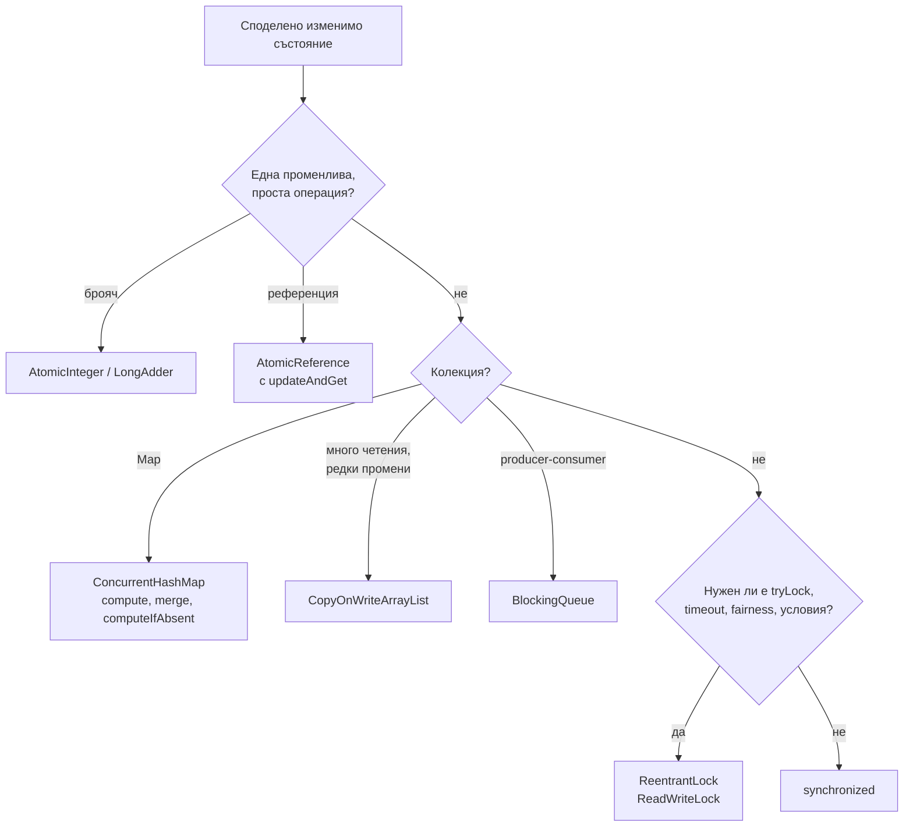
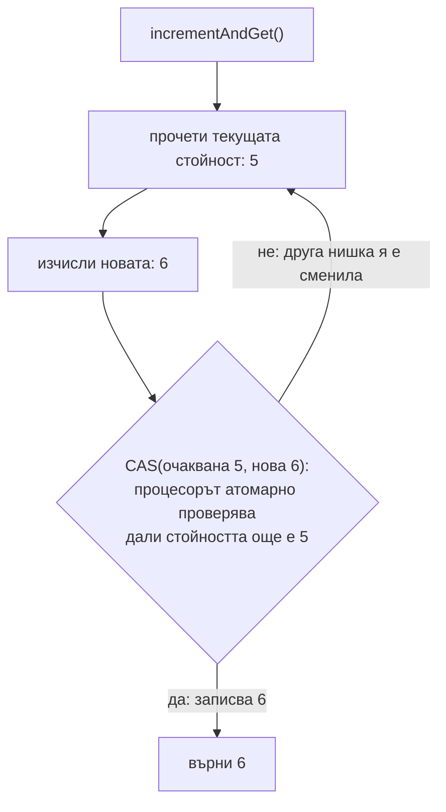
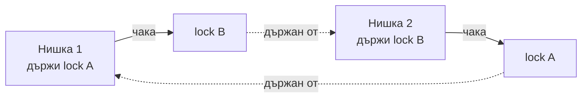

# Locks, atomics, конкурентни колекции

Пакетът `java.util.concurrent` дава по-гъвкави инструменти от `synchronized`. `ReentrantLock` е явна ключалка с `tryLock`, timeout и прекъсваемо чакане. Атомичните класове (`AtomicInteger`, `AtomicReference`, `LongAdder`) правят единични операции атомарни без блокиране, чрез хардуерната инструкция compare-and-swap (CAS). Конкурентните колекции (`ConcurrentHashMap`, `CopyOnWriteArrayList`, `BlockingQueue`) са безопасни за споделяне между нишки и дават атомарни съставни операции като `computeIfAbsent` и `merge`.

## 1. За какво се ползва и защо ни е нужен

В Spring приложение споделено изменимо състояние се появява в кешове в паметта, броячи и rate limiters, registry-та на сесии и WebSocket връзки, ограничаване на паралелни извиквания към външна система. Грешният инструмент води до изгубени записи, `ConcurrentModificationException`, deadlock или сериализиране на всички заявки върху една ключалка.

На интервю питат: `synchronized` срещу `ReentrantLock`, какво е CAS, как работи `ConcurrentHashMap`, какво е deadlock и как се избягва.

## 2. Кой инструмент



## 3. synchronized срещу ReentrantLock

| | `synchronized` | `ReentrantLock` |
|---|---|---|
| Освобождаване | Автоматично при изход от блока | Ръчно, задължително във `finally` |
| `tryLock` / timeout | Не | `tryLock()`, `tryLock(1, SECONDS)` |
| Прекъсваемо чакане | Не | `lockInterruptibly()` |
| Fairness | Не | `new ReentrantLock(true)`: по реда на чакане |
| Няколко условия | Едно (`wait`/`notify`) | Много `Condition` обекта |
| Reentrant | Да | Да |
| Virtual threads | В Java 21 pin-ва carrier нишката, оправено в Java 24 | Не pin-ва |

`ReadWriteLock` позволява много едновременни читатели или един писател: полезно, когато четенията са много повече от записите и са бавни.

## 4. CAS: как работят atomics



CAS е една процесорна инструкция (`CMPXCHG` на x86), която записва новата стойност само ако текущата е равна на очакваната. Ако не е, операцията се повтаря. Няма блокиране и превключване на нишки, затова при малка конкуренция е много по-бързо от lock. При голяма конкуренция (много нишки, един брояч) повторенията стават скъпи: `LongAdder` разпределя брояча в няколко клетки и ги сумира при четене.

## 5. ConcurrentHashMap

От Java 8 `ConcurrentHashMap` няма глобален lock. Празна кофа се попълва с CAS. Непразна кофа се заключва с `synchronized` само върху първия ѝ възел, така че нишки, работещи в различни кофи, не си пречат. Четенията изобщо не заключват. Resize се прави постепенно и нишките, които пишат по време на resize, помагат с преместването.

Особености: не приема `null` ключове и стойности (иначе `get` → `null` е двусмислено: липсва или е `null`), итераторите не хвърлят `ConcurrentModificationException`, а `size()` е приблизителен при едновременни промени.

## 6. Минимален пример

```java ConcurrencyTools.java
import java.util.*;
import java.util.concurrent.*;
import java.util.concurrent.atomic.LongAdder;
import java.util.concurrent.locks.ReentrantLock;

public class ConcurrencyTools {
    public static void main(String[] args) throws Exception {
        List<String> words = new ArrayList<>();
        for (int i = 0; i < 100_000; i++) words.add("w" + (i % 10));

        // Check-then-act с HashMap и get/put: губи обновявания и може да повреди картата
        Map<String, Integer> unsafe = new HashMap<>();
        // Атомарни операции с ConcurrentHashMap
        ConcurrentHashMap<String, LongAdder> safe = new ConcurrentHashMap<>();

        try (ExecutorService pool = Executors.newFixedThreadPool(8)) {
            for (int t = 0; t < 8; t++) {
                pool.submit(() -> {
                    for (String w : words) {
                        unsafe.put(w, unsafe.getOrDefault(w, 0) + 1);          // race condition
                        safe.computeIfAbsent(w, k -> new LongAdder()).increment();
                    }
                });
            }
        }
        long unsafeTotal = unsafe.values().stream().mapToLong(Integer::longValue).sum();
        long safeTotal = safe.values().stream().mapToLong(LongAdder::sum).sum();
        System.out.println("HashMap: " + unsafeTotal + ", ConcurrentHashMap: " + safeTotal + " (очаквано 800000)");

        // tryLock с timeout: избягва вечно чакане
        ReentrantLock lock = new ReentrantLock();
        lock.lock();
        Thread other = new Thread(() -> {
            try {
                if (lock.tryLock(200, TimeUnit.MILLISECONDS)) {
                    try { System.out.println("взех lock-а"); } finally { lock.unlock(); }
                } else {
                    System.out.println("tryLock: timeout, правя друго");
                }
            } catch (InterruptedException e) {
                Thread.currentThread().interrupt();
            }
        });
        other.start();
        other.join();
        lock.unlock();
    }
}
```

```text output
HashMap: 556858, ConcurrentHashMap: 800000 (очаквано 800000)
tryLock: timeout, правя друго
```

Броят при `HashMap` е различен при всяко пускане (при три пускания: 556858, 553030, 569895).

## 7. Deadlock



Четирите условия (Coffman): взаимно изключване, държане и чакане, невъзможност за отнемане, кръгово чакане. Премахни едно и deadlock е невъзможен. На практика:

- **Подредба на ключалките:** всички нишки взимат ключалките в един и същ глобален ред (например по id на сметката при превод).
- **`tryLock` с timeout:** при неуспех освобождаваш каквото държиш и опитваш отново.
- **По-малко ключалки:** един lock или конкурентна структура вместо няколко вложени.
- **Диагностика:** `jstack <pid>` или `jcmd <pid> Thread.print` откриват deadlock и показват кои нишки кои ключалки държат.

## 8. Въпроси на интервю

### Каква е разликата между `synchronized` и `ReentrantLock`?

И двете дават взаимно изключване и видимост и са reentrant. `ReentrantLock` добавя `tryLock` с timeout, прекъсваемо чакане, fairness и няколко `Condition`. Цената е ръчно `unlock()` във `finally`. За прост случай `synchronized` е по-четим.

### Какво е CAS?

Compare-and-swap: атомарна процесорна инструкция, която записва нова стойност само ако текущата е равна на очакваната. Atomic класовете я ползват в цикъл: прочети, изчисли, опитай CAS, повтори при неуспех. Няма блокиране, но при голяма конкуренция има много повторения.

### Как работи `ConcurrentHashMap` и защо е по-добър от `Collections.synchronizedMap`?

`synchronizedMap` слага един lock около всяка операция: всички нишки се редят. `ConcurrentHashMap` заключва само една кофа при запис (CAS за празна, `synchronized` на първия възел за непразна), а четенията не заключват. Освен това дава атомарни съставни операции: `computeIfAbsent`, `compute`, `merge`, `putIfAbsent`.

### Защо `ConcurrentHashMap` не приема `null`?

В конкурентна среда `get(k) == null` би било двусмислено: ключът липсва или стойността е `null`? При `HashMap` можеш да провериш с `containsKey`, но между двете извиквания друга нишка може да промени картата.

### Какво е deadlock и как го предотвратяваш?

Две или повече нишки чакат взаимно ключалки, които другата държи, и никоя не може да продължи. Предотвратява се с фиксирана глобална подредба на ключалките, `tryLock` с timeout, намаляване на вложените ключалки. Открива се с thread dump.

## 9. Капани и чести грешки

- `lock()` без `unlock()` във `finally`.
- `get` и после `put` върху `ConcurrentHashMap`: двете поотделно са безопасни, комбинацията не е. Ползвай `merge` или `compute`.
- Бавна или блокираща операция вътре в `computeIfAbsent`: заключва кофата (и може да даде deadlock при рекурсивно извикване върху същата карта).
- `CopyOnWriteArrayList` с много записи: всеки запис копира целия масив.
- Синхронизация върху `String` литерал или `Integer`: те са споделени в целия процес.
- Вложени ключалки в различен ред в различни методи.

## 10. Свързани документи

- [Java Memory Model](JMM.md)
- [HashMap отвътре](HashMap.md)
- [ExecutorService и CompletableFuture](Executors.md)
- [Virtual threads](Virtual_Threads.md)
