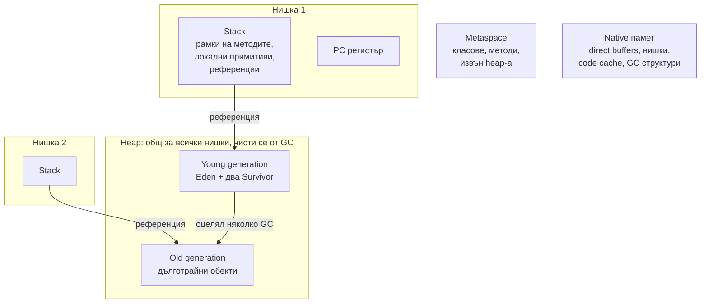
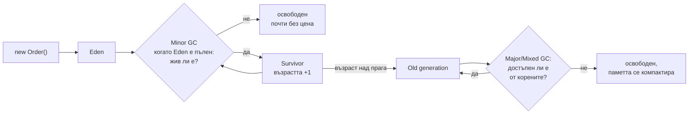

# Памет и Garbage Collection

JVM разделя паметта на няколко области. Всяка нишка има собствен stack с локалните променливи и рамките на извиканите методи. Всички обекти живеят в общ heap, който се чисти автоматично от garbage collector-а (GC). Метаданните на класовете са в metaspace, извън heap-а. GC освобождава обектите, до които няма път от "корените" (локални променливи на живите нишки, статични полета), и е организиран по поколения, защото повечето обекти умират млади.

## 1. За какво се ползва и защо ни е нужен

Java няма ръчно освобождаване на памет, но проблемите с паметта не изчезват, а се променят:

- `OutOfMemoryError: Java heap space`, когато кеш или списък расте без край;
- дълги GC паузи, които се виждат като p99 латентност от стотици милисекунди;
- контейнер, убит от Kubernetes с `OOMKilled`, въпреки че heap-ът не е пълен (паметта извън heap-а);
- `StackOverflowError` от безкрайна рекурсия.

На интервю питат: stack срещу heap, как работи GC, кои колектори има, какво е memory leak в Java и как се намира.

## 2. Областите на паметта



| Област | Какво съдържа | Грешка при препълване |
|---|---|---|
| Stack (на нишка) | Рамки на методи: локални примитиви, референции, return адрес | `StackOverflowError` |
| Heap | Всички обекти и масиви | `OutOfMemoryError: Java heap space` |
| Metaspace | Метаданни на класове | `OutOfMemoryError: Metaspace` (изтичане на class loaders) |
| Code cache | JIT компилиран код | JIT спира да компилира, warning в лога |
| Direct memory | `ByteBuffer.allocateDirect`, Netty | `OutOfMemoryError: Direct buffer memory` |

Обектът винаги е в heap-а (освен когато JIT го премахне чрез escape analysis). В stack-а е само референцията към него.

## 3. Как работи GC



Принципите:

1. **Достижимост:** GC маркира всичко достъпно от GC roots (локални променливи на активни нишки, статични полета, JNI референции). Останалото е боклук. Циклични референции не са проблем, за разлика от reference counting.
2. **Поколения:** повечето обекти умират млади. Младото поколение се чисти често, като се копират само живите (цената зависи от живите, не от мъртвите обекти).
3. **Stop-the-world:** част от фазите спират всички нишки на приложението. Модерните колектори правят повечето работа конкурентно, докато приложението работи.

## 4. Колекторите

| Колектор | Флаг | Характер | Кога |
|---|---|---|---|
| Serial | `-XX:+UseSerialGC` | Една нишка, спира всичко | Много малки heap-ове, едно CPU |
| Parallel | `-XX:+UseParallelGC` | Много нишки, спира всичко, максимален throughput | Batch обработка, където паузите нямат значение |
| G1 | `-XX:+UseG1GC` (по подразбиране от Java 9) | Heap-ът е на региони, цел за пауза (`MaxGCPauseMillis`, 200 ms) | Повечето сървърни приложения |
| ZGC | `-XX:+UseZGC` | Почти изцяло конкурентен, паузи под милисекунда, generational от Java 21 | Големи heap-ове, ниска латентност |
| Shenandoah | `-XX:+UseShenandoahGC` | Конкурентен, ниски паузи (не във всички дистрибуции) | Като ZGC |

## 5. Минимален пример: изтичане на памет

```java LeakDemo.java
import java.util.ArrayList;
import java.util.List;

public class LeakDemo {
    // Статичното поле е GC root: всичко в този списък живее, докато живее класът
    private static final List<byte[]> CACHE = new ArrayList<>();

    public static void main(String[] args) {
        for (int i = 1; ; i++) {
            CACHE.add(new byte[1024 * 1024]);          // 1 MB на итерация, никога не се маха
            if (i % 50 == 0) {
                Runtime rt = Runtime.getRuntime();
                long usedMb = (rt.totalMemory() - rt.freeMemory()) / 1024 / 1024;
                System.out.printf("%d MB добавени, използвани %d MB от максимум %d MB%n",
                        i, usedMb, rt.maxMemory() / 1024 / 1024);
            }
        }
    }
}
// java -Xmx128m -XX:+HeapDumpOnOutOfMemoryError LeakDemo.java
// 50 MB добавени, използвани 101 MB от максимум 128 MB
// ... после: java.lang.OutOfMemoryError: Java heap space
// и файл java_pid<PID>.hprof, който се отваря с Eclipse MAT или VisualVM
```

Типични изтичания в реални приложения: статични колекции и кешове без лимит, `ThreadLocal`, който не се чисти в thread pool, listeners, които не се дерегистрират, незатворени ресурси, `HashMap` с ключове с грешен `hashCode` (обектите не се намират и се трупат).

## 6. Настройки в контейнер

- `-Xmx` и `-Xms` задават максималния и началния heap. В контейнер по-добре `-XX:MaxRAMPercentage=75`: JVM чете лимита на контейнера (cgroups) и взема процент от него.
- Останалите 25% са за metaspace, stacks на нишките, code cache, direct buffers. Ако heap-ът е равен на лимита на контейнера, ядрото убива процеса (`OOMKilled`) без Java грешка.
- Диагностика: `jcmd <pid> GC.heap_info`, `jcmd <pid> GC.heap_dump`, Java Flight Recorder (`-XX:StartFlightRecording`), GC логове (`-Xlog:gc*`).

## 7. Въпроси на интервю

### Каква е разликата между stack и heap?

Stack-ът е на всяка нишка: рамки на методите с локални примитиви и референции. Освобождава се автоматично при излизане от метода, бърз е и е малък (по подразбиране около 1 MB на нишка). Heap-ът е общ за всички нишки: там са всички обекти. Чисти се от GC. Препълването дава съответно `StackOverflowError` и `OutOfMemoryError`.

### Как GC решава кой обект да освободи?

По достижимост: обходи графа от GC roots (локални променливи на живите нишки, статични полета, активни монитори). Недостижимите обекти са боклук, включително циклично свързаните помежду си.

### Защо има поколения?

Хипотезата за поколенията: повечето обекти умират скоро след създаването си. Младото поколение се чисти често и евтино (копират се само оцелелите). Старото рядко, защото там обектите обикновено още живеят.

### Може ли да има memory leak в Java?

Да. Не в смисъла на C (забравено `free`), а логически: обекти, които вече не ти трябват, но са достъпни от корен. Най-често статични колекции, кешове без лимит, `ThreadLocal` в pool нишки, незатворени ресурси.

### Какво прави `System.gc()`?

Предлага на JVM да направи пълно почистване. Не е гарантирано и обикновено е вредно в production: предизвиква ненужна пауза. Може да се изключи с `-XX:+DisableExplicitGC`.

### Каква е разликата между G1 и ZGC?

G1 е колекторът по подразбиране: дели heap-а на региони и се стреми към целева пауза (около 200 ms), като чисти първо регионите с най-много боклук. ZGC прави почти цялата работа конкурентно и държи паузите под милисекунда, независимо от размера на heap-а, срещу малко повече CPU.

## 8. Капани и чести грешки

- `-Xmx` равен на лимита на контейнера.
- Кеш в `HashMap` без лимит и без изтичане. Ползвай Caffeine с `maximumSize`.
- `ThreadLocal` в thread pool без `remove()` във `finally`.
- Финализатори (`finalize()`): deprecated, непредвидими, забавят GC. Ползвай try-with-resources или `Cleaner`.
- Ръчно `System.gc()` "за да помогне".
- Гонене на RSS на процеса вместо на heap след GC.

## 9. Свързани документи

- [JVM, bytecode и JIT](JVM.md)
- [Типове, boxing и String](Types_Strings.md)
- [HashMap отвътре](HashMap.md)
- [Нишки и жизнен цикъл](Threads.md)
