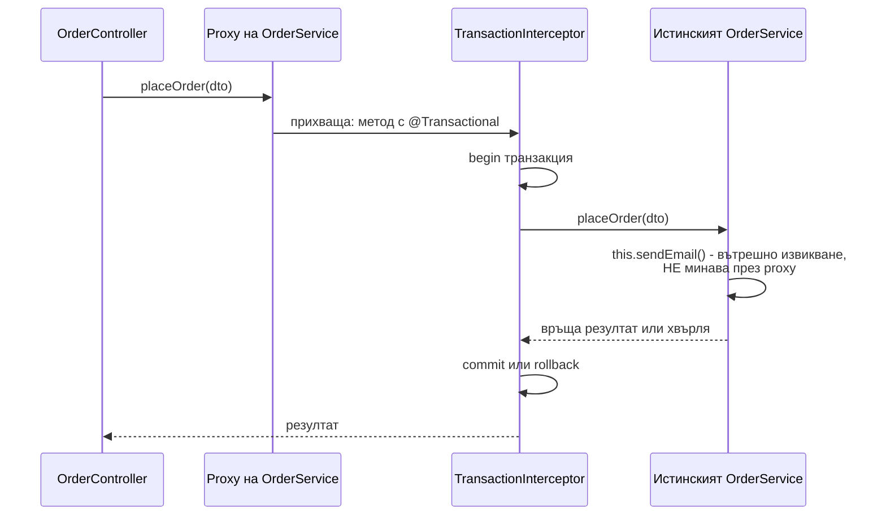

# AOP и proxies

Aspect-Oriented Programming (AOP) позволява да добавиш поведение (транзакции, кеширане, сигурност, логване, метрики) около методи, без да го пишеш в самите методи. Spring го прави с proxies: вместо твоя bean контейнерът инжектира обект-заместител, който прихваща всяко извикване отвън, изпълнява допълнителната логика и делегира към истинския обект. `@Transactional`, `@Cacheable`, `@Async`, `@PreAuthorize`, `@Retryable` работят точно така. Затова извикване на такъв метод от същия клас (`this.method()`) заобикаля proxy-то и анотацията не работи.

## 1. За какво се ползва и защо ни е нужен

Без AOP всеки service метод би започвал с отваряне на транзакция, проверка на права и логване, и завършвал с commit или rollback. AOP изнася тази повтаряща се логика (cross-cutting concerns) на едно място.

Разбирането на proxy механизма обяснява най-честите "Spring не работи" проблеми:

- `@Transactional` метод, извикан от друг метод в същия клас, не отваря транзакция;
- `@Async` метод се изпълнява синхронно;
- `@Cacheable` не кешира;
- анотация на `private` или `final` метод се игнорира тихо.

## 2. Как изглежда извикването



Контролерът държи референция към proxy-то, затова неговото извикване минава през интерцептора. Вътре в `OrderService` `this` е истинският обект, а не proxy-то: вътрешните извиквания не се прихващат.

## 3. JDK dynamic proxy срещу CGLIB

| | JDK dynamic proxy | CGLIB |
|---|---|---|
| Как | Генерира клас, който имплементира интерфейсите на bean-а | Генерира подклас на класа на bean-а |
| Изисква | Интерфейс | Не-final клас, не-final методи |
| Инжектиране по клас | Не: инжектира се само по интерфейс | Да |
| По подразбиране в Spring Boot | Не | Да (`spring.aop.proxy-target-class=true` от Boot 2.0) |
| Не прихваща | Методи извън интерфейса | `private`, `final`, `static` методи |

## 4. Минимален пример: proxy и self-invocation с чиста Java

Механизмът може да се види без Spring, с `java.lang.reflect.Proxy`. Spring прави същото, само с повече интерцептори.

```java ProxyDemo.java
import java.lang.reflect.*;

public class ProxyDemo {
    interface OrderService {
        void placeOrder();
        void placeTwo();
    }

    static class OrderServiceImpl implements OrderService {
        public void placeOrder() { System.out.println("    записвам поръчка"); }
        public void placeTwo() {
            System.out.println("    placeTwo започва");
            placeOrder();                 // this.placeOrder(): истинският обект, не proxy-то
            placeOrder();
        }
    }

    // "TransactionInterceptor": обвива всяко извикване, което мине през proxy-то
    static OrderService transactional(OrderService target) {
        InvocationHandler handler = (proxy, method, args) -> {
            System.out.println("BEGIN tx за " + method.getName());
            try {
                Object result = method.invoke(target, args);
                System.out.println("COMMIT tx за " + method.getName());
                return result;
            } catch (InvocationTargetException e) {
                System.out.println("ROLLBACK tx за " + method.getName());
                throw e.getCause();
            }
        };
        return (OrderService) Proxy.newProxyInstance(
                OrderService.class.getClassLoader(), new Class<?>[]{OrderService.class}, handler);
    }

    public static void main(String[] args) {
        OrderService service = transactional(new OrderServiceImpl());   // това инжектира Spring
        System.out.println(service.getClass().getSimpleName());        // $Proxy0, не OrderServiceImpl

        service.placeOrder();             // през proxy-то: една транзакция
        System.out.println("---");
        service.placeTwo();               // една транзакция за placeTwo, вътрешните placeOrder НЕ получават своя
    }
}
```

```text output
$Proxy0
BEGIN tx за placeOrder
    записвам поръчка
COMMIT tx за placeOrder
---
BEGIN tx за placeTwo
    placeTwo започва
    записвам поръчка
    записвам поръчка
COMMIT tx за placeTwo
```

Вътрешните `placeOrder()` нямат свои BEGIN/COMMIT. Ако `placeOrder` беше `@Transactional(propagation = REQUIRES_NEW)`, очакваната нова транзакция просто нямаше да се случи.

## 5. Как се решава self-invocation

```java OrderService.java
// 1. Най-чисто: изнеси метода в друг bean. Извикването минава през proxy-то на другия bean.
@Service
class OrderService {
    private final AuditService audit;            // отделен bean с @Transactional(REQUIRES_NEW)
    OrderService(AuditService audit) { this.audit = audit; }

    @Transactional
    public void placeOrder(Order o) {
        // ...
        audit.record(o);                         // през proxy: отделна транзакция работи
    }
}

// 2. Програмна транзакция, когато разделянето е изкуствено
@Service
class ReportService {
    private final TransactionTemplate tx;
    ReportService(TransactionTemplate tx) { this.tx = tx; }

    public void rebuild() {
        tx.executeWithoutResult(status -> {
            // кодът тук е в транзакция, без да зависи от proxy
        });
    }
}
```

Има и инжектиране на собственото proxy (`@Lazy` self-reference) или AspectJ weaving по време на компилация, но двете решения по-горе са по-ясни.

## 6. Собствен аспект

```java TimedAspect.java
@Aspect
@Component
public class TimedAspect {

    // Pointcut: всеки метод, анотиран с @Timed
    @Around("@annotation(timed)")
    public Object measure(ProceedingJoinPoint pjp, Timed timed) throws Throwable {
        long start = System.nanoTime();
        try {
            return pjp.proceed();                                   // извиква истинския метод
        } finally {
            long ms = (System.nanoTime() - start) / 1_000_000;
            log.info("{} отне {} ms", pjp.getSignature().toShortString(), ms);
        }
    }

    private static final Logger log = LoggerFactory.getLogger(TimedAspect.class);
}
```

| Термин | Значение |
|---|---|
| Aspect | Клас с допълнителната логика (`@Aspect`) |
| Advice | Кога се изпълнява: `@Before`, `@After`, `@AfterReturning`, `@AfterThrowing`, `@Around` |
| Pointcut | Израз, който избира методите (`execution(...)`, `@annotation(...)`, `within(...)`) |
| Join point | Конкретното извикване на метод, което се прихваща |
| Weaving | Свързването на аспекта с кода: в Spring по време на изпълнение, чрез proxies |

## 7. Въпроси на интервю

### Как Spring имплементира `@Transactional`?

С proxy. `BeanPostProcessor` в края на жизнения цикъл обвива bean-а в proxy (CGLIB подклас по подразбиране). Proxy-то делегира на `TransactionInterceptor`, който отваря транзакция през `PlatformTransactionManager`, вика истинския метод и прави commit или rollback според резултата.

### Защо `@Transactional` не работи при извикване от същия клас?

Защото вътрешното извикване е `this.method()`, а `this` е истинският обект, не proxy-то. Интерцепторът изобщо не участва. Решения: метода в отделен bean, `TransactionTemplate`, или AspectJ weaving.

### Каква е разликата между JDK proxy и CGLIB?

JDK dynamic proxy имплементира интерфейсите на bean-а и изисква такива. CGLIB създава подклас и работи с класове без интерфейс, но не може да прихване `final` и `private` методи и не работи с `final` класове. Spring Boot ползва CGLIB по подразбиране.

### Защо `@Transactional` на `private` метод не работи?

Proxy-то (подклас или имплементация на интерфейс) не може да override-не `private` метод, така че извикването не минава през интерцептора. Spring не дава грешка, просто анотацията няма ефект.

### Кои Spring функционалности са построени върху proxies?

`@Transactional`, `@Cacheable` и сродните, `@Async`, `@Retryable`, `@PreAuthorize` и method security, `@Validated` на ниво метод, `@Configuration` класовете (CGLIB за `@Bean` методите), Spring Data repositories (proxy, който имплементира интерфейса ти).

## 8. Капани и чести грешки

- Self-invocation на `@Transactional`, `@Async`, `@Cacheable`.
- Анотации на `private`, `final` или `static` методи.
- `final` клас за bean с `@Transactional` (Kotlin класовете са final по подразбиране: нужен е `kotlin-spring` plugin).
- `getClass()` на инжектиран bean връща класа на proxy-то (`OrderService$$SpringCGLIB$$0`).
- Твърде широк pointcut (`execution(* *(..))`), който прихваща всичко и забавя приложението.
- Тежка логика в аспект, която скрива какво реално прави методът.

## 9. Свързани документи

- [IoC контейнер и beans](Spring_IoC.md)
- [@Transactional отвътре](Spring_Transactions.md)
- [ExecutorService и CompletableFuture](Executors.md)
- [Класове, records, sealed, enums](Classes_Records.md)
