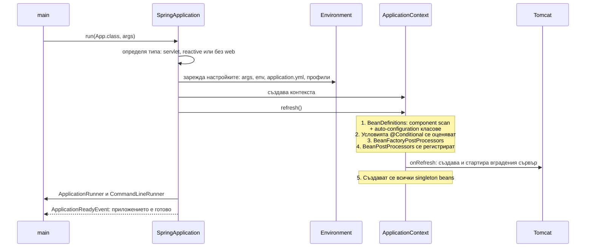
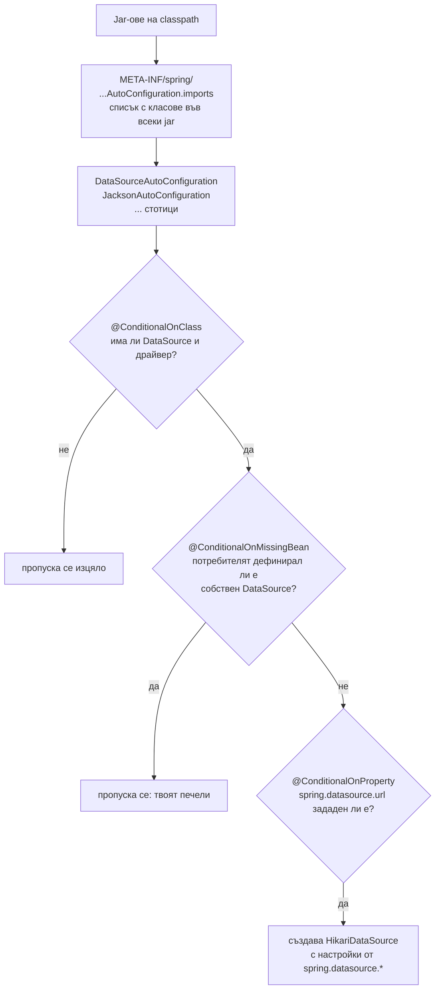

# Стартиране и auto-configuration

Spring Boot е Spring Framework плюс три идеи: starters (готови пакети от зависимости), auto-configuration (бийнове, които се създават автоматично, ако на classpath има съответната библиотека и ти не си дефинирал собствен) и вграден web сървър (приложението е обикновен `jar` с `main`). `SpringApplication.run` подготвя средата с настройките, създава `ApplicationContext`, зарежда твоите бийнове и auto-configuration класовете, стартира Tomcat и сигнализира, че приложението е готово.

## 1. За какво се ползва и защо ни е нужен

Добавяш `spring-boot-starter-data-jpa` и изведнъж имаш `DataSource`, connection pool, `EntityManagerFactory`, транзакции и repositories, без ред конфигурация. Удобно е, докато не трябва да разбереш защо нещо се е появило, защо не се е появило, или как да го замениш. Отговорът е винаги в условията (`@Conditional`) на auto-configuration класовете.

На интервю питат: какво прави `@SpringBootApplication`, как работи auto-configuration, какво е starter, как да замениш автоматичен bean, редът на зареждане на настройките, какво става при `SpringApplication.run`.

## 2. Какво се случва при `SpringApplication.run`



## 3. @SpringBootApplication

```java ShopApplication.java
@SpringBootApplication      // = @SpringBootConfiguration + @EnableAutoConfiguration + @ComponentScan
public class ShopApplication {
    public static void main(String[] args) {
        SpringApplication.run(ShopApplication.class, args);
    }
}
```

| Анотация | Какво прави |
|---|---|
| `@SpringBootConfiguration` | Това е `@Configuration` клас |
| `@ComponentScan` | Сканира пакета на класа и подпакетите му за `@Component` и производните |
| `@EnableAutoConfiguration` | Зарежда списъка с auto-configuration класове от всички jar-ове на classpath |

Затова класът с `main` трябва да е в коренния пакет: компоненти в "съседен" пакет не се намират.

## 4. Как работи auto-configuration



Auto-configuration класовете се обработват **след** твоите бийнове. Затова `@ConditionalOnMissingBean` работи: ако си дефинирал собствен bean от същия тип, автоматичният се пропуска. Това е основният механизъм за замяна.

| Условие | Активира се, когато |
|---|---|
| `@ConditionalOnClass` | Клас е на classpath (библиотеката е добавена) |
| `@ConditionalOnMissingBean` | Няма bean от този тип |
| `@ConditionalOnProperty` | Настройка има определена стойност |
| `@ConditionalOnWebApplication` | Приложението е web |
| `@ConditionalOnBean` | Вече има bean от даден тип |

**Starter** е само `pom` с подбрани зависимости (`spring-boot-starter-web` = Spring MVC + Tomcat + Jackson + validation). Самият starter не съдържа код; кодът е в `spring-boot-autoconfigure`.

## 5. Минимален пример: собствена auto-configuration

```java AuditAutoConfiguration.java
@AutoConfiguration
@ConditionalOnClass(AuditClient.class)                       // само ако библиотеката е на classpath
@EnableConfigurationProperties(AuditProperties.class)
public class AuditAutoConfiguration {

    @Bean
    @ConditionalOnMissingBean                                // потребителят може да го замени
    @ConditionalOnProperty(prefix = "audit", name = "enabled", havingValue = "true", matchIfMissing = true)
    public AuditClient auditClient(AuditProperties props) {
        return new AuditClient(props.url(), props.timeout());
    }
}

@ConfigurationProperties(prefix = "audit")
record AuditProperties(String url, Duration timeout) {}
```

```text META-INF/spring/org.springframework.boot.autoconfigure.AutoConfiguration.imports
com.acme.audit.AuditAutoConfiguration
```

## 6. Редът на настройките

От най-висок към най-нисък приоритет (опростено):

1. Аргументи от командния ред (`--server.port=9090`)
2. `SPRING_APPLICATION_JSON`
3. Системни свойства (`-Dserver.port=9090`)
4. Променливи на средата (`SERVER_PORT=9090`, relaxed binding)
5. `application-{profile}.yml` извън jar-а, после вътре в jar-а
6. `application.yml` извън jar-а, после вътре в jar-а
7. `@PropertySource` и стойности по подразбиране

Затова в Kubernetes променливите на средата презаписват `application.yml` в образа.

## 7. Въпроси на интервю

### Как работи auto-configuration?

`@EnableAutoConfiguration` чете от всеки jar файла `META-INF/spring/...AutoConfiguration.imports` (преди Spring Boot 2.7/3.0: `spring.factories`) със списък от конфигурационни класове. Всеки е защитен с условия: `@ConditionalOnClass` (има ли библиотеката), `@ConditionalOnMissingBean` (дефинирал ли е потребителят собствен), `@ConditionalOnProperty`. Обработват се след потребителските бийнове.

### Как заменяш автоматично създаден bean?

Дефинираш собствен bean от същия тип: `@ConditionalOnMissingBean` кара автоматичния да се пропусне. Или изключваш целия клас: `@SpringBootApplication(exclude = DataSourceAutoConfiguration.class)` или `spring.autoconfigure.exclude`. За дребни промени често стига настройка в `application.yml`.

### Как разбираш защо даден bean е създаден или не?

Стартираш с `--debug`: Spring Boot печата Condition Evaluation Report с всеки auto-configuration клас, дали е приложен и кое условие е изпълнено или не. В работещо приложение същото дава Actuator endpoint `/actuator/conditions`.

### Какво е starter?

Зависимост (`pom`), която събира набор от библиотеки за определена функционалност с проверени съвместими версии. Не съдържа логика: конфигурацията идва от auto-configuration класовете, които се активират, защото библиотеките вече са на classpath.

### Какво прави `SpringApplication.run`?

Определя типа на приложението, подготвя `Environment` (настройки от всички източници и активни профили), създава `ApplicationContext`, извиква `refresh()` (дефиниции на бийнове, условия, post-processors, създаване на singleton-ите, стартиране на вградения сървър), изпълнява `ApplicationRunner`/`CommandLineRunner` и публикува `ApplicationReadyEvent`.

## 8. Капани и чести грешки

- Класът с `main` в подпакет: компонентите в съседни пакети не се намират.
- Добавен starter, който тихо включва нещо нежелано (например `spring-boot-starter-security` заключва всички endpoints).
- Собствен bean, който неочаквано изключва auto-configuration и премахва настройки, които си очаквал.
- Тежка работа в `@PostConstruct` или `CommandLineRunner`, която забавя старта и readiness.
- Тайни в `application.yml` в репото вместо в променливи на средата или secret manager.

## 9. Свързани документи

- [IoC контейнер и beans](Spring_IoC.md)
- [AOP и proxies](Spring_AOP.md)
- [Пътят на HTTP заявката](Spring_MVC.md)
- [JVM, bytecode и JIT](JVM.md)
