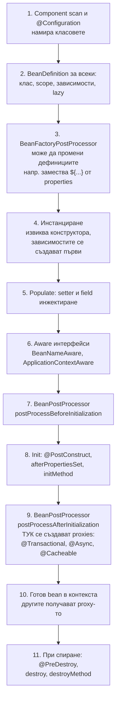

# IoC контейнер и beans

Inversion of Control (IoC) значи, че обектите не създават сами зависимостите си, а ги получават отвън. В Spring това прави контейнерът (`ApplicationContext`): при старта намира класовете с `@Component`, `@Service`, `@Repository`, `@Configuration` и `@Bean` методите, създава описание за всеки (`BeanDefinition`), създава инстанциите в правилния ред, инжектира зависимостите им (dependency injection) и ги управлява до спирането на приложението. Тези управлявани обекти се наричат beans.

## 1. За какво се ползва и защо ни е нужен

Без контейнер `OrderService` прави `new OrderRepository(new DataSource(...))`: класът е свързан с конкретни имплементации, трудно се тества и трудно се конфигурира. С DI класът декларира от какво има нужда (в конструктора), а контейнерът решава какво да подаде: истинска база в production, mock в теста.

Контейнерът е и мястото, където Spring "вгражда" поведение: транзакции, кеширане, сигурност, `@Async` се добавят чрез proxies, създадени по време на жизнения цикъл на bean-а. Разбирането на този цикъл обяснява повечето "магически" проблеми.

На интервю питат: какво е IoC и DI, видове инжектиране и защо конструктор, жизнен цикъл на bean, scopes, `BeanPostProcessor`, циклични зависимости, `@Component` срещу `@Bean`.

## 2. Как контейнерът стига до готов bean



Важният извод от стъпка 9: това, което се инжектира в другите beans, често не е твоят обект, а proxy около него. Затова анотации като `@Transactional` работят само при извикване отвън, през proxy-то (виж [AOP и proxies](Spring_AOP.md)).

## 3. Scopes

| Scope | Инстанции | Кога |
|---|---|---|
| `singleton` (по подразбиране) | Една на контейнер | Services, repositories, controllers. Трябва да са без изменимо състояние |
| `prototype` | Нова при всяко искане от контейнера | Обекти със състояние, builder-и. Spring не вика `@PreDestroy` за тях |
| `request` | Една на HTTP заявка | Данни за текущата заявка |
| `session` | Една на HTTP сесия | Количка в server-side приложение |
| `application` | Една на `ServletContext` | Рядко |

Singleton в Spring не е singleton шаблонът: това е една инстанция на контейнер, не на JVM. Капан: prototype bean, инжектиран в singleton, се създава веднъж (при създаването на singleton-а) и после е същият. Ако ти трябва нов всеки път, инжектирай `ObjectProvider<T>` и викай `getObject()`.

## 4. Минимален пример

```java OrderService.java
@Service
public class OrderService {

    private final OrderRepository repository;      // final: зависимостите са задължителни и неизменими
    private final Clock clock;

    // Constructor injection: при един конструктор @Autowired не е нужен
    public OrderService(OrderRepository repository, Clock clock) {
        this.repository = repository;
        this.clock = clock;
    }

    @PostConstruct
    void init() {
        // зависимостите вече са инжектирани; proxy-то още не е създадено
    }

    public Order place(Order order) {
        order.setCreatedAt(Instant.now(clock));
        return repository.save(order);
    }
}
```

```java AppConfig.java
@Configuration
public class AppConfig {

    @Bean                                           // bean от клас, който не е твой (или с ръчна логика)
    public Clock clock() {
        return Clock.systemUTC();
    }

    @Bean
    @ConditionalOnMissingBean                       // само ако никой друг не е дефинирал такъв
    public RestClient paymentsClient(RestClient.Builder builder, @Value("${payments.url}") String url) {
        return builder.baseUrl(url).build();
    }
}
```

В тестовете `OrderService` се създава с `new OrderService(fakeRepository, Clock.fixed(...))`, без Spring. Това е основното предимство на constructor injection.

## 5. Видове инжектиране

| Вид | Пример | Плюсове | Минуси |
|---|---|---|---|
| Конструктор | `OrderService(OrderRepository r)` | `final` полета, задължителни зависимости, лесни тестове, циклите се откриват веднага | Дълъг конструктор (сигнал, че класът прави твърде много) |
| Setter | `@Autowired void setRepo(...)` | Опционални зависимости | Обектът може да е в непълно състояние |
| Поле | `@Autowired private OrderRepository r` | Кратко | Скрити зависимости, не може `final`, тестът изисква reflection или Spring |

## 6. Въпроси на интервю

### Какво е IoC и DI?

IoC е принципът, че контролът над създаването и свързването на обектите се обръща: не класът си създава зависимостите, а външен контейнер. DI е конкретният механизъм: зависимостите се подават през конструктор, setter или поле. В Spring контейнерът е `ApplicationContext`.

### Защо constructor injection е препоръчителен?

Зависимостите са явни и задължителни, полетата могат да са `final` (неизменимост и безопасна публикация между нишки), обектът никога не е в полуинициализирано състояние, а тестовете създават класа с `new` без Spring. Цикличните зависимости се откриват при старта.

### Опиши жизнения цикъл на bean.

Spring създава `BeanDefinition`, `BeanFactoryPostProcessor`-ите могат да го променят, после инстанцира bean-а (конструктор), инжектира зависимостите, вика Aware методите, `BeanPostProcessor.before`, init методите (`@PostConstruct`), `BeanPostProcessor.after` (където се създават proxies), и bean-ът е готов. При спиране вика `@PreDestroy`.

### Каква е разликата между `@Component` и `@Bean`?

`@Component` (и `@Service`, `@Repository`, `@Controller`) се слага на класа и Spring го открива при component scan. `@Bean` се слага на метод в `@Configuration` клас и връща инстанцията: за класове от библиотеки, които не можеш да анотираш, или когато създаването изисква логика.

### Какво става при циклична зависимост?

С constructor injection А не може да се създаде без Б, а Б без А: Spring хвърля `BeanCurrentlyInCreationException` при старта. От Spring Boot 2.6 цикличните зависимости са забранени по подразбиране дори при field injection. Решението е да се преструктурира кодът (трети клас, събитие), а не `@Lazy`.

### Какво прави `@Configuration` различно от `@Component` с `@Bean` методи?

`@Configuration` класът се обвива в CGLIB подклас, така че вътрешно извикване на `@Bean` метод (`clock()` от друг `@Bean` метод) връща същия singleton от контейнера, а не нова инстанция. С `@Configuration(proxyBeanMethods = false)` или с `@Component` това не става и всяко извикване създава нов обект.

## 7. Капани и чести грешки

- Изменимо състояние в singleton bean (поле `currentUser`): споделено между всички заявки и нишки.
- Prototype bean, инжектиран в singleton, с очакване за нова инстанция при всяка употреба.
- Field injection, който прави класа нетестваем без Spring.
- Логика в конструктора, която ползва функционалност на proxy-то (`@Transactional` метод на себе си): proxy-то още не съществува.
- `new MyService()` в кода: обектът не е bean, анотациите му не работят.
- Две имплементации на един интерфейс без `@Primary` или `@Qualifier`: `NoUniqueBeanDefinitionException`.

## 8. Свързани документи

- [Стартиране и auto-configuration](Spring_Boot_Startup.md)
- [AOP и proxies](Spring_AOP.md)
- [@Transactional отвътре](Spring_Transactions.md)
- [Нишки и жизнен цикъл](Threads.md)
