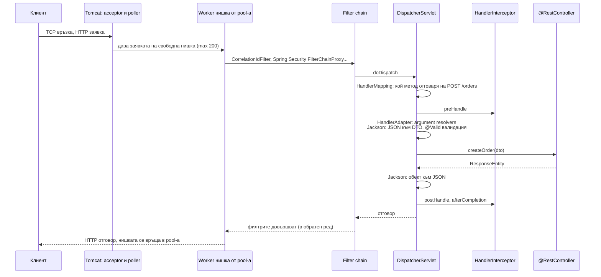
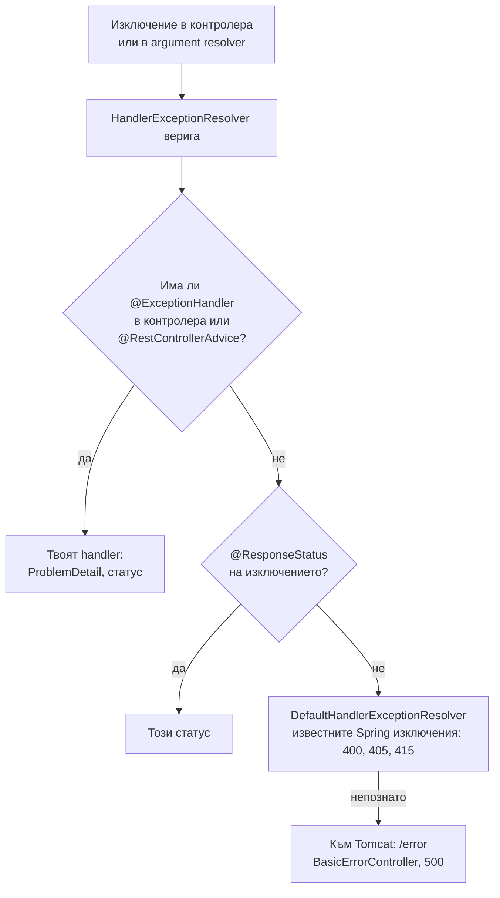

# Пътят на HTTP заявката

В Spring MVC приложение заявката минава през няколко слоя. Вграденият Tomcat приема TCP връзката и дава заявката на нишка от своя pool. Тя минава през веригата от Servlet филтри (тук е Spring Security), стига до `DispatcherServlet`, който намира кой контролер я обработва (`HandlerMapping`), минава през interceptors, превръща JSON тялото в обект (`HttpMessageConverter`), валидира го, извиква контролера и превръща резултата обратно в JSON. Цялата обработка е в една нишка, от началото до края: модел "нишка на заявка".

## 1. За какво се ползва и защо ни е нужен

Познаването на пътя казва къде да сложиш всяко нещо и защо нещо не работи:

- логване на всяка заявка с correlation id: филтър;
- проверка на права по анотация на контролера: interceptor или method security;
- единен формат на грешките: `@RestControllerAdvice`;
- защо `SecurityContextHolder.getContext()` е празен в `@Async` метод (`ThreadLocal`);
- защо при 200 бавни заявки сървърът спира да отговаря (pool-ът на Tomcat е изчерпан).

На интервю питат: какво е `DispatcherServlet`, филтър срещу interceptor, къде се обработват грешките, колко нишки има Tomcat и какво става при изчерпване, как virtual threads сменят модела.

## 2. Пътят



## 3. Филтър срещу interceptor срещу аспект

| | Servlet `Filter` | `HandlerInterceptor` | AOP аспект |
|---|---|---|---|
| Ниво | Servlet контейнер, преди Spring MVC | Вътре в `DispatcherServlet` | Около методи на beans |
| Знае ли кой контролер | Не | Да (`HandlerMethod`, анотациите му) | Да (метода) |
| Вижда ли тялото | Сурови байтове (трябва wrapper) | Не (още не е парснато в `preHandle`) | Аргументите като обекти |
| Типична употреба | Сигурност, CORS, correlation id, компресия, логване на всичко | Проверки, зависещи от handler-а, locale | Транзакции, метрики, кеширане на ниво service |
| Работи за статични ресурси и 404 | Да | Само за пътища с handler | Не |

## 4. Обработка на грешки



Изключения, хвърлени във филтър (преди `DispatcherServlet`), не стигат до `@RestControllerAdvice`: те се обработват от `/error` или от самия филтър.

## 5. Минимален пример

```java OrderController.java
@RestController
@RequestMapping("/orders")
class OrderController {
    private final OrderService service;
    OrderController(OrderService service) { this.service = service; }

    @PostMapping
    ResponseEntity<OrderResponse> create(@Valid @RequestBody CreateOrderRequest req) {   // Jackson + Bean Validation
        Order order = service.place(req.toCommand());
        return ResponseEntity.created(URI.create("/orders/" + order.getId())).body(OrderResponse.from(order));
    }
}

@RestControllerAdvice
class ApiErrors {
    @ExceptionHandler(OutOfStockException.class)
    ProblemDetail outOfStock(OutOfStockException e) {
        ProblemDetail pd = ProblemDetail.forStatusAndDetail(HttpStatus.CONFLICT, e.getMessage());
        pd.setTitle("Няма наличност");
        return pd;                                     // application/problem+json (RFC 9457)
    }

    @ExceptionHandler(MethodArgumentNotValidException.class)
    ProblemDetail invalid(MethodArgumentNotValidException e) {
        ProblemDetail pd = ProblemDetail.forStatus(HttpStatus.BAD_REQUEST);
        pd.setProperty("errors", e.getFieldErrors().stream()
                .map(f -> Map.of("field", f.getField(), "message", f.getDefaultMessage()))
                .toList());
        return pd;
    }
}

@Component
@Order(Ordered.HIGHEST_PRECEDENCE)
class CorrelationIdFilter extends OncePerRequestFilter {
    @Override
    protected void doFilterInternal(HttpServletRequest req, HttpServletResponse res, FilterChain chain)
            throws ServletException, IOException {
        String id = Optional.ofNullable(req.getHeader("X-Request-Id")).orElse(UUID.randomUUID().toString());
        MDC.put("requestId", id);                      // ThreadLocal: всеки лог ред в тази нишка го получава
        res.setHeader("X-Request-Id", id);
        try {
            chain.doFilter(req, res);
        } finally {
            MDC.remove("requestId");                   // нишката се връща в pool-а: изчисти!
        }
    }
}
```

## 6. Нишки и капацитет

| Настройка (`server.tomcat.*`) | По подразбиране | Значение |
|---|---|---|
| `threads.max` | 200 | Максимум едновременно обработвани заявки |
| `threads.min-spare` | 10 | Нишки, които винаги съществуват |
| `max-connections` | 8192 | Отворени връзки (повечето чакат в keep-alive) |
| `accept-count` | 100 | Опашка в ядрото, когато `max-connections` е достигнат |

С platform нишки всяка заявка, която чака базата или външно API, заема нишка. При 200 бавни заявки следващите чакат, независимо че CPU е свободен. С `spring.threads.virtual.enabled=true` (Spring Boot 3.2+) Tomcat пуска всяка заявка във virtual нишка и ограничението става пропускателната способност на базата и външните системи (виж [Virtual threads](Virtual_Threads.md)).

## 7. Въпроси на интервю

### Какво е `DispatcherServlet`?

Front controller на Spring MVC: един servlet, който приема всички заявки и ги разпределя. Намира handler-а през `HandlerMapping`, вика го през `HandlerAdapter` (който резолвва аргументите и превръща тялото с `HttpMessageConverter`), прилага interceptors, обработва върнатата стойност и изключенията.

### Каква е разликата между филтър и interceptor?

Филтърът е част от Servlet API и работи преди Spring MVC, за всяка заявка, включително статични ресурси и такива без handler. Interceptor-ът работи вътре в `DispatcherServlet`, знае кой контролер и метод ще се извика, и има `preHandle`, `postHandle`, `afterCompletion`. Сигурността (Spring Security) е във филтрите.

### Как Spring превръща JSON в обект?

`RequestResponseBodyMethodProcessor` вижда `@RequestBody`, избира `HttpMessageConverter` по `Content-Type` (за JSON `MappingJackson2HttpMessageConverter`, тоест Jackson `ObjectMapper`) и десериализира тялото. При `@Valid` после пуска Bean Validation и при грешка хвърля `MethodArgumentNotValidException`. За отговора е същото в обратна посока, по `Accept`.

### В колко нишки се обработва една заявка?

В една: Tomcat worker нишката я прекарва през филтри, `DispatcherServlet`, контролер, service и repository. Затова `ThreadLocal` механизмите работят (security context, транзакция, MDC), и затова не се пренасят в `@Async` или `CompletableFuture`.

### Какво става, когато всички 200 нишки на Tomcat са заети?

Новите връзки се приемат до `max-connections`, но заявките им чакат свободна нишка. Над лимита връзките чакат в опашката на ядрото (`accept-count`), после се отказват. Латентността расте, health check-овете изтичат. Решения: по-къси timeouts към външни системи, bulkhead, virtual threads, мащабиране.

## 8. Капани и чести грешки

- `ThreadLocal` (MDC, собствен контекст) без изчистване във `finally`: изтича към следващата заявка в същата нишка.
- Очакване, че `@RestControllerAdvice` хваща грешки от филтрите.
- Четене на тялото във филтър без `ContentCachingRequestWrapper`: контролерът получава празно тяло.
- Бавни външни извиквания без timeout: изчерпват pool-а на Tomcat.
- Entities като request или response тела.
- `@Transactional` на контролер.

## 9. Свързани документи

- [Virtual threads](Virtual_Threads.md)
- [AOP и proxies](Spring_AOP.md)
- [JPA и Hibernate](JPA_Hibernate.md)
- [Стартиране и auto-configuration](Spring_Boot_Startup.md)
