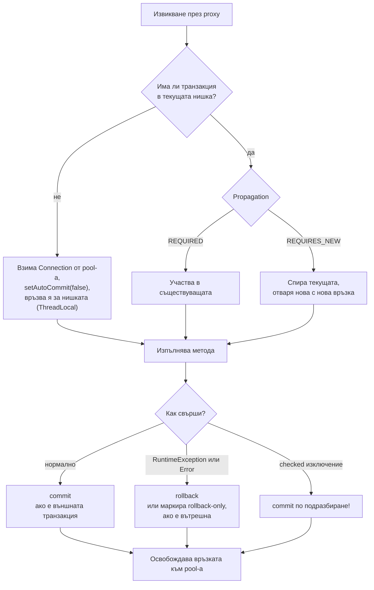
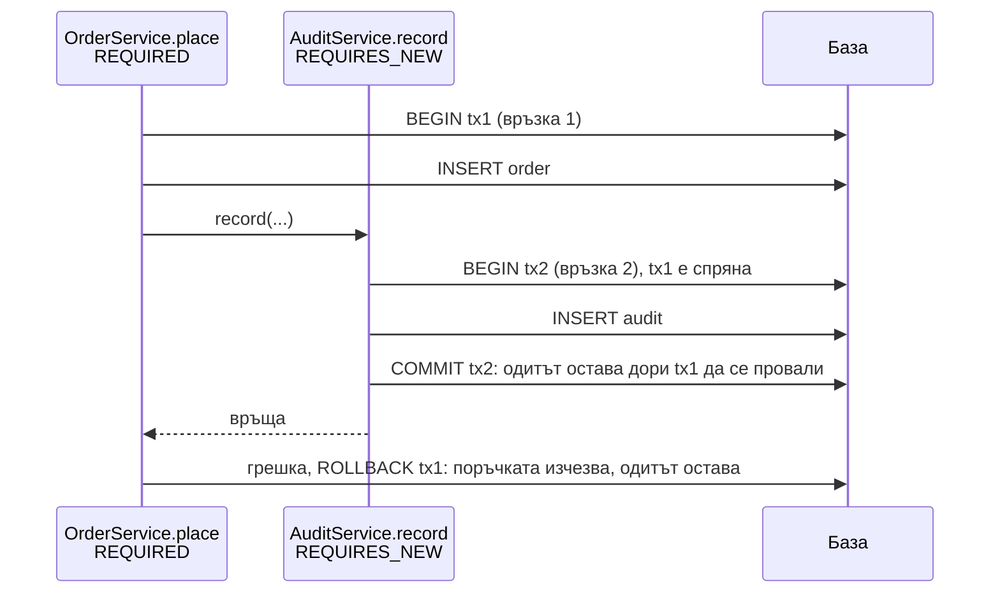

# @Transactional отвътре

`@Transactional` казва на Spring да изпълни метода в транзакция на базата: всичко вътре се записва заедно (commit) или не се записва нищо (rollback). Реализира се с proxy и `TransactionInterceptor`, който взима връзка от pool-а, изключва auto-commit, вика метода и накрая прави commit или rollback. Транзакцията е вързана за текущата нишка. Поведението се настройва с propagation (какво става, ако вече има транзакция), isolation (какво виждат паралелните транзакции), правила за rollback, `readOnly` и `timeout`.

## 1. За какво се ползва и защо ни е нужен

Транзакциите пазят консистентността на данните: поръчка без редове, плащане без запис в счетоводството или наличност, намалена два пъти, са бизнес бъгове. В същото време грешно поставената транзакция е честа причина за production проблеми: изчерпан connection pool, deadlocks в базата, тихо отказани промени.

На интервю питат: как работи `@Transactional` под капака, propagation нивата (особено `REQUIRED` срещу `REQUIRES_NEW`), isolation и аномалиите, кога има rollback, защо не работи при self-invocation, `UnexpectedRollbackException`.

## 2. Какво прави интерцепторът



Транзакцията и връзката към базата се пазят в `ThreadLocal` (`TransactionSynchronizationManager`). Затова Spring Data repositories и `JdbcTemplate`, извикани вътре в метода, автоматично ползват същата връзка. И затова код в друга нишка (`@Async`, `CompletableFuture.supplyAsync`) **не е** в транзакцията.

## 3. Propagation

| Propagation | Има транзакция | Няма транзакция |
|---|---|---|
| `REQUIRED` (по подразбиране) | Участва в нея | Създава нова |
| `REQUIRES_NEW` | Спира я и създава нова (нова връзка) | Създава нова |
| `SUPPORTS` | Участва | Изпълнява без транзакция |
| `MANDATORY` | Участва | Хвърля изключение |
| `NOT_SUPPORTED` | Спира я, изпълнява без | Изпълнява без |
| `NEVER` | Хвърля изключение | Изпълнява без |
| `NESTED` | Savepoint в текущата | Създава нова |



`REQUIRES_NEW` държи две връзки едновременно. При pool от 10 връзки и 10 паралелни заявки, които всички влизат в `REQUIRES_NEW`, всички чакат за 11-а връзка: deadlock на pool-а.

## 4. Isolation

| Ниво | Dirty read | Non-repeatable read | Phantom read |
|---|---|---|---|
| `READ_UNCOMMITTED` | Възможно | Възможно | Възможно |
| `READ_COMMITTED` (PostgreSQL, Oracle по подразбиране) | Не | Възможно | Възможно |
| `REPEATABLE_READ` (MySQL InnoDB по подразбиране) | Не | Не | Възможно по стандарт (в PostgreSQL и InnoDB на практика не) |
| `SERIALIZABLE` | Не | Не | Не |

- **Dirty read:** четеш данни, които друга транзакция още не е commit-нала (и може да откаже).
- **Non-repeatable read:** един и същ ред, прочетен два пъти в транзакцията, има различни стойности.
- **Phantom read:** една и съща заявка с условие връща различен брой редове.
- **Lost update:** две транзакции четат, променят и записват един ред; второто записване презаписва първото. Не се решава от `READ_COMMITTED`: нужен е `SELECT ... FOR UPDATE` (`@Lock(PESSIMISTIC_WRITE)`) или оптимистично заключване с `@Version`.

`isolation = Isolation.DEFAULT` значи "каквото е по подразбиране в базата".

## 5. Минимален пример

```java OrderService.java
@Service
public class OrderService {

    private final OrderRepository orders;
    private final StockRepository stock;
    private final ApplicationEventPublisher events;

    public OrderService(OrderRepository orders, StockRepository stock, ApplicationEventPublisher events) {
        this.orders = orders;
        this.stock = stock;
        this.events = events;
    }

    @Transactional(rollbackFor = Exception.class, timeout = 5)   // rollback и при checked; спира след 5 s
    public Order place(PlaceOrder cmd) {
        int updated = stock.decrement(cmd.sku(), cmd.qty());      // UPDATE ... SET qty = qty - ? WHERE qty >= ?
        if (updated == 0) throw new OutOfStockException(cmd.sku());   // RuntimeException: rollback
        Order order = orders.save(Order.from(cmd));
        events.publishEvent(new OrderPlaced(order.getId()));      // слушателят ще реагира след commit
        return order;
    }

    @Transactional(readOnly = true)                               // Hibernate не прави dirty checking, може read реплика
    public Optional<Order> find(long id) {
        return orders.findById(id);
    }
}

@Component
class OrderEmails {
    @TransactionalEventListener(phase = TransactionPhase.AFTER_COMMIT)   // само ако поръчката наистина е записана
    void onPlaced(OrderPlaced event) {
        // изпрати имейл; при rollback никога не се извиква
    }
}
```

## 6. UnexpectedRollbackException

```java Checkout.java
@Transactional
public void checkout(Cart cart) {
    try {
        coupons.apply(cart);          // също @Transactional (REQUIRED): участва в същата транзакция
    } catch (CouponExpiredException e) {
        // "поглъщаме" грешката и продължаваме...
    }
    orders.save(cart.toOrder());
}   // ...но при commit: UnexpectedRollbackException:
    // Transaction silently rolled back because it has been marked as rollback-only
```

`coupons.apply` хвърли `RuntimeException` и интерцепторът му маркира **общата** транзакция като rollback-only. Хващането на изключението във външния метод не отменя маркировката. Решения: `coupons.apply` да не е транзакционен или да е `REQUIRES_NEW`, да не хвърля (да връща резултат), или `noRollbackFor` за конкретното изключение.

## 7. Въпроси на интервю

### Как работи `@Transactional`?

Bean-ът е обвит в proxy. При извикване отвън `TransactionInterceptor` проверява дали вече има транзакция в нишката, според propagation участва в нея или отваря нова (взима връзка, `autoCommit=false`, пази я в `ThreadLocal`), вика метода и прави commit, или rollback при `RuntimeException`/`Error`. Накрая връща връзката в pool-а.

### Кога става rollback?

По подразбиране при `RuntimeException` и `Error`. При checked изключения транзакцията се commit-ва. Правилата се сменят с `rollbackFor` и `noRollbackFor`.

### Каква е разликата между `REQUIRED` и `REQUIRES_NEW`?

`REQUIRED` участва в съществуващата транзакция или създава нова, ако няма: всичко е една единица. `REQUIRES_NEW` винаги създава нова, независима транзакция с отделна връзка, а външната е спряна. Използва се за неща, които трябва да останат независимо от изхода (одит, лог на опити). Цената е втора връзка от pool-а.

### Защо `@Transactional` в `@Async` метод или в друга нишка не участва в транзакцията на извикващия?

Транзакцията е вързана за нишката чрез `ThreadLocal`. Нова нишка няма достъп до нея и, ако методът е `@Transactional`, отваря своя.

### Какво прави `readOnly = true`?

Подсказка към инфраструктурата: Hibernate изключва dirty checking и flush (по-малко памет и CPU), JDBC драйверът може да маркира връзката като read-only, а routing `DataSource` може да прати заявката към реплика. Не забранява сам по себе си записите във всички бази.

### Как предотвратяваш lost update?

Оптимистично заключване с `@Version`: при `UPDATE` се проверява версията и при конфликт се хвърля `OptimisticLockException` (после retry). Или песимистично: `SELECT ... FOR UPDATE` (`@Lock(LockModeType.PESSIMISTIC_WRITE)`), което заключва реда до края на транзакцията. Или атомарен `UPDATE ... SET qty = qty - 1 WHERE qty > 0`.

## 8. Капани и чести грешки

- Self-invocation, `private` методи, `final` класове: анотацията тихо не работи.
- Checked изключение без `rollbackFor`: частичните промени се commit-ват.
- Хванато изключение от вътрешен `REQUIRED` метод: `UnexpectedRollbackException`.
- HTTP извиквания, имейли или публикуване в Kafka вътре в транзакцията: дълго държана връзка, а при rollback съобщението вече е изпратено. Ползвай `AFTER_COMMIT` или outbox pattern.
- `@Transactional` на контролер: транзакцията обхваща и сериализацията на отговора.
- `REQUIRES_NEW` под натоварване: изчерпан pool.
- Lazy loading извън транзакцията: `LazyInitializationException` (виж [JPA и Hibernate](JPA_Hibernate.md)).

## 9. Свързани документи

- [AOP и proxies](Spring_AOP.md)
- [JPA и Hibernate](JPA_Hibernate.md)
- [Изключения](Exceptions.md)
- [Java Memory Model](JMM.md)
