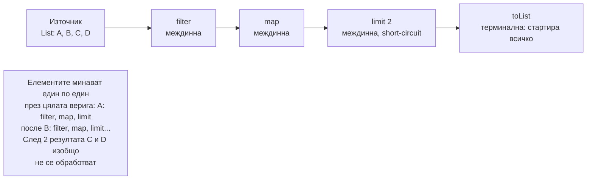

# Lambdas, Streams, Optional

Lambda е кратък запис на функция, която имплементира функционален интерфейс (интерфейс с един абстрактен метод: `Function`, `Predicate`, `Supplier`, `Consumer`, `Runnable`, `Comparator`). Stream е мързелив pipeline от операции върху поредица от елементи: междинните операции (`filter`, `map`, `sorted`) само описват работата, а тя се изпълнява едва при терминалната операция (`toList`, `collect`, `count`), и то елемент по елемент през цялата верига. `Optional` е контейнер за резултат, който може да липсва, предназначен за return типове.

## 1. За какво се ползва и защо ни е нужен

Streams правят обработката на колекции декларативна: казваш какво искаш (филтрирай, групирай, сумирай), не как да обходиш. Това е стандартният стил в съвременния Java и Spring код: трансформация на entities в DTO, групиране на поръчки по клиент, суми, търсене.

На интервю питат: мързеливост и реда на изпълнение, междинни срещу терминални операции, `map` срещу `flatMap`, `groupingBy`, `toMap` и дублиращи ключове, кога parallel streams са вредни, как правилно се ползва `Optional`.

## 2. Как се изпълнява stream



| Вид | Примери | Особеност |
|---|---|---|
| Източник | `list.stream()`, `Stream.of`, `IntStream.range`, `Files.lines` | Stream може да се консумира само веднъж |
| Междинна без състояние | `filter`, `map`, `flatMap`, `peek` | Мързелива, обработва елемент по елемент |
| Междинна със състояние | `sorted`, `distinct` | Трябва да види всички елементи, преди да пусне нататък |
| Short-circuit | `limit`, `findFirst`, `anyMatch` | Спира рано, работи и с безкрайни потоци |
| Терминална | `toList`, `collect`, `forEach`, `reduce`, `count` | Стартира изпълнението |

## 3. Функционалните интерфейси

| Интерфейс | Сигнатура | Пример |
|---|---|---|
| `Function<T, R>` | `R apply(T t)` | `Order::total` |
| `Predicate<T>` | `boolean test(T t)` | `o -> o.total() > 100` |
| `Supplier<T>` | `T get()` | `ArrayList::new` |
| `Consumer<T>` | `void accept(T t)` | `System.out::println` |
| `BiFunction<T, U, R>` | `R apply(T t, U u)` | `Integer::sum` |
| `UnaryOperator<T>` | `T apply(T t)` | `String::trim` |

Lambda може да използва локални променливи отвън само ако са effectively final (не се променят след присвояването). Причината: lambda-та може да се изпълни по-късно или в друга нишка, затова получава копие на стойността.

## 4. Минимален пример

```java StreamsDemo.java
import java.util.*;
import java.util.stream.*;

public class StreamsDemo {
    record Order(String customer, String city, double total, List<String> items) {}

    public static void main(String[] args) {
        List<Order> orders = List.of(
                new Order("Ана", "София", 120, List.of("книга", "химикал")),
                new Order("Борис", "Пловдив", 40, List.of("тетрадка")),
                new Order("Ана", "София", 300, List.of("лаптоп")),
                new Order("Вера", "Варна", 80, List.of("книга")));

        // Мързеливост: виж реда на отпечатване
        List<String> big = orders.stream()
                .filter(o -> { System.out.println("filter " + o.customer()); return o.total() > 50; })
                .map(o -> { System.out.println("map " + o.customer()); return o.customer(); })
                .limit(2)
                .toList();
        System.out.println(big);

        // Групиране и агрегиране
        Map<String, Double> byCustomer = orders.stream()
                .collect(Collectors.groupingBy(Order::customer, TreeMap::new, Collectors.summingDouble(Order::total)));
        System.out.println(byCustomer);                     // {Ана=420.0, Борис=40.0, Вера=80.0}

        // flatMap: от списък от списъци към един поток
        Set<String> allItems = orders.stream().flatMap(o -> o.items().stream()).collect(Collectors.toCollection(TreeSet::new));
        System.out.println(allItems);                       // [книга, лаптоп, тетрадка, химикал]

        // toMap с дублиращ ключ хвърля, ако не подадеш merge функция
        try {
            orders.stream().collect(Collectors.toMap(Order::customer, Order::total));
        } catch (IllegalStateException e) {
            System.out.println("toMap: " + e.getMessage().substring(0, 18));
        }
        Map<String, Double> max = orders.stream().collect(Collectors.toMap(Order::customer, Order::total, Math::max));
        System.out.println(max.get("Ана"));                 // 300.0

        // Optional: резултат, който може да липсва
        String city = orders.stream()
                .filter(o -> o.total() > 1000)
                .findFirst()
                .map(Order::city)
                .orElse("няма");
        System.out.println(city);                           // няма
    }
}
```

Изходът на първата част показва мързеливостта:

```text output
filter Ана
map Ана
filter Борис
filter Ана
map Ана
[Ана, Ана]
```

Борис е филтриран и не стига до `map`. След втория резултат `limit` спира pipeline-а и Вера изобщо не се проверява.

## 5. Optional

| Правилно | Неправилно |
|---|---|
| Return тип на метод, който може да не намери резултат (`findById`) | Поле на клас или параметър на метод |
| `opt.map(...).orElse(default)` | `opt.isPresent()` и после `opt.get()` |
| `orElseThrow(() -> new NotFoundException(id))` | `opt.get()` без проверка |
| `orElseGet(() -> expensive())` за скъпа стойност по подразбиране | `orElse(expensive())`: изчислява се винаги |
| Празна колекция за "няма елементи" | `Optional<List<T>>` |

## 6. Parallel streams

`parallelStream()` разделя работата между нишките на общия `ForkJoinPool.commonPool()` (брой нишки = ядра − 1). Помага само за CPU работа върху големи колекции с лесно делим източник (`ArrayList`, масив) и операции без споделено състояние. Вредно е за I/O (блокира общия pool за цялото приложение), за малки колекции (overhead-ът е по-голям от ползата), за `LinkedList` и при подредени операции като `findFirst` и `limit`.

## 7. Въпроси на интервю

### Какво значи, че stream е мързелив?

Междинните операции не правят нищо, само строят pipeline. Изпълнението започва при терминалната операция и елементите минават един по един през цялата верига. Затова short-circuit операции (`limit`, `findFirst`, `anyMatch`) могат да спрат рано и да не обработят останалите елементи.

### Каква е разликата между `map` и `flatMap`?

`map` превръща всеки елемент в един нов елемент. `flatMap` превръща всеки елемент в поток и слива потоците в един. От `Stream<Order>` с `map(Order::items)` получаваш `Stream<List<String>>`, а с `flatMap(o -> o.items().stream())` получаваш `Stream<String>`.

### Може ли stream да се използва два пъти?

Не. След терминална операция stream-ът е консумиран и повторна употреба хвърля `IllegalStateException`. Създай нов от източника.

### Какво е функционален интерфейс?

Интерфейс с точно един абстрактен метод (може да има `default` и `static` методи). Lambda изрази и method references могат да го имплементират. Анотацията `@FunctionalInterface` кара компилатора да провери правилото.

### Защо локалните променливи в lambda трябва да са effectively final?

Lambda-та получава копие на стойността, защото може да се изпълни по-късно, след като методът е приключил и неговият stack frame е изчезнал, или в друга нишка. Ако променливата можеше да се променя, копието и оригиналът биха се разминали.

### Кога parallel stream е лоша идея?

При I/O операции (блокира общия ForkJoinPool), малки колекции, източници, които се делят трудно (`LinkedList`, `Stream.iterate`), операции със споделено изменимо състояние и в web приложение, където всички заявки споделят същия pool.

## 8. Капани и чести грешки

- `Collectors.toMap` без merge функция при възможни дубликати.
- `peek` или `map` със странични ефекти, които разчитат на изпълнение (може да не се изпълнят).
- `parallelStream()` за заявки към базата или HTTP.
- `Optional.get()` без проверка, `Optional` като поле или параметър.
- `orElse(createDefault())` с тежка функция: изпълнява се дори при наличен резултат.
- `stream().forEach(list::add)` вместо `toList()` или `collect`.
- `Stream.toList()` връща неизменим списък, за разлика от `Collectors.toList()`.

## 9. Свързани документи

- [Collections Framework](Collections.md)
- [Класове, records, sealed, enums](Classes_Records.md)
- [ExecutorService и CompletableFuture](Executors.md)
- [Generics и type erasure](Generics.md)
