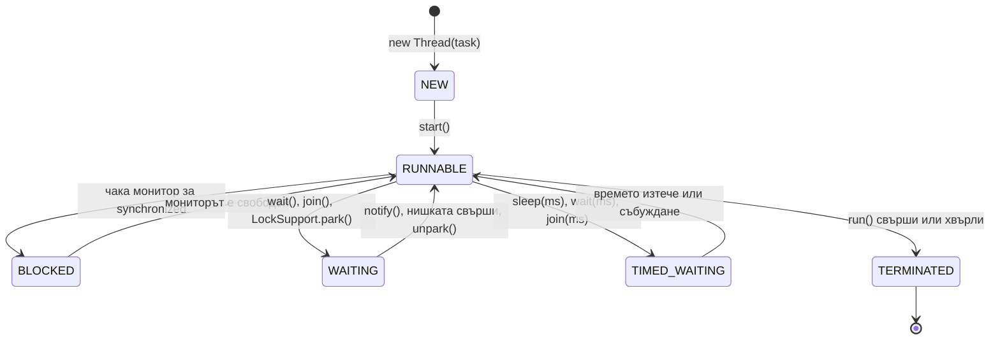

# Нишки и жизнен цикъл

Нишката (thread) е независим поток на изпълнение вътре в един процес. Всички нишки на JVM споделят heap-а (обектите), но всяка има собствен stack. Класическите (platform) нишки в Java съответстват едно към едно на нишки на операционната система, затова са скъпи: около 1 MB памет за stack и превключване от ядрото. Нишка се създава с `Thread` и задача (`Runnable`), стартира се с `start()`, а другите нишки могат да я изчакат с `join()` или да я помолят да спре с `interrupt()`.

## 1. За какво се ползва и защо ни е нужен

Spring Boot приложение е многонишково, дори да не създаваш нишки сам: Tomcat обслужва всяка заявка в отделна нишка от pool (по подразбиране до 200), `@Async` и `@Scheduled` работят в свои нишки, Kafka consumer-ите също. Затова всеки singleton bean с изменимо състояние е потенциален бъг.

На интервю питат: `start()` срещу `run()`, състоянията на нишката, `Runnable` срещу `Callable`, как се спира нишка, какво е daemon нишка, `wait`/`notify`, `sleep` срещу `wait`.

## 2. Състояния



`RUNNABLE` в Java включва и "работи в момента", и "готова, чака процесор", и "блокирана в I/O на ниво ОС". Java не различава тези три. `BLOCKED` е само чакане за `synchronized`, а не за I/O.

## 3. Минимален пример

```java ThreadsDemo.java
import java.util.concurrent.*;

public class ThreadsDemo {
    public static void main(String[] args) throws Exception {
        // 1. Runnable: няма резултат и не хвърля checked изключения
        Thread worker = new Thread(() -> {
            System.out.println("работя в " + Thread.currentThread().getName());
        }, "worker-1");
        System.out.println(worker.getState());       // NEW
        worker.start();                              // нова нишка; run() би се изпълнил в текущата
        worker.join();                               // чака worker да свърши
        System.out.println(worker.getState());       // TERMINATED

        // 2. Callable: връща резултат, изпълнява се през executor
        Callable<Integer> task = () -> 6 * 7;
        try (ExecutorService pool = Executors.newFixedThreadPool(2)) {
            Future<Integer> f = pool.submit(task);
            System.out.println("резултат " + f.get());   // блокира, докато е готов
        }

        // 3. Кооперативно спиране с interrupt
        Thread sleeper = new Thread(() -> {
            while (!Thread.currentThread().isInterrupted()) {
                try {
                    Thread.sleep(1_000);
                } catch (InterruptedException e) {
                    System.out.println("прекъсната по време на sleep");
                    Thread.currentThread().interrupt();   // възстановява флага, за да излезе цикълът
                }
            }
            System.out.println("излизам чисто");
        });
        sleeper.start();
        Thread.sleep(100);
        sleeper.interrupt();                         // само сигнал: нишката решава как да реагира
        sleeper.join();

        // 4. Daemon нишка не държи JVM жива
        Thread daemon = new Thread(() -> { while (true) Thread.onSpinWait(); });
        daemon.setDaemon(true);
        daemon.start();
        System.out.println("main свършва, JVM излиза въпреки безкрайния daemon");
    }
}
```

```text output
NEW
работя в worker-1
TERMINATED
резултат 42
прекъсната по време на sleep
излизам чисто
main свършва, JVM излиза въпреки безкрайния daemon
```

## 4. wait и notify

`wait()` и `notify()` са методи на `Object` и работят само вътре в `synchronized` блок върху същия обект. `wait()` освобождава монитора и спи, докато друга нишка извика `notify()`/`notifyAll()` върху същия обект. Винаги се извиква в цикъл, защото са възможни "фалшиви събуждания" (spurious wakeups) и условието може вече да не е вярно.

```java WaitNotify.java
import java.util.ArrayDeque;
import java.util.Queue;

public class WaitNotify {
    private final Queue<Integer> queue = new ArrayDeque<>();
    private final int capacity = 2;

    synchronized void put(int x) throws InterruptedException {
        while (queue.size() == capacity) wait();   // while, не if: условието се проверява отново
        queue.add(x);
        notifyAll();                               // събужда чакащите consumer-и
    }

    synchronized int take() throws InterruptedException {
        while (queue.isEmpty()) wait();
        int x = queue.poll();
        notifyAll();                               // събужда чакащите producer-и
        return x;
    }

    public static void main(String[] args) throws InterruptedException {
        WaitNotify buffer = new WaitNotify();
        Thread producer = new Thread(() -> {
            try { for (int i = 1; i <= 5; i++) buffer.put(i); } catch (InterruptedException ignored) {}
        });
        producer.start();
        int sum = 0;
        for (int i = 0; i < 5; i++) sum += buffer.take();
        producer.join();
        System.out.println("сума " + sum);         // сума 15
    }
}
```

В реален код това се пише с `BlockingQueue` (`ArrayBlockingQueue.put`/`take`), който прави същото вътре. Но механизмът е класически въпрос.

## 5. Въпроси на интервю

### Каква е разликата между `start()` и `run()`?

`start()` създава нова нишка на ОС и в нея извиква `run()`. Директно извикване на `run()` е обикновено извикване на метод в текущата нишка, без никаква паралелност. `start()` може да се извика само веднъж: второ извикване хвърля `IllegalThreadStateException`.

### Каква е разликата между `Runnable` и `Callable`?

`Runnable.run()` не връща резултат и не може да хвърля checked изключения. `Callable.call()` връща резултат и може да хвърля. `Callable` се подава на `ExecutorService.submit`, който връща `Future` с резултата.

### Как се спира нишка?

Кооперативно: с `interrupt()`, който вдига флаг. Блокиращите методи (`sleep`, `wait`, `join`, `BlockingQueue.take`) реагират, като хвърлят `InterruptedException`. Нишката трябва да проверява `isInterrupted()` в цикъла си и да излиза. `Thread.stop()` е премахнат, защото спираше нишката насред работа и оставяше обектите в неконсистентно състояние.

### Какво да правиш с `InterruptedException`?

Или да го хвърлиш нагоре, или, ако не можеш, да възстановиш флага с `Thread.currentThread().interrupt()`. Поглъщането му (празен `catch`) кара нишката да "забрави", че е помолена да спре, и тя никога не излиза.

### Каква е разликата между `sleep()` и `wait()`?

`sleep` е статичен метод на `Thread`: спира текущата нишка за време и не освобождава мониторите, които държи. `wait` е метод на `Object`: вика се само в `synchronized`, освобождава монитора и чака `notify` (или timeout).

### Какво е daemon нишка?

Фонова нишка, която не пречи на JVM да излезе. Когато останат само daemon нишки, JVM спира, без да ги дочака. GC и JIT нишките са daemon. Не е подходяща за работа, която трябва да завърши (запис във файл).

## 6. Капани и чести грешки

- `run()` вместо `start()`.
- Погълнат `InterruptedException`.
- `new Thread()` за всяка задача вместо pool. Виж [ExecutorService и CompletableFuture](Executors.md).
- `wait()` с `if` вместо `while`.
- `wait`/`notify` извън `synchronized`: `IllegalMonitorStateException`.
- Изменимо поле в Spring singleton bean (например `private User currentUser`), което се споделя между всички заявки.
- Необработено изключение в нишка: нишката умира тихо. Задай `Thread.setDefaultUncaughtExceptionHandler`.

## 7. Свързани документи

- [Java Memory Model](JMM.md)
- [Locks, atomics, конкурентни колекции](Locks_Atomics.md)
- [ExecutorService и CompletableFuture](Executors.md)
- [Virtual threads](Virtual_Threads.md)
