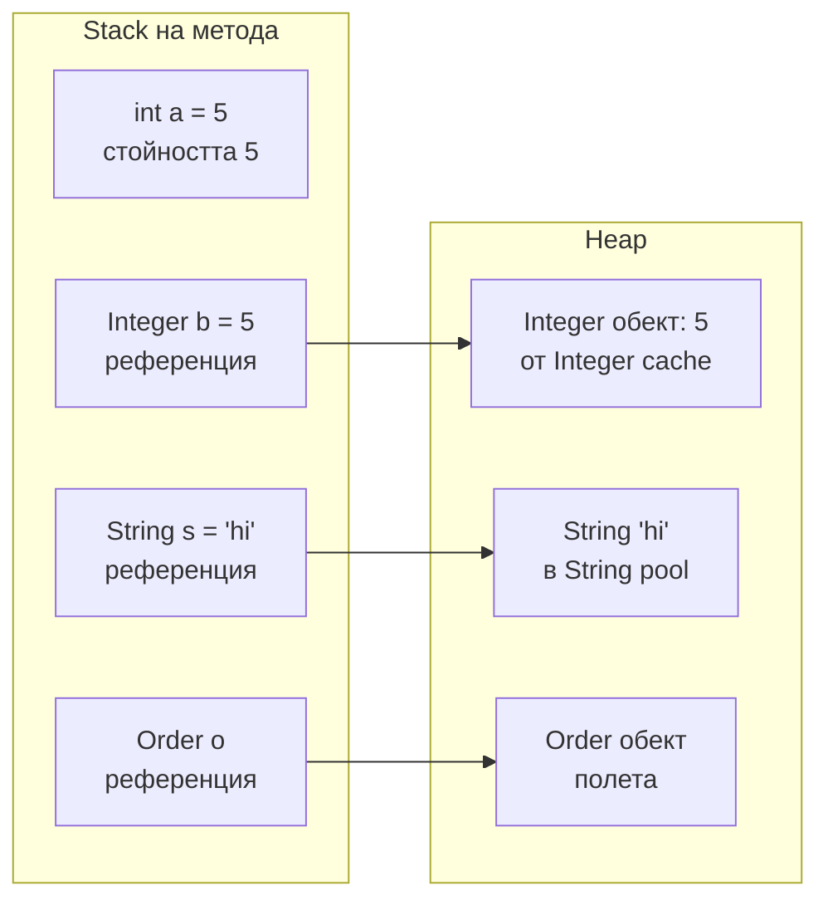
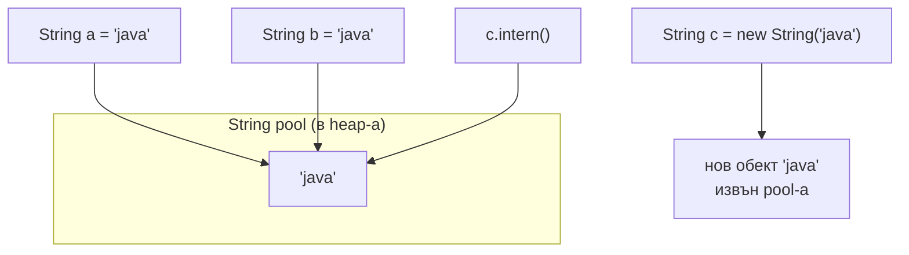

# Типове, boxing и String

Java има два вида типове: осем примитива (`int`, `long`, `double`, `boolean`, `char`, `byte`, `short`, `float`), които съдържат самата стойност, и референтни типове (всички обекти, масиви, `String`), при които променливата съдържа референция към обект в heap-а. Всеки примитив има обвиващ клас (`Integer`, `Long`...), а компилаторът превръща между тях автоматично (autoboxing). `String` е неизменим обект с отделен pool за литералите. Аргументите на методите винаги се подават по стойност, включително референциите.

## 1. За какво се ползва и защо ни е нужен

От тези правила идват едни от най-честите бъгове и въпроси на интервю:

- `Integer a = 127, b = 127; a == b` е `true`, а при 128 е `false`;
- `NullPointerException` на ред, на който "няма обект" (`int x = map.get(key)` при липсващ ключ);
- конкатенация на низове в цикъл, която прави хиляди временни обекти;
- "Java pass-by-reference ли е?" (не е);
- `Map<Long, ...>` и `get(1)`, който връща `null`, защото `1` е `Integer`.

## 2. Примитив срещу референция



| | Примитив | Обвиващ клас |
|---|---|---|
| Пример | `int`, `long`, `boolean` | `Integer`, `Long`, `Boolean` |
| Стойност по подразбиране (поле) | `0`, `false` | `null` |
| Може ли да е `null` | Не | Да |
| В колекции и generics | Не | Да (`List<Integer>`) |
| `==` | Сравнява стойности | Сравнява референции |
| Памет | 4 байта за `int` | Обект: заглавие + стойност, около 16 байта |

## 3. Autoboxing и Integer cache

```java Boxing.java
import java.util.HashMap;
import java.util.Map;

public class Boxing {
    public static void main(String[] args) {
        Integer a = 127, b = 127;
        System.out.println(a == b);           // true: Integer.valueOf кешира -128..127
        Integer c = 128, d = 128;
        System.out.println(c == d);           // false: два различни обекта
        System.out.println(c.equals(d));      // true: сравнение по стойност

        Map<String, Integer> stock = new HashMap<>();
        try {
            int qty = stock.get("missing");   // auto-unboxing на null
        } catch (NullPointerException e) {
            System.out.println("NPE при unboxing");
        }

        Map<Long, String> users = new HashMap<>();
        users.put(1L, "Ана");
        System.out.println(users.get(1));     // null: 1 е Integer, не Long
        System.out.println(users.get(1L));    // Ана
    }
}
// true
// false
// true
// NPE при unboxing
// null
// Ана
```

`Integer a = 127` се компилира до `Integer.valueOf(127)`, който връща кеширан обект за стойности от -128 до 127. Извън този диапазон създава нов обект. Затова обвиващи класове се сравняват само с `equals`.

## 4. String



- **Неизменим (immutable):** всяка "промяна" (`concat`, `replace`, `toUpperCase`) връща нов обект. Затова е безопасен за споделяне между нишки, като ключ в `HashMap` (hashCode се кешира) и за сигурност (не може да се подмени след проверка).
- **String pool:** литералите и compile-time константите се пазят в общ pool, така че еднаквите литерали са един и същ обект. `new String("java")` винаги създава нов.
- **Конкатенация:** `a + b` в един израз се компилира ефективно (от Java 9 чрез `invokedynamic`). В цикъл обаче всяка итерация създава нов низ. Ползвай `StringBuilder` (не thread-safe, бърз) или `String.join`, `Collectors.joining`.
- **Сравнение:** винаги `equals`. `==` сравнява референции и "работи" само случайно, за литерали от pool-а.

## 5. Pass-by-value

```java PassByValue.java
public class PassByValue {
    static class Box { int value; }

    static void reassign(Box box) {
        box = new Box();          // сменя локалното копие на референцията
        box.value = 99;
    }

    static void mutate(Box box) {
        box.value = 42;           // променя обекта, към който сочи копието
    }

    public static void main(String[] args) {
        Box b = new Box();
        reassign(b);
        System.out.println(b.value);   // 0: оригиналната референция не е сменена
        mutate(b);
        System.out.println(b.value);   // 42: обектът е общ
    }
}
```

Java подава копие на стойността на аргумента. За примитив това е числото. За обект това е референцията (адресът). Методът може да промени обекта през копието, но не може да накара оригиналната променлива да сочи към друг обект.

## 6. Въпроси на интервю

### Pass-by-value или pass-by-reference е Java?

Винаги pass-by-value. При обекти стойността, която се копира, е референцията. Затова методът може да промени състоянието на подадения обект, но присвояване на параметъра на нов обект не се вижда отвън.

### Защо `Integer` 127 `==` 127 е `true`, а 128 `==` 128 е `false`?

Autoboxing ползва `Integer.valueOf`, който кешира стойностите от -128 до 127. В този диапазон двете променливи сочат към един и същ обект. Извън него се създават различни обекти, а `==` сравнява референции. Правилото: обвиващи класове се сравняват с `equals`.

### Защо `String` е immutable?

Безопасност (низ, проверен като път или URL, не може да се промени след проверката), thread safety без синхронизация, String pool (споделянето е възможно само ако никой не може да промени обекта) и кеширан `hashCode`, което прави низовете бързи ключове в `HashMap`.

### Каква е разликата между `String`, `StringBuilder` и `StringBuffer`?

`String` е неизменим. `StringBuilder` е изменим буфер, бърз, не е thread-safe. `StringBuffer` е същото, но методите му са `synchronized`: остарял, рядко нужен. За сглобяване в цикъл ползвай `StringBuilder`.

### Кога да ползваш примитив и кога обвиващ клас?

Примитив по подразбиране: по-малко памет, без `null`, без boxing. Обвиващ клас, когато стойността може да липсва (`null` от базата), в колекции и generics. В JPA entity полета, които може да са `NULL` в базата, трябва да са обвиващи класове.

## 7. Капани и чести грешки

- `==` за `Integer`, `Long`, `String`.
- Unboxing на `null` от `Map.get` или от база данни.
- `Map<Long, X>.get(intValue)`: тихо връща `null`.
- Конкатенация в цикъл с `+=`.
- `double` за пари: `0.1 + 0.2 != 0.3`. Ползвай `BigDecimal` (създаден от низ, не от `double`) или цели числа в стотинки.
- Сравнение на `BigDecimal` с `equals`: `new BigDecimal("1.0").equals(new BigDecimal("1.00"))` е `false` заради скалата. Ползвай `compareTo`.

## 8. Свързани документи

- [equals, hashCode, Comparable](Equals_HashCode.md)
- [Памет и Garbage Collection](Memory_GC.md)
- [Generics и type erasure](Generics.md)
- [HashMap отвътре](HashMap.md)
