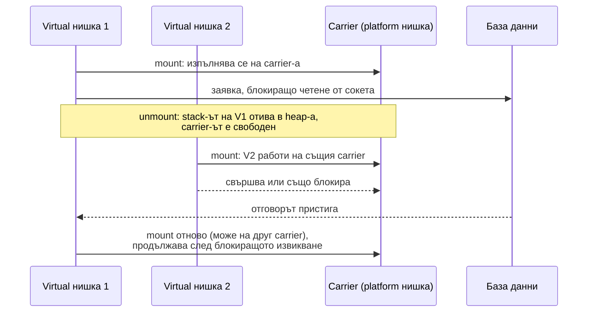
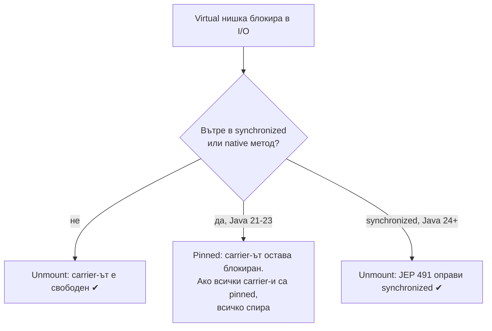

# Virtual threads

Virtual threads (Java 21, Project Loom) са нишки, управлявани от JVM, а не от операционната система. Те са евтини: няколкостотин байта до няколко KB, а не мегабайт stack, и могат да са милиони. Изпълняват се върху малък брой platform нишки, наречени carrier. Когато virtual нишка блокира в I/O, `sleep` или чакане на lock, JVM я "откача" (unmount) от carrier-а, запазва stack-а ѝ в heap-а и пуска друга virtual нишка на същия carrier. Резултатът: прост блокиращ код с мащабируемостта на асинхронния.

## 1. За какво се ползва и защо ни е нужен

Класическият Spring MVC модел е една нишка на заявка. При 200 нишки в Tomcat и заявки, които чакат базата или външно API по 500 ms, сървърът обслужва най-много 400 заявки в секунда, а CPU стои неизползван. Досега решенията бяха по-голям pool (скъпо по памет) или реактивен код (WebFlux, `CompletableFuture`), който е труден за писане, дебъг и четене на stack traces.

Virtual threads позволяват да запазиш простия блокиращ стил и да имаш хиляди едновременни заявки. В Spring Boot 3.2+ се включват с една настройка: `spring.threads.virtual.enabled=true`. Tomcat, `@Async` и scheduler-ите започват да ползват virtual нишки.

На интервю питат: как работят (mount/unmount), кога помагат и кога не, какво е pinning, защо не се слагат в pool.

## 2. Как работят



- Carrier нишките са в `ForkJoinPool` с брой, равен на броя на ядрата.
- Блокиращите операции в JDK (сокети, `Thread.sleep`, `BlockingQueue`, `ReentrantLock`, `CompletableFuture.get`) са пренаписани да откачат virtual нишката, вместо да блокират carrier-а.
- Virtual нишките са винаги daemon и нямат приоритет.

## 3. Минимален пример

```java VirtualDemo.java
import java.time.Duration;
import java.util.concurrent.*;
import java.util.stream.IntStream;

public class VirtualDemo {
    static void handle(int i) {
        try { Thread.sleep(Duration.ofMillis(500)); } catch (InterruptedException e) { Thread.currentThread().interrupt(); }
    }

    static long run(ExecutorService executor, int tasks) {
        long start = System.nanoTime();
        try (executor) {                                    // close() чака всички задачи
            IntStream.range(0, tasks).forEach(i -> executor.submit(() -> handle(i)));
        }
        return (System.nanoTime() - start) / 1_000_000;
    }

    public static void main(String[] args) {
        int tasks = 10_000;                                 // 10 000 "заявки", всяка чака 500 ms
        System.out.println("platform pool от 200 нишки: " + run(Executors.newFixedThreadPool(200), tasks) + " ms");
        System.out.println("virtual нишка на задача:    " + run(Executors.newVirtualThreadPerTaskExecutor(), tasks) + " ms");

        Thread vt = Thread.ofVirtual().unstarted(() -> {});
        System.out.println("isVirtual: " + vt.isVirtual() + ", daemon: " + vt.isDaemon());
    }
}
```

```text output
platform pool от 200 нишки: 25222 ms
virtual нишка на задача:    563 ms
isVirtual: true, daemon: true
```

200 platform нишки обработват задачите на 50 вълни по 500 ms. 10 000 virtual нишки чакат едновременно. Работата е I/O чакане, затова броят на ядрата няма значение.

## 4. Кога помагат и кога не

| Помагат | Не помагат |
|---|---|
| Много едновременни задачи, които чакат I/O: заявки към база, HTTP, опашки | CPU-тежка работа: ядрата са същите, а virtual нишките не добавят изчислителна мощ |
| Thread-per-request сървъри (Tomcat, Jetty) | Когато тясното място е pool-ът към базата (HikariCP с 10 връзки остава 10) |
| Код, който иначе би станал реактивен | Код, който държи `synchronized` по време на I/O в Java 21-23 (pinning) |

## 5. Pinning и други капани



- **Pinning:** в Java 21 virtual нишка, която блокира вътре в `synchronized` блок, не може да се откачи и блокира carrier-а. Решение в Java 21: `ReentrantLock` вместо `synchronized` около I/O. Диагностика: `-Djdk.tracePinnedThreads=full` или JFR събитието `jdk.VirtualThreadPinned`. От Java 24 `synchronized` вече не pin-ва.
- **Не ги слагай в pool:** те са евтини за създаване. Pool от virtual нишки обезсмисля идеята. Нова нишка на задача.
- **Ограничавай ресурса, не нишките:** 10 000 virtual нишки, които едновременно удрят външно API, ще го претоварят. Ползвай `Semaphore` за броя едновременни извиквания.
- **`ThreadLocal`:** работи, но с милиони нишки скъпи стойности в `ThreadLocal` (кешове на обекти) изяждат паметта. Scoped values са алтернативата (preview в Java 21).
- **Structured concurrency** (`StructuredTaskScope`): API за група подзадачи с общ живот и отказ. В Java 21 е preview.

## 6. Въпроси на интервю

### Какво са virtual threads?

Леки нишки, управлявани от JVM, въведени в Java 21. Изпълняват се върху малък брой platform (carrier) нишки. При блокиращ I/O virtual нишката се откача от carrier-а и stack-ът ѝ се пази в heap-а, така че carrier-ът обслужва други. Позволяват милиони едновременни нишки с обикновен блокиращ код.

### По-бързи ли са virtual threads?

Не изпълняват кода по-бързо. Дават по-висока пропускателна способност (повече едновременни задачи), когато задачите чакат I/O. За CPU-тежка работа няма полза.

### Какво е pinning?

Ситуация, в която virtual нишка не може да се откачи от carrier-а при блокиране: в Java 21-23 вътре в `synchronized` блок и при native извиквания. Carrier-ът остава зает. Ако всички са pinned, приложението спира да обработва. Решението беше `ReentrantLock`; в Java 24 проблемът със `synchronized` е отстранен.

### Защо не трябва да слагаш virtual threads в pool?

Pool-ът съществува, за да преизползва скъпи ресурси. Virtual нишките са евтини, така че ограничаването им в pool само ограничава паралелизма. За ограничаване на достъпа до ресурс се ползва `Semaphore`.

### Virtual threads или WebFlux?

За ново приложение с блокиращи библиотеки (JDBC, JPA, класически HTTP клиенти) virtual threads дават сходна мащабируемост с много по-прост код. WebFlux остава смислен за стрийминг, backpressure и когато целият стек вече е реактивен.

## 7. Капани и чести грешки

- Очакване, че virtual threads ускоряват CPU работа.
- `synchronized` около блокиращ I/O в Java 21.
- Pool от virtual нишки.
- Липса на ограничение към базата или външно API: тясното място се мести там.
- Големи обекти в `ThreadLocal` при много нишки.

## 8. Свързани документи

- [Нишки и жизнен цикъл](Threads.md)
- [ExecutorService и CompletableFuture](Executors.md)
- [Пътят на HTTP заявката](Spring_MVC.md)
- [Locks, atomics, конкурентни колекции](Locks_Atomics.md)
