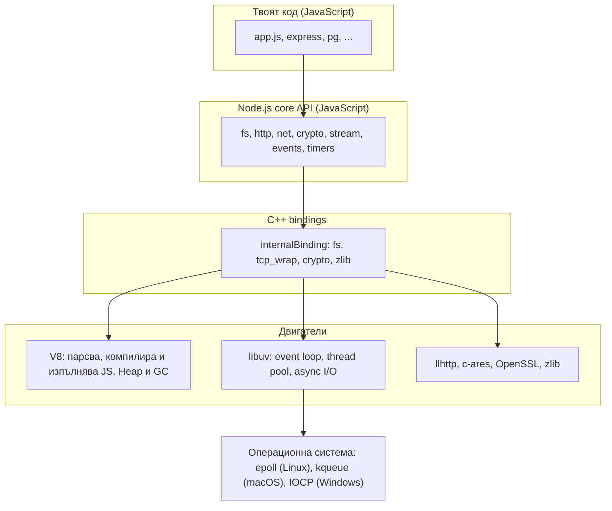
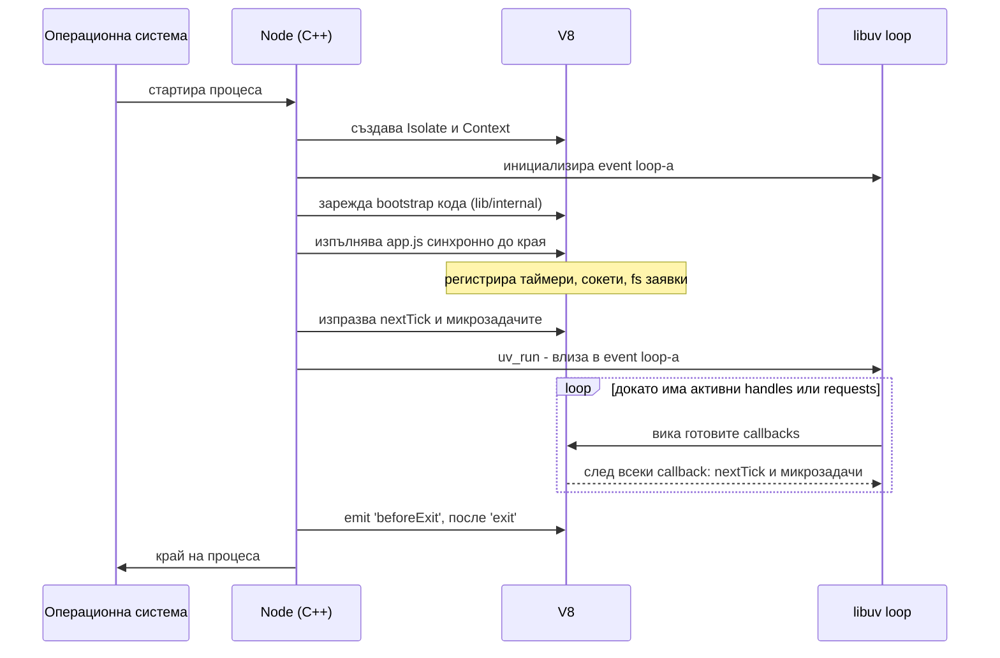

# Архитектура: V8 и libuv

Node.js е runtime, който изпълнява JavaScript извън браузъра. Състои се от три слоя: V8 изпълнява JavaScript кода, libuv (C библиотека) дава event loop-а и асинхронния I/O, а C++ bindings ги свързват. Твоят JavaScript работи на една нишка, но самият процес има още нишки, които вършат I/O работата вместо нея.

## 1. За какво се ползва и защо ни е нужен

Типичният backend прекарва по-голямата част от времето си в чакане: на базата данни, на друг сървис, на диска. Класическият модел "една нишка на заявка" (Apache, ранни Java сървъри) държи нишка блокирана през цялото това чакане. Всяка нишка струва памет (стек от порядъка на 1 MB) и превключване на контекст, така че 10 000 едновременни връзки означават 10 000 нишки.

Node обръща модела: една нишка изпълнява целия JavaScript, а чакането е делегирано на операционната система и на libuv. Докато заявка А чака базата, нишката обслужва заявки Б, В и Г. Когато отговорът за А пристигне, неговият callback влиза в опашка и се изпълнява, щом нишката се освободи.

- **Силна страна:** много едновременни връзки с малко памет. Подходящо за API gateway, BFF, real-time (WebSockets), proxy, стрийминг.
- **Слаба страна:** CPU-тежка работа (криптиране на голям файл, обработка на изображения, сложни изчисления) блокира единствената нишка и спира всички заявки. За нея има [Worker Threads](Concurrency.md).

На интервю: "Node е single-threaded" е половин истина. JavaScript кодът ти е на една нишка. Процесът има V8 помощни нишки (GC, компилатор), libuv thread pool (по подразбиране 4 нишки) и нишките, които ти създадеш с `worker_threads`.

## 2. Слоевете на Node.js



| Слой | Какво е | Пример |
|---|---|---|
| Твоят код | Обикновен JavaScript | `fs.readFile('a.txt', cb)` |
| Node core API | JavaScript модулите на Node в `lib/` | `lib/fs.js` проверява аргументите и вика binding-а |
| C++ bindings | Мост между JS и C/C++ | `internalBinding('fs').open(...)` създава `uv_fs_t` заявка |
| V8 | JavaScript engine на Google, същият като в Chrome | Компилира JS до машинен код (Ignition, Sparkplug, Maglev, TurboFan), управлява паметта |
| libuv | Крос-платформена C библиотека за асинхронен I/O | Event loop, таймери, сокети, файлове, thread pool, сигнали, child processes |
| Други | Специализирани C библиотеки | llhttp парсва HTTP, c-ares прави DNS, OpenSSL прави TLS и crypto |

Важно разграничение: V8 не знае нищо за файлове, мрежа или таймери. `setTimeout` и `fs` не са част от JavaScript езика. V8 знае само за обекти, функции, Promise и опашката с микрозадачи. Всичко останало е добавено от Node чрез libuv.

## 3. Какво се случва при `node app.js`



Последователността е:

1. Node създава V8 isolate (изолирана инстанция на engine-а със собствен heap) и libuv loop.
2. Изпълнява целия top-level код на `app.js` синхронно. Тук нищо асинхронно още не е изпълнено, само е регистрирано.
3. Изпразва опашките `process.nextTick` и микрозадачите.
4. Влиза в event loop-а. Всяка итерация пита: има ли нещо живо (отворен сървър, активен таймер, чакаща fs заявка)? Ако да, продължава. Ако не, процесът излиза.

Затова скрипт с `setTimeout(fn, 5000)` живее 5 секунди, а скрипт с `server.listen(3000)` живее вечно: listen сокетът е активен handle.

## 4. Минимален пример

```js architecture.js
const fs = require('node:fs');

console.log('1. старт');                       // синхронно, на главната нишка

fs.readFile(__filename, () => {                // заявката отива към libuv thread pool
  console.log('3. файлът е прочетен');         // callback-ът се връща в poll фазата
});

setTimeout(() => {                             // таймерът се записва в libuv, не в отделна нишка
  console.log('4. таймерът изтече');
}, 100);

console.log('2. край на синхронния код');      // V8 стига до тук, преди каквото и да е от горното

// Изход:
// 1. старт
// 2. край на синхронния код
// 3. файлът е прочетен
// 4. таймерът изтече
```

Синхронният код винаги свършва изцяло, преди да се изпълни който и да е callback. Callback-ите идват от event loop-а, който започва да върти едва след като стекът е празен.

## 5. Въпроси на интервю

### Node.js single-threaded ли е?

JavaScript кодът се изпълнява на една нишка: в даден момент се изпълнява точно една функция от твоя код. Процесът обаче е многонишков. V8 има нишки за garbage collection и оптимизираща компилация. libuv има thread pool (4 нишки по подразбиране) за файлове, DNS lookup, част от crypto и zlib. С `worker_threads` можеш да създадеш и нишки със собствен JS.

### Каква е разликата между V8 и libuv?

V8 изпълнява JavaScript: парсва, компилира, управлява heap-а и GC, поддържа call stack-а и опашката с микрозадачи (Promise). libuv дава всичко, което не е език: event loop, асинхронни сокети, файлове, таймери, процеси, сигнали и thread pool. V8 се ползва и в Chrome и Deno. libuv е създаден специално за Node и се ползва и от други проекти.

### Защо Node е добър за I/O и лош за CPU работа?

При I/O нишката само регистрира операцията и продължава. Чакането го поема ядрото на ОС (за мрежата) или thread pool-ът (за файлове). При CPU работа няма какво да се делегира: изчислението трябва да се направи от някого, а ако го прави главната нишка, никой друг callback не може да се изпълни. Една заявка, която смята 2 секунди, забавя с 2 секунди всички останали.

### Какво значи non-blocking I/O?

Извикването връща веднага, без да чака резултата. Резултатът идва по-късно като callback, Promise или събитие. Обратното, blocking I/O (`fs.readFileSync`), спира нишката, докато операцията свърши.

### Какво е "event-driven architecture" в контекста на Node?

Програмата не следва линеен поток, а реагира на събития: пристигнала връзка, прочетени данни, изтекъл таймер. Всяко събитие води до изпълнение на регистриран callback. `EventEmitter` е JS страната на модела, а event loop-ът е механизмът, който доставя събитията.

### Какво държи процеса жив?

Активни handles и requests в libuv: слушащ сървър, отворен сокет, активен таймер, чакаща fs операция, child process. Всеки от тях може да бъде "unref"-нат (`timer.unref()`, `server.unref()`), тогава не държи процеса жив. Когато не остане нищо активно, loop-ът спира и процесът излиза.

## 6. Капани и чести грешки

- Да кажеш "Node е многонишков, защото има thread pool". Thread pool-ът не изпълнява твоя JavaScript, а само C код на libuv.
- Да мислиш, че мрежовите заявки минават през thread pool-а. Мрежовият I/O е неблокиращ на ниво ОС (epoll, kqueue, IOCP) и не заема нишки. Виж [libuv и thread pool](Libuv.md).
- Да смяташ `setTimeout` за част от JavaScript. Той е API на средата (Node или браузъра), не на езика.
- Да пуснеш CPU-тежка работа в request handler. Цената плащат всички заявки, не само текущата. Виж [Блокиране на event loop-а](Blocking.md).

## 7. Свързани документи

- [Event Loop: фазите](Event_Loop.md)
- [libuv и thread pool](Libuv.md)
- [Child processes, Workers, Cluster](Concurrency.md)
- [Памет и Garbage Collection](Memory_GC.md)
