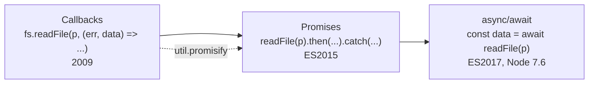
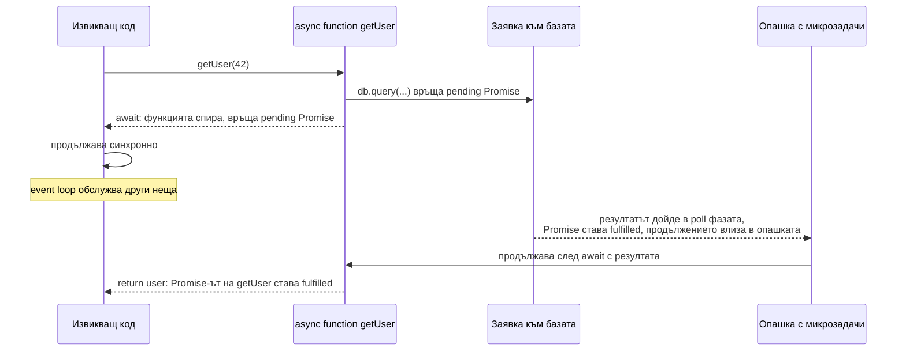

# Асинхронни модели

Асинхронният код в Node е минал през три етапа: callbacks с error-first конвенция, Promises и `async/await`, който е синтаксис над Promises. И трите описват едно и също: "започни операцията, продължи, и когато резултатът е готов, изпълни това". Разликата е в четимостта, обработката на грешки и композицията.

## 1. За какво се ползва и защо ни е нужен

Всеки I/O в Node е асинхронен, така че почти всеки backend код е асинхронен. Грешките в асинхронния код са сред най-честите production бъгове:

- забравен `await` и необработен отхвърлен Promise, който сваля процеса;
- `await` в цикъл, който прави 100 заявки последователно за 10 секунди вместо паралелно за 100 ms;
- `Promise.all` над 10 000 елемента, който отваря 10 000 връзки към базата едновременно;
- грешка, хвърлена в callback, която `try/catch` около извикването не хваща.

## 2. Еволюцията



### Callbacks: error-first

```js callbacks.js
const fs = require('node:fs');

fs.readFile('a.json', 'utf8', (err, data) => {
  if (err) return console.error(err);           // винаги първо грешката
  fs.readFile(JSON.parse(data).next, 'utf8', (err, data2) => {
    if (err) return console.error(err);
    // ... всяка следваща стъпка е едно ниво по-навътре ("callback hell")
  });
});
```

Конвенцията: първият аргумент е грешката (или `null`), следващите са резултатът. Проблемите са влагане, ръчно разпространение на грешки на всяко ниво и това, че `throw` вътре в callback не може да бъде хванат от код извън него.

### Promises

Promise е обект, който представя бъдещ резултат. Има три състояния: `pending`, `fulfilled`, `rejected`. Сменя състоянието само веднъж. `.then` и `.catch` callbacks винаги се изпълняват като микрозадачи, дори ако Promise-ът вече е изпълнен.

### async/await

`async` функция винаги връща Promise. `await` спира изпълнението на функцията (не на нишката), докато Promise-ът се изпълни, и планира продължението като микрозадача. Грешките се хващат с обикновен `try/catch`.

## 3. Как работи `await` вътре



`async` функция е по същество генератор, обвит в Promise: на всеки `await` състоянието ѝ (локални променливи, позиция) се запазва, а стекът се освобождава.

## 4. Последователно срещу паралелно

```js parallel.mjs
// Последователно: 3 x 100 ms = 300 ms. Правилно само ако втората заявка зависи от първата.
const user = await getUser(id);
const orders = await getOrders(id);
const invoices = await getInvoices(id);

// Паралелно: ~100 ms. Трите заявки са в полет едновременно.
const [user2, orders2, invoices2] = await Promise.all([getUser(id), getOrders(id), getInvoices(id)]);

// Паралелно с лимит: 10 000 id-та, но най-много 10 едновременно
async function mapLimit(items, limit, fn) {
  const results = new Array(items.length);
  let next = 0;
  async function worker() {
    while (next < items.length) {
      const i = next++;                       // безопасно: JS е еднонишков, няма race тук
      results[i] = await fn(items[i]);
    }
  }
  await Promise.all(Array.from({ length: limit }, worker));
  return results;
}
```

| Комбинатор | Изпълнява се, когато | Отхвърля се, когато | Употреба |
|---|---|---|---|
| `Promise.all` | Всички са fulfilled | Първият rejected (останалите продължават, но резултатите им се губят) | Всички резултати са нужни |
| `Promise.allSettled` | Всички са приключили | Никога | Искаш резултата на всеки, независимо от грешките |
| `Promise.race` | Първият приключил (успех или грешка) | Първият приключил е rejected | Timeout на операция |
| `Promise.any` | Първият fulfilled | Всички са rejected (`AggregateError`) | Най-бързата от няколко реплики |

## 5. Отказ и timeout с AbortSignal

```js abort.mjs
import { setTimeout as sleep } from 'node:timers/promises';

// fetch, fs, stream, timers, child_process приемат signal
async function fetchWithTimeout(url) {
  const res = await fetch(url, { signal: AbortSignal.timeout(2000) });   // отказ след 2 s
  return res.json();
}

// Собствен отказ: например при Ctrl+C или когато клиентът затвори връзката (req.on('close'))
const controller = new AbortController();
process.once('SIGINT', () => controller.abort());
await sleep(5000, undefined, { signal: controller.signal });             // хвърля AbortError при abort
```

`Promise.race` с таймер също дава timeout, но не спира операцията: заявката продължава да виси. `AbortSignal` наистина я прекратява.

## 6. Promisify и callbackify

```js promisify.js
const util = require('node:util');
const fs = require('node:fs');

const readFile = util.promisify(fs.readFile);   // (path, enc, cb) -> (path, enc) => Promise
readFile('a.txt', 'utf8').then(console.log);

// Повечето core модули вече имат Promise версия:
// node:fs/promises, node:timers/promises, node:stream/promises, node:dns/promises
```

## 7. Въпроси на интервю

### Каква е разликата между callback, Promise и async/await?

Callback е функция, подадена на операцията и извикана при край, с грешка като първи аргумент. Promise е обект за бъдещ резултат, който може да се подава, комбинира (`all`, `race`) и верижи с `.then`. `async/await` е синтаксис над Promises, който позволява асинхронен код да изглежда последователен и грешките да се хващат с `try/catch`. Под капака `await` е `.then`, а продължението е микрозадача.

### Блокира ли `await` нишката?

Не. Спира само текущата `async` функция. Главната нишка се връща към event loop-а и обслужва други неща. Когато Promise-ът се изпълни, функцията продължава в микрозадача.

### Какво става, ако Promise бъде отхвърлен и никой не го хване?

Node emit-ва `'unhandledRejection'`. От Node 15 поведението по подразбиране е `--unhandled-rejections=throw`: ако няма listener, rejection-ът се превръща в uncaught exception и процесът пада. Виж [Грешки и graceful shutdown](Errors_Shutdown.md).

### Защо `try/catch` не хваща грешка в `setTimeout` callback?

Callback-ът се изпълнява по-късно, от event loop-а, с друг call stack. `try` блокът отдавна е приключил. Грешката трябва да се хване вътре в callback-а или операцията да се обвие в Promise и да се `await`-не.

### `forEach` с async callback?

`array.forEach(async (x) => await save(x))` не чака нищо: `forEach` игнорира върнатите Promises. Функцията продължава веднага, а грешките стават unhandled rejections. Ползвай `for...of` с `await` (последователно) или `Promise.all(array.map(...))` (паралелно).

### Каква е разликата между `return promise` и `return await promise` в async функция?

В `try` блок има значение: при `return await` грешката се хваща от `catch` на същата функция, при `return promise` излиза навън. Извън `try` резултатът е същият, а `return await` дори е малко по-бърз в съвременния V8. Освен това `return await` пази функцията в async stack trace.

## 8. Капани и чести грешки

- Забравен `await`: функцията продължава без резултата, грешката е unhandled.
- `await` в цикъл за независими операции.
- `Promise.all` без лимит над голям масив.
- `async` callback в `forEach`, `map` без `Promise.all`, `filter`, `reduce`.
- Смесване на callbacks и Promises в една функция (callback се вика два пъти или никога).
- `new Promise(async (resolve, reject) => ...)`: грешка в async executor не отхвърля Promise-а.
- Timeout с `Promise.race` без отказ на операцията: ресурсите продължават да се използват.

## 9. Свързани документи

- [nextTick и микрозадачи](Microtasks.md)
- [Ред на изпълнение](Execution_Order.md)
- [Грешки и graceful shutdown](Errors_Shutdown.md)
- [EventEmitter](Event_Emitter.md)
