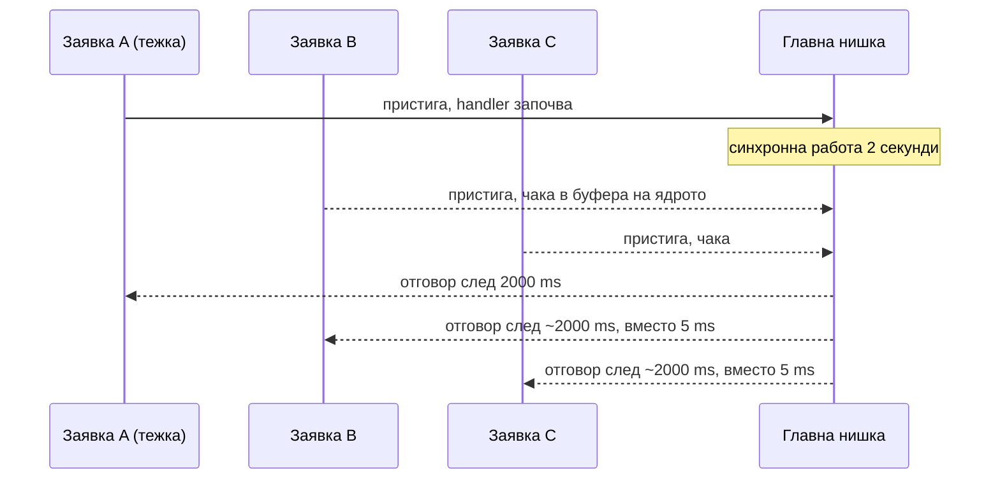
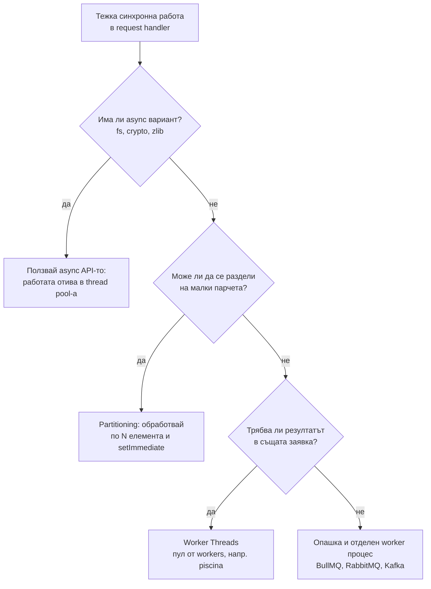

# Блокиране на event loop-а

Event loop-ът е блокиран, когато един callback държи главната нишка дълго време. Докато той се изпълнява, нищо друго не може да се случи: нови заявки не се приемат, таймери не тръгват, отговори от базата стоят непрочетени. Тъй като всички заявки споделят една нишка, бавна операция в една заявка става бавна за всички.

## 1. За какво се ползва и защо ни е нужен

Това е най-важният практически извод от модела на Node и почти сигурен въпрос на интервю. В Java или Go тежка заявка заема една нишка или goroutine, а останалите продължават. В Node тежка заявка спира целия процес.

Типични причини в реален код:

- синхронни API-та в request handler: `fs.readFileSync`, `crypto.pbkdf2Sync`, `zlib.gzipSync`, `child_process.execSync`;
- `JSON.parse` или `JSON.stringify` на отговор от десетки мегабайти;
- сортиране, филтриране или трансформация на масив със стотици хиляди елементи;
- регулярен израз с катастрофален backtracking (ReDoS), виж [Сигурност](Security.md);
- генериране на PDF, преоразмеряване на изображения, сложни изчисления;
- безкрайна верига от `process.nextTick` или Promise (starvation).

Симптоми: p99 латентността скача, health check-ът (`/healthz`) изтича и Kubernetes рестартира pod-а, WebSocket връзките изпускат ping, таймерите закъсняват, а CPU на процеса е 100% на едно ядро.

## 2. Как изглежда във времето



Заявки B и C не са направили нищо тежко, но платиха цялото време на A. При 100 заявки в секунда една такава операция трупа опашка, която се изчиства бавно.

## 3. Как се измерва

Event loop delay (лаг) е колко закъснява един таймер спрямо планираното. Event loop utilization (ELU) е какъв процент от времето loop-ът е бил зает, а не в poll чакане.

```js measure.js
const { monitorEventLoopDelay, performance } = require('node:perf_hooks');

const histogram = monitorEventLoopDelay({ resolution: 20 });  // мери на всеки 20 ms
histogram.enable();

let lastELU = performance.eventLoopUtilization();

setInterval(() => {
  const elu = performance.eventLoopUtilization(lastELU);      // разлика спрямо предишното
  lastELU = performance.eventLoopUtilization();
  console.log({
    p99LagMs: histogram.percentile(99) / 1e6,                 // стойностите са в наносекунди
    maxLagMs: histogram.max / 1e6,
    utilization: elu.utilization.toFixed(2),                  // 0 = свободен, 1 = винаги зает
  });
  histogram.reset();
}, 5000).unref();                                              // да не държи процеса жив
```

Ориентири: лаг под 10-20 ms е нормален, стотици ms са проблем. ELU близо до 1 значи, че процесът е CPU-bound и няма време за I/O. Изнеси тези числа като Prometheus метрики. За да намериш кой код блокира, ползвай CPU профил (`node --cpu-prof` или Chrome DevTools), виж [Мониторинг и debugging](Performance.md).

## 4. Решения



| Решение | Кога | Цена |
|---|---|---|
| Async API | Има такова (fs, crypto, zlib) | Почти нулева. Внимавай за насищане на пула |
| Partitioning със `setImmediate` | Цикъл върху много елементи, всеки е евтин | Общото време е малко по-голямо, но loop-ът диша |
| Worker Threads | CPU работа, резултатът трябва веднага | Нишка струва памет. Данните се копират между нишките |
| Опашка и отделен сървис | Тежка работа, може да е асинхронна за потребителя (отчети, видео) | Повече инфраструктура, но мащабира отделно |
| Streaming | Голям вход или изход (JSON, CSV, файлове) | Малко повече код, константна памет. Виж [Streams](Streams.md) |

## 5. Минимален пример: partitioning

```js partition.js
// Лошо: един callback обработва милион елемента и блокира loop-а ~секунди
function sumBlocking(items) {
  let sum = 0;
  for (const x of items) sum += heavy(x);
  return sum;
}

// Добре: по 1000 елемента, после отстъпва на loop-а
function sumPartitioned(items) {
  return new Promise((resolve) => {
    let i = 0;
    let sum = 0;
    function chunk() {
      const end = Math.min(i + 1000, items.length);
      for (; i < end; i++) sum += heavy(items[i]);
      if (i < items.length) {
        setImmediate(chunk);   // check фазата: преди следващото парче loop-ът минава през poll и I/O
      } else {
        resolve(sum);
      }
    }
    chunk();
  });
}

function heavy(x) {
  return Math.sqrt(x) * Math.sin(x);
}
```

Защо `setImmediate`, а не `process.nextTick` или `Promise.resolve().then(chunk)`? Защото nextTick и микрозадачите се изпълняват в една и съща "пауза", без loop-ът да мине през poll. Резултатът би бил същото блокиране, само разделено на функции. `setImmediate` пуска следващото парче в check фазата, а между две парчета loop-ът обработва чакащия I/O.

## 6. Минимален пример: Worker Thread

```js hash-worker.js
const { Worker, isMainThread, parentPort, workerData } = require('node:worker_threads');

if (isMainThread) {
  // Главната нишка: пуска worker и чака резултата, без да блокира
  function fib(n) {
    return new Promise((resolve, reject) => {
      const worker = new Worker(__filename, { workerData: n });
      worker.once('message', resolve);   // резултатът идва като събитие в poll фазата
      worker.once('error', reject);
    });
  }
  fib(42).then((r) => console.log('fib(42) =', r));
  setInterval(() => console.log('loop-ът е жив'), 200).unref();
} else {
  // Worker нишката: собствен V8 isolate и собствен event loop
  const f = (n) => (n < 2 ? n : f(n - 1) + f(n - 2));
  parentPort.postMessage(f(workerData));
}
```

В production не създавай worker за всяка заявка (стартирането струва десетки ms и памет). Ползвай пул, например библиотеката `piscina`. Подробно в [Child processes, Workers, Cluster](Concurrency.md).

## 7. Въпроси на интервю

### Как блокирането на event loop-а срива цялото приложение?

Всички заявки се обслужват от една нишка. Ако един handler смята 2 секунди синхронно, през тези 2 секунди не се приемат връзки, не се четат отговори от базата, не тръгват таймери. Health check-ът не отговаря, load balancer-ът или Kubernetes маркират инстанцията като мъртва и я рестартират, а всички заявки в нея се губят. Едно "бавно" място в кода става отказ на услугата.

### Как разбираш, че loop-ът е блокиран?

Мериш event loop delay с `perf_hooks.monitorEventLoopDelay` и utilization с `performance.eventLoopUtilization()`. Изнасяш ги като метрики и алармираш при висок p99. За конкретната причина правиш CPU профил и търсиш широки синхронни frames във flame graph-а.

### Ще помогне ли `async` пред функцията?

Не. `async function` с тежък синхронен цикъл вътре пак блокира: кодът до първия `await` е синхронен, а цикълът няма `await`. Async не означава "в друга нишка".

### Ще помогне ли Cluster?

Частично. С N процеса една блокирана заявка спира само 1/N от капацитета. Но в този процес всички заявки пак чакат. Правилното решение е да не блокираш, а Cluster е за използване на всички ядра.

### Как се дебъгва блокиране в production?

Метрики за лаг (евтини), логване на бавни заявки, и при нужда `--cpu-prof` или `inspector` сесия за кратко. Може и `--trace-sync-io`, което печата warning за всяко синхронно I/O извикване след първия тик.

## 8. Капани и чести грешки

- `readFileSync` в request handler "защото файлът е малък". При натоварване и бавен диск не е.
- `JSON.parse` на голям отговор от външно API. За големи данни ползвай стрийминг парсер.
- Разделяне на работа с Promise или `nextTick`, вместо със `setImmediate`.
- Worker за всяка заявка без пул.
- `bcrypt` или `pbkdf2` с много итерации в синхронния вариант при login.
- Регулярни изрази от потребителски вход, без ограничение на дължината.

## 9. Свързани документи

- [Event Loop: фазите](Event_Loop.md)
- [Child processes, Workers, Cluster](Concurrency.md)
- [Streams и backpressure](Streams.md)
- [Мониторинг и debugging](Performance.md)
- [Сигурност](Security.md)
