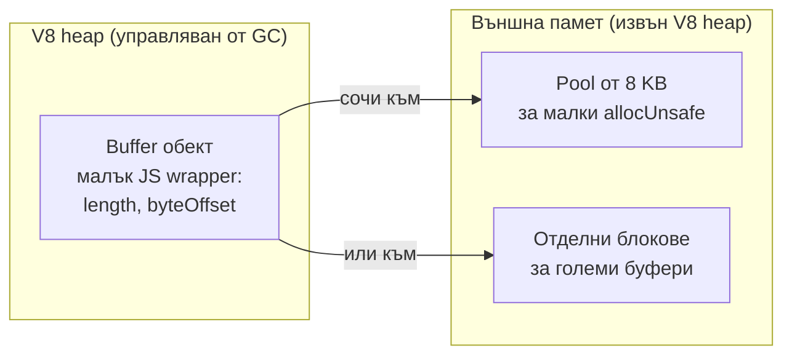

# Buffers и бинарни данни

`Buffer` е клас на Node за работа със сурови байтове: съдържание на файл, TCP пакет, изображение, криптографски ключ. Той е подклас на `Uint8Array` с фиксиран размер, а паметта му е извън V8 heap-а, затова големи бинарни данни не натоварват garbage collector-а по същия начин като обикновените обекти.

## 1. За какво се ползва и защо ни е нужен

JavaScript е проектиран за текст и числа. Низовете са UTF-16 и неизменими, така че не стават за байтове от мрежата или диска. Node добавя `Buffer`, за да може да:

- чете и пише файлове и сокети без конвертиране (стриймовете по подразбиране дават `Buffer` парчета);
- превръща между кодировки: UTF-8, Base64, hex, latin1;
- парсва бинарни протоколи (заглавия на PNG, протоколът на PostgreSQL, WebSocket frames) с `readUInt32BE`, `readInt16LE` и подобни;
- работи с криптография, където ключове и хешове са байтове.

## 2. Къде живее паметта



Самият JS обект е малък и е в heap-а. Байтовете са във външна памет, която V8 следи като "external memory". Когато обектът бъде събран от GC, паметта се освобождава. Това е причината `process.memoryUsage()` да показва отделно `heapUsed`, `external` и `arrayBuffers`.

За малки буфери Node ползва предварително заделен pool (`Buffer.poolSize`, 8 KB). `Buffer.allocUnsafe(n)` за `n` под половината на pool-а (4 KB) реже парче от него, вместо да заделя нова памет. Това е бързо, но значи, че няколко буфера споделят един и същ `ArrayBuffer`.

## 3. Създаване

| Метод | Какво прави | Безопасно ли е |
|---|---|---|
| `Buffer.alloc(size)` | Заделя и запълва с нули | Да |
| `Buffer.allocUnsafe(size)` | Заделя без нулиране, може да ползва pool-а | Съдържа стари данни от паметта, докато не го запишеш изцяло |
| `Buffer.from('текст', 'utf8')` | От низ в дадена кодировка | Да |
| `Buffer.from([0x48, 0x69])` | От масив от байтове | Да |
| `Buffer.from(arrayBuffer, offset, len)` | Изглед върху съществуващ `ArrayBuffer`, без копие | Да, но споделя паметта |
| `new Buffer(...)` | Остарял, deprecated | Не го ползвай |

## 4. Минимален пример

```js buffer.js
const buf = Buffer.from('Здравей', 'utf8');   // кирилицата е 2 байта на буква в UTF-8

console.log(buf.length);                      // 14: байтове, не символи
console.log('Здравей'.length);                // 7: UTF-16 code units
console.log(buf.toString('hex'));             // d097d0b4d180...
console.log(buf.toString('base64'));          // 0JfQtNGA0LDQstC10Lk=

// Бинарен протокол: 4 байта дължина (big-endian) + съобщение
const msg = Buffer.from('hello');
const frame = Buffer.alloc(4 + msg.length);
frame.writeUInt32BE(msg.length, 0);           // записва 5 в първите 4 байта
msg.copy(frame, 4);                           // копира съобщението след тях
console.log(frame);                           // <Buffer 00 00 00 05 68 65 6c 6c 6f>
console.log(frame.readUInt32BE(0));           // 5

// subarray споделя паметта, не копира
const view = frame.subarray(4);
view[0] = 0x48;                               // 'h' -> 'H'
console.log(frame.toString('utf8', 4));       // Hello: оригиналът също е променен
```

## 5. Кодировки и парчета

UTF-8 символ може да е от 1 до 4 байта. Ако стрийм раздели многобайтов символ между две парчета, `chunk.toString()` на всяко поотделно дава повредени символи (`�`). Решения: `readable.setEncoding('utf8')`, `string_decoder.StringDecoder`, или събиране на всички парчета и `Buffer.concat(chunks).toString()`.

```js concat.js
const chunks = [];
req.on('data', (chunk) => chunks.push(chunk));     // парчетата са Buffer
req.on('end', () => {
  const body = Buffer.concat(chunks).toString('utf8');   // декодираме веднъж, накрая
  console.log(JSON.parse(body));
});
```

## 6. Въпроси на интервю

### Какво е Buffer и защо не ползваме низове?

Buffer е последователност от байтове с фиксиран размер. Низовете в JavaScript са UTF-16, неизменими и предназначени за текст. Бинарните данни (изображения, протоколи, криптография) не са текст и не бива да минават през декодиране. Buffer позволява директен достъп до всеки байт и евтино четене на числа в определен endianness.

### Каква е разликата между `Buffer.alloc` и `Buffer.allocUnsafe`?

`alloc` нулира паметта. `allocUnsafe` не я нулира и може да ползва споделения pool, така че е по-бърз, но новият буфер може да съдържа остатъци от стари данни (пароли, токени). Ползвай `allocUnsafe` само ако веднага ще презапишеш целия буфер.

### Къде е паметта на Buffer?

Извън V8 heap-а. JS обектът е малък wrapper в heap-а, а байтовете са във външна памет, освободена когато wrapper-ът бъде събран. Затова голям Buffer не се брои в `heapUsed`, а в `external` и `arrayBuffers`, и не се ограничава от `--max-old-space-size`.

### Каква е разликата между `slice`, `subarray` и копие?

`buf.subarray()` (и остарелият `buf.slice()`) връщат изглед върху същата памет: промяна в едното се вижда в другото. За независимо копие: `Buffer.from(buf)` или `Uint8Array.prototype.slice.call(buf)`. Внимание: при `Uint8Array` `slice` копира, при `Buffer` `slice` не копира.

### Как четеш голям файл без да го зареждаш целия в Buffer?

С `fs.createReadStream`, който дава парчета от по 64 KB. Паметта е константна, независимо от размера на файла. Виж [Streams](Streams.md).

## 7. Капани и чести грешки

- `buf.length` е в байтове, `str.length` е в UTF-16 единици. За кирилица и емоджи те се различават.
- `chunk.toString()` на всяко парче поотделно чупи многобайтови символи.
- Малък `subarray` от голям Buffer държи целия голям Buffer жив в паметта. Ако пазиш малкото парче дълго, копирай го.
- `allocUnsafe` без пълно презаписване може да изтече чувствителни данни.
- Сравняване на тайни (HMAC, токени) с `===` или `buf.equals`. Ползвай `crypto.timingSafeEqual`.

## 8. Свързани документи

- [Streams и backpressure](Streams.md)
- [File System и async I/O](File_System.md)
- [Памет и Garbage Collection](Memory_GC.md)
