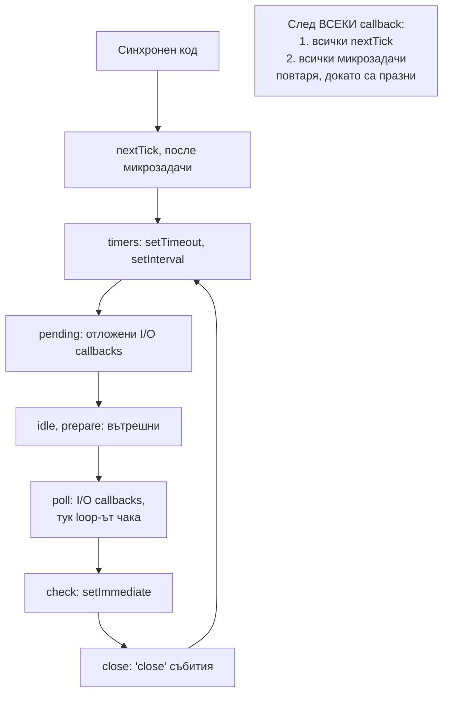

# Бърз преговор

Най-важното от всички теми, сбито за последните 15 минути преди интервюто. Всеки ред е отговор, който можеш да кажеш на глас. За обяснението и диаграмите отвори съответния документ.

## 1. Архитектура в три изречения

JavaScript кодът се изпълнява на една нишка от V8. Всичко асинхронно (мрежа, файлове, таймери) минава през libuv: мрежата с неблокиращ I/O на ОС (epoll, kqueue, IOCP), а файловете, DNS lookup, crypto и zlib в thread pool от 4 нишки. Когато операцията свърши, callback-ът влиза в event loop-а и се изпълнява на главната нишка. Подробно: [Архитектура](Architecture.md), [libuv](Libuv.md).

## 2. Картата на event loop-а

Подробно: [Event Loop: фазите](Event_Loop.md), [nextTick и микрозадачи](Microtasks.md).

## 3. Ред на изпълнение

| Приоритет | Какво | Бележка |
|---|---|---|
| 1 | Синхронен код | Включително executor-а на `new Promise` и кода преди първия `await` |
| 2 | `process.nextTick` | Цялата опашка, и новодобавените |
| 3 | Микрозадачи: `.then`, след `await`, `queueMicrotask` | Цялата опашка. После пак проверка на nextTick |
| 4 | Следващият callback от loop-а | timers → pending → poll → check → close |

Изключения, които питат:

- `setTimeout(0)` срещу `setImmediate` от главния модул: редът не е гарантиран.
- Същото в I/O callback: `setImmediate` винаги е първи.
- В ES модул на top level: Promise преди nextTick.
- От Node 11: микрозадачите се изпълняват след всеки таймер, не след цялата фаза.

Подробно: [Ред на изпълнение](Execution_Order.md).

## 4. Еднолинейни отговори

| Въпрос | Отговор |
|---|---|
| Single-threaded ли е Node? | JS кодът да, процесът не: V8 GC нишки, libuv thread pool, worker threads |
| `nextTick` срещу `setImmediate`? | nextTick: веднага след текущия callback, преди всичко. setImmediate: check фазата, след poll |
| Какво е starvation? | Рекурсивен nextTick или Promise не пуска loop-а до I/O |
| Какво ползва thread pool-а? | fs, `dns.lookup`, `pbkdf2`, `scrypt`, `randomBytes`, zlib. Не и мрежата |
| `UV_THREADPOOL_SIZE`? | По подразбиране 4, максимум 1024, задава се при старт |
| Как се връща резултат от пула? | Нишката слага задачата в "готови", `uv_async_send` събужда loop-а, poll фазата вика callback-а |
| Защо CPU работа е опасна? | Блокира единствената JS нишка, всички заявки чакат |
| Как се разделя тежка работа? | Парчета със `setImmediate`, Worker Threads, или опашка и отделен worker |
| Worker Threads срещу Child Process? | Нишка със собствен isolate, евтина, може обща памет. Процес: пълна изолация, по-скъп |
| Cluster? | N процеса на един порт, primary разпределя round-robin. В Kubernetes вместо това реплики |
| Buffer? | Байтове извън V8 heap, подклас на `Uint8Array` |
| `alloc` срещу `allocUnsafe`? | Нулиран срещу ненулиран и от pool-а: по-бърз, може да съдържа стари данни |
| Backpressure? | `write()` връща `false`, чакаш `'drain'`. `pipeline` го прави сам |
| `pipe` срещу `pipeline`? | `pipeline` разпространява грешките и затваря всички стриймове |
| Синхронен ли е `emit`? | Да. Listeners се изпълняват веднага, в реда на регистрация |
| `'error'` без listener? | `emit` хвърля, процесът пада |
| CJS срещу ESM? | Синхронно, по време на изпълнение, копие срещу статично, асинхронно, live bindings, top-level await |
| `exports` срещу `module.exports`? | `require` връща `module.exports`. `exports = {}` не прави нищо |
| Как работи GC? | Поколения: Scavenge за младите, Mark-Sweep-Compact за старите |
| Причини за изтичане? | Кеш без лимит, listeners, таймери, closures, глобални масиви |
| Unhandled rejection в Node 15+? | Става uncaught exception, процесът пада |
| След `uncaughtException`? | Логни, опитай чисто затваряне с timeout, излез с код 1 |
| Graceful shutdown? | SIGTERM → readiness 503 → `server.close()` → довърши заявките → затвори ресурси → exit |
| Prototype pollution? | `__proto__` във входа замърсява `Object.prototype` за всички обекти |
| ReDoS? | Регулярен израз с backtracking блокира event loop-а |
| Как мериш блокиране? | `monitorEventLoopDelay`, `eventLoopUtilization`, CPU профил |

## 5. Трите числа, които да помниш

| Число | Какво |
|---|---|
| 4 | Нишки в libuv thread pool-а по подразбиране |
| 1 ms | Минималното закъснение на `setTimeout(fn, 0)` |
| 64 KB | `highWaterMark` на байтови стриймове от Node 22 (преди 16 KB) и размерът на парче при `fs.createReadStream` |

## 6. Как да отговаряш

1. **Определение** в едно изречение.
2. **Защо** съществува: какъв проблем решава.
3. **Как работи**, ако може с диаграма на бялата дъска (фазите на loop-а, пътят до thread pool-а и обратно).
4. **Пример** от реален проект.
5. **Капан**, който си срещал или знаеш. Това отличава човек с опит.

## 7. Свързани документи

- [Event Loop: фазите](Event_Loop.md)
- [nextTick и микрозадачи](Microtasks.md)
- [Ред на изпълнение](Execution_Order.md)
- [libuv и thread pool](Libuv.md)
- [Блокиране на event loop-а](Blocking.md)
