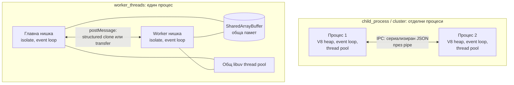
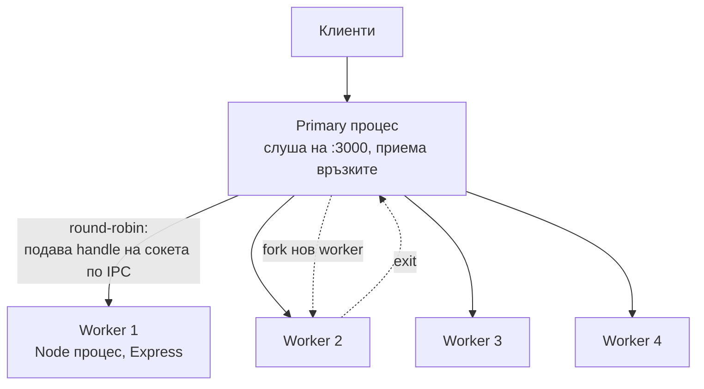

# Child processes, Workers, Cluster

Node има три начина да излезе извън една JavaScript нишка. `child_process` пуска отделен процес на ОС (друга програма или друг Node), `worker_threads` пуска нова нишка със собствен V8 isolate и event loop в същия процес, а `cluster` пуска няколко копия на един Node сървър, които слушат на един и същ порт. Процесите са изолирани и тежки, нишките са по-леки и могат да споделят памет.

## 1. За какво се ползва и защо ни е нужен

Един Node процес изпълнява JavaScript на едно ядро. Сървър с 8 ядра използва 1/8 от CPU-то си, а CPU-тежка задача блокира всички заявки. Трите модула решават различни части от проблема:

- **`child_process`:** да извикаш външна програма (`ffmpeg`, `git`, `imagemagick`, Python скрипт) или да изолираш рискова работа в отделен процес, който може да умре без да свали сървъра.
- **`worker_threads`:** CPU-тежка JavaScript работа (хеширане, парсване, компресия, ML inference), без да блокираш главния loop. Резултатът се връща в същата заявка.
- **`cluster`:** да използваш всички ядра за HTTP сървър без друг инструмент. В контейнери (Kubernetes) обикновено вместо това пускаш повече pod-ове с по един процес.

## 2. Сравнение



| | `child_process` | `worker_threads` | `cluster` |
|---|---|---|---|
| Единица | Процес на ОС | Нишка в същия процес | Процес (през `fork`) |
| Памет | Изцяло отделна | Отделен heap, но може `SharedArrayBuffer` | Изцяло отделна |
| Комуникация | stdin/stdout, IPC (JSON) | `postMessage` (structured clone), transfer, shared memory | IPC (JSON) |
| Цена на старт | ~30-50 ms и десетки MB за Node процес | ~десетина ms и няколко MB | Като процес |
| Срив | Не засяга родителя | Грешка в worker-а е събитие `'error'`, процесът оцелява. `process.exit` в worker спира само него | Primary може да рестартира worker |
| Типична употреба | Външни програми, изолация | CPU работа в JS | HTTP сървър на всички ядра |

## 3. child_process: четирите функции

| Функция | Shell? | Изход | Кога |
|---|---|---|---|
| `spawn(cmd, args)` | Не | Stream (stdout, stderr) | Дълги процеси, голям изход (`ffmpeg`) |
| `execFile(file, args)` | Не | Буфериран в callback | Кратка команда, малък изход (`git rev-parse HEAD`) |
| `exec(command)` | Да (`/bin/sh -c`) | Буфериран, `maxBuffer` 1 MB | Само с фиксиран низ. Никога с потребителски вход |
| `fork(modulePath)` | Не | IPC канал с `send` / `on('message')` | Друг Node скрипт, с който си говориш |

```js spawn.js
const { spawn, execFile } = require('node:child_process');

// spawn: изходът идва като stream, подходящо за дълги процеси
const ff = spawn('ffmpeg', ['-i', 'in.mp4', '-vf', 'scale=640:-1', 'out.mp4']);
ff.stderr.on('data', (chunk) => process.stdout.write(chunk));   // прогрес на ffmpeg
ff.on('close', (code) => console.log('ffmpeg exit code', code));

// execFile: без shell, аргументите са масив, няма command injection
execFile('git', ['rev-parse', 'HEAD'], (err, stdout) => {
  if (err) throw err;
  console.log('commit', stdout.trim());
});
```

Процесът се управлява от libuv: pipes към stdout/stderr са handles в poll фазата, а сигналът за край (SIGCHLD) също минава през loop-а. Главната нишка не чака.

## 4. worker_threads

Всеки worker има собствен V8 isolate, собствен heap и собствен event loop. Не може да вижда променливите на главната нишка. Данните минават по три начина:

1. **Structured clone** (по подразбиране при `postMessage`): обектът се копира. Безопасно, но скъпо за големи данни.
2. **Transfer** (`postMessage(buf, [buf])`): `ArrayBuffer` се премества без копиране. Изпращачът губи достъп до него.
3. **`SharedArrayBuffer`**: истинска обща памет. Синхронизацията е твоя грижа, с `Atomics`.

```js worker-pool.js
const { Worker } = require('node:worker_threads');
const os = require('node:os');

// Минимален пул: N workers, задачите чакат в опашка
class Pool {
  constructor(file, size = os.availableParallelism()) {
    this.idle = [];
    this.queue = [];
    for (let i = 0; i < size; i++) this.idle.push(new Worker(file));
  }
  run(data) {
    return new Promise((resolve, reject) => {
      this.queue.push({ data, resolve, reject });
      this.#next();
    });
  }
  #next() {
    if (!this.idle.length || !this.queue.length) return;
    const worker = this.idle.pop();
    const { data, resolve, reject } = this.queue.shift();
    const done = (fn) => (value) => {
      worker.removeAllListeners();
      this.idle.push(worker);   // връщаме worker-а в пула
      fn(value);
      this.#next();
    };
    worker.once('message', done(resolve));
    worker.once('error', done(reject));
    worker.postMessage(data);
  }
}
```

```js task.js
const { parentPort } = require('node:worker_threads');

parentPort.on('message', (n) => {
  let x = 0;
  for (let i = 0; i < n; i++) x += Math.sqrt(i);   // CPU работа, блокира само тази нишка
  parentPort.postMessage(x);
});
```

В реален проект ползвай готов пул като `piscina`. Горният код е за да видиш идеята. Ако worker-ът хвърли грешка, той умира и трябва да се замени с нов.

## 5. cluster



```js cluster.js
const cluster = require('node:cluster');
const http = require('node:http');
const os = require('node:os');

if (cluster.isPrimary) {
  for (let i = 0; i < os.availableParallelism(); i++) cluster.fork();   // по един процес на ядро
  cluster.on('exit', (worker, code) => {
    console.log(`worker ${worker.process.pid} умря (${code}), пускам нов`);
    cluster.fork();
  });
} else {
  // Всеки worker "слуша" на 3000, но реално primary приема и разпределя връзките
  http.createServer((req, res) => res.end(`pid ${process.pid}\n`)).listen(3000);
}
```

По подразбиране (освен на Windows) primary приема връзките и ги разпределя round-robin. Workers не споделят памет: сесии, кеш и rate limit в паметта не работят коректно между тях. Те трябва да са в Redis или база.

## 6. Въпроси на интервю

### Каква е разликата между Worker Threads и Child Processes?

Child process е отделен процес на ОС с изцяло отделна памет, комуникация през pipes и IPC с JSON, по-скъп старт. Worker thread е нишка в същия процес, със собствен isolate и event loop, по-евтин старт, комуникация с `postMessage` и възможност за обща памет през `SharedArrayBuffer`. Процесът дава по-силна изолация (срив, изтичане на памет), нишката дава по-ниска цена и по-бърз обмен на данни.

### Кога Cluster, кога Worker Threads?

Cluster е за мащабиране на I/O сървър по ядра: всеки worker обслужва заявки независимо. Worker Threads са за изнасяне на CPU работа от главната нишка, докато тя продължава да обслужва I/O. Двете се комбинират. В Kubernetes обикновено не ползваш Cluster, а пускаш повече реплики с по един процес и оставяш оркестратора да балансира.

### Споделят ли worker threads libuv thread pool-а?

Да. Пулът е един за процеса. Ако четири workers четат файлове едновременно, те се състезават за същите 4 нишки.

### Защо `exec` е опасен?

Изпълнява низ през shell. Ако в низа има потребителски вход (`exec('convert ' + filename)`), атакуващ може да подаде `a.png; rm -rf /`. `execFile` и `spawn` подават аргументите като масив, без shell, така че няма интерпретация на `;`, `|`, `$()`.

### Какво се случва с данните при `postMessage`?

По подразбиране се копират чрез structured clone алгоритъма (поддържа Map, Set, Date, типизирани масиви, циклични референции, но не функции и класове с методи). `ArrayBuffer` може да се прехвърли без копиране чрез transfer list. `SharedArrayBuffer` се споделя, не се копира.

## 7. Капани и чести грешки

- Нов `Worker` на всяка заявка. Стартът е скъп. Ползвай пул.
- Изпращане на огромни обекти с `postMessage`: копирането може да струва повече от самата работа.
- In-memory сесии или кеш с Cluster. Всеки worker има своя памет.
- `exec` с конкатениран потребителски вход.
- Забравени child процеси при спиране на сървъра. Убивай ги при `SIGTERM`, виж [Грешки и graceful shutdown](Errors_Shutdown.md).
- `os.cpus().length` в контейнер връща ядрата на хоста. `os.availableParallelism()` (Node 18.14+) е по-правилен, но дали отчита CPU лимита на контейнера зависи от версията. Провери в средата си или задай броя изрично.

## 8. Свързани документи

- [Архитектура: V8 и libuv](Architecture.md)
- [Блокиране на event loop-а](Blocking.md)
- [libuv и thread pool](Libuv.md)
- [Сигурност](Security.md)
