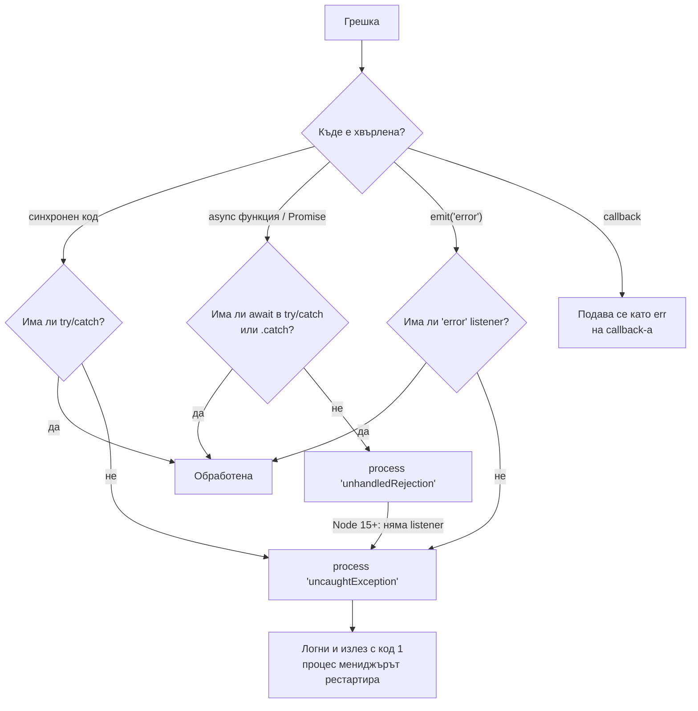
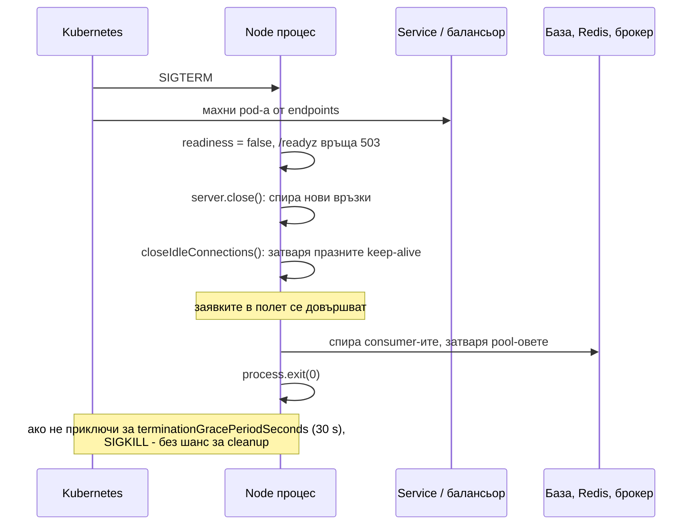

# Грешки и graceful shutdown

Грешките в Node се делят на два вида: operational (очаквани събития от реалния свят: мрежата падна, файлът липсва, базата върна timeout) и programmer errors (бъгове: `undefined is not a function`, грешен аргумент). Първите се обработват и приложението продължава. Вторите оставят процеса в неизвестно състояние, затова правилната реакция е логване и рестарт. Graceful shutdown е реда, по който процесът спира: спира да приема нова работа, довършва текущата, затваря ресурсите и излиза.

## 1. За какво се ползва и защо ни е нужен

В един процес се обслужват хиляди заявки. Една необработена грешка може да:

- свали целия процес и всички заявки в полет (`uncaughtException`, необработен rejection, `'error'` без listener);
- остави процеса жив, но в лошо състояние (незатворени транзакции, заключени ресурси, полуобновен кеш).

При деплой Kubernetes изпраща `SIGTERM` на всеки стар pod. Ако процесът просто умре, клиентите получават прекъснати връзки и 502. Ако не реагира, след 30 секунди получава `SIGKILL`. Graceful shutdown прави деплоя невидим за потребителите.

## 2. Пътищата на една грешка



## 3. Operational срещу programmer грешки

| | Operational | Programmer |
|---|---|---|
| Примери | `ECONNREFUSED`, `ETIMEDOUT`, `ENOENT`, 404 от външно API, дублиран ключ в базата | `TypeError`, `ReferenceError`, грешен аргумент, нарушен инвариант |
| Можеш ли да ги предвидиш | Да | Не (иначе щеше да ги поправиш) |
| Реакция | Retry, fallback, 4xx/5xx отговор, логване | Логване и рестарт на процеса |
| Продължава ли процесът | Да | Не, състоянието е неизвестно |

## 4. `uncaughtException` и `unhandledRejection`

```js process-handlers.js
// Последна линия на защита: логни и излез. НЕ продължавай работа.
process.on('uncaughtException', (err, origin) => {
  logger.fatal({ err, origin }, 'uncaught exception');
  process.exitCode = 1;
  shutdown('uncaughtException');          // опит за чисто затваряне, с твърд timeout
});

process.on('unhandledRejection', (reason) => {
  // В Node 15+ без този handler rejection-ът става uncaughtException.
  // Хвърляме го, за да мине през същия път.
  throw reason;
});
```

Защо да не продължиш след `uncaughtException`? Грешката е прекъснала код по средата: транзакция може да е отворена, mutex взет, обект наполовина обновен. Документацията на Node казва изрично, че не е безопасно да продължиш нормална работа.

## 5. Graceful shutdown



```js shutdown.js
const http = require('node:http');

const server = http.createServer(app);
server.listen(3000);

let shuttingDown = false;

async function shutdown(signal) {
  if (shuttingDown) return;                       // втори сигнал не стартира втори shutdown
  shuttingDown = true;
  console.log(`${signal}: спиране`);

  // Твърд лимит: ако нещо виси, излез принудително преди SIGKILL
  setTimeout(() => {
    console.error('shutdown timeout, принудително излизане');
    process.exit(1);
  }, 25_000).unref();                             // unref: таймерът не държи процеса жив

  // 1. Спри нови връзки. Callback-ът се вика, когато всички връзки са затворени.
  const closed = new Promise((resolve) => server.close(resolve));
  server.closeIdleConnections();                  // keep-alive връзки без активна заявка (Node 18.2+)

  // 2. Изчакай заявките в полет
  await closed;

  // 3. Затвори ресурсите в обратен ред на отварянето
  await queueConsumer.stop();                     // спри да взимаш нови съобщения
  await db.end();                                 // pool-ът изчаква активните заявки
  await redis.quit();

  process.exit(0);
}

process.on('SIGTERM', () => shutdown('SIGTERM'));  // Kubernetes, Docker stop
process.on('SIGINT', () => shutdown('SIGINT'));    // Ctrl+C
```

Важни детайли:

- **Readiness:** между `SIGTERM` и момента, в който балансьорът спре да праща трафик, минават няколко секунди. Затова често се добавя кратко изчакване (`preStop` hook или `sleep 5`) преди `server.close()`.
- **PID 1 в Docker:** ако стартираш с `CMD npm start`, сигналът отива при npm, не при Node. Ползвай `CMD ["node", "server.js"]` или `--init` (tini).
- **Keep-alive:** `server.close()` не затваря отворени keep-alive връзки. Без `closeIdleConnections()` процесът може да чака до `keepAliveTimeout`.

## 6. Минимален пример: грешки в Express

```js express-errors.js
const express = require('express');
const app = express();

class NotFoundError extends Error {
  status = 404;
}

app.get('/orders/:id', async (req, res) => {
  const order = await db.findOrder(req.params.id);       // Express 5 препраща rejection-а към error middleware
  if (!order) throw new NotFoundError(`order ${req.params.id}`);
  res.json(order);
});

// Error middleware: 4 аргумента. Последен в списъка.
app.use((err, req, res, next) => {
  const status = err.status ?? 500;
  if (status >= 500) req.log?.error({ err }, 'request failed');
  res.status(status).json({ error: status >= 500 ? 'Internal Server Error' : err.message });
});
```

В Express 4 async грешките не стигат сами до error middleware: трябва `try/catch` и `next(err)` или пакет като `express-async-errors`. Express 5 го прави автоматично.

## 7. Въпроси на интервю

### Каква е разликата между operational и programmer грешки?

Operational са очаквани проблеми от средата (мрежа, диск, външни системи, невалиден вход) и се обработват в кода: retry, fallback, подходящ HTTP статус. Programmer грешките са бъгове. Не можеш да ги обработиш смислено, защото не знаеш в какво състояние е процесът. Логваш и рестартираш.

### Какво правиш в `uncaughtException` handler?

Логваш грешката синхронно или с flush, опитваш кратко чисто затваряне с твърд timeout и излизаш с ненулев код. Не продължаваш да обслужваш заявки. Рестартът е работа на процес мениджъра (Kubernetes, systemd, PM2).

### Какво се случва при необработен rejection в Node 15+?

Режимът по подразбиране е `throw`: Node emit-ва `'unhandledRejection'`, и ако няма listener, го превръща в uncaught exception и процесът пада. До Node 14 само печаташе warning, което водеше до тихи бъгове.

### Как реализираш graceful shutdown?

Слушаш `SIGTERM` и `SIGINT`. Маркираш инстанцията като неготова (readiness 503). Викаш `server.close()` за да спреш нови връзки и `closeIdleConnections()` за празните keep-alive. Изчакваш текущите заявки. Спираш consumer-ите на опашки, затваряш pool-овете към базата и Redis. Излизаш с `exit(0)`. Слагаш твърд timeout, по-кратък от grace period-а на оркестратора.

### Защо `process.exit()` веднага е лоша идея?

Прекъсва заявките в полет, не дава шанс на буферираните логове да се запишат, не затваря връзките към базата коректно (сървърът на базата ги вижда като внезапно прекъснати). `process.exitCode = 1` и естествено излизане е по-чисто, когато е възможно.

## 8. Капани и чести грешки

- Продължаване на работа след `uncaughtException`.
- Празен `catch {}`, който скрива грешки.
- Хвърляне на низ (`throw 'error'`) вместо `Error`: няма stack trace.
- Async route handler в Express 4 без обработка на грешките.
- `CMD npm start` в Docker: Node не получава `SIGTERM` и умира със `SIGKILL`.
- Shutdown без твърд timeout: процесът виси до `SIGKILL`.
- Връщане на `err.message` и stack trace на клиента при 500: изтичане на вътрешна информация.

## 9. Свързани документи

- [Асинхронни модели](Async_Patterns.md)
- [EventEmitter](Event_Emitter.md)
- [HTTP сървърът под капака](HTTP_Server.md)
- [Мониторинг и debugging](Performance.md)
