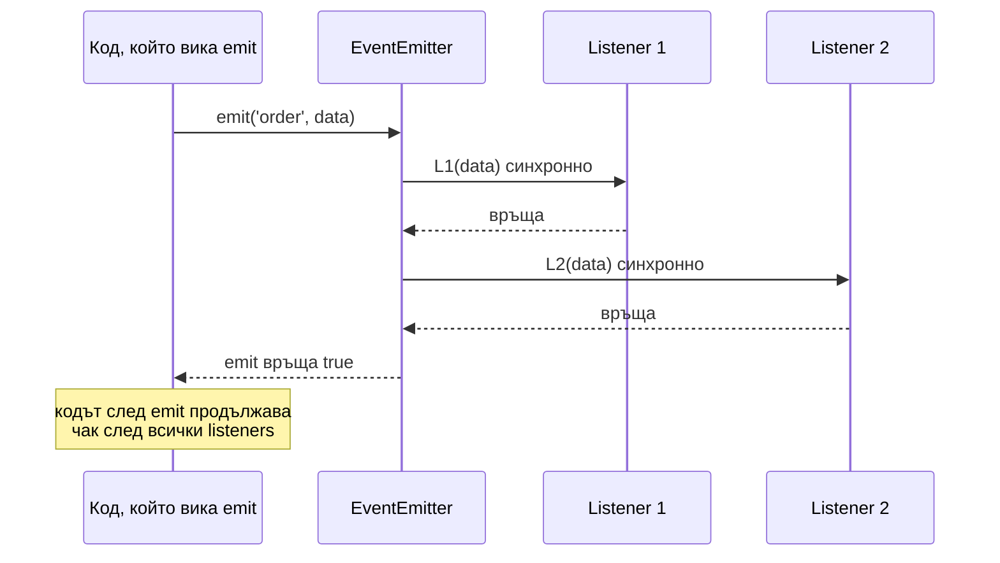

# EventEmitter

`EventEmitter` от модула `node:events` е основата на event-driven модела в Node: обект, на който закачаш listeners по име на събитие (`on`), и който ги вика, когато emit-не това събитие (`emit`). Стриймове, HTTP сървъри, сокети, child процеси и `process` са EventEmitter-и. Важното за интервю: `emit` е синхронен. Той вика всички listeners един след друг, в реда на регистрация, преди да върне.

## 1. За какво се ползва и защо ни е нужен

EventEmitter разделя "кой съобщава, че нещо се е случило" от "кой реагира". Сървърът не знае какво ще правиш със заявката, само emit-ва `'request'`. Стриймът не знае кой чете, само emit-ва `'data'`.

В приложен код се ползва за:

- domain събития в рамките на процеса (`order.created` → изпрати имейл, обнови статистика);
- обвиване на библиотека с callback API в по-удобен интерфейс;
- прогрес на дълга операция (`'progress'`, `'done'`, `'error'`).

За събития между процеси или сървиси EventEmitter не стига: там е нужен брокер (Kafka, RabbitMQ, Redis pub/sub).

## 2. Как работи emit



Вътрешно EventEmitter е обект `{ eventName: [listener1, listener2] }`. `emit` копира масива и вика функциите в цикъл. Няма опашка, няма event loop, няма асинхронност. Ако listener хвърли грешка, тя излиза от `emit` и останалите listeners не се изпълняват.

## 3. Минимален пример

```js emitter.js
const { EventEmitter, once } = require('node:events');

class OrderService extends EventEmitter {
  create(order) {
    // ... запис в базата
    this.emit('created', order);       // всички listeners се изпълняват тук, синхронно
    return order;
  }
}

const orders = new OrderService();

orders.on('created', (o) => console.log('1. имейл за', o.id));
orders.on('created', (o) => console.log('2. статистика за', o.id));
orders.once('created', () => console.log('3. само първия път'));
orders.on('error', (err) => console.error('грешка:', err.message));   // винаги закачай 'error'

console.log('преди');
orders.create({ id: 42 });
console.log('след');
// преди
// 1. имейл за 42
// 2. статистика за 42
// 3. само първия път
// след

// events.once връща Promise, удобно с await
(async () => {
  setTimeout(() => orders.create({ id: 43 }), 10);
  const [order] = await once(orders, 'created');
  console.log('дочакахме', order.id);
})();
```

Ако listener-ът трябва да прави тежка или бавна работа, той сам трябва да я направи асинхронна (`setImmediate`, async функция, опашка). Иначе бави кода, който е извикал `emit`.

## 4. Събитието `'error'`

`'error'` е специално. Ако emitter emit-не `'error'` и няма нито един listener за него, `emit` хвърля грешката. Ако никой не я хване, процесът пада.

```js error-event.js
const { EventEmitter } = require('node:events');
const e = new EventEmitter();

e.emit('error', new Error('бум'));
// Error: бум   <- uncaught exception, процесът излиза
```

Затова всеки стрийм, сокет и сървър трябва да има `on('error')`. Най-честата причина за неочакван срив е стрийм без error listener.

## 5. Async listeners и `captureRejections`

`emit` не чака async listeners. Ако async listener хвърли, получаваш unhandled rejection, а не `'error'` събитие:

```js async-listener.js
const { EventEmitter } = require('node:events');

const e = new EventEmitter({ captureRejections: true });  // хваща отхвърлени Promise от listeners
e.on('job', async () => {
  throw new Error('async грешка');
});
e.on('error', (err) => console.log('хванато:', err.message));
e.emit('job');
// хванато: async грешка
```

Без `captureRejections: true` грешката става unhandled rejection, което в Node 15+ сваля процеса.

## 6. Въпроси на интервю

### Синхронен или асинхронен е `emit`?

Синхронен. Вика всички listeners в реда на регистрация, преди да върне. Кодът след `emit` се изпълнява, след като всички са свършили. Асинхронното е какво правят listeners вътре, не самото доставяне.

### Защо Node emit-ва някои събития с `process.nextTick`?

За да даде на потребителя шанс да закачи listener. `net.createServer().listen()` emit-ва `'listening'` асинхронно: ако беше синхронно, събитието щеше да мине, преди кодът след `listen()` да закачи `on('listening')`. Същото е причината грешки за невалидни аргументи в стриймовете да идват на следващия тик.

### Какво е "MaxListenersExceededWarning"?

Предупреждение, когато на едно събитие са закачени повече от 10 listeners (по подразбиране). Почти винаги значи изтичане: някой код вика `on` при всяка заявка, без да вика `off`. Може да се промени с `setMaxListeners`, но първо провери дали не е бъг.

### Каква е разликата между `on` и `once`?

`once` маха listener-а преди да го извика, така че се изпълнява най-много веднъж. `events.once(emitter, name)` връща Promise, който се изпълнява при първото събитие и се отхвърля при `'error'`.

### EventEmitter същото ли е като event loop-а?

Не. EventEmitter е просто JS обект с масиви от функции, без опашка и без асинхронност. Event loop-ът е механизмът в libuv, който доставя I/O събития. Двете се срещат, защото Node core кодът често emit-ва събития от callbacks, които event loop-ът е извикал.

## 7. Капани и чести грешки

- Липсващ `'error'` listener на стрийм или сокет: процесът пада.
- `on` в handler на всяка заявка, без `off`: изтичане на памет и `MaxListenersExceededWarning`.
- Тежка синхронна работа в listener: бави този, който emit-ва, и блокира loop-а.
- Async listener, който хвърля, без `captureRejections`: unhandled rejection.
- Очакване, че `emit` ще "изчака" listeners. Не чака Promise.

## 8. Свързани документи

- [nextTick и микрозадачи](Microtasks.md)
- [Streams и backpressure](Streams.md)
- [Грешки и graceful shutdown](Errors_Shutdown.md)
- [Памет и Garbage Collection](Memory_GC.md)
