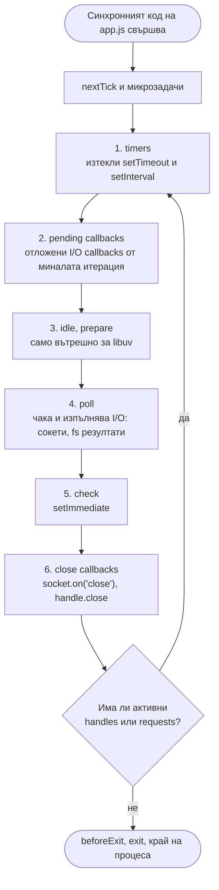
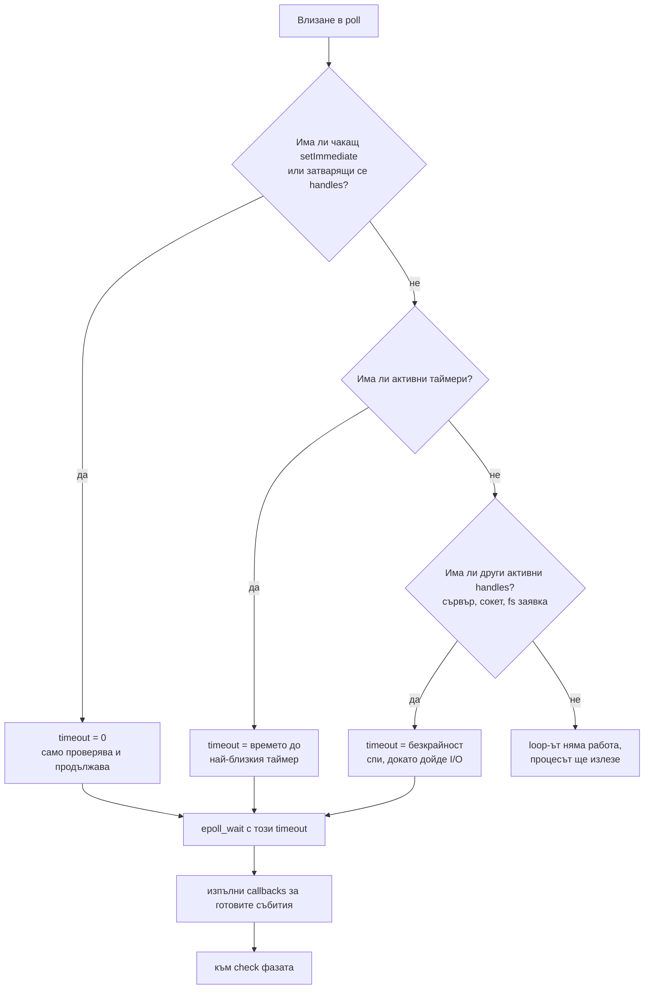
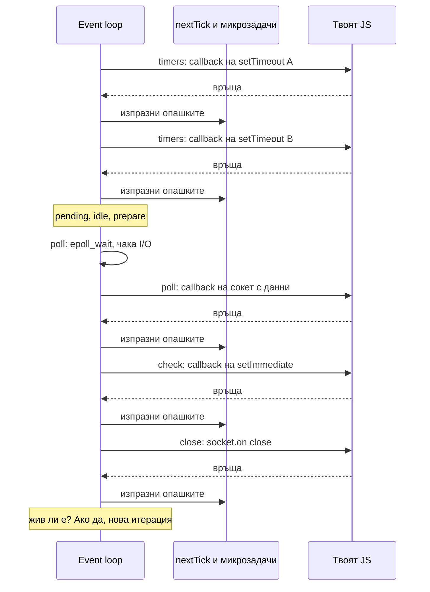

# Event Loop: фазите

Event loop-ът е безкрайният цикъл в libuv, който позволява на Node да обслужва асинхронни операции въпреки еднонишковото изпълнение на JavaScript. Той не изпълнява работа сам: проверява кои операции са готови (изтекъл таймер, пристигнали данни, свършило четене на файл) и вика техните callbacks един по един на главната нишка. Всяка итерация минава през фиксиран ред от фази, а между всеки два callback-а Node изпразва опашките на `process.nextTick` и Promise.

## 1. За какво се ползва и защо ни е нужен

Без event loop една нишка може да прави само едно нещо и да чака. С него нишката никога не чака: регистрира операция, продължава, и се връща към резултата, когато е готов. Това е причината един Node процес да държи десетки хиляди отворени WebSocket връзки.

Разбирането на фазите не е академично. Отговаря на реални въпроси от production:

- Защо таймер за 10 ms понякога се изпълнява след 200 ms? (Защото loop-ът е зает другаде.)
- Защо `setImmediate` в I/O callback винаги е преди `setTimeout(fn, 0)`? (Заради реда на фазите.)
- Защо рекурсивен `process.nextTick` замразява сървъра, а рекурсивен `setImmediate` не? (Защото nextTick не е фаза.)
- Защо health check-ът изтича, докато сървърът "работи"? (Блокиран loop.)

## 2. Фазите на една итерация



Между всеки два callback-а, във всяка фаза, Node изпразва две опашки: първо `process.nextTick`, после микрозадачите (Promise, `queueMicrotask`). Те не са фаза на loop-а. Виж [nextTick и микрозадачи](Microtasks.md).

Всяка фаза има собствена FIFO опашка от callbacks. Когато loop-ът влезе във фаза, изпълнява callback-ите в нея, докато опашката се изпразни или стигне системен лимит, после минава към следващата фаза.

## 3. Какво прави всяка фаза

### Фаза 1: timers

Изпълнява callback-ите на `setTimeout` и `setInterval`, чийто праг е изтекъл. Прагът е минимум, не гаранция: `setTimeout(fn, 100)` значи "не по-рано от 100 ms". Ако в момента на изтичане loop-ът е в дълъг callback, таймерът чака.

- `setTimeout(fn, 0)` всъщност е `setTimeout(fn, 1)`. Node превръща всяка стойност под 1 (и над 2 147 483 647) в 1 ms.
- Node групира таймерите по продължителност в свързани списъци и държи списъците в приоритетна опашка (binary heap). Затова 10 000 таймера с еднакво време са евтини.
- Poll фазата контролира кога таймерите получават шанс: тя изчислява колко може да спи, така че да се събуди навреме за най-близкия таймер.

### Фаза 2: pending callbacks

Изпълнява I/O callbacks, които libuv е решил да отложи за следващата итерация. Пример: някои TCP грешки (на някои системи `ECONNREFUSED` при connect), callbacks за завършен запис. В ежедневния код почти не я виждаш, но е полезно да я споменеш.

### Фаза 3: idle, prepare

Използва се само вътрешно от libuv и Node (например за статистики и подготовка преди poll). Твоят код не може да постави нищо тук.

### Фаза 4: poll

Най-важната фаза. Тук loop-ът пита операционната система "кое от това, което наблюдавам, е готово?" чрез `epoll_wait` (Linux), `kevent` (macOS) или `GetQueuedCompletionStatusEx` (Windows). Готови са например:

- сокет с пристигнали данни (HTTP заявка, отговор от базата);
- нова входяща връзка на слушащ сървър;
- резултат от thread pool-а (прочетен файл, `crypto.pbkdf2`), за който работната нишка е "почукала" на loop-а.

За всяко готово събитие libuv вика съответния callback, той стига до твоя JavaScript. Подробно в [libuv и thread pool](Libuv.md).

Колко време poll фазата чака (блокира в `epoll_wait`) се решава така:



Това е мястото, където Node "спи" ефективно: процес без натоварване стои в `epoll_wait` и не харчи CPU.

### Фаза 5: check

Изпълнява callback-ите на `setImmediate`. Фазата съществува, за да можеш да кажеш "изпълни това веднага след текущия I/O, преди loop-ът отново да заспи". Името е подвеждащо: `setImmediate` не е "веднага", а "в check фазата на текущата итерация". `setImmediate`, извикан вътре в check фазата, отива за следващата итерация, така че не може да блокира loop-а.

### Фаза 6: close callbacks

Изпълнява callbacks на внезапно затворени handles: `socket.on('close')` след `socket.destroy()`, `server.close()` callback, затворени child process pipes. Нормално затваряне често се обработва и през `process.nextTick`.

### След close: жив ли е loop-ът?

libuv проверява дали има активни, ref-нати handles (сървър, сокет, таймер) или чакащи requests (fs, DNS). Ако няма, `uv_run` връща. Node emit-ва `process.on('beforeExit')`. Ако listener там постави нова работа, loop-ът тръгва отново. Ако не, emit-ва `exit` и процесът приключва.

## 4. Една итерация във времето



## 5. Минимален пример

```js phases.js
const fs = require('node:fs');

fs.readFile(__filename, () => {
  // Тук сме в poll фазата: callback-ът на fs идва от thread pool-а през poll.
  console.log('poll: файлът е прочетен');

  setTimeout(() => console.log('timers: setTimeout 0'), 0);   // следващата итерация, фаза timers
  setImmediate(() => console.log('check: setImmediate'));     // тази итерация, веднага след poll
  process.nextTick(() => console.log('nextTick: веднага след текущия callback'));
  Promise.resolve().then(() => console.log('microtask: след nextTick'));
});

// Изход (винаги в този ред):
// poll: файлът е прочетен
// nextTick: веднага след текущия callback
// microtask: след nextTick
// check: setImmediate
// timers: setTimeout 0
```

Редът е детерминиран, защото сме в poll: следващата фаза е check (`setImmediate`), а timers е чак в следващата итерация.

## 6. Въпроси на интервю

### Изброй фазите на event loop-а.

Timers (`setTimeout`, `setInterval`), pending callbacks (отложени I/O callbacks), idle/prepare (вътрешни), poll (чакане и изпълнение на I/O), check (`setImmediate`), close callbacks (`'close'` събития). После проверка дали loop-ът е жив и нова итерация.

### Къде се изпълняват callbacks на Promise и `process.nextTick`?

В нито една фаза. Те се изпълняват след всеки отделен callback, независимо в коя фаза е той, и преди loop-ът да продължи. Първо цялата nextTick опашка, после цялата опашка с микрозадачи, повтаряно докато и двете са празни.

### Какво прави poll фазата, когато няма какво да прави?

Блокира в `epoll_wait` (или аналог). Колко дълго зависи от останалата работа: ако има `setImmediate`, изобщо не чака; ако има таймер, чака до него; ако има само отворен сървър, чака безкрайно, докато дойде връзка.

### Колко точен е `setTimeout`?

Не е точен. Гарантира само минимално закъснение. Реалното закъснение е минимумът плюс времето, което loop-ът е прекарал в други callbacks. Ако един callback отнеме 300 ms, всички таймери, които изтичат през това време, ще се изпълнят с поне толкова закъснение.

### Защо `setInterval` с тежък callback е опасен?

Ако callback-ът отнема повече от интервала, изпълненията се трупат едно след друго и loop-ът почти не стига до I/O. Безопасният модел е рекурсивен `setTimeout`, който планира следващото изпълнение чак когато текущото свърши.

### Ще видиш ли разлика в Node 20+?

От libuv 1.45 (Node 20) таймерите технически се изпълняват в края на итерацията, след close callbacks, а не в началото. Тъй като loop-ът е цикъл, концептуалният ред остава същият: close, timers, pending, poll, check, close... При първото влизане в loop-а таймерите пак се проверяват веднъж. За интервю е достатъчно да знаеш класическия ред и да споменеш, че детайлът е сменен.

## 7. Капани и чести грешки

- Да мислиш, че `setImmediate` е по-бърз от `setTimeout(fn, 0)` винаги. От главния модул редът им не е детерминиран. Виж [Ред на изпълнение](Execution_Order.md).
- Да смяташ микрозадачите за фаза. Те се изпълняват между callbacks, не като етап от цикъла.
- Да разчиташ на таймер за точно време (rate limit, анимация, планиране). За точно планиране ползвай външен scheduler или `cron`, а не дълги `setTimeout`.
- Да оставиш забравен `setInterval`, който пречи на процеса да излезе. Ползвай `clearInterval` или `.unref()`.
- Да блокираш poll фазата с тежък синхронен код в request handler. Всички сокети чакат. Виж [Блокиране на event loop-а](Blocking.md).

## 8. Свързани документи

- [nextTick и микрозадачи](Microtasks.md)
- [Ред на изпълнение](Execution_Order.md)
- [libuv и thread pool](Libuv.md)
- [Блокиране на event loop-а](Blocking.md)
