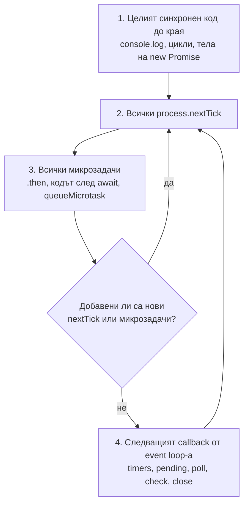
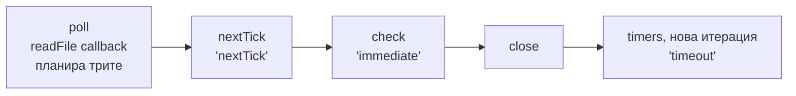

# Ред на изпълнение

Задачите от типа "какво ще отпечата този код" са най-честият начин да се провери дали разбираш event loop-а. Всички се решават с едно и също правило от пет стъпки. Тук то е обяснено, а след това е приложено към задачите, които най-често се дават на интервю. Изходът на всеки пример е проверен с Node 24 (CommonJS, освен ако не е казано друго).

## 1. За какво се ползва и защо ни е нужен

Редът на изпълнение не е само интервю трик. Бъгове в production често идват оттам:

- събитие, emit-нато преди listener-ът да е закачен;
- `await` в цикъл, който прави заявките последователни, вместо паралелни;
- кеш, който се чете преди да е записан, защото записът е в `setImmediate`, а четенето е в `.then`;
- тест, който минава локално и пада в CI, защото разчита на реда на `setTimeout` и `setImmediate`.

## 2. Правилото



1. **Синхронният код** се изпълнява докрай. Тялото на `new Promise((resolve) => { ... })` е синхронно. Кодът в `async` функция до първия `await` също е синхронен.
2. **nextTick опашката** се изпразва изцяло.
3. **Опашката с микрозадачи** се изпразва изцяло. Ако по време на 2 или 3 са добавени нови задачи, връщаш се на 2.
4. **Event loop-ът** взема следващия готов callback според фазата: timers, после poll (I/O), после check (`setImmediate`), после close.
5. **След всеки отделен callback** от стъпка 4 повтаряш 2 и 3.

Два допълнителни факта:

- В ES модул на top level стъпки 2 и 3 са разменени (Promise преди nextTick). Виж [nextTick и микрозадачи](Microtasks.md).
- `setTimeout(fn, 0)` срещу `setImmediate(fn)` от главния модул нямат гарантиран ред. Вътре в I/O callback `setImmediate` винаги е първи.

## 3. Задача: класическата

```js puzzle-1.js
console.log('A');
setTimeout(() => console.log('B'), 0);
Promise.resolve().then(() => console.log('C'));
process.nextTick(() => console.log('D'));
console.log('E');
```

**Отговор:** `A E D C B`

Синхронно: A, E. После nextTick: D. После микрозадачи: C. После loop-ът, фаза timers: B.

## 4. Задача: setTimeout срещу setImmediate

```js puzzle-2.js
setTimeout(() => console.log('timeout'), 0);
setImmediate(() => console.log('immediate'));
```

**Отговор:** Недетерминирано. Може да е `timeout immediate` или `immediate timeout`.

`setTimeout(fn, 0)` е всъщност 1 ms. Когато loop-ът влезе в timers фазата за първи път, проверява дали от планирането е минала поне 1 ms. Това зависи от колко бързо е стартирал процесът и колко е натоварена машината. Ако е минала, таймерът е първи. Ако не, loop-ът минава през poll към check и `setImmediate` е първи, а таймерът е в следващата итерация.

На бърза машина с Node 22+ най-често ще видиш `immediate` първо. Но добави 5 ms синхронна работа след двата реда и `timeout` излиза първи всеки път. Затова отговорът за интервю е "не е гарантиран, зависи от производителността на процеса".

## 5. Задача: същото, но в I/O callback

```js puzzle-3.js
const fs = require('node:fs');

fs.readFile(__filename, () => {
  setTimeout(() => console.log('timeout'), 0);
  setImmediate(() => console.log('immediate'));
  process.nextTick(() => console.log('nextTick'));
});
```

**Отговор:** `nextTick immediate timeout`, винаги.

Callback-ът на `readFile` се изпълнява в poll фазата. Щом свърши, nextTick опашката: `nextTick`. Следващата фаза след poll е check: `immediate`. Timers е чак в следващата итерация: `timeout`.



## 6. Задача: async функция

```js puzzle-4.js
async function task() {
  console.log('B');
  await null;
  console.log('D');
}
console.log('A');
task();
console.log('C');
```

**Отговор:** `A B C D`

Извикването на `async` функция изпълнява тялото ѝ синхронно до първия `await`. `await` спира функцията и планира продължението като микрозадача. Затова B е преди C, а D е след целия синхронен код.

## 7. Задача: всичко заедно

```js puzzle-5.js
console.log('1');

setTimeout(() => {
  console.log('2');
  process.nextTick(() => console.log('3'));
  Promise.resolve().then(() => console.log('4'));
}, 0);

setTimeout(() => console.log('5'), 0);

new Promise((resolve) => {
  console.log('6');          // синхронно: executor-ът се изпълнява веднага
  resolve();
}).then(() => console.log('7'));

process.nextTick(() => console.log('8'));
console.log('9');
```

**Отговор:** `1 6 9 8 7 2 3 4 5`

| Стъпка | Какво се изпълнява | Изход |
|---|---|---|
| Синхронно | `log 1`, executor на Promise, `log 9` | 1 6 9 |
| nextTick | `log 8` | 8 |
| Микрозадачи | `.then` на Promise | 7 |
| timers, първи таймер | `log 2`, планира tick и promise | 2 |
| nextTick след първия таймер | `log 3` | 3 |
| Микрозадачи след първия таймер | `log 4` | 4 |
| timers, втори таймер | `log 5` | 5 |

Ключовото: 3 и 4 са преди 5, защото от Node 11 опашките се изпразват след всеки таймер, а не след цялата фаза. В Node 10 изходът беше `... 2 5 3 4`.

## 8. Задача: setImmediate в setImmediate

```js puzzle-6.js
setImmediate(() => {
  console.log('immediate 1');
  setImmediate(() => console.log('immediate 3'));
  process.nextTick(() => console.log('tick'));
});
setImmediate(() => console.log('immediate 2'));
```

**Отговор:** `immediate 1, tick, immediate 2, immediate 3`

`tick` е веднага след своя callback. `immediate 3` е добавен по време на check фазата и отива за следващата итерация, затова е след `immediate 2`. Така `setImmediate` не може да "изгладнее" loop-а, за разлика от `process.nextTick`.

## 9. Задача: await на async функция

```js puzzle-7.js
const a = async () => {
  console.log('a1');
  await b();
  console.log('a2');
};
const b = async () => {
  console.log('b1');
};

console.log('start');
a();
Promise.resolve().then(() => console.log('p1')).then(() => console.log('p2'));
console.log('end');
```

**Отговор:** `start a1 b1 end a2 p1 p2`

`a()` печата a1 и синхронно вика `b()`, което печата b1 и връща вече изпълнен Promise. `await` на изпълнен native Promise планира продължението (a2) като една микрозадача, добавена преди p1. p2 зависи от p1, затова е последно.

## 10. Задача: `return Promise` от async функция

```js puzzle-8.js
async function withPromise() { return Promise.resolve('x'); }
async function withValue() { return 'y'; }

withPromise().then(() => console.log('return Promise'));
withValue().then(() => console.log('return value'));
Promise.resolve()
  .then(() => console.log('t1'))
  .then(() => console.log('t2'))
  .then(() => console.log('t3'));
```

**Отговор:** `return value, t1, t2, return Promise, t3`

Когато `async` функция върне Promise, външният Promise трябва да "приеме" състоянието на вътрешния. Това струва две допълнителни микрозадачи (V8 вика `then` на вътрешния Promise в отделна задача, после резолюцията е още една). Затова `return Promise` изостава с два "тика" от `return value`. Въпросът е за напреднали, но показва, че микрозадачите се броят.

## 11. Задача: close срещу timers

```js puzzle-9.js
const net = require('node:net');

const server = net.createServer().listen(0, () => {
  const socket = net.connect(server.address().port);
  socket.on('close', () => {
    console.log('close');
    server.close();
  });
  socket.on('connect', () => {
    console.log('poll: connect');
    setTimeout(() => console.log('timers'), 0);
    setImmediate(() => console.log('check'));
    socket.destroy();
  });
});
```

**Отговор:** `poll: connect, check, close, timers`

`connect` идва в poll фазата. След нея е check, после close callbacks (сокетът е унищожен), и чак тогава timers на следващата итерация.

## 12. Задача: таймер и блокиращ цикъл

```js puzzle-10.js
const start = Date.now();
setTimeout(() => console.log('timeout след', Date.now() - start, 'ms'), 10);
while (Date.now() - start < 100) {}
console.log('цикълът свърши');
```

**Отговор:** `цикълът свърши`, после `timeout след 100 ms` (или малко повече).

Таймерът изтича на 10-тата ms, но loop-ът е блокиран от синхронния цикъл. Callback-ът чака стекът да се изпразни. Това е най-простата демонстрация защо блокирането е опасно.

## 13. Въпроси на интервю

### Кое е по-бързо: nextTick, Promise, setImmediate или setTimeout?

В CommonJS и вътре в callbacks: `process.nextTick` → Promise (микрозадачи) → `setImmediate` и `setTimeout(0)`, като последните две зависят от това къде си. От I/O callback `setImmediate` е преди `setTimeout`. От главния модул редът им не е гарантиран.

### Защо тялото на `new Promise` е синхронно?

Executor функцията се вика веднага от конструктора, за да може да стартира асинхронната операция. Асинхронни са само `.then`, `.catch` и `.finally` callbacks. Те винаги са микрозадачи, дори Promise-ът вече да е изпълнен.

### Какво ще стане с `setTimeout(fn, 0)`, ако след него има `for` цикъл от 1 секунда?

Ще се изпълни след цикъла, приблизително на 1000-ната ms. Таймерите гарантират минимално, не точно време.

### Как да гарантираш, че callback се изпълнява след текущия I/O, но преди таймерите?

С `setImmediate`, извикан от I/O callback. Check фазата е непосредствено след poll.

## 14. Капани и чести грешки

- Да забравиш, че executor-ът на `new Promise` и кодът преди първия `await` са синхронни.
- Да отговориш "setImmediate винаги е първи". Само в I/O цикъл.
- Да отговориш по поведението на Node 10 за таймери и микрозадачи.
- Да пропуснеш, че в `.mjs` файл на top level Promise изпреварва nextTick.
- Да разчиташ на ред между независими асинхронни операции в тестове. Ако редът е важен, изрази го явно с `await`.

## 15. Свързани документи

- [Event Loop: фазите](Event_Loop.md)
- [nextTick и микрозадачи](Microtasks.md)
- [Асинхронни модели](Async_Patterns.md)
- [Блокиране на event loop-а](Blocking.md)
