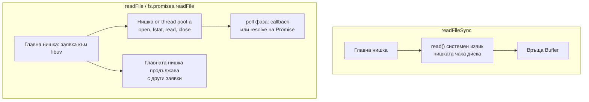

# File System и async I/O

Модулът `fs` дава три стила за една и съща работа с файлове: синхронен (`fs.readFileSync`), с callback (`fs.readFile`) и с Promise (`fs.promises.readFile` или `node:fs/promises`). Синхронният блокира главната нишка, а другите два изпращат операцията в libuv thread pool-а и връщат резултата през poll фазата на event loop-а. Отделно има стриймове за големи файлове и `fs.watch` за наблюдение на промени.

## 1. За какво се ползва и защо ни е нужен

Почти всеки сървър чете конфигурация, шаблони, качени файлове, логове. Изборът на API има пряк ефект върху производителността:

- При старта на приложението (зареждане на конфигурация, сертификати) синхронният вариант е нормален: още не обслужваш заявки, а кодът е по-прост.
- В request handler синхронният вариант блокира всички заявки, докато дискът отговори.
- За големи файлове и `readFile`, и `readFileSync` зареждат всичко в паметта. Там се ползва стрийм.

## 2. Трите стила



| | `readFileSync` | `readFile(cb)` | `fs.promises.readFile` |
|---|---|---|---|
| Блокира ли loop-а | Да | Не | Не |
| Къде е I/O-то | Главната нишка | Thread pool | Thread pool |
| Грешки | `throw` | `cb(err)` | Отхвърлен Promise |
| Кога | Старт, CLI скриптове | Стар код, callback API | Нов код с `async/await` |

`fs.promises` е малко по-бавен от callback API-то при много малки операции, защото създава Promise за всяка, но разликата рядко има значение. Предпочитай го в нов код.

## 3. Минимален пример

```js read-config.mjs
import { readFile, writeFile, mkdir, stat } from 'node:fs/promises';
import { readFileSync } from 'node:fs';
import path from 'node:path';

// При старт: синхронно е приемливо, сървърът още не слуша
const config = JSON.parse(readFileSync(new URL('./config.json', import.meta.url), 'utf8'));

// В request handler: само async
export async function saveReport(userId, data) {
  const dir = path.join(config.reportsDir, String(userId));
  await mkdir(dir, { recursive: true });                    // не гърми, ако вече съществува
  const file = path.join(dir, `${Date.now()}.json`);
  await writeFile(file, JSON.stringify(data), { flag: 'wx' }); // 'wx': грешка, ако файлът съществува
  const { size } = await stat(file);
  return { file, size };
}
```

## 4. Големи файлове: стрийм

```js big-file.js
const fs = require('node:fs');
const { pipeline } = require('node:stream/promises');
const zlib = require('node:zlib');

// Константна памет (~64 KB буфер), независимо дали файлът е 1 MB или 50 GB
async function compress(src, dst) {
  await pipeline(fs.createReadStream(src), zlib.createGzip(), fs.createWriteStream(dst));
}
```

`fs.readFile` има и твърд лимит: файл над ~2 GB (максималният размер на Buffer зависи от версията) гърми с `ERR_FS_FILE_TOO_LARGE`. Подробно в [Streams и backpressure](Streams.md).

## 5. FileHandle

`fs.promises.open` връща `FileHandle` обект. Той е полезен, когато правиш няколко операции върху един файл (четене на части, `stat`, запис), без да го отваряш всеки път. Задължително го затваряй, иначе дескрипторът изтича.

```js handle.mjs
import { open } from 'node:fs/promises';

const fh = await open('./data.bin', 'r');
try {
  const header = Buffer.alloc(8);
  await fh.read(header, 0, 8, 0);       // чете първите 8 байта, без да зарежда файла
  console.log(header.readUInt32BE(0));
} finally {
  await fh.close();                     // винаги, дори при грешка
}
```

## 6. Въпроси на интервю

### Каква е разликата между `readFile` и `readFileSync`?

`readFileSync` изпълнява системните извиквания на главната нишка и я блокира, докато файлът е прочетен. `readFile` изпраща работата в libuv thread pool-а и връща веднага, а callback-ът се изпълнява в poll фазата. Синхронният е приемлив при старт и в CLI инструменти, но не и в код, който обслужва заявки.

### Асинхронният `fs` наистина ли е неблокиращ на ниво ОС?

Не в смисъла на мрежовите сокети. ОС няма удобен неблокиращ API за обикновени файлове, така че libuv изпълнява блокиращите извиквания (`open`, `read`) в нишка от пула. За главната нишка е неблокиращ, но заема една от 4-те нишки на пула за времето на операцията.

### Защо `fs.readFile` на голям файл е лоша идея дори да е асинхронен?

Не блокира loop-а, но зарежда целия файл в паметта. Няколко паралелни заявки за файлове от стотици MB изчерпват RAM. Освен това има лимит за размера на един Buffer. За големи файлове се ползва стрийм.

### Как се проверява дали файл съществува?

Не с `fs.exists` (deprecated) и по-добре не с проверка преди операция, защото между проверката и операцията файлът може да изчезне (race condition, TOCTOU). Направи операцията директно и обработи грешката `ENOENT`. Ако само трябва да знаеш, `fs.promises.access` или `stat` с `try/catch`.

### Какво е `EMFILE`?

"Too many open files": процесът е стигнал лимита на файлови дескриптори (`ulimit -n`). Причини: отворени, но незатворени `FileHandle`, стриймове без обработка на грешки, хиляди паралелни `readFile`. Решения: ограничаване на паралелизма, затваряне в `finally`, `pipeline`.

## 7. Капани и чести грешки

- `*Sync` функции в request handler.
- Конструиране на път от потребителски вход без проверка: path traversal (`../../etc/passwd`). Виж [Сигурност](Security.md).
- `fs.exists` и после операция (race condition).
- Хиляди паралелни `readFile` с `Promise.all` без лимит: насищане на thread pool-а и `EMFILE`.
- Незатворен `FileHandle` при грешка. Ползвай `try/finally`.
- `fs.watch` се държи различно по платформи (дублирани събития, липсващи имена на файлове). За сериозно наблюдение ползвай библиотека като `chokidar`.

## 8. Свързани документи

- [libuv и thread pool](Libuv.md)
- [Streams и backpressure](Streams.md)
- [Buffers и бинарни данни](Buffers.md)
- [Блокиране на event loop-а](Blocking.md)
