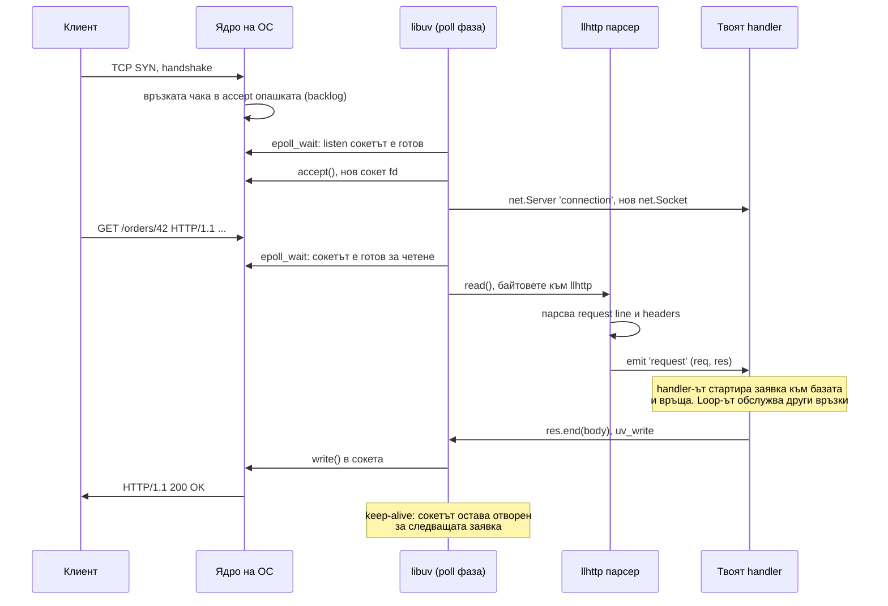
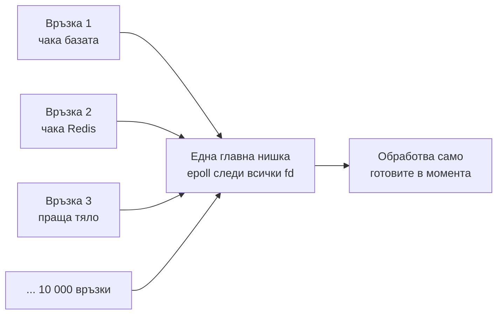

# HTTP сървърът под капака

`http.createServer` създава TCP сървър (libuv `uv_tcp_t` handle), който слуша на порт, приема връзки и парсва HTTP с C библиотеката llhttp. За всяка заявка emit-ва `'request'` с два стрийма: `req` (Readable) и `res` (Writable). Express, Fastify и NestJS са слоеве над точно този механизъм. Целият път от пристигнал пакет до твоя handler минава през poll фазата на event loop-а, без thread pool.

## 1. За какво се ползва и защо ни е нужен

На интервю често питат "какво се случва, когато заявка стигне до Node сървър?". Добрият отговор свързва всички теми: ядрото приема връзката, epoll я съобщава, libuv я приема, llhttp парсва байтовете, EventEmitter вика handler-а, стриймът връща отговора, keep-alive държи сокета отворен.

Практическото значение:

- разбираш защо бавен handler не блокира другите връзки, а тежък синхронен handler ги блокира;
- знаеш кои timeouts да настроиш (`headersTimeout`, `requestTimeout`, `keepAliveTimeout`) и защо load balancer-ът понякога връща 502;
- знаеш защо тялото на заявката не е налично веднага, а трябва да се прочете като стрийм.

## 2. Пътят на една заявка



1. **Ядрото** прави TCP handshake и слага готовата връзка в accept опашката на слушащия сокет.
2. **Poll фаза:** `epoll_wait` съобщава, че слушащият сокет е готов. libuv вика `accept()` и получава нов файлов дескриптор.
3. **Node** обвива дескриптора в `net.Socket` и emit-ва `'connection'`. HTTP сървърът закача парсер към сокета.
4. **Данни:** когато байтовете на заявката пристигнат, poll фазата ги чете и ги подава на llhttp.
5. **Парсване:** след като headers са парснати, Node създава `IncomingMessage` (`req`) и `ServerResponse` (`res`) и emit-ва `'request'`. Тялото още може да не е пристигнало: то идва като `'data'` събития на `req`.
6. **Отговор:** `res.write` и `res.end` пишат в сокета през `uv_write`. Ако сокетът не може да приеме веднага, данните се буферират и `write` връща `false` (backpressure).
7. **Keep-alive:** при HTTP/1.1 сокетът остава отворен за следващи заявки, докато не изтече `keepAliveTimeout`.

## 3. Минимален пример

```js server.js
const http = require('node:http');

const server = http.createServer(async (req, res) => {
  // req е Readable: тялото се чете асинхронно
  const chunks = [];
  for await (const chunk of req) chunks.push(chunk);
  const body = Buffer.concat(chunks).toString('utf8');

  // симулираме заявка към база: loop-ът е свободен през тези 50 ms
  await new Promise((r) => setTimeout(r, 50));

  res.writeHead(200, { 'Content-Type': 'application/json' });
  res.end(JSON.stringify({ method: req.method, url: req.url, bytes: body.length }));
});

server.keepAliveTimeout = 65_000;    // по-дълго от idle timeout на load balancer-а (напр. AWS ALB: 60 s)
server.headersTimeout = 66_000;      // трябва да е по-голямо от keepAliveTimeout
server.requestTimeout = 30_000;      // максимално време за цялата заявка (защита от бавни клиенти)

server.listen(3000, () => console.log('слуша на :3000'));
```

## 4. Защо 10 000 връзки не са проблем



Всяка отворена връзка е файлов дескриптор, регистриран в epoll, и няколко KB памет за буфери и JS обекти. Няма нишка на връзка. Главната нишка работи само когато някоя връзка има готови данни. Затова Node е подходящ за много едновременни, предимно чакащи връзки (API gateway, чат, SSE), и неподходящ, ако всяка заявка изисква много CPU.

## 5. Въпроси на интервю

### Какво се случва, когато HTTP заявка стигне до Node сървър?

Ядрото приема TCP връзката. В poll фазата libuv вижда, че слушащият сокет е готов, и я приема. Node създава `net.Socket`, HTTP модулът закача llhttp парсер. Когато байтовете пристигнат, poll фазата ги чете, llhttp парсва headers, Node създава `req` и `res` и emit-ва `'request'`. Handler-ът се изпълнява синхронно до първия `await`. Отговорът се записва в сокета през libuv. При keep-alive сокетът остава отворен.

### Използва ли HTTP сървърът thread pool-а?

Самият сървър не: приемането, четенето и писането в сокетите са неблокиращ I/O през epoll/kqueue. Thread pool-ът се намесва само ако handler-ът прави fs, `dns.lookup`, crypto или zlib операции.

### Защо load balancer-ът понякога връща 502 при Node backend?

Класическа причина: `keepAliveTimeout` на Node (5 s по подразбиране) е по-кратък от idle timeout-а на load balancer-а (60 s при AWS ALB). Node затваря неактивна връзка точно когато балансьорът решава да я преизползва, и заявката удря затворен сокет. Решението е `keepAliveTimeout` да е по-дълъг от този на балансьора, а `headersTimeout` още по-дълъг.

### Как Express се отнася към `http`?

Express е функция `(req, res) => {}`, подадена на `http.createServer`. Добавя router, middleware верига и помощни методи върху `req` и `res`. Не сменя модела: всичко пак е един event loop и `req`/`res` са същите стриймове.

### Какво е Slowloris атака и как Node се пази?

Атакуващ отваря много връзки и праща headers много бавно, за да държи ресурси заети. Node има `headersTimeout` (60 s по подразбиране) и `requestTimeout` (300 s от Node 18), които затварят такива връзки. В production пред Node обикновено има reverse proxy (nginx, балансьор), който също филтрира.

## 6. Капани и чести грешки

- Четене на `req.body` без body parser или без стрийм: тялото не е налично автоматично.
- Тежка синхронна работа в handler: всички връзки чакат.
- `keepAliveTimeout` по-кратък от този на балансьора: периодични 502.
- Липсващ лимит за размера на тялото: един клиент изпраща 2 GB и процесът остава без памет. Express има `limit` в `express.json()`.
- Забравен `res.end()` при някой клон на грешка: клиентът виси до timeout.
- `server.close()` при спиране без затваряне на keep-alive връзките: процесът не излиза. Виж [Грешки и graceful shutdown](Errors_Shutdown.md).

## 7. Свързани документи

- [libuv и thread pool](Libuv.md)
- [Streams и backpressure](Streams.md)
- [EventEmitter](Event_Emitter.md)
- [Грешки и graceful shutdown](Errors_Shutdown.md)
