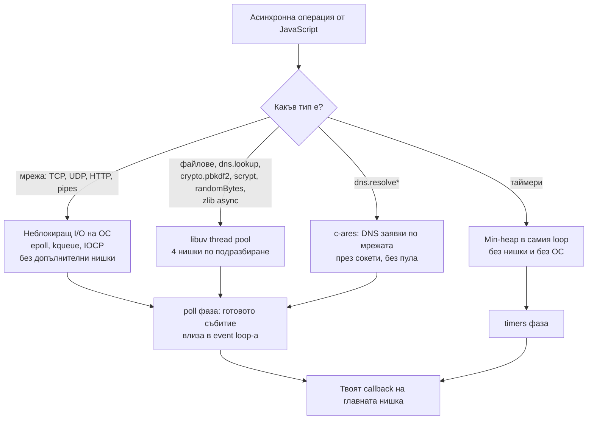
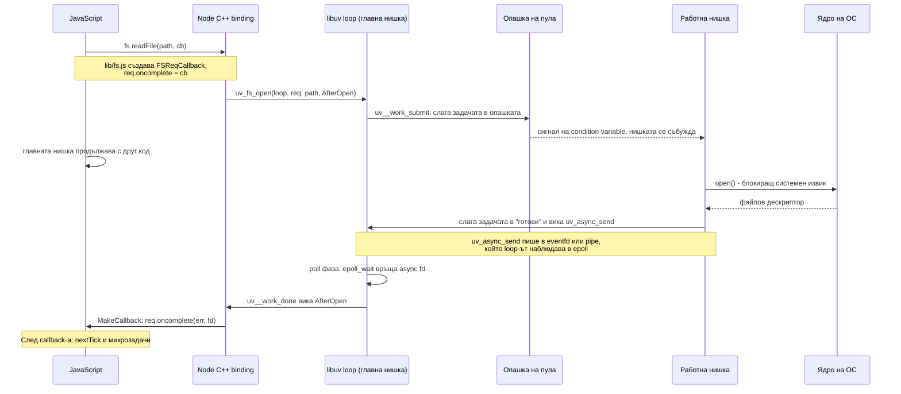
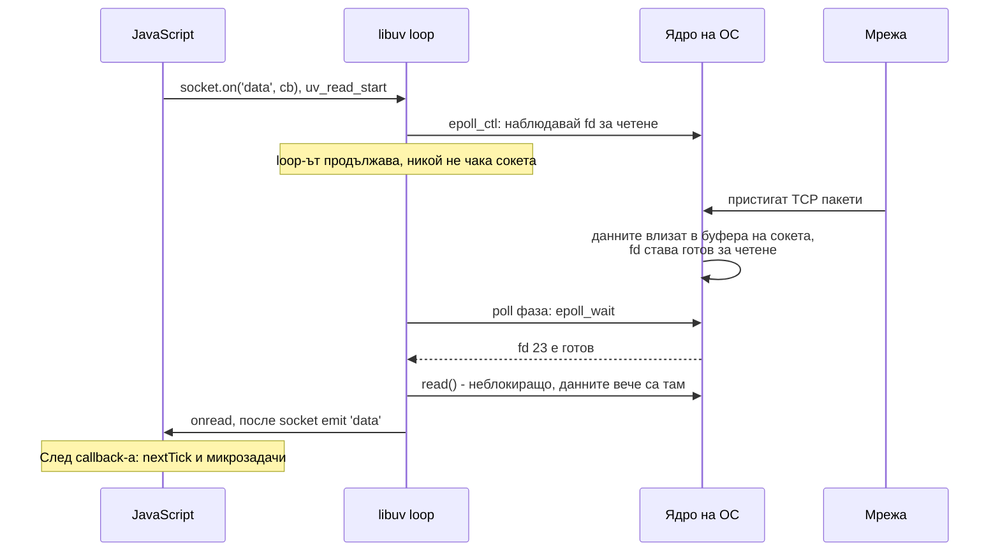

# libuv и thread pool

libuv е C библиотеката, която дава на Node event loop-а и целия асинхронен I/O. Тя използва два различни механизма: за мрежата пита ядрото на операционната система кои сокети са готови (epoll, kqueue, IOCP) и не заема нишки, а за операции, които ОС не може да направи асинхронно (файлове, DNS lookup, част от crypto, zlib), ги изпълнява в пул от работни нишки. И в двата случая резултатът се връща в event loop-а в poll фазата и оттам като callback в JavaScript.

## 1. За какво се ползва и защо ни е нужен

Операционните системи не предлагат еднакъв асинхронен API. Linux има epoll, macOS и BSD имат kqueue, Windows има IOCP. Освен това за обикновени файлове повечето от тях нямат истински неблокиращ интерфейс: `read()` на файл винаги блокира нишката. libuv скрива тези разлики зад един API и решава проблема с файловете, като ги чете в отделни нишки.

За интервю трябва да можеш да проследиш пътя на една операция: от JavaScript, през C++, до libuv, до ядрото или до нишка от пула, и обратно до твоя callback. Също трябва да знаеш кои операции минават през пула, защото той е ограничен (4 нишки по подразбиране) и при насищане всички файлови операции, DNS и crypto чакат.

## 2. Кое къде отива



| Операция | Механизъм | Заема ли нишка от пула? |
|---|---|---|
| `http`, `net`, `tls`, WebSocket, заявки към БД през TCP | epoll / kqueue / IOCP | Не |
| `fs.readFile`, `fs.writeFile`, `fs.promises.*`, `fs.stat` | Thread pool | Да |
| `fs.watch` | inotify / FSEvents | Не |
| `dns.lookup` (ползва се от `http.get('example.com')`) | Thread pool (`getaddrinfo`) | Да |
| `dns.resolve4`, `dns.resolveMx` | c-ares, мрежови сокети | Не |
| `crypto.pbkdf2`, `crypto.scrypt`, `crypto.randomBytes` с callback, `generateKeyPair` | Thread pool | Да |
| `crypto.createHash().update()` | Синхронно на главната нишка | Не, но блокира loop-а |
| `zlib.gzip`, `zlib.createGzip()` | Thread pool | Да |
| `setTimeout`, `setInterval` | Структура в loop-а | Не |
| `child_process.spawn` | Отделен процес, pipes през epoll | Не |

## 3. Пътят на `fs.readFile` (thread pool)



Стъпка по стъпка:

1. **JavaScript:** `lib/fs.js` валидира аргументите и създава обект `FSReqCallback`, в който записва твоя callback.
2. **C++ binding:** `node_file.cc` превежда аргументите и вика `uv_fs_open` с C функция, която да се извика при завършване.
3. **libuv подава работата на пула:** `uv__work_submit` слага задачата в глобална опашка, защитена с mutex, и събужда спяща нишка. Главната нишка веднага се връща в JavaScript.
4. **Работната нишка** изпълнява блокиращия системен извик (`open`, `read`, `stat`). Само тя чака диска.
5. **Сигнал обратно:** нишката слага завършената задача в опашката "готови" на loop-а и вика `uv_async_send`. Това пише байт в `eventfd` (Linux) или pipe, който loop-ът наблюдава като всеки друг файлов дескриптор.
6. **Poll фаза:** `epoll_wait` на главната нишка се събужда, защото async дескрипторът е готов. libuv обхожда готовите задачи и вика техните C callbacks.
7. **Обратно в JavaScript:** C++ callback-ът отваря `InternalCallbackScope` и вика `req.oncomplete`, тоест твоята функция. Когато тя върне, scope-ът изпразва nextTick и микрозадачите.

`fs.readFile` всъщност е няколко такива обиколки една след друга: `open`, `fstat` (за размера), едно или повече `read`, `close`. Всяка е отделна задача в пула.

## 4. Пътят на мрежово четене (без thread pool)



Разликата: тук няма работна нишка. Ядрото само получава пакетите и отбелязва, че сокетът е готов. Главната нишка чете, когато данните вече са в паметта, така че `read()` не блокира. Затова един Node процес може да държи 50 000 отворени връзки с 4 нишки в пула: сокетите изобщо не ги ползват.

## 5. Handles и requests

libuv има две основни абстракции:

| | Handle | Request |
|---|---|---|
| Живот | Дълъг, докато не го затвориш | Кратък, една операция |
| Примери | `uv_tcp_t` (сокет, сървър), `uv_timer_t`, `uv_signal_t`, `uv_idle_t` (използван за `setImmediate`) | `uv_fs_t` (fs операция), `uv_write_t`, `uv_getaddrinfo_t`, `uv_work_t` |
| Държи ли процеса жив? | Да, ако е активен и ref-нат | Да, докато не завърши |
| Затваряне | `uv_close`, callback-ът е в close фазата | Свършва сам |

`server.unref()`, `timer.unref()`, `socket.unref()` казват на libuv "не държи процеса жив заради мен". Полезно за фонови таймери (метрики, keep-alive ping), които не трябва да пречат на процеса да излезе.

## 6. Минимален пример: насищане на пула

```js pool.js
const crypto = require('node:crypto');

const start = Date.now();
for (let i = 1; i <= 5; i++) {
  // pbkdf2 с callback се изпълнява в libuv thread pool
  crypto.pbkdf2('secret', 'salt', 300000, 64, 'sha512', () => {
    console.log(`hash ${i}: ${Date.now() - start} ms`);
  });
}

// node pool.js (пул с 4 нишки):
// hash 4: 58 ms
// hash 1: 59 ms
// hash 3: 63 ms
// hash 2: 64 ms
// hash 5: 109 ms   <- петата чака свободна нишка
//
// UV_THREADPOOL_SIZE=5 node pool.js:
// всичките пет около 65 ms
```

Четири хеша вървят паралелно, петият чака. Редът на първите четири е случаен, защото нишките се състезават. Ако в същото време приложението чете файлове, те също ще чакат в същата опашка.

## 7. Настройка на пула

- `UV_THREADPOOL_SIZE` задава броя нишки. По подразбиране 4, максимум 1024.
- Пулът се създава мързеливо при първата операция, която го ползва. Задавай променливата при стартиране (`UV_THREADPOOL_SIZE=16 node app.js`), а не в кода, за да не зависиш от реда на зареждане.
- Пулът е един за целия процес и се споделя от всички `worker_threads`.
- Повече нишки помагат при много паралелни файлови операции или crypto. Не помагат за мрежата. Прекалено много нишки само увеличават превключването на контекст.

## 8. Въпроси на интервю

### Как асинхронна операция стига от JavaScript до libuv и как резултатът се връща?

JS API-то (например `fs.readFile`) създава request обект с твоя callback и вика C++ binding. Binding-ът вика функция на libuv. Ако е мрежова, libuv регистрира сокета в epoll/kqueue. Ако е файлова, слага задача в опашката на thread pool-а. Когато операцията свърши, нишката от пула сигнализира loop-а чрез `uv_async_send` (а за мрежата ядрото маркира сокета като готов). В poll фазата loop-ът вижда готовото събитие, вика C++ callback-а, който вика твоята JavaScript функция. След нея Node изпразва nextTick и микрозадачите.

### Кои операции ползват thread pool-а?

Файловата система (освен `fs.watch`), `dns.lookup`, асинхронните crypto функции (`pbkdf2`, `scrypt`, `randomBytes`, `generateKeyPair`), асинхронният zlib, и C++ addons с `uv_queue_work`. Мрежата не го ползва.

### Защо HTTP заявка към `example.com` може да се забави, когато сървърът чете много файлове?

`http.get` първо резолва името с `dns.lookup`, което минава през thread pool-а. Ако четирите нишки са заети с файлове, DNS lookup чака в опашката. Решения: по-голям `UV_THREADPOOL_SIZE`, кеширане на DNS, или `dns.resolve` (c-ares, без пула).

### Защо файловете не се четат асинхронно през epoll?

epoll и kqueue съобщават "дескрипторът е готов за четене". За обикновен файл отговорът винаги е "готов", дори данните да не са в кеша, така че `read()` пак блокира. Linux има io_uring, който е истински асинхронен и за файлове, но libuv го ползва само в ограничени случаи. За интервю приеми, че fs минава през пула.

### Как работи `setImmediate` на ниво libuv?

Node държи `uv_check_t` handle, чийто callback изпълнява опашката с immediates в check фазата. Докато има чакащи immediates, Node активира и `uv_idle_t` handle. Активен idle handle кара poll фазата да не блокира (timeout 0), така че loop-ът стига бързо до check.

## 9. Капани и чести грешки

- "Node ползва thread pool за всеки I/O." Не. Мрежата е изцяло на главната нишка с неблокиращ I/O.
- Да увеличиш `UV_THREADPOOL_SIZE`, за да ускориш HTTP сървър. Няма ефект, освен ако проблемът не е в fs, DNS или crypto.
- Синхронните варианти (`fs.readFileSync`, `crypto.pbkdf2Sync`) не ползват пула: работят на главната нишка и я блокират.
- `crypto.createHash` и `JSON.parse` на голям обект са синхронни. Пулът не те спасява от тях.
- Да забравиш, че пулът е споделен: бавен диск забавя и crypto, и DNS.

## 10. Свързани документи

- [Архитектура: V8 и libuv](Architecture.md)
- [Event Loop: фазите](Event_Loop.md)
- [File System и async I/O](File_System.md)
- [HTTP сървърът под капака](HTTP_Server.md)
- [Блокиране на event loop-а](Blocking.md)
