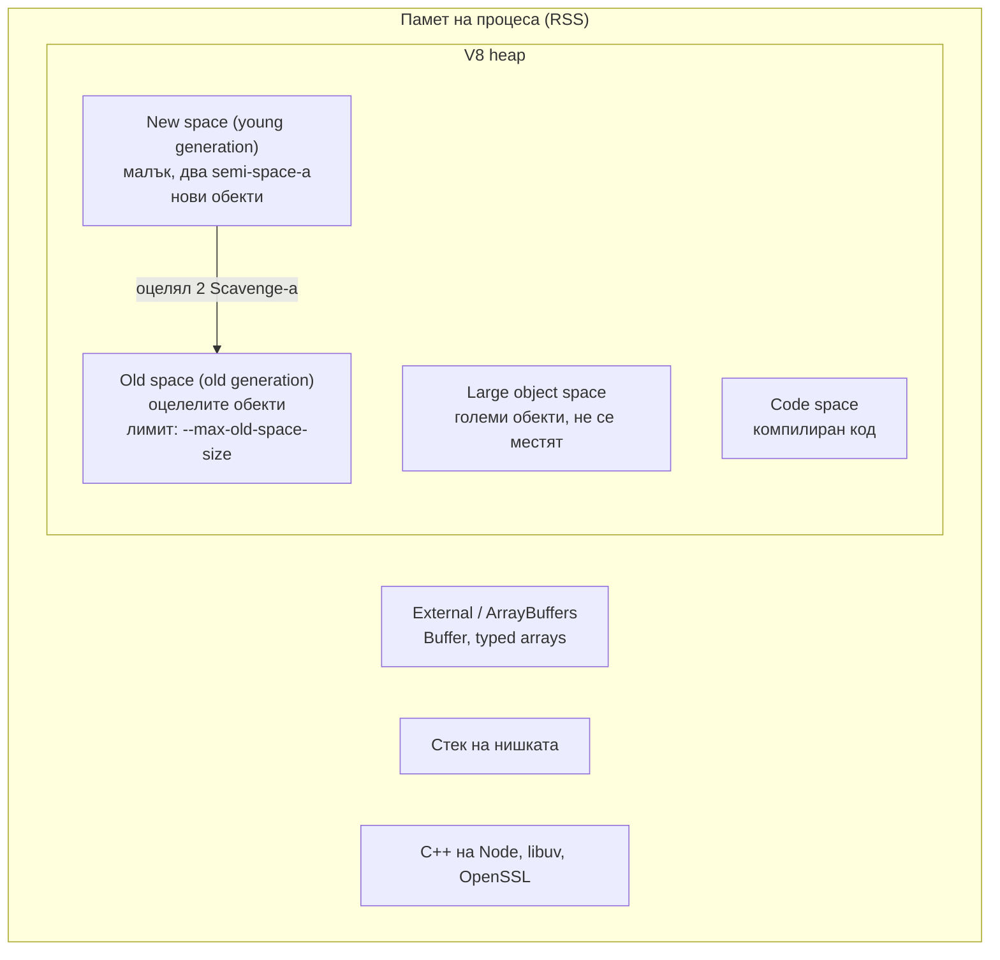
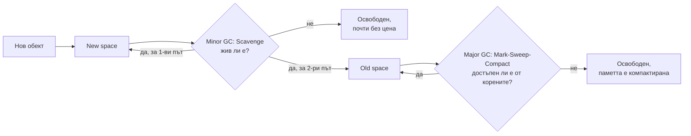

# Памет и Garbage Collection

V8 управлява паметта на JavaScript автоматично: заделя обекти в heap-а и периодично освобождава тези, до които вече няма път от "корените" (глобални обекти, стека, активни handles). Heap-ът е разделен на поколения: младо (new space), където повечето обекти умират бързо и се чистят с евтин алгоритъм (Scavenge), и старо (old space), където живеят дълготрайните обекти и се чистят с по-скъп Mark-Sweep-Compact. Изтичане на памет в JavaScript значи, че нещо все още държи референция към обекти, които не ти трябват.

## 1. За какво се ползва и защо ни е нужен

Node сървърите живеят дни и седмици. Малко изтичане от 1 KB на заявка при 100 заявки в секунда е 8 GB на ден. Процесът расте, GC паузите стават все по-дълги (латентността скача), и накрая процесът пада с `FATAL ERROR: Reached heap limit Allocation failed - JavaScript heap out of memory`.

На интервю очакват да знаеш:

- как е устроен heap-ът и защо има поколения;
- кои са типичните причини за изтичане в Node;
- как се намира изтичане (heap snapshots, сравнение);
- как се настройва лимитът в контейнер.

## 2. Структура на паметта



`process.memoryUsage()` връща:

| Поле | Какво е |
|---|---|
| `rss` | Цялата физическа памет на процеса |
| `heapTotal` | Заделен V8 heap |
| `heapUsed` | Реално използван V8 heap |
| `external` | Памет на C++ обекти, свързани с JS (вкл. Buffers) |
| `arrayBuffers` | Частта от `external` за `ArrayBuffer` и `Buffer` |

## 3. Как работи GC

Хипотезата за поколенията: повечето обекти умират млади (временни променливи, парснат JSON за една заявка). Затова V8 чисти младото поколение често и евтино, а старото рядко и по-внимателно.



- **Scavenge (minor GC):** new space е разделен на две половини. Живите обекти се копират от едната в другата, мъртвите просто остават в старата половина, която се изчиства изцяло. Цената зависи от броя на живите, не на мъртвите обекти. Пауза от порядъка на 1 ms.
- **Mark-Sweep-Compact (major GC):** маркира всичко достъпно от корените, освобождава немаркираното, понякога премества обекти, за да намали фрагментацията. V8 (проектът Orinoco) прави маркирането инкрементално и паралелно в помощни нишки, така че паузите на главната нишка са кратки, но не нулеви.

По време на GC пауза главната нишка не изпълнява JavaScript, така че GC паузите се виждат като забавяне на event loop-а.

## 4. Типични изтичания в Node

| Причина | Пример | Решение |
|---|---|---|
| Неограничен кеш в паметта | `const cache = {}` или `Map`, в който всяка заявка добавя ключ | LRU с лимит (`lru-cache`), TTL, или Redis |
| Event listeners, които не се махат | `emitter.on('x', ...)` във всяка заявка | `off` / `once` / `AbortSignal`, следи `MaxListenersExceededWarning` |
| Забравени таймери | `setInterval`, който държи closure към голям обект | `clearInterval`, `unref`, cleanup при затваряне |
| Closures | Callback пази референция към целия request обект | Пази само нужните полета |
| Глобални променливи | Масив с логове или метрики, който само расте | Ограничен буфер, изнасяне навън |
| Promise, който никога не се изпълнява | Чакащи заявки без timeout | Timeout и `AbortSignal` |
| Малък `subarray` от голям Buffer | Пазиш 10 байта, но държиш 10 MB | Копирай с `Buffer.from(view)` |

## 5. Минимален пример: изтичане и поправка

```js leak.js
const http = require('node:http');

// Изтичане: всяка заявка добавя запис, нищо не се маха
const seen = new Map();

http.createServer((req, res) => {
  seen.set(`${Date.now()}-${Math.random()}`, { url: req.url, headers: req.headers });
  res.end('ok');
}).listen(3000);

// Мониторинг: heapUsed расте линейно с броя заявки
setInterval(() => {
  const { heapUsed, rss } = process.memoryUsage();
  console.log(`heapUsed ${(heapUsed / 1e6).toFixed(1)} MB, rss ${(rss / 1e6).toFixed(1)} MB`);
}, 5000).unref();
```

```js fixed.js
const { LRUCache } = require('lru-cache');

// Поправка: ограничен кеш, старите записи се изхвърлят
const seen = new LRUCache({ max: 10_000, ttl: 60_000 });
```

## 6. Как се намира изтичане

1. **Потвърди:** графиката на `heapUsed` след GC расте без да се изравнява. Ако е "трион" около една стойност, няма изтичане.
2. **Направи snapshot-и:** `node --inspect app.js`, отвори `chrome://inspect`, раздел Memory, направи heap snapshot. Пусни натоварване. Направи втори. Или от кода: `v8.writeHeapSnapshot()`, или сигнал с `--heapsnapshot-signal=SIGUSR2`.
3. **Сравни:** изглед "Comparison" показва кои конструктори са увеличили броя си. Отвори обект и виж "Retainers": веригата от референции, която го държи жив, до корена. Там е бъгът.
4. **В production:** `--heapsnapshot-near-heap-limit=1` пише snapshot автоматично малко преди OOM.

Snapshot-ът спира процеса за секунди и е голям колкото heap-а. Прави го на реплика извън балансьора.

## 7. Лимити и контейнери

- `--max-old-space-size=1536` задава лимита на old space в MB. Без него V8 избира стойност по наличната памет.
- В контейнер с лимит 2 GB задай около 75% от лимита за heap. Останалото е за Buffers, стека, native паметта. Ако heap-ът е равен на лимита на контейнера, OOM killer-ът на ядрото убива процеса без хубаво съобщение.
- Чрез `NODE_OPTIONS="--max-old-space-size=1536"` в Dockerfile или deployment-а.

## 8. Въпроси на интервю

### Как работи garbage collection в V8?

С поколения. Новите обекти отиват в new space, който се чисти често с Scavenge: живите се копират в другата половина, мъртвите изчезват. Обекти, оцелели две такива почиствания, се местят в old space. Old space се чисти по-рядко с Mark-Sweep-Compact: маркиране от корените, освобождаване на немаркираното, компактиране. Голяма част от работата е инкрементална и паралелна в помощни нишки.

### Какво е изтичане на памет в език с GC?

Обект, който вече не ти трябва, но е достъпен от корен (глобална променлива, активен closure, listener, таймер, кеш). GC освобождава само недостъпното, така че такъв обект живее вечно.

### Как би намерил изтичане на памет в production?

Метрики на `heapUsed` и `rss` във времето, за да потвърдиш растеж. После два или три heap snapshot-а през интервал под натоварване, сравнение по брой обекти, и проследяване на retainers веригата на растящия тип до кода, който го държи.

### Къде е паметта на Buffer и брои ли се в `--max-old-space-size`?

Извън V8 heap-а, в external memory. Не се ограничава от `--max-old-space-size`, но се вижда в `rss`, `external` и `arrayBuffers`. Затова процес може да надхвърли лимита на контейнера, без heap-ът да е пълен.

### Какво са `WeakMap` и `WeakRef`?

`WeakMap` държи ключовете си слабо: ако обектът-ключ няма други референции, записът се освобождава. Полезно за метаданни към обекти, без да ги държиш живи. `WeakRef` дава слаба референция към обект, `FinalizationRegistry` вика callback след събирането му. Последните две са за редки случаи (кешове), защото моментът на GC е непредвидим.

## 9. Капани и чести грешки

- In-memory кеш без лимит.
- `--max-old-space-size` равен на лимита на контейнера.
- Ръчно `global.gc()` (с `--expose-gc`) в production "за да помогне". Не помага, само добавя паузи.
- Да гониш `rss` вместо `heapUsed`: `rss` не пада веднага след GC, защото ОС не прибира паметта моментално.
- Snapshot на production инстанция, която обслужва трафик: паузата е секунди.

## 10. Свързани документи

- [Buffers и бинарни данни](Buffers.md)
- [EventEmitter](Event_Emitter.md)
- [Мониторинг и debugging](Performance.md)
- [Архитектура: V8 и libuv](Architecture.md)
