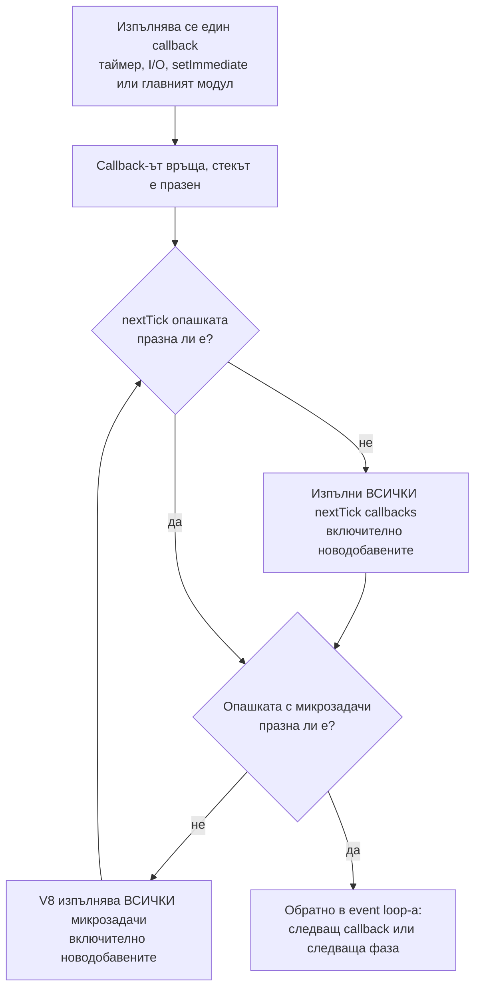

# nextTick и микрозадачи

Освен фазите на event loop-а, Node има две опашки с по-висок приоритет: опашката на `process.nextTick` (на Node) и опашката с микрозадачи (на V8, там отиват `.then` на Promise, кодът след `await` и `queueMicrotask`). Те се изпразват изцяло след всеки отделен callback и преди loop-ът да направи каквото и да е друго. nextTick опашката винаги се изпразва първа.

## 1. За какво се ползва и защо ни е нужен

Микрозадачите съществуват, за да може асинхронният код да продължи "веднага щом текущата синхронна работа свърши", без да чака цяла итерация на loop-а. Без тях всеки `await` щеше да струва минимум една обиколка през timers, poll и check.

`process.nextTick` е по-стар механизъм на Node (отпреди Promise да е част от езика). Ползва се, когато библиотека трябва да:

- **Направи callback винаги асинхронен.** Функция, която понякога вика callback-а синхронно, а понякога асинхронно, е трудна за ползване (проблемът "Zalgo"). С `nextTick` callback-ът винаги е след текущия код, но преди всякакъв I/O.
- **Emit-не събитие след конструктора.** `new Server()` не може да emit-не `'listening'` синхронно, защото потребителят още не е закачил listener. С `nextTick` събитието идва точно след като кодът, който е създал обекта, свърши.
- **Върне грешка асинхронно** при невалидни аргументи, със същия контракт като при истинска I/O грешка.

На интервю ключовото е да обясниш реда и опасността от "гладуване" (starvation): ако опашките се пълнят безкрайно, loop-ът никога не стига до I/O.

## 2. Как се изпразват опашките



Алгоритъмът (функцията `processTicksAndRejections` в `lib/internal/process/task_queues.js`) е:

```js
// Опростен псевдокод на Node
function processTicksAndRejections() {
  do {
    while (nextTickQueue.length > 0) {   // 1. всички nextTick, и новите също
      runTick(nextTickQueue.shift());
    }
    runMicrotasks();                     // 2. V8 изпразва всички Promise callbacks
    // nextTick, добавен от Promise callback, ще бъде хванат от следващото завъртане
  } while (nextTickQueue.length > 0 || hasPendingRejections());
}
```

Следствия от алгоритъма:

- nextTick, добавен вътре в nextTick, се изпълнява в същото изпразване, преди който и да е Promise.
- Promise callback, добавен вътре в nextTick, чака всички nextTick-ове да свършат.
- nextTick, добавен вътре в Promise callback, чака всички Promise callbacks да свършат (V8 изпразва своята опашка докрай), после се изпълнява.

## 3. Кога точно се изпълняват

| Момент | Изпразват ли се опашките? |
|---|---|
| След като главният модул (`app.js`) свърши | Да, преди първата итерация на loop-а |
| След всеки `setTimeout` / `setInterval` callback | Да, след всеки поотделно (от Node 11) |
| След всеки `setImmediate` callback | Да, след всеки поотделно (от Node 11) |
| След всеки I/O callback в poll фазата | Да |
| След всеки `'close'` callback | Да |
| Между две фази на loop-а | Не е отделна стъпка: опашките вече са празни, защото са изпразнени след последния callback |

Промяната в Node 11 е класически въпрос. До Node 10 микрозадачите се изпълняваха чак след като свършат всички таймери в timers фазата. От Node 11 поведението е като в браузъра: след всеки таймер поотделно.

```js node11.js
setTimeout(() => {
  console.log('timeout 1');
  Promise.resolve().then(() => console.log('promise 1'));
}, 0);
setTimeout(() => {
  console.log('timeout 2');
  Promise.resolve().then(() => console.log('promise 2'));
}, 0);

// Node 11+:  timeout 1, promise 1, timeout 2, promise 2
// Node <=10: timeout 1, timeout 2, promise 1, promise 2
```

## 4. Трите API-та

| API | Опашка | Кой я управлява | Кога да се ползва |
|---|---|---|---|
| `process.nextTick(fn, ...args)` | nextTick queue | Node (JavaScript масив) | В библиотеки: асинхронен callback или събитие "веднага след текущия код" |
| `Promise.resolve().then(fn)`, кодът след `await` | microtask queue | V8 | Нормален асинхронен код |
| `queueMicrotask(fn)` | microtask queue | V8 | Когато искаш микрозадача без да създаваш Promise. Работи и в браузъра |

Документацията на Node препоръчва `queueMicrotask` пред `nextTick` за нов код, освен ако нямаш конкретна нужда да изпревариш Promise callbacks.

## 5. Минимален пример

```js order.js
// Пускай като CommonJS: node order.js (без "type": "module")
console.log('1. sync');

setTimeout(() => console.log('7. timeout'), 0);              // фаза timers
setImmediate(() => console.log('8. immediate'));              // фаза check

Promise.resolve().then(() => {
  console.log('4. promise 1');
  process.nextTick(() => console.log('6. tick от promise'));  // ще чака всички promise-и
});

process.nextTick(() => {
  console.log('3. tick 1');
  Promise.resolve().then(() => console.log('5. promise от tick')); // ще чака всички tick-ове
});

console.log('2. sync');

// Изход:
// 1. sync
// 2. sync
// 3. tick 1
// 4. promise 1
// 5. promise от tick
// 6. tick от promise
// 7. timeout       (7 и 8 може да разменят местата си, виж "Ред на изпълнение")
// 8. immediate
```

Проследяване: синхронният код печата 1 и 2. Опашки след това: nextTick = [tick 1], micro = [promise 1]. Node изпразва nextTick: печата 3 и добавя "promise от tick" в micro = [promise 1, promise от tick]. V8 изпразва micro: печата 4 (добавя "tick от promise" в nextTick), после 5. Обратно в цикъла: nextTick не е празна, печата 6. Всичко е празно, loop-ът стартира.

## 6. ES модули: обърнат ред на top level

В ES модул (`.mjs` или `"type": "module"`) самото изпълнение на модула е асинхронно и става вътре в микрозадача. Затова на top level Promise callbacks се изпълняват преди `process.nextTick`:

```js esm-order.mjs
process.nextTick(() => console.log('tick'));
Promise.resolve().then(() => console.log('promise'));

// node esm-order.mjs  -> promise, tick
// същият код като .cjs -> tick, promise
```

V8 вече изпразва опашката с микрозадачи, когато модулът свърши, така че новият Promise callback влиза в текущото изпразване. nextTick опашката се проверява чак след него. Вътре в callbacks на таймери и I/O редът отново е стандартният (nextTick първи). Това е любим "хитър" въпрос.

## 7. Въпроси на интервю

### Каква е разликата между `process.nextTick()` и `setImmediate()`?

`process.nextTick` изпълнява callback-а веднага след текущата операция, преди loop-ът да продължи, преди Promise callbacks и преди всякакъв I/O. Не е фаза на loop-а. `setImmediate` слага callback-а в check фазата, след poll. Имената са обратни на поведението: nextTick е по-"непосредствен" от setImmediate. Рекурсивен nextTick може да блокира loop-а завинаги; рекурсивен setImmediate не може, защото новите отиват в следващата итерация.

### Каква е разликата между `process.nextTick()` и `Promise.resolve().then()`?

И двете се изпълняват след текущия callback, преди loop-ът да продължи. nextTick опашката се изпразва първа (в CommonJS и вътре в callbacks). Те са различни опашки: nextTick е на Node, микрозадачите са на V8.

### Какво е starvation?

Ако callback в nextTick (или в Promise) добавя нов nextTick безкрайно, опашката никога не се изпразва и loop-ът не стига до poll. Сървърът не приема връзки, таймерите не тръгват, но CPU е 100%. Същото важи за безкрайна верига от `.then`.

```js starvation.js
function forever() {
  process.nextTick(forever);   // никога не дава шанс на loop-а
}
forever();
setTimeout(() => console.log('никога няма да се отпечата'), 0);
```

### Защо Node има nextTick, ако има микрозадачи?

Исторически: `process.nextTick` е от 2009, Promise става част от езика през 2015. Днес той остава за обратна съвместимост и за случаите, когато библиотека иска да изпревари Promise callbacks. Голяма част от вътрешния код на Node (streams, net) разчита на него.

### Колко микрозадачи струва един `await`?

`await` на native Promise е една микрозадача (след оптимизацията в V8 7.2). `return promise` от `async` функция или връщане на Promise от `.then` струва две допълнителни микрозадачи, защото V8 трябва да "разопакова" thenable-а (PromiseResolveThenableJob, после `.then`). Затова `return await` и `return` понякога дават различен ред на изхода.

## 8. Капани и чести грешки

- Да ползваш `process.nextTick` за "отложи за после", когато искаш да дадеш шанс на I/O. За това е `setImmediate`.
- Да вярваш, че nextTick е винаги преди Promise. На top level в ES модул е обратно.
- Да тестваш поведение на Node 10 и да очакваш същото в Node 22 (промяната в Node 11 за таймерите).
- Тежка работа, разделена на парчета с Promise или nextTick, не разблокира loop-а. Парчетата се изпълняват едно след друго в едно изпразване. За разделяне ползвай `setImmediate`. Виж [Блокиране на event loop-а](Blocking.md).

## 9. Свързани документи

- [Event Loop: фазите](Event_Loop.md)
- [Ред на изпълнение](Execution_Order.md)
- [Асинхронни модели](Async_Patterns.md)
- [EventEmitter](Event_Emitter.md)
