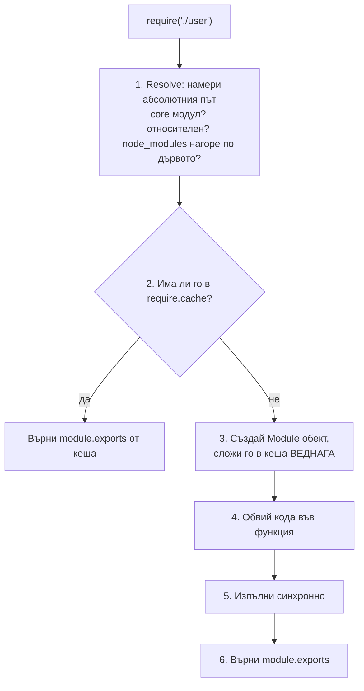
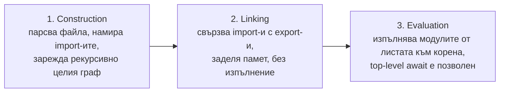
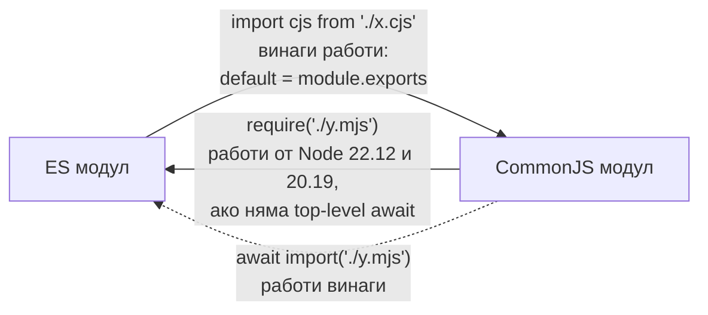

# CommonJS и ES Modules

Node има две модулни системи. CommonJS (`require`, `module.exports`) е оригиналната: зарежда синхронно, по време на изпълнение, и връща копие на стойността на `module.exports`. ES Modules (`import`, `export`) е стандартът на езика: зависимостите се откриват статично преди изпълнение, зареждането може да е асинхронно, а импортите са "живи" връзки към експортите. Коя система ползва файл се решава от разширението (`.cjs`, `.mjs`) или от полето `"type"` в `package.json`.

## 1. За какво се ползва и защо ни е нужен

Модулите дават капсулация (всеки файл има собствен обхват) и ясни зависимости. Двете системи съществуват едновременно по исторически причини: CommonJS е от 2009, ESM влиза в езика през 2015 и в Node стабилно през 2020 (Node 12.17 / 14). Огромна част от npm екосистемата е още CommonJS, а новите пакети все по-често са само ESM.

На интервю очакват да знаеш разликите, как двете системи си взаимодействат и типичните проблеми: `ERR_REQUIRE_ESM`, липса на `__dirname` в ESM, циклични зависимости, двойни инстанции на пакет.

## 2. Сравнение

| | CommonJS | ES Modules |
|---|---|---|
| Синтаксис | `const x = require('x')`, `module.exports = ...` | `import x from 'x'`, `export default ...` |
| Кога се откриват зависимостите | По време на изпълнение (`require` е обикновена функция) | Статично, преди изпълнение |
| Зареждане | Синхронно | Асинхронно (на фази) |
| Какво получаваш | Копие на стойността на `module.exports` към момента | Жива връзка (live binding) към експорта |
| Top-level `await` | Не | Да |
| `this` на top level | `module.exports` | `undefined` |
| `__dirname`, `__filename` | Да | Не; ползвай `import.meta.dirname`, `import.meta.filename` (Node 20.11+) или `import.meta.url` |
| Разширение в пътя | Не е задължително | Задължително за относителни пътища (`./a.js`) |
| Strict mode | По избор | Винаги |
| Tree shaking от bundler | Трудно | Да, заради статичната структура |

## 3. Как работи `require`



Стъпка 4 е module wrapper-ът. Всеки CommonJS файл реално се изпълнява така:

```js wrapper.js
(function (exports, require, module, __filename, __dirname) {
  // твоят код тук
  // затова exports, require и __dirname "просто съществуват" и не са глобални
});
```

Кешът е по абсолютен път. Втори `require` на същия файл не го изпълнява отново, а връща същия обект. Така модулът е singleton в рамките на процеса.

## 4. Как работи `import`



Понеже графът е известен преди изпълнение, грешен import (`import { nope } from './a.js'`) гърми със `SyntaxError` преди да се изпълни и един ред. Live bindings значат, че ако модулът промени експортирана променлива, импортиращият вижда новата стойност.

## 5. Минимален пример: живи връзки срещу копие

```js counter.cjs
let count = 0;
module.exports = { count, inc: () => count++ };
```

```js main.cjs
const c = require('./counter.cjs');
c.inc();
console.log(c.count);   // 0: count е копирано в обекта при експорта
```

```js counter.mjs
export let count = 0;
export const inc = () => count++;
```

```js main.mjs
import { count, inc } from './counter.mjs';
inc();
console.log(count);     // 1: count е жива връзка към променливата в модула
```

## 6. Циклични зависимости

```js a.cjs
exports.loaded = false;
const b = require('./b.cjs');                  // b започва да се изпълнява
console.log('в a, b.loaded =', b.loaded);      // true
exports.loaded = true;
```

```js b.cjs
const a = require('./a.cjs');                  // a е в кеша, но не е довършен
console.log('в b, a.loaded =', a.loaded);      // false: виждаме непълния exports на a
exports.loaded = true;
```

CommonJS не гърми при цикъл: връща непълния `module.exports` от кеша. Ако `a` после замени `module.exports = {...}` с нов обект, `b` остава със стария. ESM също позволява цикли, но достъп до още неинициализиран `let` или `const` експорт хвърля `ReferenceError`. И в двата случая цикълът е знак за лоша структура.

## 7. Взаимодействие



- **ESM импортира CJS:** винаги работи. `default` е `module.exports`. Именуваните импорти работят, ако Node успее да ги открие статично в кода (`exports.foo = ...`).
- **CJS импортира ESM:** динамичният `import()` работи винаги и връща Promise. Синхронният `require()` на ES модул работи от Node 22.12 / 20.19 без флаг, ако модулът няма top-level `await`. В по-стари версии гърми с `ERR_REQUIRE_ESM`.
- **Dual package hazard:** ако пакет се публикува и като CJS, и като ESM, приложението може да зареди и двете копия. Тогава има две инстанции на "singleton" (два кеша, две връзки към базата), а `instanceof` между тях не работи.

```json package.json
{
  "name": "my-lib",
  "type": "module",
  "exports": {
    ".": {
      "import": "./dist/index.js",
      "require": "./dist/index.cjs"
    }
  }
}
```

`"type": "module"` прави `.js` файловете в пакета ES модули. `"exports"` определя кои пътища са публични и какво да се зареди за `import` и за `require`. Файлове извън `exports` не могат да се импортират отвън.

## 8. Въпроси на интервю

### Каква е разликата между CommonJS и ES Modules?

CommonJS зарежда синхронно, по време на изпълнение, и `require` връща стойността на `module.exports`. ESM се анализира статично преди изпълнение, зарежда се на фази (асинхронно), импортите са живи връзки, поддържа top-level `await` и винаги е в strict mode. ESM е стандартът на езика и работи и в браузъра.

### Какво е module wrapper?

Функцията, в която Node обвива всеки CommonJS файл: `(exports, require, module, __filename, __dirname)`. Тя дава собствен обхват на файла (променливите не са глобални) и инжектира тези пет имена.

### Как работи кешът на `require`?

Модулите се кешират по абсолютен път в `require.cache` при първото зареждане. Следващите `require` връщат същия `module.exports` без повторно изпълнение. Модулът е включен в кеша преди изпълнението си, което позволява цикличните зависимости (с непълен exports).

### Каква е разликата между `exports` и `module.exports`?

`exports` е променлива, която първоначално сочи към същия обект като `module.exports`. `require` връща `module.exports`. Добавянето на свойства към `exports` работи, но `exports = {...}` само пренасочва локалната променлива и няма ефект. За замяна на целия експорт ползвай `module.exports = ...`.

### Защо `__dirname` не съществува в ESM?

Защото ES модулите не се обвиват в CommonJS wrapper-а. Еквивалентът е `import.meta.dirname` (Node 20.11+) или `path.dirname(fileURLToPath(import.meta.url))`.

### Как проверяваш дали модулът е стартиран директно?

В CommonJS: `require.main === module`. В ESM: `import.meta.url === pathToFileURL(process.argv[1]).href`, или от Node 24.2 `import.meta.main`.

## 9. Капани и чести грешки

- `exports = { ... }` вместо `module.exports = { ... }`.
- Липсващо разширение в ESM import (`'./user'` вместо `'./user.js'`): `ERR_MODULE_NOT_FOUND`.
- Мутиране на кеширан модул от един файл, което изненадва друг (модулите са singleton-и).
- `require` в hot path (вътре в handler): resolve и кеш lookup при всяка заявка. Импортирай на top level.
- Циклични зависимости, които дават `undefined` за функции при старта.
- Смесване на CJS и ESM копия на един пакет (dual package hazard).

## 10. Свързани документи

- [Архитектура: V8 и libuv](Architecture.md)
- [nextTick и микрозадачи](Microtasks.md)
- [Памет и Garbage Collection](Memory_GC.md)
