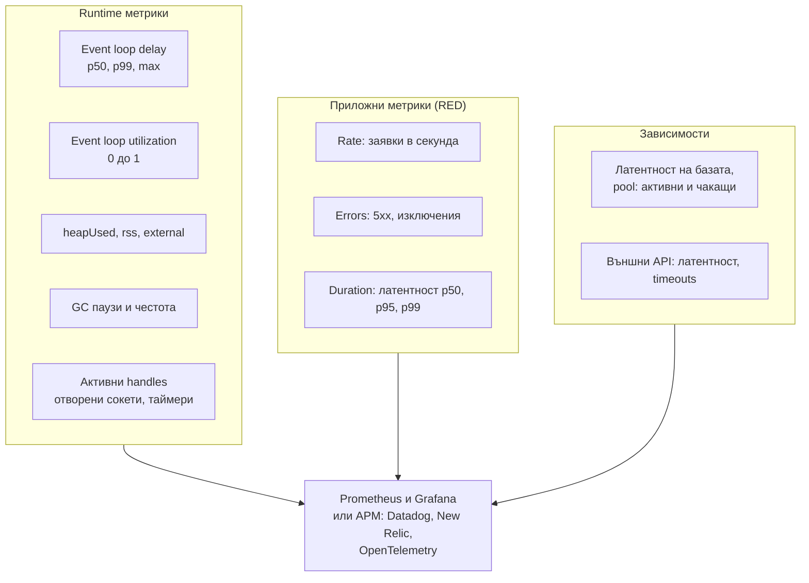
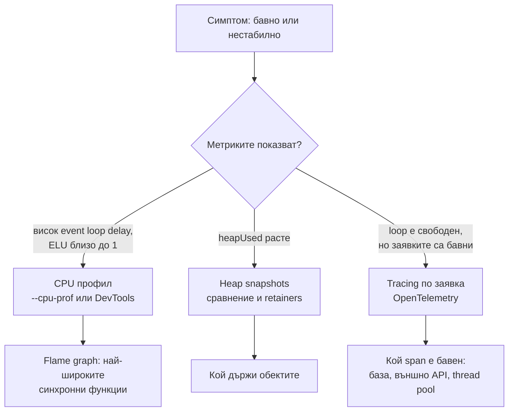

# Мониторинг и debugging

Производителността на Node се следи по няколко сигнала, специфични за модела му: event loop delay (колко закъсняват callbacks), event loop utilization (колко е зает loop-ът), heap и GC паузи, плюс стандартните латентност, throughput и грешки. При проблем се ползват вградените инструменти: `--inspect` с Chrome DevTools за debugging и профили, `--cpu-prof` и `--heap-prof` за профили без DevTools, heap snapshots за изтичания.

## 1. За какво се ползва и защо ни е нужен

CPU и RAM на сървъра не казват достатъчно за Node процес. Процес на 25% CPU на 4-ядрен сървър може да е на 100% на единственото ядро, което JavaScript ползва. Процес с нормален CPU може да е бавен, защото thread pool-ът е наситен. Затова е нужно да мериш вътрешността на runtime-а.

Типични въпроси от production, на които отговарят инструментите:

- p99 латентността скочи след деплоя. Кой код е новият горещ път? (CPU профил)
- Паметта расте с 50 MB на час. Какво се натрупва? (heap snapshots)
- Health check-ът понякога изтича. Блокиран ли е loop-ът? (event loop delay)
- Заявките са бавни, но CPU е нисък. Къде се чака? (tracing, thread pool, външни системи)

## 2. Какво да следиш



| Сигнал | Как се взима | Какво значи високата стойност |
|---|---|---|
| Event loop delay | `perf_hooks.monitorEventLoopDelay()` | Синхронна работа блокира loop-а |
| ELU | `performance.eventLoopUtilization()` | Процесът е CPU-bound, близо до капацитета си |
| `heapUsed` | `process.memoryUsage()` | Изтичане, ако расте след всеки GC |
| GC паузи | `PerformanceObserver` с `entryTypes: ['gc']`, `--trace-gc` | Твърде много алокации или голям heap |
| Активни ресурси | `process.getActiveResourcesInfo()` | Изтичане на сокети или таймери |

Готовият пакет `prom-client` изнася повечето runtime метрики с `collectDefaultMetrics()`.

## 3. Процесът на търсене



## 4. Инструменти

### Debugger

```bash
node --inspect app.js            # слуша на 127.0.0.1:9229, отвори chrome://inspect
node --inspect-brk app.js        # спира на първия ред, за да сложиш breakpoints
node --inspect=0.0.0.0:9229      # НЕ в production: всеки с достъп до порта изпълнява код
```

VS Code и WebStorm се закачат към същия протокол. Към вече работещ процес: `kill -USR1 <pid>` активира inspector-а на Linux и macOS.

### CPU профил

```bash
node --cpu-prof app.js           # при излизане пише CPU.*.cpuprofile в текущата папка
# натоварване: npx autocannon -c 100 -d 30 http://localhost:3000/orders
# отвори файла в Chrome DevTools > Performance или в VS Code
```

Flame graph показва стековете. Ширината е времето. Търси широки "плата" от твой код или от библиотеки: `JSON.stringify`, регулярни изрази, синхронно хеширане, сортиране.

### Heap профил и snapshots

```bash
node --heap-prof app.js                          # профил на алокациите
node --heapsnapshot-signal=SIGUSR2 app.js        # kill -USR2 <pid> пише snapshot
node --heapsnapshot-near-heap-limit=1 app.js     # snapshot малко преди OOM
```

### Диагностика от командния ред

| Флаг | Какво прави |
|---|---|
| `--trace-gc` | Печата всяко GC събитие с продължителност |
| `--trace-sync-io` | Warning за всяко синхронно I/O след старта |
| `--trace-warnings` | Stack trace за всеки warning (напр. MaxListeners) |
| `--report-on-fatalerror` | JSON диагностичен доклад при срив: стек, heap, handles, env |
| `--enable-source-maps` | Stack traces към TypeScript източника |

## 5. Минимален пример: метрики за Prometheus

```js metrics.js
const http = require('node:http');
const client = require('prom-client');

client.collectDefaultMetrics();       // event loop lag, heap, GC, handles, CPU

const duration = new client.Histogram({
  name: 'http_request_duration_seconds',
  help: 'Продължителност на HTTP заявките',
  labelNames: ['method', 'route', 'status'],
  buckets: [0.01, 0.05, 0.1, 0.3, 1, 3],
});

http.createServer(async (req, res) => {
  if (req.url === '/metrics') {
    res.setHeader('Content-Type', client.register.contentType);
    return res.end(await client.register.metrics());
  }
  const end = duration.startTimer({ method: req.method, route: '/orders' });
  // ... обработка
  res.end('ok');
  end({ status: res.statusCode });    // записва времето в хистограмата
}).listen(3000);
```

## 6. Бързи победи

- Пусни последната LTS версия. Всяка нова версия на V8 и libuv носи подобрения.
- Ползвай бърз JSON logger (`pino`) вместо синхронни `console.log` в горещия път. `console.log` към терминал или файл е синхронен.
- Fastify е значително по-бърз от Express при прост JSON API, заради schema-based сериализация.
- Кеширай скъпи изчисления и отговори от външни системи (с лимит).
- `keepAlive` агент за изходящи HTTP заявки (`fetch` в Node го има по подразбиране).
- Connection pool към базата с размер според капацитета на базата, не "колкото повече, толкова по-добре".

## 7. Въпроси на интервю

### Как би намерил защо Node приложение е бавно?

Започвам от метриките: латентност по endpoint, event loop delay, ELU, памет. Ако loop-ът е блокиран, правя CPU профил под натоварване и търся широките синхронни функции във flame graph-а. Ако loop-ът е свободен, гледам tracing: кой span е бавен (база, външно API, DNS, thread pool). Ако паметта расте, сравнявам heap snapshots.

### Какво е event loop utilization?

Отношението на времето, в което loop-ът изпълнява код, към общото време. Изчислява се от libuv като разлика между активно време и време в poll чакане. 0.2 значи, че процесът има много свободен капацитет. Близо до 1 значи, че е наситен и латентността ще расте.

### Как debug-ваш production процес без рестарт?

`kill -USR1 <pid>` активира inspector-а и се закачам през SSH тунел. Или предварително стартиран с `--heapsnapshot-signal` и диагностичен доклад (`process.report`). Внимание: inspector-ът дава пълен контрол над процеса, никога не го излагай публично.

### Синхронен ли е `console.log`?

Зависи от това накъде пише и от платформата. Към файл и към терминал на Linux и macOS е синхронен, при pipes зависи от платформата. При интензивно логване в горещия път това се вижда във flame graph-а. Ползвай асинхронен logger като `pino`.

## 8. Капани и чести грешки

- Мерене само на CPU и RAM на машината, без event loop метрики.
- Средна латентност вместо percentiles. p99 е мястото, където Node проблемите се виждат.
- `--inspect=0.0.0.0` на публичен интерфейс.
- Профилиране без натоварване: профилът не показва горещия път.
- Heap snapshot на инстанция, която обслужва трафик.
- `console.log` с големи обекти в горещия път.

## 9. Свързани документи

- [Блокиране на event loop-а](Blocking.md)
- [Памет и Garbage Collection](Memory_GC.md)
- [libuv и thread pool](Libuv.md)
- [Грешки и graceful shutdown](Errors_Shutdown.md)
