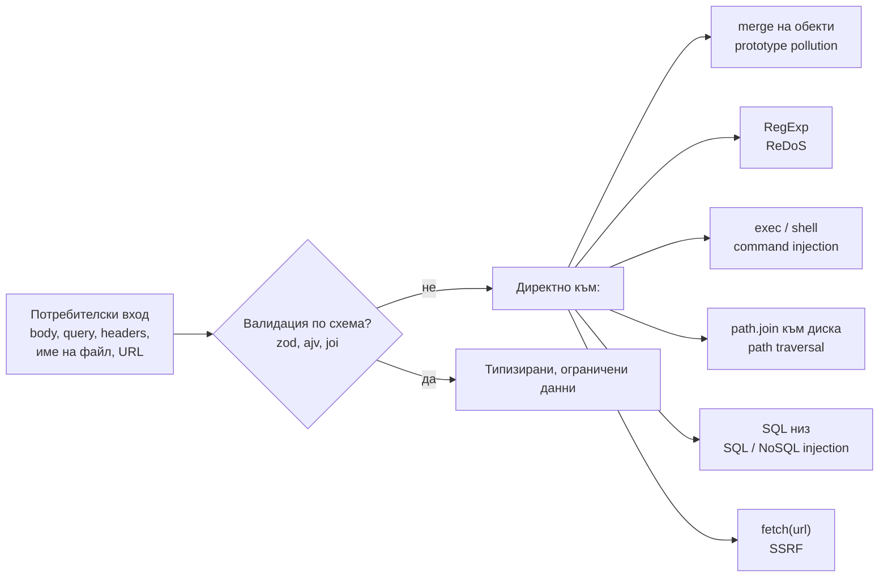

# Сигурност

Сигурността на Node приложение е най-вече сигурност на JavaScript кода и на зависимостите му. Някои уязвимости са общи за всеки backend (injection, path traversal, SSRF), а някои са специфични за JavaScript и модела на Node: prototype pollution идва от динамичните обекти на езика, а ReDoS е опасен именно защото един регулярен израз блокира единствената нишка на event loop-а.

## 1. За какво се ползва и защо ни е нужен

npm проект с 20 директни зависимости обикновено има стотици транзитивни. Всяка от тях изпълнява код с пълните права на процеса. Освен това JavaScript позволява неща, които в статично типизирани езици са невъзможни: да промениш прототипа на всички обекти, да изпълниш низ като код.

На интервю за Node най-често питат за prototype pollution, ReDoS, command injection, path traversal и supply chain атаки. Добре е да знаеш и защитите на ниво HTTP (security headers, rate limiting, лимит на тялото).

## 2. Къде влиза атаката



## 3. Prototype pollution

В JavaScript всеки обект наследява от `Object.prototype`. Ако атакуващ успее да запише свойство в `Object.prototype`, то се появява във всеки обект в процеса.

```js pollution.js
// Наивна рекурсивна merge функция, каквато има в много стари библиотеки
function merge(target, source) {
  for (const key in source) {
    if (typeof source[key] === 'object' && source[key] !== null) {
      target[key] ??= {};
      merge(target[key], source[key]);
    } else {
      target[key] = source[key];
    }
  }
  return target;
}

// JSON.parse създава собствено свойство "__proto__" (не сменя прототипа)
const payload = JSON.parse('{"__proto__": {"isAdmin": true}}');
merge({}, payload);              // target["__proto__"] е Object.prototype!

const user = {};
console.log(user.isAdmin);       // true: всеки обект в процеса вече е "admin"
```

Защита:

- Валидирай входа по схема, която отхвърля непознати ключове.
- В merge функции пропускай `__proto__`, `constructor`, `prototype`.
- За речници ползвай `Map` или `Object.create(null)` (обект без прототип).
- `node --disable-proto=delete` маха `__proto__` accessor-а изцяло.
- Проверки като `if (user.isAdmin)` пиши с `Object.hasOwn(user, 'isAdmin')`.

## 4. ReDoS

Регулярни изрази с вложени квантификатори (`(a+)+`, `(\w+\s?)*`) могат да направят експоненциален брой опити (backtracking) за вход, който почти съвпада. В Node това е DoS: регулярният израз се изпълнява синхронно на главната нишка и блокира всички заявки.

```js redos.js
const evil = /^(\w+\s?)*$/;                    // вложен квантификатор
const input = 'a'.repeat(30) + '!';            // почти съвпада, но не съвсем

console.time('regex');
evil.test(input);                              // секунди или минути; всяка буква удвоява времето
console.timeEnd('regex');
```

Защита:

- Ограничи дължината на входа преди регулярния израз.
- Избягвай вложени квантификатори и алтернации, които се припокриват.
- Провери изразите с инструмент (`safe-regex`, `recheck`) или ESLint правила.
- За ненадеждни шаблони ползвай engine без backtracking (`re2`).

## 5. Command injection и path traversal

```js injection.js
const { exec, execFile } = require('node:child_process');
const path = require('node:path');
const fs = require('node:fs/promises');

// ЛОШО: filename = "a.png; rm -rf /" се изпълнява от shell
exec(`convert ${filename} out.jpg`);

// ДОБРЕ: без shell, аргументите са масив
execFile('convert', [filename, 'out.jpg']);

// ЛОШО: name = "../../etc/passwd" излиза от папката
const bad = path.join('/srv/uploads', name);

// ДОБРЕ: резолвни и провери, че пътят е вътре в разрешената папка
const root = '/srv/uploads';
const full = path.resolve(root, name);
if (!full.startsWith(root + path.sep)) throw new Error('забранен път');
await fs.readFile(full);
```

## 6. Supply chain

| Риск | Защита |
|---|---|
| Пакет с известна уязвимост | `npm audit`, Dependabot или Renovate, редовно обновяване |
| Злонамерен `postinstall` скрипт | `npm ci --ignore-scripts` в CI, преглед на нови зависимости |
| Typosquatting (`expres` вместо `express`) | Внимание при `npm install`, ограничен списък с разрешени пакети |
| Компрометиран maintainer пуска нова версия | `package-lock.json` в репото и `npm ci`, не `npm install` в CI |
| Твърде много зависимости | Всяка нова зависимост е решение. Стандартната библиотека на Node покрива много (`fetch`, `test`, `crypto.randomUUID`) |

Node 20+ има и експериментален permission model (`node --permission --allow-fs-read=/app`), който ограничава достъпа до файловата система, child процеси и workers.

## 7. HTTP слой

- **Security headers:** `helmet` за Express задава CSP, HSTS, `X-Content-Type-Options` и други.
- **Rate limiting:** на login и скъпите endpoints, с общо хранилище (Redis), ако има няколко инстанции.
- **Лимит на тялото:** `express.json({ limit: '100kb' })`. Без него един клиент може да изпрати огромно тяло.
- **CORS:** конкретни origins, не `*` с credentials.
- **Тайни:** от променливи на средата или secret manager, никога в кода и репото.
- **Сравнение на тайни:** `crypto.timingSafeEqual`, не `===` (timing attack).
- **Пароли:** `bcrypt`, `argon2` или `crypto.scrypt` (асинхронният вариант, в thread pool-а).

## 8. Въпроси на интервю

### Какво е prototype pollution?

Атака, при която вход като `{"__proto__": {"isAdmin": true}}` минава през небезопасно сливане или присвояване по път (`obj[a][b] = c`) и записва свойство в `Object.prototype`. Оттам то се появява във всеки обект в процеса и може да заобиколи проверки за права или да доведе до изпълнение на код. Защитата е валидация по схема, филтриране на `__proto__`/`constructor`/`prototype`, `Map` или `Object.create(null)` за речници.

### Какво е ReDoS и защо е особено опасен в Node?

Regular expression denial of service: специално подбран вход кара регулярния израз да прави експоненциален брой стъпки. В многонишков сървър блокира една нишка. В Node блокира единствената нишка на event loop-а, така че цялото приложение спира да отговаря. Защита: лимит на дължината, безопасни изрази, `re2`.

### Как предпазваш от command injection?

Не подаваш потребителски вход към shell. Ползваш `execFile` или `spawn` с масив от аргументи вместо `exec` с низ. Валидираш входа по whitelist.

### Как управляваш риска от зависимостите?

Lockfile в репото и `npm ci` в CI. Автоматично сканиране (`npm audit`, Dependabot, Snyk). Преглед на всяка нова зависимост: поддръжка, брой maintainers, `install` скриптове. Минимален брой зависимости.

### Защо `eval` и `new Function` са опасни?

Изпълняват низ като код с пълните права на процеса. Ако в низа попадне потребителски вход, атакуващият изпълнява произволен код на сървъра. Модулът `vm` не е sandbox за ненадежден код.

## 9. Капани и чести грешки

- `exec` с конкатениран вход.
- `path.join` с потребителско име на файл без проверка.
- Регулярни изрази от Stack Overflow без проверка за backtracking.
- `Object.assign` или deep merge на `req.body` в конфигурационен обект.
- Връщане на stack trace на клиента.
- `npm install` в CI вместо `npm ci`.
- Модулът `vm` като "sandbox" за потребителски код.

## 10. Свързани документи

- [Блокиране на event loop-а](Blocking.md)
- [Child processes, Workers, Cluster](Concurrency.md)
- [File System и async I/O](File_System.md)
- [Грешки и graceful shutdown](Errors_Shutdown.md)
