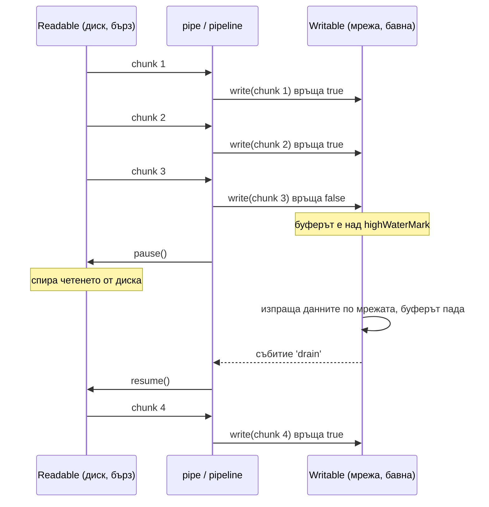
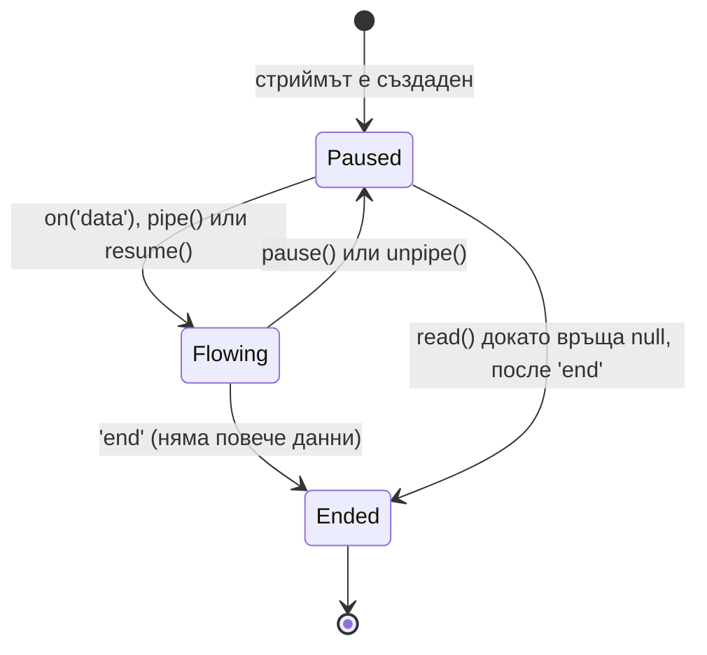

# Streams и backpressure

Stream е абстракция за данни, които идват или заминават на парчета във времето, вместо наведнъж. Node има четири вида: Readable (източник), Writable (приемник), Duplex (и двете, независимо) и Transform (Duplex, при който изходът е изчислен от входа). Механизмът backpressure спира бързия източник, когато бавният приемник не смогва, така че паметта остава константна.

## 1. За какво се ползва и защо ни е нужен

Без стриймове, за да върнеш файл от 2 GB, трябва да го прочетеш целия в паметта и после да го изпратиш. С 10 едновременни заявки това са 20 GB RAM и процесът умира с Out-Of-Memory. Със стрийм четеш 64 KB, изпращаш 64 KB, четеш следващите. Паметта е няколкостотин KB, независимо от размера на файла и от броя заявки.

Реални примери:

- сваляне и качване на файлове (`fs.createReadStream(file).pipe(res)`);
- обработка на CSV или лог файл ред по ред;
- компресия в движение (`zlib.createGzip()`);
- проксиране на отговор от друг сървис;
- експорт на милиони редове от базата (cursor към CSV към HTTP отговор);
- самите HTTP заявка (`req`) и отговор (`res`) са стриймове, също и TCP сокетите.

## 2. Четирите вида

| Вид | Посока | Примери | Ключови методи и събития |
|---|---|---|---|
| Readable | Данни излизат | `fs.createReadStream`, `req` в сървъра, `process.stdin` | `'data'`, `'end'`, `read()`, `pipe()`, `for await` |
| Writable | Данни влизат | `fs.createWriteStream`, `res` в сървъра, `process.stdout` | `write()`, `end()`, `'drain'`, `'finish'` |
| Duplex | Два независими канала | `net.Socket`, WebSocket | И двата набора |
| Transform | Изходът зависи от входа | `zlib.createGzip()`, `crypto.createCipheriv()`, CSV парсър | `transform(chunk, enc, cb)`, `flush(cb)` |

Всеки стрийм има вътрешен буфер с горна граница `highWaterMark`: 64 KB за байтови стриймове (от Node 22, преди 16 KB) и 16 обекта в `objectMode`. Границата е праг, а не твърд лимит: `write` пак приема данни над нея, но връща `false` като сигнал "спри".

## 3. Backpressure



Ако пренебрегнеш `false` от `write()` и продължиш да пишеш, данните се трупат в буфера на Writable без край. Резултатът е същият като да прочетеш всичко в паметта, само по-бавен. `pipe()` и `pipeline()` обработват backpressure автоматично. Ръчно писане в цикъл трябва да проверява резултата и да чака `'drain'`.

## 4. Режими на Readable



- **Paused:** данните стоят в буфера, докато не извикаш `read()`. `for await (const chunk of stream)` работи в този режим и спазва backpressure автоматично.
- **Flowing:** данните се push-ват към `'data'` listener-а толкова бързо, колкото идват. Ако няма listener, се губят.

Не смесвай `on('data')`, `pipe()` и `for await` върху един и същ стрийм.

## 5. Минимален пример: pipeline

```js gzip-download.js
const http = require('node:http');
const fs = require('node:fs');
const zlib = require('node:zlib');
const { pipeline } = require('node:stream/promises');

http.createServer(async (req, res) => {
  res.setHeader('Content-Type', 'text/csv');
  res.setHeader('Content-Encoding', 'gzip');
  try {
    // Файл -> gzip -> HTTP отговор, на парчета от 64 KB, с backpressure
    await pipeline(
      fs.createReadStream('./big-report.csv'),   // Readable
      zlib.createGzip(),                         // Transform, работи в thread pool-а
      res,                                       // Writable: сокетът към клиента
    );
  } catch (err) {
    // pipeline унищожава всички стриймове при грешка (напр. клиентът е прекъснал)
    console.error('download failed', err.code);
  }
}).listen(3000);
```

`pipeline` е предпочитаният начин пред `a.pipe(b).pipe(c)`. При `pipe` грешка в един стрийм не затваря останалите и файловите дескриптори изтичат. `pipeline` унищожава цялата верига и връща грешката на едно място.

## 6. Минимален пример: собствен Transform

```js grep-errors.mjs
import { Transform } from 'node:stream';
import { pipeline } from 'node:stream/promises';

// Transform, който разделя входа на редове и пропуска само редовете с ERROR
class GrepErrors extends Transform {
  #tail = '';
  _transform(chunk, encoding, callback) {
    const lines = (this.#tail + chunk.toString('utf8')).split('\n');
    this.#tail = lines.pop();                  // последният ред може да е непълен
    for (const line of lines) {
      if (line.includes('ERROR')) this.push(line + '\n');
    }
    callback();                                // сигнал "готов за следващото парче"
  }
  _flush(callback) {
    if (this.#tail.includes('ERROR')) this.push(this.#tail + '\n');
    callback();
  }
}

await pipeline(process.stdin, new GrepErrors(), process.stdout);   // top-level await: файлът е ES модул
// cat app.log | node grep-errors.mjs
```

Ако `callback` не бъде извикан, стриймът спира: така Transform сигнализира backpressure към източника.

## 7. Async iteration

От Node 10 насам всеки Readable е async iterable. Това е най-четимият начин да обработиш стрийм, и backpressure работи сам, защото следващото парче се чете чак когато тялото на цикъла свърши.

```js lines.js
const fs = require('node:fs');
const readline = require('node:readline');

async function countErrors(path) {
  const rl = readline.createInterface({ input: fs.createReadStream(path), crlfDelay: Infinity });
  let n = 0;
  for await (const line of rl) {           // ред по ред, файлът може да е 50 GB
    if (line.includes('ERROR')) n++;
  }
  return n;
}
```

## 8. Въпроси на интервю

### Какво е backpressure и как Node го обработва?

Ситуация, в която приемникът не смогва с темпото на източника. Writable сигнализира с `write()`, което връща `false`, когато буферът му е над `highWaterMark`, и после emit-ва `'drain'`, когато се изпразни. `pipe` и `pipeline` реагират, като паузират Readable-а и го пускат отново при `'drain'`. Ако го игнорираш, паметта расте неограничено.

### Защо `pipeline` вместо `pipe`?

`pipe` не пренася грешките по веригата: ако Writable-ът се провали, Readable-ът продължава да е отворен и дескрипторът изтича. Трябва да слушаш `'error'` на всеки стрийм поотделно. `pipeline` закача обработка на грешки на всички, унищожава всички при грешка и дава един callback или Promise.

### Каква е разликата между Duplex и Transform?

И двата са четими и записваеми. При Duplex двете страни са независими: сокетът изпраща и получава различни данни. При Transform изходът е функция от входа: записваш некомпресирани данни, четеш компресирани.

### Какво е `objectMode`?

По подразбиране стриймовете носят `Buffer` или низове и `highWaterMark` е в байтове. В `objectMode` всяко парче е произволен JS обект (ред от базата, парснат JSON запис) и `highWaterMark` е брой обекти.

### Как стрийм от база данни стига до HTTP отговор без да зареди всичко?

Курсор от драйвера (например `pg-query-stream`) дава Readable в objectMode, Transform превръща всеки ред в CSV ред, а `res` е Writable. Свързваш ги с `pipeline`. Ако клиентът чете бавно, backpressure стига до курсора и той спира да тегли редове от базата.

## 9. Капани и чести грешки

- `fs.readFile` за големи файлове вместо стрийм: Out-Of-Memory при натоварване.
- `.pipe()` без обработка на грешки на всеки стрийм.
- Ръчен цикъл с `write()`, който игнорира `false`.
- `chunk.toString()` на парче, което разделя многобайтов UTF-8 символ. Ползвай `setEncoding('utf8')` или събирай парчетата.
- Забравен `callback()` в `_transform`: стриймът замръзва без грешка.
- `on('data')` без `on('error')`: необработеното `'error'` събитие сваля процеса. Виж [EventEmitter](Event_Emitter.md).

## 10. Свързани документи

- [Buffers и бинарни данни](Buffers.md)
- [File System и async I/O](File_System.md)
- [EventEmitter](Event_Emitter.md)
- [HTTP сървърът под капака](HTTP_Server.md)
