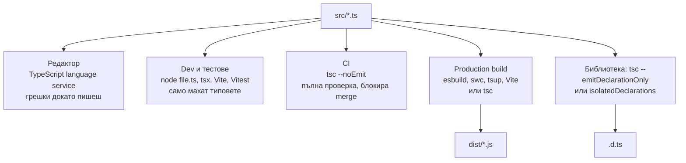

# Build и производителност

Проверката на типовете и превръщането на TypeScript в JavaScript са две отделни задачи и в съвременен проект ги вършат различни инструменти. `tsc` е единственият, който проверява типове, но е бавен за генериране. esbuild, swc, Babel и самият Node (type stripping) само махат типовете, файл по файл, десетки пъти по-бързо, без да проверяват нищо. Затова типичната схема е: редакторът и CI проверяват с `tsc --noEmit`, а бърз инструмент генерира или директно изпълнява кода.

## 1. За какво се ползва и защо ни е нужен

В голям проект `tsc` може да отнеме минути. Ако всеки рестарт на dev сървъра или всеки тест чака пълна проверка, работата се забавя. Разделянето на двете задачи дава:

- мигновен старт на dev сървъра и тестовете;
- проверка на типовете паралелно (в редактора и в CI), без да блокира;
- възможност да изпълниш `.ts` директно с Node, без build стъпка.

Цената: инструментите, които компилират файл по файл, не виждат други файлове, така че някои конструкции не работят. `isolatedModules` и `erasableSyntaxOnly` гарантират, че кодът е съвместим с тях.

## 2. Типичният pipeline



## 3. Инструментите

| Инструмент | Проверява ли типове | Скорост | Кога |
|---|---|---|---|
| `tsc` | Да | Бавен | CI проверка, генериране на `.d.ts`, малки проекти |
| esbuild | Не | Много бърз (Go) | Bundling, tsup, Vite за production |
| swc | Не | Много бърз (Rust) | Next.js, NestJS CLI, Jest трансформация |
| Babel `preset-typescript` | Не | Среден | Стари проекти с Babel pipeline |
| Node type stripping | Не | Без build стъпка | Скриптове, малки сървиси, dev. От Node 23.6 без флаг, в Node 22 от 22.18 |
| `tsx` | Не | Бърз (esbuild) | Изпълнение на `.ts` с поддръжка на всичко, вкл. enums и decorators |
| TypeScript 7 (`tsgo`) | Да | Около 10 пъти по-бърз от `tsc` | Порт на компилатора на Go (проект Corsa). Същата типова система |

## 4. Ограниченията на компилацията файл по файл

```ts isolated.ts
// 1. Re-export на тип без "type": инструментът не знае дали User е тип или стойност
export { User } from './user.js';          // Грешка с isolatedModules
export type { User } from './user.js';     // ОК

// 2. const enum от друг файл: стойността не може да се вгради, без да се прочете другият файл
// 3. enum, namespace и parameter properties генерират код: Node type stripping гърми
//    с SyntaxError. erasableSyntaxOnly ги забранява още в редактора.
```

| Флаг | Гарантира |
|---|---|
| `isolatedModules` | Всеки файл може да се транспилира сам (esbuild, swc, Babel) |
| `verbatimModuleSyntax` | Import-ите остават точно както са написани, `import type` изчезва |
| `erasableSyntaxOnly` (5.8) | Само синтаксис, който може да се изтрие (за Node type stripping) |
| `isolatedDeclarations` (5.5) | `.d.ts` може да се генерира файл по файл, без проверка на типовете. Изисква явни типове на експортите |

## 5. Минимален пример: Node backend без build стъпка

```json package.json
{
  "type": "module",
  "scripts": {
    "dev": "node --watch src/server.ts",
    "typecheck": "tsc --noEmit",
    "test": "node --test 'src/**/*.test.ts'",
    "start": "node src/server.ts"
  }
}
```

```ts src/server.ts
import { createServer } from 'node:http';
import type { IncomingMessage, ServerResponse } from 'node:http';   // import type: изчезва изцяло
import { route } from './router.ts';                               // разширението .ts е задължително

createServer((req: IncomingMessage, res: ServerResponse) => route(req, res)).listen(3000);
```

Node изпълнява `.ts` файла, като заменя типовете с интервали (така позициите в stack traces съвпадат). Не проверява типовете и не чете `tsconfig.json`. За да работи `import './router.ts'` и при `tsc`, в tsconfig трябва `allowImportingTsExtensions` (с `noEmit`) или `rewriteRelativeImportExtensions`.

## 6. Производителност на проверката

- **`skipLibCheck: true`:** не проверява `.d.ts` в `node_modules`. Най-голямата лесна печалба.
- **`incremental: true`:** пази информация между пусканията в `.tsbuildinfo`.
- **Project references** (`composite`, `references`, `tsc -b`): монорепо се разделя на проекти, които се проверяват поотделно и само когато са се променили.
- **Явни return типове** на експортирани функции: компилаторът не трябва да извежда сложни типове при всяко използване.
- **`interface extends`** вместо дълги вериги от `&`: отношенията между interfaces се кешират.
- **Огромни union-и** (хиляди членове от template literal типове) и дълбока рекурсия забавят всичко.
- **Диагностика:** `tsc --extendedDiagnostics` показва времето по етапи, `tsc --generateTrace dir` дава trace, който се отваря в Perfetto и показва кои типове са скъпи.

## 7. Въпроси на интервю

### Каква е разликата между `tsc` и esbuild?

`tsc` проверява типовете и генерира JavaScript и декларации. Знае за целия проект. esbuild (и swc) само махат типовете и трансформират синтаксиса, файл по файл, без проверка. Десетки пъти по-бързи са, но не хващат типови грешки. Затова се комбинират: esbuild за build, `tsc --noEmit` за проверка.

### Какво прави `isolatedModules`?

Дава грешка за конструкции, които не могат да се компилират правилно, без да се прочетат други файлове: re-export на тип без `type`, `const enum` между файлове, файлове без import/export. Гарантира, че кодът е съвместим с инструменти, които компилират файл по файл.

### Може ли Node да изпълнява TypeScript?

Да, с type stripping: Node 22.6 го въведе зад флаг, от Node 23.6 (и 22.18) е включен по подразбиране. Node маха типовете, без да ги проверява. Не поддържа синтаксис, който генерира код: enums, namespaces със стойности, parameter properties, decorators. `erasableSyntaxOnly` в tsconfig предупреждава за тях.

### Как ускоряваш бавна TypeScript компилация?

`skipLibCheck`, `incremental`, project references в монорепо, явни return типове на публичните функции, по-малко сложни conditional и template literal типове. Диагностика с `--extendedDiagnostics` и `--generateTrace`. В перспектива TypeScript 7 (компилаторът, пренаписан на Go).

### Защо CI трябва да пуска `tsc --noEmit` отделно?

Защото build инструментите (esbuild, swc, Vite) не проверяват типове. Без отделна стъпка код с типови грешки минава build-а и стига до production.

## 8. Капани и чести грешки

- Build с esbuild или Vite без `tsc --noEmit` в CI.
- `enum` или parameter properties в код, който се пуска с `node file.ts`.
- `export { Type }` без `type` при `isolatedModules`.
- Различни версии на TypeScript в редактора и в CI (`Use Workspace Version` във VS Code).
- `ts-node` с пълна проверка за dev сървър: бавен старт. `tsx` или Node type stripping са по-бързи.

## 9. Свързани документи

- [Компилаторът и type erasure](What_Is_TS.md)
- [tsconfig и strict](Tsconfig.md)
- [Enums и алтернативи](Enums.md)
- [Модули и .d.ts файлове](Modules_Declarations.md)
