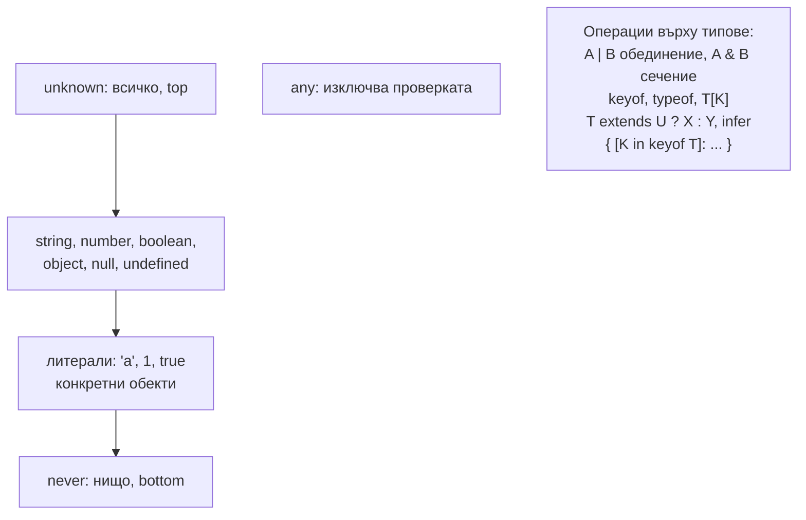

# Бърз преговор

Най-важното от всички теми, сбито за последните 15 минути преди интервюто. Всеки ред е отговор, който можеш да кажеш на глас. За обяснението и диаграмите отвори съответния документ.

## 1. TypeScript в три изречения

TypeScript е JavaScript със статична, структурна типова система, която съществува само при компилация. `tsc` проверява типовете и генерира JavaScript, като ги изтрива. Затова данните отвън трябва да се валидират с код, а типовете вътре в системата могат да се вярват. Подробно: [Компилаторът и type erasure](What_Is_TS.md), [Runtime граница](Runtime_Boundary.md).

## 2. Картата на типовата система



## 3. Еднолинейни отговори

| Въпрос | Отговор |
|---|---|
| Структурно или номинално? | Структурно: съвместимостта е по форма, не по име |
| Excess property check? | Само за пресни обектни литерали, подадени директно |
| Как правиш номинален тип? | Branded тип: `string & { __brand: 'UserId' }` |
| `any` срещу `unknown`? | `any` изключва проверката и се разлива; `unknown` изисква narrowing |
| `never`? | Празното множество: функции, които не връщат, проверка за изчерпателност, филтриране в conditional типове |
| `type` срещу `interface`? | `interface`: обекти, declaration merging, `extends` с проверка. `type`: всичко, вкл. union, tuple, conditional |
| Widening? | `let x = 'a'` е `string`, `const x = 'a'` е `'a'` |
| `as const`? | Литерални типове и `readonly` на всяко ниво |
| `satisfies` срещу анотация? | И двете проверяват; `satisfies` пази тесния изведен тип |
| `as` срещу `satisfies`? | `as` вярва и проверява само припокриване; `satisfies` проверява изцяло |
| Narrowing? | Стесняване на типа в клон по `typeof`, `in`, `instanceof`, сравнение, type guard |
| Discriminated union? | Union с общо литерално поле; проверката му стеснява целия обект |
| Type guard срещу assertion function? | `x is T` връща boolean; `asserts x is T` хвърля и стеснява до края на обхвата |
| Защо generic, а не `any`? | Пази връзката между входа и изхода |
| `K extends keyof T`? | `K` е едно от имената на свойствата; `T[K]` е типът на свойството |
| Union от масив? | `(typeof ARR)[number]` с `as const` |
| Дистрибутивен conditional? | Гол `T` с union се прилага за всеки член; `[T]` го изключва |
| `infer`? | Извежда част от тип в условието: `T extends Promise<infer V> ? V : T` |
| Mapped type? | `{ [K in keyof T]: ... }`, с `-readonly`, `-?`, `as` за преименуване |
| `Pick`? | `{ [P in K]: T[P] }` с `K extends keyof T` |
| `Omit`? | `Pick<T, Exclude<keyof T, K>>`; не проверява ключовете, не е дистрибутивен |
| Ковариантност? | Изход: `() => Dog` е подтип на `() => Animal` |
| Контравариантност? | Вход: `(a: Animal) => void` е подтип на `(d: Dog) => void` |
| Методи срещу свойства-функции? | Методите са бивариантни (дупка); свойствата са строги |
| `private` срещу `#private`? | Компилатор срещу истинска runtime капсулация |
| Какво генерира `enum`? | IIFE с обект; числовият е двупосочен. Алтернатива: union или `as const` обект |
| `.d.ts`? | Само типове за JavaScript код; `@types/*` от DefinitelyTyped |
| Module augmentation? | `declare module 'x'` в модулен файл + declaration merging |
| Най-важният strict флаг? | `strictNullChecks` |
| `noUncheckedIndexedAccess`? | `arr[i]` и `dict[k]` стават `T \| undefined`. Не е в `strict` |
| `catch (e)`? | `unknown` при strict; провери с `instanceof Error` |
| `tsc` срещу esbuild? | Проверка и генериране срещу само махане на типовете |
| Node и TypeScript? | Type stripping без проверка; без enums, namespaces, parameter properties |
| `Object.keys` връща? | `string[]`, защото обектът може да има допълнителни полета |

## 4. Пет имплементации наизуст

```ts by-heart.ts
type MyPartial<T> = { [K in keyof T]?: T[K] };
type MyPick<T, K extends keyof T> = { [P in K]: T[P] };
type MyExclude<T, U> = T extends U ? never : T;
type MyOmit<T, K extends keyof any> = MyPick<T, MyExclude<keyof T, K>>;
type MyReturnType<T extends (...args: any) => any> = T extends (...args: any) => infer R ? R : never;
```

## 5. Как да отговаряш

1. **Определение** в едно изречение.
2. **Защо** съществува: какъв проблем решава.
3. **Пример** в код, по възможност на бялата дъска: три-четири реда стигат.
4. **Къде се чупи:** дупката или капанът. Това отличава човек с опит.
5. **Как го ползваш в реален проект:** валидация на границата, discriminated unions за състояния, strict tsconfig.

## 6. Свързани документи

- [Структурно типизиране](Structural_Typing.md)
- [Narrowing и control flow](Narrowing.md)
- [Conditional types и infer](Conditional_Types.md)
- [Utility types отвътре](Utility_Types.md)
- [Чести капани](Pitfalls.md)
