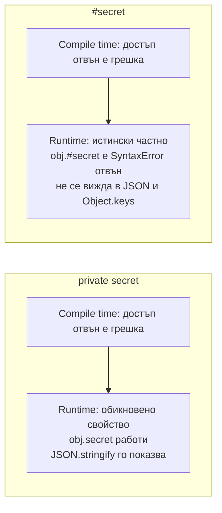

# Класове

Класовете в TypeScript са JavaScript класове с добавени типове и няколко модификатора: `public`, `private`, `protected`, `readonly`, `abstract`, `override`. Повечето от тях съществуват само при компилация. Важната разлика за интервю е между `private` (проверка само от компилатора, полето е видимо в runtime) и `#private` (истинско частно поле на JavaScript, недостъпно отвън и в runtime).

## 1. За какво се ползва и защо ни е нужен

Класовете са естествени за services, repositories, domain обекти с поведение, грешки (`class NotFoundError extends Error`) и навсякъде, където framework-ът ги изисква (NestJS, Angular, TypeORM). TypeScript добавя:

- **контрол на достъпа** (`private`, `protected`), за да капсулираш състоянието;
- **договори** с `implements`, които класът трябва да спази;
- **abstract** класове за обща логика с методи, които наследниците трябва да имплементират;
- **parameter properties**, които съкращават конструкторите.

## 2. private срещу #private



| | `private x` | `#x` |
|---|---|---|
| Кой проверява | Само компилаторът | JavaScript engine-ът |
| Достъп в runtime отвън | Да (`obj['x']`, `as any`) | Не |
| В `JSON.stringify`, `Object.keys` | Да | Не |
| Наследници | Не могат да го достъпят | Не могат |
| Две инстанции на същия клас | Виждат си полетата | Виждат си полетата |
| Работи с type stripping | Да | Да |

Правило: `#private` за истинска капсулация (тайни, вътрешно състояние на библиотека). `private` е приемлив, когато framework-ът разчита на него (dependency injection в NestJS) или когато ти трябва достъп в тестовете.

## 3. Минимален пример

```ts classes.ts
interface Repository<T> {
  findById(id: string): Promise<T | null>;
  save(entity: T): Promise<void>;
}

abstract class BaseService<T extends { id: string }> {
  // abstract: наследникът е длъжен да го имплементира
  protected abstract readonly entityName: string;

  constructor(protected readonly repo: Repository<T>) {}   // parameter property: декларира и присвоява

  async getOrThrow(id: string): Promise<T> {
    const entity = await this.repo.findById(id);
    if (!entity) throw new NotFoundError(`${this.entityName} ${id}`);
    return entity;
  }
}

interface User { id: string; email: string }

class UserService extends BaseService<User> {
  protected readonly entityName = 'User';
  #loginAttempts = new Map<string, number>();          // истински частно

  override async getOrThrow(id: string): Promise<User> { // override: грешка, ако базовият метод изчезне
    const user = await super.getOrThrow(id);
    return { ...user, email: user.email.toLowerCase() };
  }

  recordFailedLogin(email: string): number {
    const n = (this.#loginAttempts.get(email) ?? 0) + 1;
    this.#loginAttempts.set(email, n);
    return n;
  }
}

class NotFoundError extends Error {
  readonly status = 404;
  constructor(message: string) {
    super(message);
    this.name = 'NotFoundError';
  }
}
```

## 4. implements не наследява

`implements` само проверява, че класът има нужната форма. Не добавя имплементация, не дава типове на параметрите на методите и не съществува в runtime. Заради структурното типизиране клас, който не пише `implements`, но има същите методи, пак е съвместим с interface-а.

```ts implements.ts
interface Greeter {
  greet(name: string): string;
}

class Polite implements Greeter {
  greet(name) {                 // Грешка (noImplicitAny): name не получава тип от interface-а
    return `Здравейте, ${name}`;
  }
}
```

## 5. Въпроси на интервю

### Каква е разликата между `private` и `#private`?

`private` е модификатор на TypeScript: компилаторът забранява достъпа отвън, но в изходния JavaScript полето е обикновено свойство, видимо с `obj['x']`, `JSON.stringify` и в дебъгера. `#x` е стандартно частно поле на JavaScript: engine-ът го пази в runtime и няма начин да се достъпи отвън.

### Какво са parameter properties?

Модификатор (`private`, `public`, `protected`, `readonly`) пред параметър на конструктора, който едновременно декларира поле и го присвоява. Генерира runtime код (`this.repo = repo`), затова не работи с type stripping в Node и е забранен от `erasableSyntaxOnly`.

### Каква е разликата между abstract клас и interface?

Interface е само договор за форма, изчезва при компилация, клас може да имплементира няколко. Abstract класът съществува в runtime, може да има имплементирани методи, полета и конструктор, и клас може да наследи само един. Ползвай abstract клас, когато има обща логика, interface, когато е само договор.

### Какво прави `override`?

Маркира, че методът презаписва метод от базовия клас. С `noImplicitOverride` е задължителен. Ако базовият метод бъде преименуван или изтрит, получаваш грешка, вместо тихо да имаш нов метод, който никой не вика.

### Как работи `this` в методи, подадени като callback?

Както в JavaScript: `button.onclick = obj.handle` губи `this`. TypeScript може да хване това, ако декларираш `this` параметър (`handle(this: MyClass)`). Решения: arrow function като поле (`handle = () => {...}`) или `.bind(this)`.

## 6. Капани и чести грешки

- `private` за тайни, които после изтичат през `JSON.stringify` или логове.
- Очакване, че `implements` дава типове на параметрите.
- Наследяване на `Error` без `this.name` и (при стар target) без `Object.setPrototypeOf`: `instanceof` не работи при target ES5.
- Methods като callbacks без bind.
- Дълбоки йерархии с наследяване, когато композиция би била по-проста.

## 7. Свързани документи

- [Структурно типизиране](Structural_Typing.md)
- [Decorators](Decorators.md)
- [Enums и алтернативи](Enums.md)
- [Build и производителност](Build_Tooling.md)
