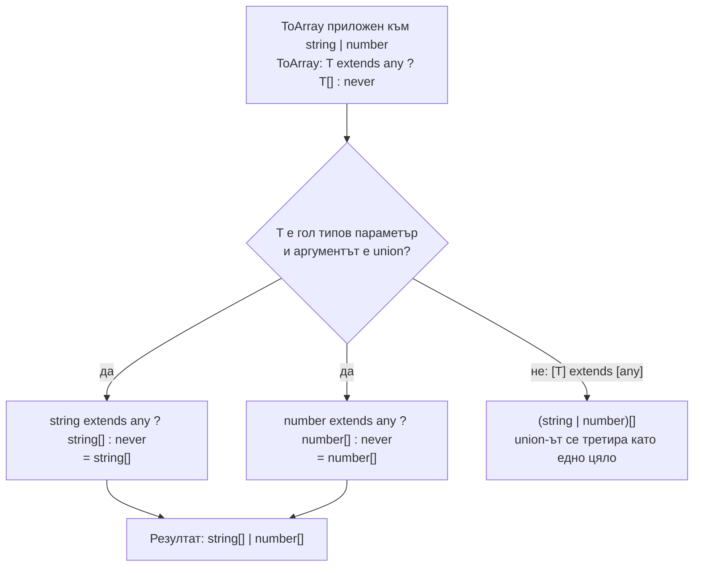

# Conditional types и infer

Conditional type е `if` на ниво типове: `T extends U ? X : Y` дава `X`, ако `T` е съвместим с `U`, и `Y` иначе. С ключовата дума `infer` в условието можеш да "извадиш" част от тип: типа на елементите на масив, return типа на функция, стойността в Promise. Когато `T` е union и е "гол" типов параметър, условието се прилага върху всеки член поотделно (дистрибутивност).

## 1. За какво се ползва и защо ни е нужен

Conditional типовете са основата на почти всички вградени утилити типове: `ReturnType`, `Parameters`, `Awaited`, `Exclude`, `Extract`, `NonNullable`. В приложен код ги ползваш по-рядко, но на интервю за senior позиция е почти сигурно да те помолят да напишеш някой от тях или да обясниш дистрибутивността.

Практически приложения:

- извличане на типове от функции и библиотеки, които не експортират типовете си (`Parameters<typeof lib.fn>[0]`);
- типове, които зависят от аргумент (`fetch` с `{ json: true }` връща обект, иначе низ);
- филтриране на union (махни `null`, остави само функциите);
- рекурсивни трансформации (`DeepPartial`, `DeepReadonly`).

## 2. Дистрибутивност



Дистрибутивността важи само когато проверяваният тип е гол типов параметър (`T extends ...`). Обвиването в tuple (`[T] extends [any]`) я изключва. Специален случай: `never` е празен union, така че дистрибутивен conditional върху `never` дава `never`, без да проверява условието.

## 3. Минимален пример

```ts conditional.ts
// Основна форма
type IsString<T> = T extends string ? true : false;
type A = IsString<'hi'>;          // true
type B = IsString<42>;            // false

// Дистрибутивност: филтриране на union
type MyExclude<T, U> = T extends U ? never : T;
type C = MyExclude<'a' | 'b' | 'c', 'a'>;     // 'b' | 'c'

type MyNonNullable<T> = T extends null | undefined ? never : T;
type D = MyNonNullable<string | null | undefined>;   // string

// Без дистрибутивност
type IsUnion<T> = [T] extends [string] ? 'all strings' : 'mixed';
type E = IsUnion<'a' | 1>;        // 'mixed' (без [] щеше да е 'all strings' | 'mixed')
```

## 4. infer

`infer X` декларира нов типов параметър вътре в условието и казва на компилатора "намери какво трябва да е X, за да е вярно условието".

```ts infer.ts
// Типът на елемента на масив
type ElementOf<T> = T extends readonly (infer E)[] ? E : never;
type F = ElementOf<string[]>;                    // string

// Return тип на функция (така е написан вграденият ReturnType)
type MyReturnType<T> = T extends (...args: any[]) => infer R ? R : never;
type G = MyReturnType<() => Promise<number>>;    // Promise<number>

// Първи параметър
type FirstArg<T> = T extends (first: infer A, ...rest: any[]) => any ? A : never;
type H = FirstArg<(id: string, force: boolean) => void>;   // string

// infer с ограничение (TS 4.7): само ако е число
type NumericLiteral<T> = T extends `${infer N extends number}` ? N : never;
type I = NumericLiteral<'42'>;                   // 42

// Разопаковане на Promise, рекурсивно (идеята зад Awaited)
type Unwrap<T> = T extends PromiseLike<infer V> ? Unwrap<V> : T;
type J = Unwrap<Promise<Promise<string>>>;       // string
```

## 5. Рекурсивни типове

```ts deep.ts
type DeepPartial<T> = T extends (...args: any[]) => any
  ? T                                            // функциите не се пипат
  : T extends object
    ? { [K in keyof T]?: DeepPartial<T[K]> }     // рекурсивно за всяко свойство
    : T;                                         // примитивите остават същите

interface Settings {
  db: { host: string; port: number };
  cache: { ttl: number };
}

const patch: DeepPartial<Settings> = { db: { port: 5433 } };   // ОК: всичко е опционално на всяко ниво
```

Компилаторът има лимит на дълбочината на рекурсия (по-висок, когато рекурсивното извикване е в опашна позиция на conditional типа). Твърде сложни рекурсивни типове забавят редактора и дават `Type instantiation is excessively deep and possibly infinite`.

## 6. Въпроси на интервю

### Какво е conditional type?

Тип с форма `T extends U ? X : Y`. Ако `T` е присвоим на `U`, резултатът е `X`, иначе `Y`. Изчислява се при компилация. Ако `T` е generic, който още не е известен, резултатът се отлага, докато не стане известен.

### Какво е дистрибутивен conditional type?

Когато проверяваният тип е гол типов параметър и получи union, условието се прилага за всеки член поотделно и резултатите се обединяват. Затова `Exclude<'a' | 'b', 'a'>` дава `'b'`. Изключва се с `[T] extends [U]`.

### Какво прави `infer`?

Въвежда типова променлива в условието на conditional type, която компилаторът извежда чрез съпоставяне. `T extends Promise<infer V> ? V : T` извлича типа в Promise. Може да има ограничение: `infer N extends number`.

### Напиши `ReturnType` сам.

`type MyReturnType<T extends (...args: any) => any> = T extends (...args: any) => infer R ? R : never;`

### Защо `IsString<never>` дава `never`, а не `false`?

`never` е празен union. Дистрибутивният conditional обхожда членовете на union-а, а при празен няма какво да обходи, така че резултатът е празен: `never`. С `[T] extends [string]` резултатът е `true`, защото `never` е присвоим на всичко.

## 7. Капани и чести грешки

- Неочаквана дистрибутивност при union аргументи.
- Изненадата с `never` в дистрибутивен conditional.
- Сложни conditional типове в публично API: грешките стават нечетими за потребителите.
- Дълбока рекурсия, която забавя редактора.
- Conditional тип върху още неизвестен generic вътре във функция: компилаторът не може да го стесни и изисква `as`.

## 8. Свързани документи

- [Generics](Generics.md)
- [Mapped и template literal типове](Mapped_Types.md)
- [Utility types отвътре](Utility_Types.md)
- [any, unknown, never и йерархията](Type_Hierarchy.md)
