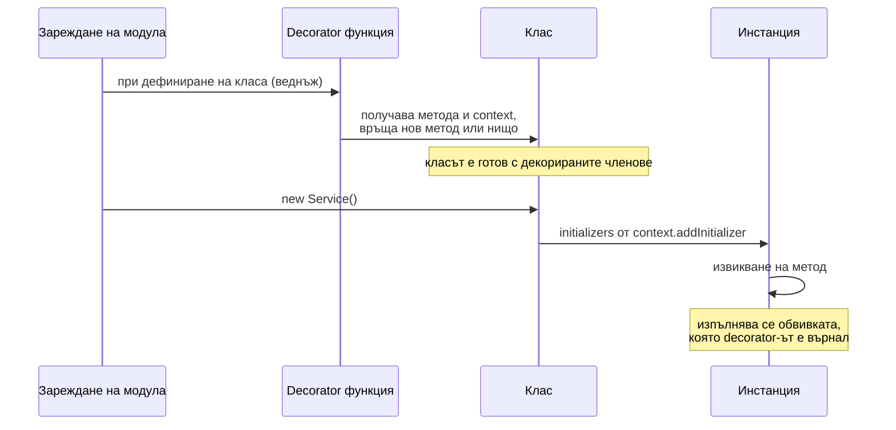

# Decorators

Decorator е функция, която се прилага към клас или член на клас (метод, поле, accessor) със синтаксиса `@name` и може да го наблюдава, замени или обогати. В TypeScript има два несъвместими варианта: стандартните decorators по предложението на TC39 (поддържани от TS 5.0 без флаг) и старите `experimentalDecorators`, на които още стоят NestJS, Angular, TypeORM и class-validator. Decorators генерират runtime код, така че не са просто типове.

## 1. За какво се ползва и защо ни е нужен

Decorators изнасят повтарящо се поведение от тялото на метода към декларация:

- **framework-и:** `@Controller('/users')`, `@Get(':id')`, `@Injectable()` в NestJS, `@Component` в Angular;
- **ORM и валидация:** `@Entity()`, `@Column()`, `@IsEmail()`;
- **cross-cutting логика:** логване, измерване на време, кеширане, retry, проверка на права;
- **автоматично bind-ване** на методи към инстанцията.

На интервю питат каква е разликата между двата варианта, защо NestJS изисква `experimentalDecorators` и `emitDecoratorMetadata`, и как decorator-ът се изпълнява във времето.

## 2. Кога се изпълнява decorator



Decorator-ът се изпълнява веднъж, когато класът се дефинира (при зареждане на модула), не при всяко извикване. Той връща заместител, и заместителят се изпълнява при всяко извикване.

## 3. Двата варианта

| | Стандартни (TC39, TS 5.0+) | `experimentalDecorators` |
|---|---|---|
| Флаг | Не е нужен | `experimentalDecorators: true` |
| Сигнатура | `(value, context)` | `(target, propertyKey, descriptor)` |
| Decorators на параметри | Не | Да (`@Inject()` в конструктор) |
| Metadata за типовете | Не (`emitDecoratorMetadata` не работи) | Да, с `emitDecoratorMetadata` и `reflect-metadata` |
| Използват се от | Нови библиотеки, собствен код | NestJS, Angular, TypeORM, class-validator |
| Стандарт | Предложение на TC39 | Ранен вариант, няма да стане стандарт |

NestJS dependency injection работи така: `emitDecoratorMetadata` записва в runtime типовете на параметрите на конструктора (`design:paramtypes`), а контейнерът ги чете с `reflect-metadata`, за да знае какво да инжектира. Със стандартните decorators тази информация не съществува.

## 4. Минимален пример: стандартен decorator

```ts decorators.ts
// Method decorator: обвива метода и мери времето му
function timed<This, Args extends unknown[], Return>(
  method: (this: This, ...args: Args) => Return,
  context: ClassMethodDecoratorContext<This, (this: This, ...args: Args) => Return>,
) {
  const name = String(context.name);
  return function (this: This, ...args: Args): Return {
    const start = performance.now();
    try {
      return method.call(this, ...args);                 // извиква оригиналния метод
    } finally {
      console.log(`${name}: ${(performance.now() - start).toFixed(1)} ms`);
    }
  };
}

// Decorator, който bind-ва метода към инстанцията при създаването ѝ
function bound<This, T extends (this: This, ...args: any[]) => any>(
  method: T,
  context: ClassMethodDecoratorContext<This, T>,
) {
  context.addInitializer(function (this: This) {
    (this as Record<string | symbol, unknown>)[context.name] = method.bind(this);
  });
}

class ReportService {
  constructor(private readonly prefix: string) {}

  @timed
  build(rows: number): string {
    let out = '';
    for (let i = 0; i < rows; i++) out += `${this.prefix}${i}\n`;
    return out;
  }

  @bound
  print() {
    console.log(this.prefix);
  }
}

const svc = new ReportService('ред ');
svc.build(10_000);                    // build: 1.3 ms
const { print } = svc;
print();                              // работи: this е bind-нат от @bound
```

## 5. Въпроси на интервю

### Какво е decorator?

Функция, приложена към клас или член на клас с `@`, която се изпълнява при дефиниране на класа и може да замени или обогати декорирания елемент. Използва се за декларативно добавяне на поведение: routing, DI, валидация, логване.

### Каква е разликата между стандартните и experimental decorators?

Стандартните следват предложението на TC39 и имат сигнатура `(value, context)`. Не поддържат decorators на параметри и metadata за типовете. Experimental са ранният вариант на TypeScript със сигнатура `(target, key, descriptor)`, поддържат decorators на параметри и с `emitDecoratorMetadata` записват типовете в runtime. Двата модела не са съвместими: проектът избира единия.

### Защо NestJS изисква `emitDecoratorMetadata`?

За dependency injection по тип. Компилаторът записва типовете на параметрите на конструктора като metadata. В runtime DI контейнерът чете `design:paramtypes` и знае, че `UsersController` има нужда от `UsersService`. Без metadata трябва да посочваш зависимостите ръчно с `@Inject(Token)`.

### Кога се изпълнява decorator-ът?

Веднъж, при дефиниране на класа, тоест при зареждане на модула. Ако върне нова функция, тя замества метода и се изпълнява при всяко извикване. Логика за всяка инстанция се добавя с `context.addInitializer`.

### Работят ли decorators с type stripping в Node?

Не. Decorators изискват трансформация на кода и не са "изтриваеми" типове. Проект с decorators трябва да се компилира с `tsc`, swc или esbuild.

## 6. Капани и чести грешки

- Смесване на библиотеки за двата модела в един проект.
- `emitDecoratorMetadata` с типове, импортирани с `import type`: metadata-та става `Object` и DI не намира зависимостта.
- Тежка логика в decorator-а, която забавя зареждането на всеки модул.
- Скрито поведение: decorator, който променя резултата или хвърля, е труден за дебъг.
- Очакване, че decorators работят върху обикновени функции. Само върху класове и членовете им.

## 7. Свързани документи

- [Класове](Classes.md)
- [tsconfig и strict](Tsconfig.md)
- [Build и производителност](Build_Tooling.md)
- [Модули и .d.ts файлове](Modules_Declarations.md)
