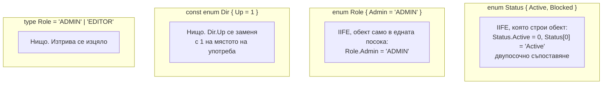

# Enums и алтернативи

`enum` е една от малкото конструкции в TypeScript, които генерират runtime код: числов или низов enum става JavaScript обект, а числовият има и обратно съпоставяне (от стойност към име). `const enum` се вгражда като литерал на мястото на употреба и изчезва. Съвременната практика е да се предпочита union от низови литерали или `as const` обект, защото работят без специален emit и с инструменти, които само махат типовете.

## 1. За какво се ползва и защо ни е нужен

Наборите от константи (статуси, роли, видове събития) са навсякъде. Enum дава име на всяка стойност и тип за целия набор. Проблемите идват от поведението му:

- генерира код, който Node с type stripping и `erasableSyntaxOnly` не приемат;
- числовите enums позволяват да присвоиш произволно `number`;
- низовите enums са номинални: `'ADMIN'` от API не може да се присвои на `Role.Admin` без конвертиране;
- `const enum` чупи компилацията файл по файл (`isolatedModules`) и публикуваните библиотеки.

На интервю често питат "какво генерира enum" и "какво ползваш вместо enum".

## 2. Какво става при компилация



Реалният изход на `tsc` за числов и низов enum:

```js status.js
var Status;
(function (Status) {
    Status[Status["Active"] = 0] = "Active";     // Status.Active = 0 и Status[0] = 'Active'
    Status[Status["Blocked"] = 1] = "Blocked";
})(Status || (Status = {}));

var Role;
(function (Role) {
    Role["Admin"] = "ADMIN";                       // без обратно съпоставяне
    Role["Editor"] = "EDITOR";
})(Role || (Role = {}));

const d = 1 /* Dir.Up */;                         // const enum: само литерал
```

## 3. Сравнение

| | Числов `enum` | Низов `enum` | `const enum` | Union от литерали | `as const` обект |
|---|---|---|---|---|---|
| Runtime код | Обект, двупосочен | Обект | Няма (вграден) | Няма | Обикновен обект |
| Стойности в runtime за итериране | Да (с обратните ключове) | Да | Не | Не (освен ако нямаш масив) | Да |
| Присвояване на литерал (`'ADMIN'`) | Числото: да, ако е валидно | Не: номинален | Зависи | Да | Да |
| Работи с type stripping (`erasableSyntaxOnly`) | Не | Не | Не | Да | Да |
| Работи с `isolatedModules` | Да | Да | Проблемно между файлове | Да | Да |

## 4. Минимален пример: алтернативите

```ts alternatives.ts
// 1. Union от литерали: най-простото, когато ти трябва само тип
type Status = 'active' | 'blocked' | 'deleted';

function setStatus(s: Status) { /* ... */ }
setStatus('active');                 // ОК: стойност от API или JSON става директно

// 2. as const обект: когато ти трябват и имена, и стойности в runtime
export const Role = {
  Admin: 'ADMIN',
  Editor: 'EDITOR',
  Viewer: 'VIEWER',
} as const;
export type Role = (typeof Role)[keyof typeof Role];   // 'ADMIN' | 'EDITOR' | 'VIEWER'

function can(role: Role) { /* ... */ }
can(Role.Admin);                     // ОК: като enum
can('EDITOR');                       // ОК: и като литерал
Object.values(Role);                 // ['ADMIN', 'EDITOR', 'VIEWER'] за dropdown или валидация

// 3. Масив, когато ти трябва списък за валидация
export const STATUSES = ['active', 'blocked', 'deleted'] as const;
export type StatusFromList = (typeof STATUSES)[number];
```

Едно име (`Role`) се ползва и като стойност, и като тип. TypeScript ги държи в отделни пространства от имена, така че няма конфликт.

## 5. Въпроси на интервю

### Какво генерира `enum` в JavaScript?

IIFE, която създава обект. При числов enum обектът е двупосочен: `Status.Active === 0` и `Status[0] === 'Active'`. При низов enum е само от име към стойност. `const enum` не генерира нищо: стойностите се вграждат като литерали.

### Защо мнозина избягват enums?

Генерират runtime код и не работят с инструменти, които само махат типовете (Node type stripping, `erasableSyntaxOnly`). Низовите enums са номинални, така че стойност от API трябва ръчно да се конвертира. Числовите приемат всяка `number` променлива. `const enum` има проблеми с `isolatedModules` и при публикуване на библиотеки. Union от литерали или `as const` обект дават същата безопасност без тези проблеми.

### Какво е проблемът с `const enum`?

Стойностите се вграждат при компилация, което изисква компилаторът да види декларацията в друг файл. Инструменти, които компилират файл по файл (esbuild, swc, Babel, `isolatedModules`), не могат. В `.d.ts` на библиотека `const enum` кара потребителите да зависят от вградени стойности, които може да се сменят между версиите.

### Как итерираш числов enum?

`Object.values(Status)` връща и имената, и числата (`['Active', 'Blocked', 0, 1]`) заради обратното съпоставяне. Трябва да филтрираш: `Object.values(Status).filter((v) => typeof v === 'number')`. С `as const` обект няма такъв проблем.

## 6. Капани и чести грешки

- `Object.keys` или `Object.values` върху числов enum, които връщат двойни записи.
- Сравнение на низ от API с низов enum без конвертиране.
- `const enum` в публикувана библиотека.
- Enum в проект, който се изпълнява с `node --experimental-strip-types` или с `erasableSyntaxOnly`.
- Числов enum с явни стойности, които после се преномерират и чупят записаните в базата данни.

## 7. Свързани документи

- [Компилаторът и type erasure](What_Is_TS.md)
- [keyof, typeof, indexed access](Type_Operators.md)
- [Build и производителност](Build_Tooling.md)
- [tsconfig и strict](Tsconfig.md)
