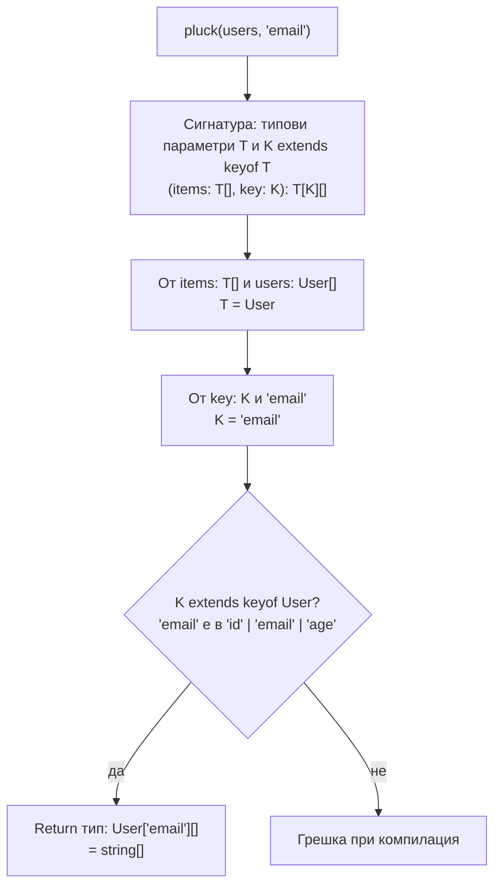

# Generics

Generics са типови параметри: функция, клас или тип приема тип като аргумент, точно както приема стойност. `function first<T>(arr: T[]): T` работи за масив от всякакъв тип и запазва връзката между входа и изхода: подадеш ли `string[]`, получаваш `string`. Без generics трябва да избираш между копиране на кода за всеки тип и `any`, който губи цялата информация.

## 1. За какво се ползва и защо ни е нужен

Generics изразяват връзка между типове. Типични места:

- **Колекции и структури:** `Array<T>`, `Map<K, V>`, `Promise<T>`, собствен `Cache<T>`.
- **Помощни функции:** `groupBy`, `pick`, `debounce`, които запазват типа на аргумента.
- **API клиенти:** `get<T>(url): Promise<T>`, `useQuery<TData>()`.
- **Repository слой:** `Repository<Entity>` с `findById(id): Promise<Entity>`.
- **Всички утилити типове:** `Partial<T>`, `Pick<T, K>`, `ReturnType<F>`.

На интервю често дават да напишеш generic функция с ограничение (`<T extends ...>`), или питат защо `<T>` е по-добре от `any`.

## 2. Как се извеждат типовите аргументи



Компилаторът събира кандидати за всеки типов параметър от аргументите, избира най-подходящия и после проверява ограниченията. Явно подаване (`pluck<User, 'email'>(...)`) рядко е нужно.

## 3. Минимален пример

```ts generics.ts
// Без ограничение: T е всеки тип
function first<T>(items: T[]): T | undefined {
  return items[0];
}
const n = first([1, 2, 3]);          // number | undefined
const s = first(['a', 'b']);         // string | undefined

// С ограничение: T трябва да има id
function byId<T extends { id: string }>(items: T[]): Map<string, T> {
  return new Map(items.map((item) => [item.id, item]));   // item.id е позволено заради extends
}

// Два параметъра, свързани помежду си
function pluck<T, K extends keyof T>(items: T[], key: K): T[K][] {
  return items.map((item) => item[key]);
}

interface User { id: string; email: string; age: number }
declare const users: User[];

const emails = pluck(users, 'email');   // string[]
const ages = pluck(users, 'age');       // number[]
pluck(users, 'phone');                  // Грешка: 'phone' не е keyof User

// Generic клас
class TypedCache<T> {
  #store = new Map<string, { value: T; expires: number }>();
  set(key: string, value: T, ttlMs: number) {
    this.#store.set(key, { value, expires: Date.now() + ttlMs });
  }
  get(key: string): T | undefined {
    const hit = this.#store.get(key);
    return hit && hit.expires > Date.now() ? hit.value : undefined;
  }
}
const userCache = new TypedCache<User>();
```

## 4. Defaults, const и NoInfer

```ts advanced-generics.ts
// Default на типов параметър
interface ApiResponse<T = unknown> {
  data: T;
  status: number;
}
const r: ApiResponse = { data: 1, status: 200 };     // T = unknown

// const типов параметър (TS 5.0): извежда литерали, без "as const" при извикването
function routes<const T extends readonly string[]>(paths: T): T {
  return paths;
}
const r1 = routes(['/users', '/orders']);            // readonly ['/users', '/orders']

// NoInfer (TS 5.4): този аргумент не участва в извеждането на T
function createFsm<S extends string>(states: S[], initial: NoInfer<S>) {
  return { states, current: initial };
}
createFsm(['idle', 'running'], 'idle');              // ОК
createFsm(['idle', 'running'], 'stopped');           // Грешка; без NoInfer S щеше да стане 'idle' | 'running' | 'stopped'
```

## 5. Въпроси на интервю

### Какво са generics и защо не `any`?

Типови параметри, които позволяват код да работи с много типове, като запазва връзката между тях. `function id<T>(x: T): T` връща същия тип, който е получила. `function id(x: any): any` губи информацията: резултатът е `any` и нищо след него не се проверява.

### Какво прави `extends` в generic?

Задава ограничение (constraint): типовият аргумент трябва да е съвместим с дадения тип. Вътре във функцията това позволява достъп до свойствата на ограничението (`T extends { id: string }` позволява `item.id`). При извикването с неподходящ тип има грешка.

### Какво е `K extends keyof T`?

Ограничение, което казва, че `K` е едно (или няколко) от имената на свойствата на `T`. Заедно с indexed access `T[K]` дава типа на конкретното свойство. Това е основата на типобезопасните `get`, `pick` и `pluck`.

### Кога не трябва да ползваш generic?

Когато типовият параметър се появява само веднъж в сигнатурата. `function log<T>(x: T): void` не свързва нищо и е същото като `(x: unknown): void`. Правилото: generic има смисъл, когато свързва поне две позиции (вход с изход, или два входа).

### Какво е const type parameter?

Модификатор `const` пред типов параметър (TS 5.0), който кара извеждането да е като при `as const`: литерални типове и readonly tuples, без потребителят да пише `as const` при извикването.

### Какво прави `NoInfer`?

Утилити тип (TS 5.4), който изключва даден параметър от извеждането на типовия аргумент. Така `T` се извежда само от "основния" аргумент, а останалите се проверяват спрямо него, вместо да го разширяват.

## 6. Капани и чести грешки

- Типов параметър, използван само веднъж.
- `get<T>(url): Promise<T>` при fetch: изглежда безопасно, но е скрит `as T`. Данните не се проверяват. Виж [Runtime граница и валидация](Runtime_Boundary.md).
- Твърде много типови параметри, които потребителят трябва да подава ръчно.
- `T extends object` или `T extends {}`, когато реално ти трябва конкретна форма.
- Генерични React компоненти в `.tsx`: `<T>` се чете като JSX. Пиши `<T,>` или `<T extends unknown>`.

## 7. Свързани документи

- [keyof, typeof, indexed access](Type_Operators.md)
- [Conditional types и infer](Conditional_Types.md)
- [Utility types отвътре](Utility_Types.md)
- [Variance](Variance.md)
