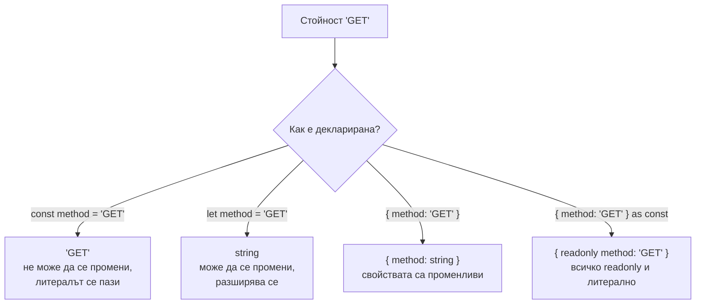
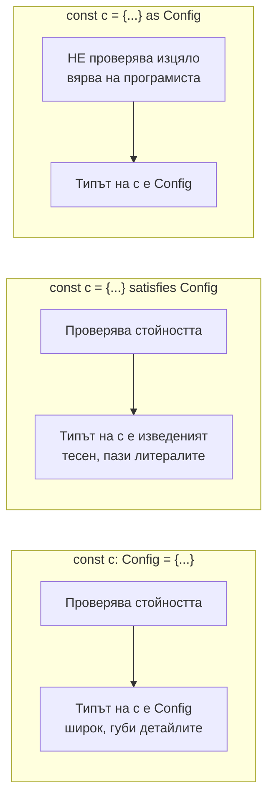

# Inference, widening, satisfies

TypeScript извежда (infer) повечето типове сам: от стойността на променлива, от return израза на функция, от контекста, в който е написан callback. При извеждането прилага widening: `let x = 'a'` става `string`, защото `x` може да се промени, а `const x = 'a'` остава литералът `'a'`. С `as const` и `satisfies` контролираш колко тесен да е изведеният тип, без да губиш проверката.

## 1. За какво се ползва и защо ни е нужен

Добрият TypeScript код има малко анотации. Писането на `const count: number = 0` е шум. Анотациите са нужни на границите: параметри на функции, публични API-та, места, където изведеният тип е твърде широк или твърде тесен.

Разбирането на inference решава чести проблеми:

- защо `['a', 'b']` е `string[]`, а не `['a', 'b']`;
- защо обект с конфигурация губи литералните си типове;
- защо callback-ът в `arr.map(x => ...)` знае типа на `x` без анотация;
- кога да ползваш анотация, кога `satisfies` и кога никога `as`.

## 2. Widening



| Код | Изведен тип |
|---|---|
| `const a = 'x'` | `'x'` |
| `let a = 'x'` | `string` |
| `const o = { m: 'x' }` | `{ m: string }` |
| `const o = { m: 'x' } as const` | `{ readonly m: 'x' }` |
| `const arr = [1, 'a']` | `(string \| number)[]` |
| `const arr = [1, 'a'] as const` | `readonly [1, 'a']` |
| `let n = null` (strict) | `null` |

## 3. Contextual typing

Типът тече не само от стойността към променливата, а и обратно: от мястото, където е написан изразът, към самия израз.

```ts contextual.ts
const users = [{ name: 'Ана', age: 30 }];

users.map((u) => u.name.toUpperCase());     // u: { name: string; age: number } от типа на масива

window.addEventListener('keydown', (e) => {
  e.key;                                     // e: KeyboardEvent, изведен от името на събитието
});

type Handler = (req: { url: string }) => void;
const h: Handler = (req) => req.url;         // req е типизиран от анотацията на h
```

## 4. Анотация, satisfies и as



```ts satisfies.ts
type Route = { path: string; method: 'GET' | 'POST' };

// 1. Анотация: проверено, но типът е широк
const routesA: Record<string, Route> = {
  users: { path: '/users', method: 'GET' },
};
routesA.users.path;      // ОК
routesA.orders.path;     // компилира се! Record<string, ...> позволява всеки ключ

// 2. satisfies: проверено и типът пази конкретните ключове
const routesB = {
  users: { path: '/users', method: 'GET' },
} satisfies Record<string, Route>;
routesB.users.method;    // 'GET': литералът е запазен
routesB.orders;          // Грешка: няма такъв ключ

// 3. as: проверява само дали типовете "се припокриват", не дали стойността е пълна
const routeC = { path: '/users' } as Route;   // компилира се, въпреки че липсва method
const routeD: Route = { path: '/users' };     // Грешка: Property 'method' is missing
```

Правило: анотация, когато искаш променливата да има точно този тип (параметри, публични API-та). `satisfies`, когато искаш проверка, но и тесния изведен тип (конфигурации, таблици). `as` само когато знаеш нещо, което компилаторът не може да знае, и никога за "поправка" на грешка.

## 5. Минимален пример: return type inference

```ts return.ts
function parse(input: string) {
  if (input === '') return null;
  const n = Number(input);
  return Number.isNaN(n) ? { ok: false as const, error: 'NaN' } : { ok: true as const, value: n };
}
// Изведен return тип:
// { ok: false; error: string; } | { ok: true; value: number; } | null

const r = parse('42');
if (r?.ok) r.value;      // number: discriminated union от изведения тип
```

Return типът се извежда от всички `return` изрази. За публични функции на модул е добре да го напишеш явно: така промяна вътре във функцията не сменя тихо договора, а проверката на големи проекти е по-бърза (виж `isolatedDeclarations` в [Build и производителност](Build_Tooling.md)).

## 6. Въпроси на интервю

### Какво е type widening?

Разширяване на литерален тип до по-общия му тип при извеждане. `let x = 'a'` е `string`, защото `x` може да получи друга стойност. Свойствата на обектни литерали също се разширяват, защото са променливи. `const` за примитиви и `as const` за обекти и масиви предотвратяват widening.

### Какво прави `as const`?

Прави израза максимално тесен: литерални типове вместо `string` и `number`, `readonly` за всички свойства, `readonly` tuple вместо масив. Използва се за константни таблици и конфигурации, от които после се извеждат типове (`typeof ROLES[number]`).

### Каква е разликата между `satisfies` и анотация?

И двете проверяват, че стойността отговаря на типа. Анотацията задава типа на променливата да е точно анотираният, губейки по-конкретната информация. `satisfies` (TS 4.9) проверява, но запазва изведения тип: литерали, конкретни ключове, конкретни варианти на union.

### Каква е разликата между `as` и `satisfies`?

`as` е type assertion: казва на компилатора "третирай това като X" и проверява само дали двата типа не са напълно несвързани. Не открива липсващи или грешни полета в много случаи. `satisfies` е пълна проверка без смяна на типа.

### Какво е contextual typing?

Извеждане на типа на израз от мястото, където е използван. Callback-ът в `map` получава типа на елемента, обработчикът в `addEventListener` получава правилния тип събитие, функция, присвоена на типизирана променлива, получава типовете на параметрите си.

## 7. Капани и чести грешки

- Анотация, която разширява типа и губи информация (`Record<string, X>` вместо `satisfies`).
- `as` за "поправка" на грешка.
- `let` за стойност, която после се подава като литерален тип: `let m = 'GET'; fetch(url, { method: m })` при строг тип на `method`.
- Празен масив `const arr = []` в strict: типът се извежда според следващите `push`, но извън функцията може да стане `any[]`. Анотирай празните масиви.
- Липсващ явен return тип на експортирани функции: промяна в имплементацията тихо сменя публичния договор.

## 8. Свързани документи

- [Narrowing и control flow](Narrowing.md)
- [Generics](Generics.md)
- [keyof, typeof, indexed access](Type_Operators.md)
- [Runtime граница и валидация](Runtime_Boundary.md)
